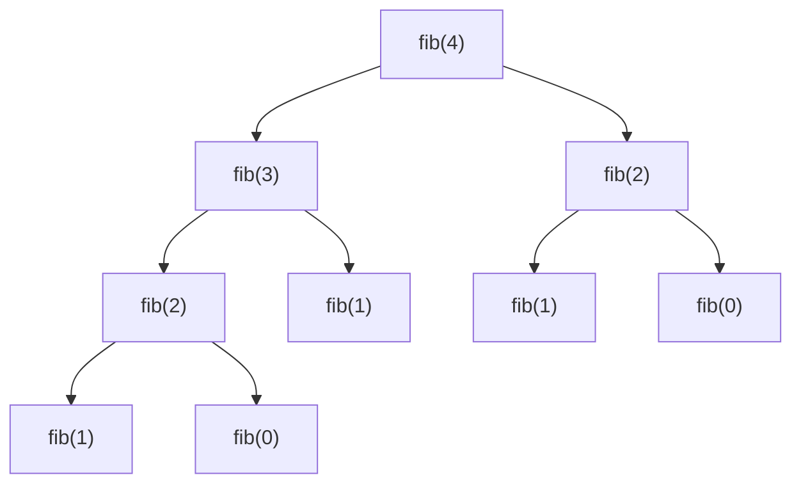

# Recursion

> **Estimated Time:** 5 hr | **Difficulty:** Intermediate
> **Prerequisites:** [02 - Complexity Analysis](../../00-foundations/02-complexity-analysis/README.md), [03 - JavaScript for DSA](../../00-foundations/03-javascript-for-dsa/README.md), [10 - Stack and Queue](../../01-core-linear/10-stack-and-queue/README.md)

---

## What You'll Learn
- You can split any recursive function into a **base case** and a **recursive case**.
- You can trace the **call stack** by hand and explain what happens when a function returns.
- You can draw a **recursion tree** and read time and space complexity from it.
- You can speed up an exponential recursion with **memoization**.
- You can solve the classic recursion problems: power, subsets, parentheses, Hanoi, Josephus, and stack tricks.

## The Big Idea

Imagine standing in a long queue and wanting to know your position. You cannot see the front. So you ask the person ahead: "What is your position?" They ask the person ahead of them, and so on. The first person says "I am number 1". Each person then answers "your number plus 1" back down the line. Nobody solved the whole problem. Each person did one tiny step and trusted the person ahead.

That is recursion: a function solves a problem by calling itself on a **smaller version** of the same problem, and stops when the problem is so small the answer is obvious.

Every recursive function has two parts:

1. **Base case.** The smallest input, answered directly. Without it the function calls itself forever.
2. **Recursive case.** Reduce the problem, call yourself, then use that result to build the answer. The input must get closer to the base case on every call.

Why interviewers love it: recursion is the foundation of trees, graphs, backtracking, divide and conquer and dynamic programming. If you cannot think recursively, those topics stay hard. It also shows whether you can reason about the call stack, complexity, and edge cases.

The mindset that makes recursion easy is the **leap of faith**: assume your function already works for the smaller input, and only ask "how do I use that answer to solve the current input?"

## How to Spot It

| If the problem says ... | think ... |
|---|---|
| "Do the same thing on a smaller input" | Recursion with a clear base case |
| "Generate all subsets / combinations / permutations" | Recursion tree with choices at each step |
| "Choose or skip each element" | Take / not-take recursion |
| Tree, nested lists, folders, JSON | The data is recursive, so the code is too |
| "Compute x^n", "n-th term", "divide in half" | Recursion that halves (log n) or reduces by one |
| Naive recursion repeats the same inputs | Add memoization (start of DP) |
| "Only the top of the stack is accessible" | Use the call stack as your extra storage |
| Small `n` (up to about 20) with "all ways" | Exponential recursion is fine |

## Core Concepts / Template

### 1. The call stack

Each call gets a **stack frame**: its own copy of the parameters and local variables, plus the place to return to. A new call pushes a frame. A return pops it. The most recent call finishes first (last in, first out).

Trace of `factorial(3)`:

```
factorial(3)            -> needs factorial(2)
  factorial(2)          -> needs factorial(1)
    factorial(1)        -> base case, returns 1
  back in factorial(2): 2 * 1 = 2, returns 2
back in factorial(3):   3 * 2 = 6, returns 6
```

Stack depth over time: 1, 2, 3 frames going down, then 2, 1, 0 coming back up. **Space used is the maximum depth**, not the total number of calls.

### 2. Stack overflow

A JavaScript engine gives the stack a limited size. A recursion that goes too deep (roughly ten thousand frames in Node, the exact number depends on frame size) throws `RangeError: Maximum call stack size exceeded`. Two causes: a missing or wrong base case, or a legitimate input that is simply too deep.

### 3. Tail recursion (and why JS does not save you)

A call is a **tail call** when it is the very last thing the function does, so nothing is left to do after it returns. Compare:

```js
// NOT tail recursive: still has "n *" to do after the call returns
function fact(n) { return n <= 1 ? 1 : n * fact(n - 1); }

// Tail recursive: the running answer travels in a parameter
function factTail(n, acc = 1) { return n <= 1 ? acc : factTail(n - 1, acc * n); }
```

Some languages do **tail call optimization (TCO)**: they reuse one frame, so depth stays O(1). The ECMAScript spec asks for it, but in practice **Node and Chrome (V8) do not implement it** (only Safari does). So in JavaScript, tail recursion gives no space savings. If depth could reach tens of thousands, convert the recursion to a loop or use your own explicit stack. Tail recursion is still worth knowing because the converted loop is almost mechanical: the parameters become loop variables.

### 4. Recursion tree and complexity

Draw one node per call. Then:

- **Time** is roughly (number of nodes) x (work per node).
- **Space** is the height of the tree (maximum depth), plus any memory you keep.

Naive Fibonacci tree for `fib(4)`:






`fib(2)` is computed twice. For bigger `n` the repeats explode. Each call branches into two, depth is `n`, so about 2^n nodes.

Quick rules for reading a tree:

| Shape | Time | Space (depth) |
|---|---|---|
| One call, input shrinks by 1 (factorial) | O(n) | O(n) |
| One call, input halves (fast power) | O(log n) | O(log n) |
| Two calls, shrink by 1 (naive fib, subsets) | O(2^n) | O(n) |
| k calls per level, depth d | O(k^d) | O(d) |

### 5. Memoization

If the same input is solved many times, **store the answer the first time** and reuse it. Add a lookup before the recursion and a save after it.

```js
function memoize(fn) {
  const cache = new Map();
  return (n) => {
    if (!cache.has(n)) cache.set(n, fn(n));
    return cache.get(n);
  };
}
```

Memoization turns naive Fibonacci from O(2^n) into O(n): there are only `n + 1` distinct inputs, and each is computed once. This is the bridge to dynamic programming (see the DP chapters).

### 6. The reusable recipe

```js
function solve(input) {
  if (/* smallest case */) return /* direct answer */;   // 1. base case
  const smaller = solve(/* reduced input */);            // 2. leap of faith
  return /* combine smaller with current */;             // 3. build answer
}
```

Three questions to ask every time:
1. What is the smallest input and its answer? (base case)
2. How do I shrink the input? (progress toward base)
3. If I had the answer for the smaller input, how do I get mine? (combine)

For "generate all" problems the recipe becomes: at each step, list the choices, make one, recurse, then undo it (this is explored fully in [Backtracking](../02-backtracking/README.md)).

## Problems (easy -> hard)

### 1. Factorial and Sum of First N — Easy
**Companies:** -
**Problem:** Return `n!` (1 x 2 x ... x n), and separately the sum 1 + 2 + ... + n. Example: `factorial(5)` -> `120`, `sumTo(5)` -> `15`.
**Intuition:** `n! = n * (n-1)!` and `sum(n) = n + sum(n-1)`. Both reduce by one and stop at a trivial case.
**Approach 1 - Brute force:** A loop that multiplies (or adds) from 1 to n. Time O(n), Space O(1). Perfectly fine; recursion here is for practice.
**Approach 2 - Optimal (recursive):** Base case `n <= 1` returns 1 (or `n === 0` returns 0 for the sum). Otherwise combine `n` with the call on `n - 1`.

Dry run `sumTo(3)`:

| call | waits for | returns |
|---|---|---|
| sumTo(3) | 3 + sumTo(2) | 6 |
| sumTo(2) | 2 + sumTo(1) | 3 |
| sumTo(1) | 1 + sumTo(0) | 1 |
| sumTo(0) | base case | 0 |

```js
function factorial(n) {
  if (n <= 1) return 1; // covers 0! = 1
  return n * factorial(n - 1);
}

function sumTo(n) {
  if (n === 0) return 0;
  return n + sumTo(n - 1);
}
```

**Complexity:** Time O(n), Space O(n) for the call stack.
**Watch out:** `factorial(0)` must be 1. Factorials overflow doubles quickly (past 170!) and lose exact integer precision after 18!; use `BigInt` if exact large values are needed. Negative input would recurse forever, so validate it if the problem allows negatives. The sum has a closed form `n*(n+1)/2` in O(1), mention it.

### 2. Fibonacci: Naive vs Memoized — Easy
**Companies:** Amazon, Google, Microsoft
**Problem:** Return the n-th Fibonacci number where `fib(0) = 0`, `fib(1) = 1`, `fib(n) = fib(n-1) + fib(n-2)`. Example: `fib(10)` -> `55`.
**Intuition:** The definition is already recursive. The trap is that the two branches recompute the same values (see the tree above).
**Approach 1 - Brute force:** Direct translation of the formula. Time O(2^n), Space O(n) (depth). `fib(45)` already takes seconds.
**Approach 2 - Better (memoization):** Keep a `Map`. Before computing `fib(n)`, check it. After computing, save it. Each of the `n + 1` inputs is solved once.
**Approach 3 - Optimal:** Iterate with two variables (`a`, `b`), O(n) time and O(1) space. Shown below the recursive code.

Dry run `fibMemo(5)` (miss = computed, hit = reused):

| call | result | note |
|---|---|---|
| fib(5) -> fib(4) -> fib(3) -> fib(2) | 1 | go down the left branch, computing |
| fib(1), fib(0) | 1, 0 | base cases |
| fib(3) | 2 | saved |
| right side of fib(4): fib(2) | 1 | hit, no new work |
| fib(4) | 3 | saved |
| right side of fib(5): fib(3) | 2 | hit |
| fib(5) | 5 | |

```js
function fibNaive(n) {
  if (n < 2) return n;
  return fibNaive(n - 1) + fibNaive(n - 2);
}

function fibMemo(n, memo = new Map()) {
  if (n < 2) return n;
  if (memo.has(n)) return memo.get(n);
  const r = fibMemo(n - 1, memo) + fibMemo(n - 2, memo);
  memo.set(n, r);
  return r;
}

// Bottom-up, O(1) space. The usual "final answer" in interviews.
function fibIter(n) {
  let a = 0, b = 1;
  for (let i = 0; i < n; i++) [a, b] = [b, a + b];
  return a;
}
```

**Complexity:** Naive: Time O(2^n), Space O(n). Memo: Time O(n), Space O(n). Iterative: Time O(n), Space O(1).
**Watch out:** Create the `Map` once and pass it down (default parameter does this on the first call only). Results above `fib(78)` exceed `Number.MAX_SAFE_INTEGER`. Very large `n` with memo recursion can overflow the stack, so the loop is safer.

### 3. Reverse an Array or String Recursively — Easy
**Companies:** -
**Problem:** Reverse an array in place, and reverse a string, using recursion. Example: `[1,2,3,4,5]` -> `[5,4,3,2,1]`, `"hello"` -> `"olleh"`.
**Intuition:** Swap the two ends, then reverse the middle. For a string, put the first character after the reversed rest.
**Approach 1 - Brute force:** Loop with two pointers. Time O(n), Space O(1).
**Approach 2 - Optimal (recursive):** Array: `l` and `r` move inward; stop when `l >= r` (zero or one element left, nothing to swap). String: reverse everything but the first character, then append the first character.

Dry run on `[1,2,3,4,5]`:

| l, r | array after swap |
|---|---|
| 0, 4 | [5,2,3,4,1] |
| 1, 3 | [5,4,3,2,1] |
| 2, 2 | stop (l >= r) |

```js
function reverseArray(a, l = 0, r = a.length - 1) {
  if (l >= r) return a;
  [a[l], a[r]] = [a[r], a[l]];
  return reverseArray(a, l + 1, r - 1);
}

function reverseString(s) {
  return s === '' ? '' : reverseString(s.slice(1)) + s[0];
}
```

**Complexity:** Array: Time O(n), Space O(n) stack. String: Time O(n^2) because each `slice` and concatenation copies, Space O(n^2) in the worst case for the intermediate strings.
**Watch out:** Use `l >= r`, not `l === r`, otherwise even-length input never meets and you recurse forever. The string version is a teaching exercise; in real code use `[...s].reverse().join('')`.

### 4. Palindrome Check Recursively — Easy
**Companies:** -
**Problem:** Return whether a string reads the same forwards and backwards. Example: `"racecar"` -> `true`, `"ab"` -> `false`.
**Intuition:** A string is a palindrome if the two end characters match and the inside is a palindrome. A string of length 0 or 1 is always one.
**Approach 1 - Brute force:** Reverse the string and compare. Time O(n), Space O(n).
**Approach 2 - Optimal (recursive, no copies):** Pass indices `l` and `r`. If they cross, return true. If `s[l] !== s[r]`, return false. Otherwise recurse inward.

Dry run on `"abba"`:

| l, r | s[l], s[r] | result |
|---|---|---|
| 0, 3 | a, a | match, go inward |
| 1, 2 | b, b | match, go inward |
| 2, 1 | crossed | true |

```js
function isPalin(s, l = 0, r = s.length - 1) {
  if (l >= r) return true;
  if (s[l] !== s[r]) return false; // early exit
  return isPalin(s, l + 1, r - 1);
}
```

**Complexity:** Time O(n), Space O(n) stack (about n/2 frames).
**Watch out:** The empty string is a palindrome. If the interview version says "ignore case and non-alphanumeric characters" (LeetCode Valid Palindrome), clean the string first or skip such characters while moving the indices.

### 5. Flood Fill (Recursion Intro) — Easy
**Companies:** Amazon, Microsoft, Google
**Problem:** Given a grid of colors, a start cell and a new color, repaint the start cell and every cell connected to it (up, down, left, right) that has the same original color. Example: `[[1,1,1],[1,1,0],[1,0,1]]`, start (1,1), color 2 -> `[[2,2,2],[2,2,0],[2,0,1]]`.
**Intuition:** Paint this cell, then ask each of the four neighbours to do the same. Each neighbour asks its neighbours. The recursion stops at borders and at cells with a different color.
**Approach 1 - Brute force:** Not really a separate idea; BFS with a queue is the iterative twin. Time O(m*n), Space O(m*n).
**Approach 2 - Optimal (DFS recursion):** Remember the old color. Base cases: out of bounds, or color is not the old color. Otherwise repaint, then recurse into four directions. Repainting doubles as the "visited" mark, so no extra array is needed.

```js
function floodFill(image, sr, sc, color) {
  const old = image[sr][sc];
  if (old === color) return image; // else we would loop forever
  const go = (r, c) => {
    if (r < 0 || c < 0 || r >= image.length || c >= image[0].length) return;
    if (image[r][c] !== old) return;
    image[r][c] = color;
    go(r + 1, c); go(r - 1, c); go(r, c + 1); go(r, c - 1);
  };
  go(sr, sc);
  return image;
}
```

**Complexity:** Time O(m*n), Space O(m*n) worst case stack (a snake-shaped region).
**Watch out:** The `old === color` guard is the classic bug: without it, repainting never marks cells as done and the recursion never ends. On big grids the depth can exceed the stack limit; use BFS then. More grid traversal in [Grid and Islands](../../04-graphs/02-grid-and-islands/README.md).

### 6. Pow(x, n) — Medium
**Companies:** Meta, Google, Amazon, LinkedIn
**Problem:** Compute `x` raised to the integer power `n` (n may be negative). Example: `pow(2, 10)` -> `1024`, `pow(2, -2)` -> `0.25`.
**Intuition:** `x^n = (x^(n/2))^2`, times one extra `x` if `n` is odd. Halving the exponent each time gives about log n steps instead of n.
**Approach 1 - Brute force:** Multiply `x` by itself `n` times. Time O(n), Space O(1). Too slow for `n` near 2^31.
**Approach 2 - Optimal (fast exponentiation):** Compute `half = pow(x, floor(n/2))` once, then square it. For negative `n`, compute `1 / pow(x, -n)`.

Dry run `pow(2, 10)`:

| call | half | returns |
|---|---|---|
| pow(2,10) | pow(2,5) | half*half |
| pow(2,5) | pow(2,2) | half*half*2 = 32 |
| pow(2,2) | pow(2,1) | half*half = 4 |
| pow(2,1) | pow(2,0) = 1 | 1*1*2 = 2 |

```js
function myPow(x, n) {
  if (n < 0) return 1 / myPow(x, -n);
  if (n === 0) return 1;
  const half = myPow(x, Math.floor(n / 2)); // compute ONCE
  return n % 2 === 0 ? half * half : half * half * x;
}
```

**Complexity:** Time O(log n), Space O(log n).
**Watch out:** Calling `myPow` twice (`myPow(x,n/2) * myPow(x,n/2)`) brings the time back to O(n). In JavaScript `-n` is safe for `-2^31` (numbers are doubles), unlike in C++ or Java where negating the minimum int overflows. `0^0` is conventionally 1.

### 7. Count Good Numbers — Medium
**Companies:** Google, Amazon, Microsoft
**Problem:** A digit string of length `n` is "good" if digits at even indices (0, 2, ...) are even and digits at odd indices are prime (2, 3, 5, 7). Return how many good strings exist, modulo 1,000,000,007. Example: `n = 4` -> `400`.
**Intuition:** Positions are independent. Even index: 5 choices (0,2,4,6,8). Odd index: 4 choices (2,3,5,7). With `ceil(n/2)` even positions and `floor(n/2)` odd positions the answer is `5^ceil(n/2) * 4^floor(n/2)`. The numbers are huge, so we need fast power with a modulus.
**Approach 1 - Brute force:** Generate all `10^n` strings and test each. Impossible beyond tiny `n`.
**Approach 2 - Better:** Multiply 5 or 4 in a loop `n` times with mod. Time O(n). Fine for small `n`, too slow when `n` goes up to 10^15.
**Approach 3 - Optimal:** Use the recursive fast power from the previous problem, with `% MOD` at each step.

For `n = 4`: `5^2 * 4^2 = 25 * 16 = 400`.

```js
const MOD = 1000000007n;

// BigInt: two numbers below 1e9+7 multiply to about 1e18, which loses precision as a double.
function modPow(b, e) {
  if (e === 0n) return 1n;
  const h = modPow(b, e / 2n);
  const r = (h * h) % MOD;
  return e % 2n === 1n ? (r * b) % MOD : r;
}

function countGoodNumbers(n) {
  const N = BigInt(n);
  return Number((modPow(5n, (N + 1n) / 2n) * modPow(4n, N / 2n)) % MOD);
}
```

**Complexity:** Time O(log n), Space O(log n).
**Watch out:** Plain `Number` multiplication breaks silently here because `(1e9)^2` is above 2^53. Use `BigInt`. The even-index count is `ceil(n/2)`: for odd `n` there is one extra even position. Index 0 counts as even (5 choices, leading zeros allowed).

### 8. K-th Symbol in Grammar — Medium
**Companies:** Amazon, Google, Microsoft
**Problem:** Row 1 is `0`. Each next row replaces every `0` with `01` and every `1` with `10`. Return the k-th symbol (1-indexed) of row n. Example: `n = 4, k = 5` -> `1` (row 4 is `01101001`).
**Intuition:** Every symbol in row `n` is a child of one symbol in row `n-1`. Position `k` has parent `ceil(k/2)`. If `k` is odd it is the **left** child (same value as the parent); if even it is the **right** child (the flipped value).
**Approach 1 - Brute force:** Build every row. Row `n` has `2^(n-1)` symbols. Time and Space O(2^n).
**Approach 2 - Optimal:** Walk up to the parent by recursion, then apply "same or flip".

Dry run `kthGrammar(4, 5)`:

| call | parent | k odd? | result |
|---|---|---|---|
| (4,5) | (3,3) | yes | same as parent = 1 |
| (3,3) | (2,2) | yes | same as parent = 1 |
| (2,2) | (1,1) = 0 | no | flip = 1 |

Answer 1.

```js
function kthGrammar(n, k) {
  if (n === 1) return 0;
  const parent = kthGrammar(n - 1, Math.ceil(k / 2));
  return k % 2 === 1 ? parent : 1 - parent;
}
```

**Complexity:** Time O(n), Space O(n).
**Watch out:** Parent index is `ceil(k/2)`, not `floor`. Do not build the strings; the whole point is the path from the leaf up to the root of the implicit binary tree.

### 9. Subsets (Power Set) — Medium
**Companies:** Amazon, Meta, Google, Microsoft
**Problem:** Given distinct integers, return all subsets (the power set). Example: `[1,2,3]` -> `[[],[1],[2],[3],[1,2],[1,3],[2,3],[1,2,3]]` in any order.
**Intuition:** For each element you have exactly two choices: **take it or skip it**. Two choices over `n` elements gives `2^n` subsets. The recursion tree has depth `n` and every leaf is one subset.
**Approach 1 - Brute force:** Loop over masks `0 .. 2^n - 1`; bit `i` says whether element `i` is in. Time O(n * 2^n), Space O(n) per subset.
**Approach 2 - Optimal (take / skip recursion):** At index `i`, first skip `nums[i]` and recurse, then push it, recurse, and pop it (undo). At `i === n`, copy the current list into the answer.

Tree for `[1,2]` (S = skip, T = take):

```
            i=0
        S /     \ T(1)
      i=1        i=1
     S/  \T(2)  S/  \T(2)
    []   [2]   [1]  [1,2]
```

```js
function subsets(nums) {
  const res = [];
  const cur = [];
  (function go(i) {
    if (i === nums.length) { res.push([...cur]); return; } // copy!
    go(i + 1);                    // skip
    cur.push(nums[i]); go(i + 1); // take
    cur.pop();                    // undo
  })(0);
  return res;
}
```

**Complexity:** Time O(n * 2^n) (2^n leaves, each copy costs up to n), Space O(n) for the stack, not counting the output.
**Watch out:** Pushing `cur` itself instead of `[...cur]` makes every entry the same array, which ends up empty. The pop after the "take" branch is what makes `cur` correct for the sibling branch. If the input has duplicates you need sorting plus a skip rule (see [Backtracking](../02-backtracking/README.md)).

### 10. Print All Subsequences of a String — Medium
**Companies:** Amazon, Microsoft
**Problem:** Print or return all subsequences (keep original order, may skip characters) of a string. Example: `"abc"` -> `abc, ab, ac, a, bc, b, c, ""`.
**Intuition:** Same take / skip idea as subsets, but over characters. A subsequence is not a substring: characters do not have to be adjacent, but order stays.
**Approach 1 - Brute force:** Mask loop over `2^n` patterns, like subsets.
**Approach 2 - Optimal:** Recurse with an index and the string built so far. Strings are immutable, so passing `cur + s[i]` needs no undo step.

```js
function subsequences(s) {
  const res = [];
  (function go(i, cur) {
    if (i === s.length) { res.push(cur); return; }
    go(i + 1, cur + s[i]); // take
    go(i + 1, cur);        // skip
  })(0, '');
  return res;
}
```

**Complexity:** Time O(n * 2^n), Space O(n) stack plus output.
**Watch out:** A string with `n` characters has `2^n` subsequences including the empty one. If characters repeat, you get duplicate subsequences; collect them in a `Set` if the problem wants distinct ones. Mention this follow-up: length 30 already means a billion results.

### 11. Generate Parentheses — Medium
**Companies:** Google, Amazon, Meta, Microsoft, Bloomberg
**Problem:** Given `n` pairs, return all strings of well-formed parentheses. Example: `n = 3` -> `["((()))","(()())","(())()","()(())","()()()"]`.
**Intuition:** Build the string left to right. You may add `(` if you still have some left to place. You may add `)` only if it closes an already open `(`, meaning `close < open`. If you follow those two rules, every string you finish is valid, so nothing needs checking afterwards.
**Approach 1 - Brute force:** Generate all `2^(2n)` strings of `(` and `)` and filter the valid ones. Wasteful.
**Approach 2 - Optimal (prune while building):** Track `open` and `close` counts. Stop when length is `2n`.

Partial trace for `n = 2`:

```
""
 "("            (open=1)
  "(("          (open=2, can't add more "(")
   "(()"       then "(())"   -> output
  "()"         (close=1)
   "()("       then "()()"   -> output
```

```js
function generateParenthesis(n) {
  const res = [];
  (function go(cur, open, close) {
    if (cur.length === 2 * n) { res.push(cur); return; }
    if (open < n) go(cur + '(', open + 1, close);
    if (close < open) go(cur + ')', open, close + 1);
  })('', 0, 0);
  return res;
}
```

**Complexity:** Time O(4^n / sqrt(n)), which is about the n-th Catalan number times n for building each string. Space O(n) stack.
**Watch out:** The condition for `)` is `close < open`, not `close < n`. Using `close < n` produces strings like `)(`. Interviewers like hearing "the answer count is the Catalan number: 1, 2, 5, 14 ...".

### 12. Letter Combinations of a Phone Number — Medium
**Companies:** Amazon, Google, Meta, Microsoft, Uber
**Problem:** Given digits 2-9, return all letter strings the digits could spell on a phone keypad. Example: `"23"` -> `["ad","ae","af","bd","be","bf","cd","ce","cf"]`.
**Intuition:** At each digit you loop over its letters (3 or 4 choices), append one, and recurse to the next digit. The recursion depth equals the number of digits.
**Approach 1 - Brute force:** Nested loops, but you do not know how many digits there are, so you cannot write a fixed number of loops. Recursion is the answer to "variable nesting depth".
**Approach 2 - Optimal:** Recursion with an index and the partial string. At `i === digits.length`, save it.

```js
function letterCombinations(digits) {
  if (!digits) return []; // not [""]
  const map = { 2: 'abc', 3: 'def', 4: 'ghi', 5: 'jkl', 6: 'mno', 7: 'pqrs', 8: 'tuv', 9: 'wxyz' };
  const res = [];
  (function go(i, cur) {
    if (i === digits.length) { res.push(cur); return; }
    for (const ch of map[digits[i]]) go(i + 1, cur + ch);
  })(0, '');
  return res;
}
```

**Complexity:** Time O(4^n * n) in the worst case (digits 7 and 9 have 4 letters), Space O(n) stack plus output.
**Watch out:** Empty input must return `[]`, not `[""]`. Digits 7 and 9 have four letters.

### 13. Tower of Hanoi — Medium
**Companies:** Amazon, Microsoft, Adobe
**Problem:** Move `n` disks from peg A to peg C using peg B. Move one disk at a time and never put a bigger disk on a smaller one. Return the moves. Example: `n = 2` -> `A->B, A->C, B->C`.
**Intuition:** To move `n` disks from A to C: move the top `n-1` to B (out of the way), move the largest from A to C, then move the `n-1` from B onto C. Trust the recursion to move `n-1` disks correctly. You never need to simulate the whole thing in your head.
**Approach 1 - Brute force:** There is no simple non-recursive idea that beginners can derive. (Iterative solutions exist but are harder to explain.)
**Approach 2 - Optimal (recursive):** `hanoi(n, from, to, via)`: move `n-1` from `from` to `via`, record `from -> to`, move `n-1` from `via` to `to`. Base case `n = 0` does nothing.

Moves for `n = 3` (7 total): `A->C, A->B, C->B, A->C, B->A, B->C, A->C`.

Count recurrence: `T(n) = 2*T(n-1) + 1`, so `T(n) = 2^n - 1`.

```js
function hanoi(n, from = 'A', to = 'C', via = 'B', moves = []) {
  if (n === 0) return moves;
  hanoi(n - 1, from, via, to, moves); // clear the way
  moves.push([from, to]);             // move the biggest
  hanoi(n - 1, via, to, from, moves); // put the rest on top
  return moves;
}
```

**Complexity:** Time O(2^n), Space O(n) stack (plus the moves list, which is itself 2^n - 1 entries).
**Watch out:** The roles of the pegs swap in the two recursive calls. This minimum number of moves, `2^n - 1`, is a favorite follow-up question. `n = 64` would need more moves than anyone could ever perform.

### 14. Josephus Problem — Medium
**Companies:** Amazon, Google, Microsoft
**Problem:** `n` people stand in a circle, numbered 1 to `n`. Starting at 1, count `k` people and remove the k-th, then keep counting from the next person. Return the survivor. Example: `n = 5, k = 2` -> `3`.
**Intuition:** After the first removal you have the same problem with `n - 1` people, only the numbering is shifted. If you know the survivor's position `f(n-1)` in the smaller circle, you can map it back to the bigger circle by shifting `k` places. That mapping is `(f(n-1) + k) mod n` in 0-indexed terms.
**Approach 1 - Brute force:** Simulate with an array, removing one person at a time with `splice`. Time O(n * k) or O(n^2), Space O(n).
**Approach 2 - Optimal (recurrence):** 0-indexed: `f(1) = 0`, `f(n) = (f(n-1) + k) % n`. Add 1 at the end for 1-indexed. The code folds the +1 into every step.

Dry run, `k = 2` (1-indexed values):

| n | f(n) | how |
|---|---|---|
| 1 | 1 | base case |
| 2 | 1 | ((1 + 2 - 1) % 2) + 1 |
| 3 | 3 | ((1 + 2 - 1) % 3) + 1 |
| 4 | 1 | ((3 + 2 - 1) % 4) + 1 |
| 5 | 3 | ((1 + 2 - 1) % 5) + 1 |

```js
function josephus(n, k) {
  if (n === 1) return 1;
  return ((josephus(n - 1, k) + k - 1) % n) + 1;
}
```

**Complexity:** Time O(n), Space O(n) stack (use a loop for O(1) space).
**Watch out:** Mixing 0-indexed and 1-indexed is the whole difficulty. Verify with a tiny case such as `n = 5, k = 2` -> `3` before presenting. For `k = 2` there is a closed form using the highest power of two, a nice bonus to mention.

### 15. Reverse a Stack Using Recursion — Medium
**Companies:** Amazon, Microsoft, Flipkart
**Problem:** Reverse a stack without using another stack, array or queue. Only `push`, `pop` and `peek` are allowed, plus recursion. Example: `[1,2,3,4]` (4 on top) -> `[4,3,2,1]` (1 on top).
**Intuition:** The call stack is a free extra stack. Pop everything, remembering each element in a frame. When the stack is empty, the frames return one by one (the last element popped returns first). Each returning frame puts its element **at the bottom** of the stack. That needs a helper, "insert at bottom".
**Approach 1 - Brute force:** Copy into an array or second stack, reverse. Not allowed by the problem. Time O(n), Space O(n).
**Approach 2 - Optimal:** Two recursive functions.
- `reverseStack`: pop the top, reverse the rest, then `insertAtBottom(top)`.
- `insertAtBottom(x)`: if empty, push `x`. Otherwise pop the top, recurse, push the top back.

Dry run on `[1,2,3]` (3 on top):

| step | action | stack |
|---|---|---|
| 1 | pop 3, reverse [1,2] ... | |
| 2 | pop 2, reverse [1] | |
| 3 | pop 1, reverse [] returns | [] |
| 4 | insertAtBottom(1) | [1] |
| 5 | insertAtBottom(2) | [2,1] |
| 6 | insertAtBottom(3) | [3,2,1] |

```js
function reverseStack(st) {
  if (st.length === 0) return;
  const top = st.pop();
  reverseStack(st);
  insertAtBottom(st, top);
}

function insertAtBottom(st, x) {
  if (st.length === 0) { st.push(x); return; }
  const top = st.pop();
  insertAtBottom(st, x);
  st.push(top);
}
```

**Complexity:** Time O(n^2) (each `insertAtBottom` is O(n)), Space O(n) stack.
**Watch out:** A JS array works as a stack, so `pop` and `push` are the only operations used; do not index into it. Forgetting `insertAtBottom` and just pushing back gives you the original order.

### 16. Sort a Stack Using Recursion — Medium
**Companies:** Amazon, Microsoft, Flipkart, Adobe
**Problem:** Sort a stack so the smallest element is at the bottom and the largest is on top (or the reverse, as the problem states), using only stack operations and recursion. Example: `[3,1,4,2]` (2 on top) -> `[1,2,3,4]`.
**Intuition:** Same trick as above. Pop the top, sort the rest, then **insert the popped element at its correct sorted position**. The rest is sorted, so inserting is a short recursion: pop elements bigger than `x`, push `x`, then push those elements back.
**Approach 1 - Brute force:** Dump into an array, `sort`, push back. Time O(n log n), Space O(n). Usually not allowed in the interview.
**Approach 2 - Optimal:** `sortStack` pops, sorts the rest, calls `insertSorted`. `insertSorted(x)`: if the stack is empty or the top is `<= x`, push `x`. Else pop the top, recurse, push the top back.

Dry run on `[3,1,2]` (2 on top):

| step | action | stack |
|---|---|---|
| 1 | pop 2, sort [3,1]: pop 1, sort [3]: pop 3, sort [] | [] |
| 2 | insertSorted(3) | [3] |
| 3 | insertSorted(1): top 3 > 1, pop 3, push 1, push 3 | [1,3] |
| 4 | insertSorted(2): top 3 > 2, pop 3; top 1 <= 2, push 2; push 3 | [1,2,3] |

```js
function sortStack(st) {
  if (st.length === 0) return;
  const top = st.pop();
  sortStack(st);
  insertSorted(st, top);
}

function insertSorted(st, x) {
  if (st.length === 0 || st[st.length - 1] <= x) { st.push(x); return; }
  const top = st.pop();
  insertSorted(st, x);
  st.push(top);
}
```

**Complexity:** Time O(n^2), Space O(n) stack.
**Watch out:** Use `<=` so equal values do not get shuffled around forever and duplicates stay stable. Check the empty stack first, before reading `st[st.length - 1]`.

## Common Mistakes
- **"Recursion will figure it out without a base case."** Always write the base case first. Missing or unreachable base cases cause stack overflow.
- **"The input shrinks, so progress is guaranteed."** Check that every path moves toward the base case. `l === r` instead of `l >= r` is a typical miss.
- **"Two recursive calls are the same as one call stored."** `f(n/2) * f(n/2)` runs the work twice. Store the result in a variable.
- **"Memoization is only for DP."** It applies to any pure recursion that repeats inputs. Only memoize functions whose output depends only on their arguments.
- **"I can push `cur` into the answer."** Push a copy (`[...cur]`); the same array is mutated later.
- **"Tail recursion is free in JS."** V8 does not do tail call optimization, so a deep tail recursion still overflows.
- **"Space is zero for recursion."** The call stack counts. Depth `n` means O(n) space.
- **"Recursion is always slower than loops."** The cost is a constant factor and stack memory. The real danger is exponential branching, not recursion itself.

## Interview Tips
- Say the three things out loud first: **base case, how the input shrinks, how to combine**. This alone shows structure.
- Draw the recursion tree for a tiny input (n = 3) before coding. Count nodes to state time, find depth to state space.
- Call out the stack: "space is O(depth), and JS has no tail call optimization, so for very deep inputs I would switch to a loop or an explicit stack."
- If you see repeated subproblems, say "this recomputes the same states; I will memoize", then state the new complexity (number of distinct states x work per state).
- Typical follow-ups: convert to iterative; reduce space; handle negative or huge inputs; count vs generate all results; handle duplicates.
- Edge cases to mention: `n = 0`, `n = 1`, empty string or array, negative exponents, very large `n`, duplicates, and integer limits (use `BigInt` when products exceed 2^53).
- For "generate all" problems, give the output size first (`2^n`, Catalan, `k^n`). It tells the interviewer you know the lower bound on time.

## Practice List
**Easy:**
- Fibonacci Number
- Climbing Stairs
- Power of Two
- Reverse String
- Valid Palindrome
- Merge Two Sorted Lists
- Maximum Depth of Binary Tree
- Flood Fill
- Sum of Digits (recursive)

**Medium:**
- Pow(x, n)
- Count Good Numbers
- K-th Symbol in Grammar
- Subsets
- Subsets II
- Permutations
- Combination Sum
- Generate Parentheses
- Letter Combinations of a Phone Number
- Decode String
- Different Ways to Add Parentheses
- Find the Winner of the Circular Game
- Unique Binary Search Trees

**Hard:**
- N-Queens
- Sudoku Solver
- Regular Expression Matching
- Remove Invalid Parentheses
- Expression Add Operators
- Word Search II

## Key Takeaways
- Every recursion needs a **base case** and a **recursive case that moves toward it**.
- Use the **leap of faith**: assume the smaller call works, then only write how to combine.
- **Space equals the maximum depth** of the call stack, and JavaScript has **no tail call optimization**.
- Read complexity from the **recursion tree**: nodes x work per node.
- **Memoization** turns repeated-subproblem recursion (like naive Fibonacci) from exponential to linear.
- **Halving the input** (fast power) gives O(log n); **two choices per element** (take / skip) gives O(2^n).
- The call stack can act as an **extra stack**, which is the trick behind reversing and sorting a stack in place.

---
[← Previous: Monotonic Stack and Queue](../../01-core-linear/11-monotonic-stack-queue/README.md) | [Next: Backtracking →](../02-backtracking/README.md) | [Back to Intermediate Index](../README.md)
