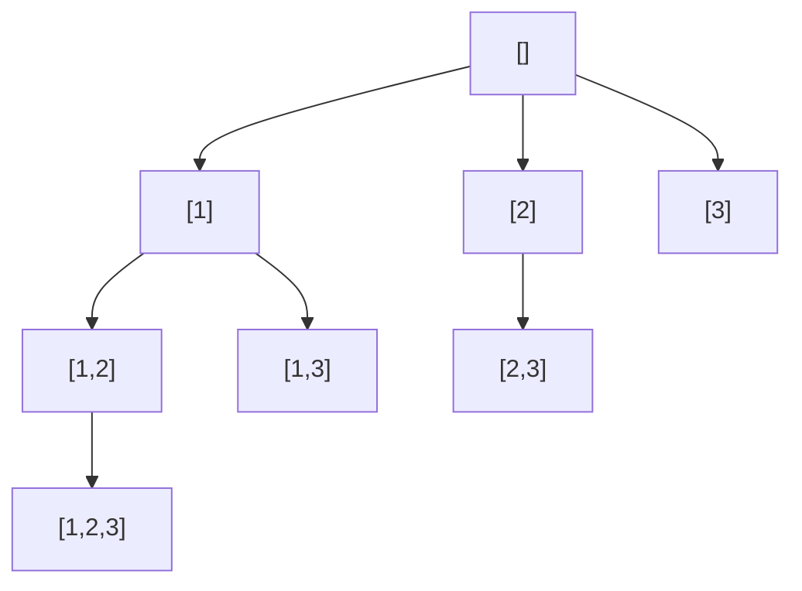

# Backtracking

> **Estimated Time:** 8 hr | **Difficulty:** Intermediate
> **Prerequisites:** [02 - Recursion](../01-recursion/README.md)

---

## What You'll Learn
- You can write the **choose / explore / unchoose** template from memory and explain every line.
- You can tell the three shapes apart: subsets, combinations and permutations, and pick the right loop for each.
- You can **prune** a search early (bounds, sorted breaks, constraint sets) so it does not explore dead branches.
- You can skip duplicate results by **sorting** and using the "same value, same level" rule.
- You can solve grid and constraint puzzles (word search, N-Queens, Sudoku, rat in a maze) with the same template.

## The Big Idea

Think about finding your way out of a maze of rooms. At each room you pick a door and walk in. If you hit a dead end, you walk back to the last room and try the next door. You never teleport. You always undo your last step first.

Backtracking is exactly that. You build an answer one piece at a time. After every piece you ask: "Can this still become a valid answer?" If yes, go deeper. If no, undo the last piece and try something else. The search is a tree, and you walk it depth first.

Why this matters: many problems say "list ALL ways to do X" or "is there ANY way to do X". There is no formula for these. You must try the options. Backtracking tries them in an organised way, and pruning lets you skip huge parts of the tree that cannot work.

Interviewers love it because it tests three things at once: clean recursion, careful state handling (the undo step), and whether you can reason about pruning and duplicates.

Be honest about cost: backtracking is usually exponential (2^n for subsets, n! for permutations). The goal is not to make it polynomial. The goal is to be correct, and to cut the tree as much as you can.

## How to Spot It

| If the problem says ... | think ... |
|---|---|
| "return all subsets / combinations / permutations" | backtracking, output size is exponential anyway |
| "generate all valid strings" (parentheses, IPs, phone letters) | build char by char, prune invalid prefixes |
| "find all ways to split / partition a string" | choose where the next piece ends |
| "place things so none conflict" (queens, sudoku, coloring) | place one thing, check constraints, undo |
| "is there a path / arrangement that satisfies ..." | search with early return on first success |
| "n is small" (n <= 10 for permutations, n <= 20 for subsets, board <= 9x9) | exponential is expected, backtracking is fine |
| "count ways" but n is large (n ~ 1000) | NOT backtracking, try DP |

## Core Concepts / Template

#### The three steps

1. **Choose:** add one option to the current path.
2. **Explore:** recurse to fill the next position.
3. **Unchoose:** remove that option, so the path is back to what it was. Now the loop can try the next option.

```js
function backtrack(/* state */) {
  if (/* path is a complete answer */) {
    res.push([...path]); // COPY the path, it will keep changing
    return;
  }
  for (const option of /* options at this step */) {
    if (/* option is invalid or useless */) continue; // pruning
    path.push(option);   // choose
    backtrack(/* next state */); // explore
    path.pop();          // unchoose
  }
}
```

The most common bug: pushing `path` itself into the result. Later pops will empty it. Always push a copy: `[...path]`.

#### The three shapes

| Shape | Loop starts at | What you pass down | Order matters? |
|---|---|---|---|
| Subsets / combinations | `start` | `i + 1` (or `i` if reuse allowed) | No. [1,2] is the same as [2,1] |
| Permutations | `0` every time | a `used[]` array | Yes |
| Split a string | `start` | `end + 1` | Pieces are in order |

Subsets and combinations use a `start` index so you only look forward. That is how you avoid getting both [1,2] and [2,1].

#### Pruning

Pruning means "stop this branch now, it cannot lead to an answer". Common ways:
- **Bound:** the sum is already too big, or you do not have enough numbers left.
- **Sorted break:** if the array is sorted and `c[i] > left`, every later number is also too big, so `break` (not just `continue`).
- **Constraint sets:** keep sets of used columns / diagonals so the validity check is O(1).

#### Skipping duplicates (the sort trick)

If the input has repeated values, sort first. Then in a loop over candidates at the same level, skip a value that equals its left neighbour:

```js
if (i > start && nums[i] === nums[i - 1]) continue;
```

Why `i > start`? The first copy at this level is fine to use. Only the second, third, ... copy at the same level would repeat a result that the first copy already gave. Using a duplicate at a deeper level is fine, because then it is a different position in the path.

#### Short trace: subsets of [1, 2, 3]

```
path=[]            record []
 choose 1 -> [1]   record [1]
  choose 2 -> [1,2]   record [1,2]
   choose 3 -> [1,2,3] record [1,2,3]
   unchoose 3
  unchoose 2
  choose 3 -> [1,3]   record [1,3]
  unchoose 3
 unchoose 1
 choose 2 -> [2]   record [2]
  choose 3 -> [2,3]   record [2,3]
 ...
 choose 3 -> [3]   record [3]
```

Every node in the tree is recorded once, so there are 2^3 = 8 results.






## Problems (easy -> hard)

### 1. Subsets — Medium
**Companies:** Amazon, Meta, Microsoft, Google
**Problem:** Given distinct integers, return all possible subsets (the power set). Example: `[1,2,3]` -> `[[],[1],[2],[3],[1,2],[1,3],[2,3],[1,2,3]]`.
**Intuition:** Each element is either in or out. Walking forward with a `start` index and recording the path at every node gives every subset exactly once.
**Approach 1 - Brute force:** Loop over all bitmasks from 0 to 2^n - 1 and build a subset from the set bits. Time O(n * 2^n), Space O(n) extra.
**Approach 2 - Optimal (backtracking):** Record the current path at every call. Then for each `i >= start`, choose `nums[i]`, recurse with `i + 1`, unchoose. Trace for `[1,2,3]` is the one in Core Concepts.

```js
function subsets(nums) {
  const res = [], path = [];
  function dfs(start) {
    res.push([...path]); // every node is an answer
    for (let i = start; i < nums.length; i++) {
      path.push(nums[i]);
      dfs(i + 1);
      path.pop();
    }
  }
  dfs(0);
  return res;
}
```

**Complexity:** Time O(n * 2^n), Space O(n) recursion (output not counted).
**Watch out:** Forgetting to copy the path. Empty input returns `[[]]`, not `[]`.

### 2. Combinations — Medium
**Companies:** Amazon, Google, Microsoft
**Problem:** Return all combinations of `k` numbers chosen from `1..n`. Example: `n=4, k=2` -> `[[1,2],[1,3],[1,4],[2,3],[2,4],[3,4]]`.
**Intuition:** Same as subsets, but only record when the path has exactly `k` items. Pruning: if you need `need` more numbers, the loop must stop at `n - need + 1`, because later starts cannot fit enough numbers.
**Approach 1 - Brute force:** Generate all subsets, keep those of size k. Time O(n * 2^n).
**Approach 2 - Optimal:** Backtracking with the upper bound prune. Trace for `n=4, k=3`: path `[]`, need 3, `i` goes only to 2 (not 3 or 4). Start `[1]`: need 2, `i` goes up to 3. Start `[1,2]`: need 1, `i` goes up to 4. Records `[1,2,3]`, `[1,2,4]`, and so on.

```js
function combine(n, k) {
  const res = [], path = [];
  function dfs(start) {
    if (path.length === k) { res.push([...path]); return; }
    const need = k - path.length;
    for (let i = start; i <= n - need + 1; i++) { // prune: not enough numbers left
      path.push(i);
      dfs(i + 1);
      path.pop();
    }
  }
  dfs(1);
  return res;
}
```

**Complexity:** Time O(k * C(n,k)), Space O(k).
**Watch out:** Numbers start at 1, not 0. Without the bound the code is still correct, just slower.

### 3. Letter Combinations of a Phone Number — Medium
**Companies:** Amazon, Google, Meta, Microsoft
**Problem:** Given digits 2-9, return all letter strings the digits could spell on a phone keypad. Example: `"23"` -> `["ad","ae","af","bd","be","bf","cd","ce","cf"]`.
**Intuition:** One position per digit. At position `i`, try every letter of that digit. No `start` index, since each level has its own separate choices.
**Approach 1 - Brute force:** Iteratively build a list: for each digit, expand every existing string by each letter. Time O(4^n * n). This is fine too, and not really different.
**Approach 2 - Optimal:** Backtracking, depth = number of digits. Trace for `"23"`: pick `a`, then `d,e,f` -> `ad, ae, af`; unchoose `a`; pick `b` ...

```js
function letterCombinations(digits) {
  if (!digits) return []; // empty input -> no combinations, not [""]
  const map = { 2: 'abc', 3: 'def', 4: 'ghi', 5: 'jkl', 6: 'mno', 7: 'pqrs', 8: 'tuv', 9: 'wxyz' };
  const res = [], path = [];
  function dfs(i) {
    if (i === digits.length) { res.push(path.join('')); return; }
    for (const ch of map[digits[i]]) {
      path.push(ch);
      dfs(i + 1);
      path.pop();
    }
  }
  dfs(0);
  return res;
}
```

**Complexity:** Time O(4^n * n), Space O(n).
**Watch out:** Empty string must return `[]`. Digits 7 and 9 have 4 letters.

### 4. Generate Parentheses — Medium
**Companies:** Amazon, Google, Meta, Microsoft, Bloomberg
**Problem:** Given `n`, return all well-formed strings with `n` pairs of parentheses. Example: `n=3` -> `["((()))","(()())","(())()","()(())","()()()"]`.
**Intuition:** Do not generate every string and filter. Only add `(` if you have used fewer than `n`. Only add `)` if it would not close more than you opened. Every prefix stays valid, so no dead branches.
**Approach 1 - Brute force:** Build all 2^(2n) strings, check each for validity. Time O(2^(2n) * n).
**Approach 2 - Optimal:** Track `open` and `close` counts. Rules: `open < n` allows `(`; `close < open` allows `)`. Trace for `n=2`: `(` -> `((` -> `(()` -> `(())`. And `(` -> `()` -> `()(` -> `()()`.

```js
function generateParenthesis(n) {
  const res = [];
  function dfs(open, close, cur) {
    if (cur.length === 2 * n) { res.push(cur); return; }
    if (open < n) dfs(open + 1, close, cur + '(');
    if (close < open) dfs(open, close + 1, cur + ')');
  }
  dfs(0, 0, '');
  return res;
}
```

**Complexity:** Time O(4^n / sqrt(n)) (the Catalan number times n for building strings), Space O(n) recursion.
**Watch out:** Passing a new string each call means there is no explicit undo, because strings are immutable. That is fine and is a valid form of backtracking.

### 5. Permutations — Medium
**Companies:** Amazon, Google, Meta, Microsoft, LinkedIn
**Problem:** Given distinct integers, return all orderings. Example: `[1,2,3]` -> 6 lists, `[1,2,3]`, `[1,3,2]`, `[2,1,3]`, ... .
**Intuition:** Order matters, so every position may take any unused number. A `used[]` array tells you what is still free.
**Approach 1 - Brute force:** Generate all n^n sequences and filter those with no repeats. Time O(n^n).
**Approach 2 - Optimal:** Fill position by position, skipping used items. Trace: pick 1 -> pick 2 -> only 3 is left -> `[1,2,3]`. Undo 3 and 2. Pick 3 -> only 2 left -> `[1,3,2]`. Undo. Then start with 2.

```js
function permute(nums) {
  const res = [], path = [], used = new Array(nums.length).fill(false);
  function dfs() {
    if (path.length === nums.length) { res.push([...path]); return; }
    for (let i = 0; i < nums.length; i++) { // from 0, order matters
      if (used[i]) continue;
      used[i] = true; path.push(nums[i]);
      dfs();
      path.pop(); used[i] = false;
    }
  }
  dfs();
  return res;
}
```

**Complexity:** Time O(n * n!), Space O(n).
**Watch out:** You must undo BOTH `used[i]` and the path. Forgetting `used[i] = false` gives missing answers.

### 6. Subsets II — Medium
**Companies:** Amazon, Meta, Microsoft
**Problem:** Like Subsets, but the input may contain duplicates. Return unique subsets only. Example: `[1,2,2]` -> `[[],[1],[2],[1,2],[2,2],[1,2,2]]`.
**Intuition:** Sort, so equal numbers sit side by side. At one level of the tree, using the second `2` as the "first pick" repeats what the first `2` already produced. Skip it.
**Approach 1 - Brute force:** Generate all subsets, put each (as a joined string key) into a set. Time O(n * 2^n), extra memory for the set.
**Approach 2 - Optimal:** Sort, then `if (i > start && nums[i] === nums[i-1]) continue`. Trace for `[1,2,2]`: at level `[1]`, `i=1` picks 2 -> `[1,2]`. `i=2` is a duplicate of `i=1` and `i > start`, so skipped. But going deeper from `[1,2]`, start is 2, so `i=2` is allowed -> `[1,2,2]`.

```js
function subsetsWithDup(nums) {
  nums = [...nums].sort((a, b) => a - b); // sort first, always
  const res = [], path = [];
  function dfs(start) {
    res.push([...path]);
    for (let i = start; i < nums.length; i++) {
      if (i > start && nums[i] === nums[i - 1]) continue; // same level duplicate
      path.push(nums[i]);
      dfs(i + 1);
      path.pop();
    }
  }
  dfs(0);
  return res;
}
```

**Complexity:** Time O(n * 2^n), Space O(n).
**Watch out:** `i > 0` instead of `i > start` is wrong. It would also block `[2,2]`.

### 7. Combination Sum — Medium
**Companies:** Amazon, Google, Meta, Microsoft, Apple
**Problem:** Given distinct positive integers and a target, return all unique combinations that sum to the target. Each number may be used unlimited times. Example: `[2,3,6,7], 7` -> `[[2,2,3],[7]]`.
**Intuition:** It is the subsets pattern, but when you pick `c[i]` you recurse with `i` (not `i + 1`) so it can be picked again. Passing `start = i` still blocks going backwards, so no reordered duplicates.
**Approach 1 - Brute force:** Try every multiset of numbers up to target / min, deduplicate. Slow and messy.
**Approach 2 - Optimal:** Sort. Subtract as you go. Stop when `left === 0` (record) or `c[i] > left` (break, since sorted). Trace for `[2,3,6,7], 7`: `[2]` left 5 -> `[2,2]` left 3 -> `[2,2,2]` left 1: 2 > 1 break. Back, `[2,2,3]` left 0: record. Then `[2,3]` left 2 ... and finally `[7]` left 0: record.

```js
function combinationSum(candidates, target) {
  const c = [...candidates].sort((a, b) => a - b);
  const res = [], path = [];
  function dfs(start, left) {
    if (left === 0) { res.push([...path]); return; }
    for (let i = start; i < c.length; i++) {
      if (c[i] > left) break; // sorted: all later are too big too
      path.push(c[i]);
      dfs(i, left - c[i]); // i, not i + 1: reuse allowed
      path.pop();
    }
  }
  dfs(0, target);
  return res;
}
```

**Complexity:** Time O(2^t) loosely, where t = target / min(c) is the maximum depth. Space O(t).
**Watch out:** Using `i + 1` here forbids reuse. Using `0` instead of `i` gives `[2,3]` and `[3,2]` as separate answers.

### 8. Combination Sum II — Medium
**Companies:** Amazon, Meta, Microsoft, Snap
**Problem:** Candidates may contain duplicates, and each element can be used at most once. Return unique combinations that sum to target. Example: `[10,1,2,7,6,1,5], 8` -> `[[1,1,6],[1,2,5],[1,7],[2,6]]`.
**Intuition:** Combine two ideas you already know: no reuse (`i + 1`, like subsets) and same-level duplicate skip (like Subsets II).
**Approach 1 - Brute force:** All subsets, filter by sum, dedupe with a set. Time O(n * 2^n).
**Approach 2 - Optimal:** Sort, break on `c[i] > left`, skip `i > start && c[i] === c[i-1]`. Trace: sorted `[1,1,2,5,6,7,10]`, target 8. Take first 1, then second 1 (deeper level, allowed), then 6 -> `[1,1,6]`. At the top level, the second 1 is skipped because the first 1 already explored everything it could start.

```js
function combinationSum2(candidates, target) {
  const c = [...candidates].sort((a, b) => a - b);
  const res = [], path = [];
  function dfs(start, left) {
    if (left === 0) { res.push([...path]); return; }
    for (let i = start; i < c.length; i++) {
      if (c[i] > left) break;
      if (i > start && c[i] === c[i - 1]) continue; // skip same-level duplicate
      path.push(c[i]);
      dfs(i + 1, left - c[i]);
      path.pop();
    }
  }
  dfs(0, target);
  return res;
}
```

**Complexity:** Time O(2^n), Space O(n).
**Watch out:** Forgetting to sort makes the duplicate check useless.

### 9. Combination Sum III — Medium
**Companies:** Amazon, Google
**Problem:** Use exactly `k` distinct digits from 1-9 that add up to `n`. Return all combinations. Example: `k=3, n=7` -> `[[1,2,4]]`.
**Intuition:** It is Combinations with a sum. The pool is fixed to 1..9, so no sort or dedupe is needed. Stop at size `k`, record only if the sum is exactly right.
**Approach 1 - Brute force:** All 2^9 = 512 subsets of 1..9, keep those with size k and sum n. This is actually cheap.
**Approach 2 - Optimal:** Backtracking with `d > left` break. Trace for `k=3, n=9`: `[1,2]` left 6 -> picks 3..6 -> `6` fits -> `[1,2,6]`. Then `[1,3,5]`, `[2,3,4]`.

```js
function combinationSum3(k, n) {
  const res = [], path = [];
  function dfs(start, left) {
    if (path.length === k) { if (left === 0) res.push([...path]); return; }
    for (let d = start; d <= 9; d++) {
      if (d > left) break; // digits only grow, so stop
      path.push(d);
      dfs(d + 1, left - d);
      path.pop();
    }
  }
  dfs(1, n);
  return res;
}
```

**Complexity:** Time O(C(9,k) * k), Space O(k).
**Watch out:** Check `left === 0` only when the size is exactly `k`. A short path with sum 0 is not valid.

### 10. Permutations II — Medium
**Companies:** Amazon, Meta, Microsoft, LinkedIn
**Problem:** Permutations of an array that may contain duplicates. Return only unique permutations. Example: `[1,1,2]` -> `[[1,1,2],[1,2,1],[2,1,1]]`.
**Intuition:** Sort. When two equal numbers are side by side, force them to be used left to right. If the left twin is not used yet, the right twin must wait. That makes only one ordering of identical numbers possible.
**Approach 1 - Brute force:** Generate all n! permutations, put into a set. Wastes time on repeats.
**Approach 2 - Optimal:** Add the twin rule `i > 0 && a[i] === a[i-1] && !used[i-1]` -> skip. Trace `[1,1,2]`: at the first position, the second 1 is skipped (first 1 unused). Using first 1, then at the next position, second 1 is allowed (first 1 is used).

```js
function permuteUnique(nums) {
  const a = [...nums].sort((x, y) => x - y);
  const res = [], path = [], used = new Array(a.length).fill(false);
  function dfs() {
    if (path.length === a.length) { res.push([...path]); return; }
    for (let i = 0; i < a.length; i++) {
      if (used[i]) continue;
      // twin rule: use a duplicate only after its left twin is used
      if (i > 0 && a[i] === a[i - 1] && !used[i - 1]) continue;
      used[i] = true; path.push(a[i]);
      dfs();
      path.pop(); used[i] = false;
    }
  }
  dfs();
  return res;
}
```

**Complexity:** Time O(n * n!) worst case (all distinct), Space O(n).
**Watch out:** Sort first, or the twin rule does nothing. Writing the rule as `used[i-1]` (no `!`) also gives correct output but prunes less. Pick one form and be able to explain it.

### 11. Palindrome Partitioning — Medium
**Companies:** Amazon, Google, Meta, Microsoft
**Problem:** Split a string so every piece is a palindrome. Return all ways. Example: `"aab"` -> `[["a","a","b"],["aa","b"]]`.
**Intuition:** At each step choose where the next piece ends. Only continue if that piece is a palindrome. A precomputed table makes the check O(1).
**Approach 1 - Brute force:** Try every cut pattern (2^(n-1)), check each piece with a loop. Extra O(n) per check.
**Approach 2 - Better:** Backtracking, check with two pointers each time. Time O(n * 2^n).
**Approach 3 - Optimal:** Precompute `isPal[i][j]` with DP: equal ends and the inside is a palindrome. Trace for `"aab"`: from 0, end=0 `"a"` ok -> from 1, `"a"` ok -> from 2, `"b"` ok -> record `[a,a,b]`. Back to from 1, `"ab"` not palindrome. Back to 0, `"aa"` ok -> from 2, `"b"` -> record `[aa,b]`. `"aab"` fails.

```js
function partition(s) {
  const n = s.length;
  const isPal = Array.from({ length: n }, () => new Array(n).fill(false));
  for (let i = n - 1; i >= 0; i--)
    for (let j = i; j < n; j++)
      isPal[i][j] = s[i] === s[j] && (j - i < 2 || isPal[i + 1][j - 1]);
  const res = [], path = [];
  function dfs(start) {
    if (start === n) { res.push([...path]); return; }
    for (let end = start; end < n; end++) {
      if (!isPal[start][end]) continue; // prune: bad piece
      path.push(s.slice(start, end + 1));
      dfs(end + 1);
      path.pop();
    }
  }
  dfs(0);
  return res;
}
```

**Complexity:** Time O(n * 2^n) (e.g. `"aaaa"` has 2^(n-1) splits), Space O(n^2) for the table.
**Watch out:** Fill `isPal` from the bottom (i going down), since `isPal[i][j]` needs `isPal[i+1][j-1]`.

### 12. Word Search — Medium
**Companies:** Amazon, Microsoft, Meta, Google, Bloomberg
**Problem:** Given a grid of letters and a word, return true if the word can be traced through adjacent cells (up/down/left/right) without reusing a cell. Example: board `ABCE/SFCS/ADEE`, word `"ABCCED"` -> true.
**Intuition:** Try every cell as a start. From a cell, match the next letter in 4 directions. Mark the cell as visited while it is on the current path, and unmark on the way back. That unmark is the "unchoose".
**Approach 1 - Brute force:** Same search, but with a separate `visited` matrix. Fine, just more memory.
**Approach 2 - Optimal:** Mark in place by overwriting the cell with `'#'`, restore after. Return true at once when found. Trace for `"SEE"`: start at S (1,3) -> E (2,3) -> E (2,2): done, true.

```js
function exist(board, word) {
  const R = board.length, C = board[0].length;
  function dfs(r, c, i) {
    if (i === word.length) return true;
    if (r < 0 || c < 0 || r >= R || c >= C || board[r][c] !== word[i]) return false;
    const saved = board[r][c];
    board[r][c] = '#'; // choose: mark visited
    const found = dfs(r + 1, c, i + 1) || dfs(r - 1, c, i + 1) ||
                  dfs(r, c + 1, i + 1) || dfs(r, c - 1, i + 1);
    board[r][c] = saved; // unchoose
    return found;
  }
  for (let r = 0; r < R; r++)
    for (let c = 0; c < C; c++)
      if (dfs(r, c, 0)) return true;
  return false;
}
```

**Complexity:** Time O(R * C * 3^L) where L is the word length (3 because you never go back where you came from), Space O(L).
**Watch out:** Restore the cell even when you found the answer or you corrupt the board for the next start. As written, it is restored before returning. A good speed-up: if the word's last letter is rarer than its first, search the reversed word.

### 13. Restore IP Addresses — Medium
**Companies:** Amazon, Google, Meta, Microsoft
**Problem:** Insert 3 dots into a digit string to form every valid IPv4 address. Example: `"25525511135"` -> `["255.255.11.135","255.255.111.35"]`.
**Intuition:** It is a string-split problem with exactly 4 pieces. Each piece has 1 to 3 digits, value 0-255, and no leading zero (except `"0"` itself).
**Approach 1 - Brute force:** Try all positions of 3 dots (three nested loops), validate each piece. Time O(1) for fixed bounds (at most 3^3 choices), but ugly.
**Approach 2 - Optimal:** Backtracking over piece length 1..3. Prune with remaining characters: you need between `partsLeft` and `3 * partsLeft` characters. Trace for `"0000"`: piece `"0"` (cannot extend, leading zero) x4 -> `0.0.0.0`.

```js
function restoreIpAddresses(s) {
  const res = [], parts = [];
  function dfs(start) {
    if (parts.length === 4) { if (start === s.length) res.push(parts.join('.')); return; }
    const partsLeft = 4 - parts.length, charsLeft = s.length - start;
    if (charsLeft < partsLeft || charsLeft > partsLeft * 3) return; // prune
    for (let len = 1; len <= 3; len++) {
      const seg = s.slice(start, start + len);
      if (seg.length < len) break;
      if (len > 1 && seg[0] === '0') break; // no leading zeros
      if (Number(seg) > 255) break;
      parts.push(seg);
      dfs(start + len);
      parts.pop();
    }
  }
  dfs(0);
  return res;
}
```

**Complexity:** Time O(3^4) = O(1) for fixed bounds (the string is capped at 12 useful characters), Space O(1).
**Watch out:** A piece like `"01"` or `"00"` is invalid. Also check you used the whole string, not only 4 pieces.

### 14. Rat in a Maze — Medium
**Companies:** Amazon, Microsoft, Flipkart, Samsung
**Problem:** A grid has 1 for open and 0 for blocked. A rat starts at the top-left and must reach the bottom-right, moving U, D, L, R, never visiting a cell twice on one path. Return all paths as strings, in alphabetical order. Example: `[[1,0,0,0],[1,1,0,1],[1,1,0,0],[0,1,1,1]]` -> `["DDRDRR","DRDDRR"]`.
**Intuition:** At each cell, try the four moves. Mark the cell visited while you are inside it and unmark when you leave, so other paths can still use it. This is "all simple paths", not shortest path, so BFS is the wrong tool.
**Approach 1 - Brute force:** There is no cheaper way to list all paths. Exploring them all is the answer. Time O(4^(n*n)) worst case.
**Approach 2 - Optimal:** Backtracking with a `seen` matrix and the direction order D, L, R, U so output is already sorted. Trace: start (0,0) -> D (1,0) -> D (2,0): next, D (3,0) is blocked. R (2,1) -> D (3,1) -> R (3,2) -> R (3,3): record `DDRDRR`.

```js
function findPaths(maze) {
  const n = maze.length, res = [];
  if (n === 0 || maze[0][0] === 0 || maze[n - 1][n - 1] === 0) return res;
  const seen = Array.from({ length: n }, () => new Array(n).fill(false));
  const dirs = [['D', 1, 0], ['L', 0, -1], ['R', 0, 1], ['U', -1, 0]]; // alphabetical
  function dfs(r, c, path) {
    if (r === n - 1 && c === n - 1) { res.push(path); return; }
    seen[r][c] = true;
    for (const [ch, dr, dc] of dirs) {
      const nr = r + dr, nc = c + dc;
      if (nr >= 0 && nc >= 0 && nr < n && nc < n && maze[nr][nc] === 1 && !seen[nr][nc])
        dfs(nr, nc, path + ch);
    }
    seen[r][c] = false; // unchoose
  }
  dfs(0, 0, '');
  return res;
}
```

**Complexity:** Time O(4^(n^2)) worst case, much less in practice. Space O(n^2).
**Watch out:** If start or end is blocked, return an empty list. A 1x1 open maze gives `[""]` (one path of no moves).

### 15. M-Coloring Problem — Medium
**Companies:** Amazon, Microsoft, Flipkart, Google
**Problem:** Given an undirected graph with `n` nodes and `m` colors, can you color all nodes so no two connected nodes share a color? Example: a 4-cycle with one diagonal (edges 0-1, 1-2, 2-3, 3-0, 0-2) and `m=3` -> true.
**Intuition:** Color nodes one by one. For each node try colors 1..m, skipping any color a neighbour already has. If a node has no valid color, go back and change the previous node.
**Approach 1 - Brute force:** Try all m^n colorings, validate each. Time O(m^n * E).
**Approach 2 - Optimal:** Backtracking with an immediate neighbour check, so invalid partial colorings die early. Return true as soon as one full coloring exists. Trace for the example with `m=3`: node0=1, node1=2, node2=3 (touches 0 and 1), node3=2 (touches 0 and 2, not 1). Done.

```js
function graphColoring(n, edges, m) {
  const adj = Array.from({ length: n }, () => []);
  for (const [u, v] of edges) { adj[u].push(v); adj[v].push(u); }
  const color = new Array(n).fill(0); // 0 = uncolored
  function dfs(node) {
    if (node === n) return true;
    for (let c = 1; c <= m; c++) {
      if (adj[node].some((nb) => color[nb] === c)) continue;
      color[node] = c;
      if (dfs(node + 1)) return true;
      color[node] = 0; // unchoose
    }
    return false;
  }
  return dfs(0);
}
```

**Complexity:** Time O(m^n) worst case, Space O(n + E).
**Watch out:** Graph coloring is NP-complete, so exponential is expected. Disconnected graphs work naturally since you loop over node indices.

### 16. Partition to K Equal Sum Subsets — Medium
**Companies:** Amazon, Meta, Google, Microsoft
**Problem:** Can the array be split into `k` non-empty subsets with equal sums? Example: `[4,3,2,3,5,2,1], k=4` -> true (`[5]`, `[1,4]`, `[2,3]`, `[2,3]`).
**Intuition:** Think of `k` buckets, each with capacity `sum / k`. Place numbers into buckets one at a time. If a number does not fit anywhere, backtrack.
**Approach 1 - Brute force:** Assign each number to any of k buckets. Time O(k^n).
**Approach 2 - Better:** Bitmask DP over which numbers are used. Time O(2^n * n), covered in the bitmask DP chapter.
**Approach 3 - Optimal (practical):** Backtracking with strong pruning: if `sum % k != 0` return false; sort descending (big numbers fail fast); if the largest > target return false; and skip a bucket whose current sum equals one already tried for this number (same state, same result). Trace for `[4,3,2,3,5,2,1]`, target 5, sorted `[5,4,3,3,2,2,1]`: 5 fills bucket A. 4 goes to B. 3 goes to C. The next 3 goes to D. Then 2 fits C (3+2), the next 2 fits D (3+2), and 1 fits B (4+1). All placed, so true.

```js
function canPartitionKSubsets(nums, k) {
  const total = nums.reduce((a, b) => a + b, 0);
  if (total % k !== 0) return false;
  const target = total / k;
  const a = [...nums].sort((x, y) => y - x); // big first fails fast
  if (a[0] > target) return false;
  const sums = new Array(k).fill(0);
  function dfs(i) {
    if (i === a.length) return true; // total matches, so every bucket is exactly target
    const tried = new Set();
    for (let b = 0; b < k; b++) {
      if (sums[b] + a[i] > target) continue;
      if (tried.has(sums[b])) continue; // identical bucket state, skip
      tried.add(sums[b]);
      sums[b] += a[i];
      if (dfs(i + 1)) return true;
      sums[b] -= a[i];
    }
    return false;
  }
  return dfs(0);
}
```

**Complexity:** Time O(k^n) worst case, but pruning makes it fast for the LeetCode limits (n <= 16). Space O(n + k).
**Watch out:** Without the "same bucket sum" skip, many tests time out. Also the `a[0] > target` check.

### 17. N-Queens (and Total N-Queens) — Hard
**Companies:** Amazon, Google, Meta, Microsoft, Apple
**Problem:** Place `n` queens on an `n x n` board so none attack each other. Return all boards (`Q` and `.`). Variant: return only the count. Example: `n=4` -> 2 solutions; counts for n=1..9 are 1, 0, 0, 2, 10, 4, 40, 92, 352.
**Intuition:** One queen per row, so go row by row and choose the column. A queen attacks its column and its two diagonals. All cells on one `\` diagonal share `r - c`, and on one `/` diagonal share `r + c`. Three sets give an O(1) check.
**Approach 1 - Brute force:** Place n queens anywhere (C(n^2, n) ways), then check. Hopeless.
**Approach 2 - Better:** Row by row, and scan the board to check safety. Time O(n!) times O(n) check.
**Approach 3 - Optimal:** Row by row with three sets (`cols`, `r-c`, `r+c`). For the count, use bitmasks: `cols`, `left` and `right` are integers, and `free` bits are the safe columns. Shifting `left` and `right` each row moves the diagonal attacks to the next row. Trace for `n=4`: row 0 col 1 -> row 1 col 3 -> row 2 col 0 -> row 3 col 2: the board `.Q.. / ...Q / Q... / ..Q.`.

```js
function solveNQueens(n) {
  const res = [], cols = new Set(), d1 = new Set(), d2 = new Set(), pos = [];
  function dfs(r) {
    if (r === n) { res.push(pos.map((c) => '.'.repeat(c) + 'Q' + '.'.repeat(n - c - 1))); return; }
    for (let c = 0; c < n; c++) {
      if (cols.has(c) || d1.has(r - c) || d2.has(r + c)) continue;
      cols.add(c); d1.add(r - c); d2.add(r + c); pos.push(c);
      dfs(r + 1);
      pos.pop(); cols.delete(c); d1.delete(r - c); d2.delete(r + c);
    }
  }
  dfs(0);
  return res;
}

// count only, bitmask version (fast)
function totalNQueens(n) {
  let count = 0;
  const full = (1 << n) - 1;
  function dfs(cols, left, right) {
    if (cols === full) { count++; return; }
    let free = full & ~(cols | left | right); // 1 bits = safe columns
    while (free) {
      const bit = free & -free; // lowest safe column
      free -= bit;
      dfs(cols | bit, ((left | bit) << 1) & full, (right | bit) >> 1);
    }
  }
  dfs(0, 0, 0);
  return count;
}
```

**Complexity:** Time O(n!) (far less in practice), Space O(n).
**Watch out:** Undo all three sets, not just one. Board output: `n=1` gives `[["Q"]]`, `n=2` and `n=3` give `[]`. Know the symmetry trick: only try half the first row and double (careful with odd n).

### 18. Word Break II — Hard
**Companies:** Amazon, Google, Meta, Microsoft, Airbnb
**Problem:** Given a string and a dictionary, return every sentence you can form by inserting spaces so each word is in the dictionary. Example: `"catsanddog"`, dict `[cat, cats, and, sand, dog]` -> `["cats and dog","cat sand dog"]`.
**Intuition:** At a start index, try every word that matches the next characters, then solve the rest. The rest depends only on `start`, so cache the answer for each `start` (memo). Without the cache, strings like `"aaaa...ab"` blow up.
**Approach 1 - Brute force:** Plain backtracking, no cache. Exponential even when there is no answer.
**Approach 2 - Optimal:** DFS that returns a list of sentences for the suffix at `start`, with a memo map, and only substrings up to the longest word length are checked. Trace for `"catsanddog"`: at 0, `cat` -> rest from 3 (`sanddog`): `sand` -> `dog`. Gives `cat sand dog`. At 0, `cats` -> from 4 (`anddog`): `and` -> `dog`. Gives `cats and dog`.

```js
function wordBreak(s, wordDict) {
  const words = new Set(wordDict);
  const maxLen = Math.max(...wordDict.map((w) => w.length));
  const memo = new Map(); // start -> all sentences for s[start..]
  function dfs(start) {
    if (start === s.length) return ['']; // one way: empty sentence
    if (memo.has(start)) return memo.get(start);
    const out = [];
    for (let end = start + 1; end <= Math.min(s.length, start + maxLen); end++) {
      const w = s.slice(start, end);
      if (!words.has(w)) continue;
      for (const rest of dfs(end)) out.push(rest ? w + ' ' + rest : w);
    }
    memo.set(start, out);
    return out;
  }
  return dfs(0);
}
```

**Complexity:** Time and space O(output size + n * maxLen). The output itself can be exponential. Failing suffixes are computed only once.
**Watch out:** Handle the end case (`['']`) so you do not get a trailing space. This is "backtracking + memoization", a bridge to DP. Interviewers often ask for Word Break I (true/false) first, which is pure DP.

### 19. Expression Add Operators — Hard
**Companies:** Google, Meta, Amazon, Snap
**Problem:** Given a digit string and a target, insert `+`, `-` or `*` between digits (or nothing, to join digits) so the expression equals the target. Return all expressions. Example: `"123", 6` -> `["1+2+3","1*2*3"]`.
**Intuition:** At each step pick the next number (1 or more digits) and an operator. The hard part is `*`, because it binds tighter. Keep the value of the last term (`prev`). To multiply, undo the last term from the sum and add `prev * n` instead.
**Approach 1 - Brute force:** Generate all expressions as strings, then evaluate each with a parser. Evaluation cost per expression is extra.
**Approach 2 - Optimal:** Evaluate on the fly. For `+n`: `value + n`, `prev = n`. For `-n`: `value - n`, `prev = -n`. For `*n`: `value - prev + prev * n`, `prev = prev * n`. Trace for `"232", 8`: `2` (v=2, prev=2) -> `*3`: v = 2-2+6 = 6, prev=6 -> `+2`: v=8. Match: `2*3+2`.

```js
function addOperators(num, target) {
  const res = [];
  // prev = the last term, so '*' can undo it and re-apply it multiplied
  function dfs(i, expr, value, prev) {
    if (i === num.length) { if (value === target) res.push(expr); return; }
    for (let j = i; j < num.length; j++) {
      if (j > i && num[i] === '0') break; // no number with a leading zero
      const str = num.slice(i, j + 1), n = Number(str);
      if (i === 0) dfs(j + 1, str, n, n); // first number, no operator
      else {
        dfs(j + 1, expr + '+' + str, value + n, n);
        dfs(j + 1, expr + '-' + str, value - n, -n);
        dfs(j + 1, expr + '*' + str, value - prev + prev * n, prev * n);
      }
    }
  }
  dfs(0, '', 0, 0);
  return res;
}
```

**Complexity:** Time O(4^n * n), Space O(n) recursion plus the strings.
**Watch out:** Leading zeros (`"05"` is not allowed, but `"0"` is). `"00", 0` -> `0+0`, `0-0`, `0*0`. Inputs are short (at most 10 digits), so plain JS Numbers are safe here.

### 20. Sudoku Solver — Hard
**Companies:** Amazon, Google, Microsoft, Apple, Uber
**Problem:** Fill the empty cells (`.`) of a 9x9 board so every row, column and 3x3 box has digits 1-9 exactly once. The input has exactly one solution.
**Intuition:** For each empty cell, try 1-9, skipping digits that clash. If a later cell has no valid digit, go back and change an earlier one. Sets per row, column and box keep the clash check O(1).
**Approach 1 - Brute force:** Fill the board and check at the end. Impossible.
**Approach 2 - Optimal:** Collect empty cells first. Backtrack through the list. Return `true` right away when done, so you stop at the first solution and do not undo it. Box index is `floor(r/3)*3 + floor(c/3)`. A stronger version picks the cell with the fewest options first (MRV heuristic).
Trace: first empty cell (0,2) in the sample. Row has 5,3,7; column has 8,9; box has 5,3,6,9,8. So only 4 works, and the search continues from there.

```js
function solveSudoku(board) { // board: array of 9 arrays of chars, edited in place
  const rows = Array.from({ length: 9 }, () => new Set());
  const cols = Array.from({ length: 9 }, () => new Set());
  const boxes = Array.from({ length: 9 }, () => new Set());
  const empty = [];
  for (let r = 0; r < 9; r++)
    for (let c = 0; c < 9; c++) {
      const ch = board[r][c];
      if (ch === '.') empty.push([r, c]);
      else { rows[r].add(ch); cols[c].add(ch); boxes[Math.floor(r / 3) * 3 + Math.floor(c / 3)].add(ch); }
    }
  function dfs(idx) {
    if (idx === empty.length) return true;
    const [r, c] = empty[idx], b = Math.floor(r / 3) * 3 + Math.floor(c / 3);
    for (let d = 1; d <= 9; d++) {
      const ch = String(d);
      if (rows[r].has(ch) || cols[c].has(ch) || boxes[b].has(ch)) continue;
      board[r][c] = ch; rows[r].add(ch); cols[c].add(ch); boxes[b].add(ch);
      if (dfs(idx + 1)) return true; // keep the solution, do not undo
      board[r][c] = '.'; rows[r].delete(ch); cols[c].delete(ch); boxes[b].delete(ch);
    }
    return false; // no digit fits: caller must change its choice
  }
  dfs(0);
}
```

**Complexity:** Time O(9^m) worst case where m is the number of empty cells, in practice fast. Space O(m).
**Watch out:** Returning `false` when no digit fits is what triggers backtracking. If you ignore the return value of `dfs(idx + 1)`, the solution gets erased on the way out.

### 21. Unique Paths III — Hard
**Companies:** Google, Amazon, Meta
**Problem:** A grid has `1` = start, `2` = end, `0` = empty, `-1` = obstacle. Count the paths from start to end that walk over every empty cell exactly once. Example: `[[1,0,0,0],[0,0,0,0],[0,0,2,-1]]` -> 2.
**Intuition:** This is the "count paths with obstacles" idea, but with a twist: you must visit every free cell. So count the free cells first, and only count a path that reaches the end with zero cells left.
**Approach 1 - Brute force:** Enumerate all paths from start to end, then check that each visited every free cell. This is the same search, with the check done at the end.
**Approach 2 - Optimal:** Backtracking that tracks how many cells are left to step on. Reaching `2` counts only if `left === 0`. Mark cells with `-1` while on the path and restore after. Trace on the 3x4 sample: the two valid paths snake across the grid, and every other route reaches the end early with cells left over, so it adds 0.
Note: for the easier question "count paths from top-left to bottom-right with obstacles, any length", use DP (see the grid DP chapter). Backtracking is needed only when paths must not revisit cells and you must visit all.

```js
function uniquePathsIII(grid) {
  const R = grid.length, C = grid[0].length;
  let sr, sc, todo = 0; // todo = empty cells + the end cell
  for (let r = 0; r < R; r++)
    for (let c = 0; c < C; c++) {
      if (grid[r][c] === 1) { sr = r; sc = c; }
      else if (grid[r][c] === 0 || grid[r][c] === 2) todo++;
    }
  function dfs(r, c, left) {
    if (r < 0 || c < 0 || r >= R || c >= C || grid[r][c] === -1) return 0;
    if (grid[r][c] === 2) return left === 0 ? 1 : 0; // all cells covered?
    const saved = grid[r][c];
    grid[r][c] = -1; // choose: block this cell
    const cnt = dfs(r + 1, c, left - 1) + dfs(r - 1, c, left - 1) +
                dfs(r, c + 1, left - 1) + dfs(r, c - 1, left - 1);
    grid[r][c] = saved; // unchoose
    return cnt;
  }
  return dfs(sr, sc, todo);
}
```

**Complexity:** Time O(4^(R*C)) worst case, Space O(R*C).
**Watch out:** `todo` must include the end cell, because stepping on the end uses `left - 1` before the check. Restoring the cell after the recursive calls is mandatory.

## Common Mistakes
- **"I can push `path` into the result."** No. `path` is reused and changes later. Push `[...path]`.
- **"Unchoose is optional."** It is half the algorithm. Whatever you add before the recursive call (path, `used`, visited mark, set entries) must be removed after it.
- **"Duplicates can be fixed after."** Better to prevent them with sort + same-level skip than to dedupe huge output with a set.
- **"`i > 0` is the duplicate check."** For subsets and combinations it must be `i > start`. Otherwise `[2,2]` is wrongly blocked.
- **"Reuse means start from 0."** Reuse means recurse with `i`, not `0`. Starting from 0 makes `[2,3]` and `[3,2]` both appear.
- **"`continue` and `break` are the same when pruning."** On a sorted array, a too-big value means all later ones are too big, so `break`. On an unsorted one, only `continue` is correct.
- **"Backtracking is the same as DFS."** DFS visits nodes of a given graph. Backtracking builds candidate answers and abandons partial ones. The code looks alike, but state undo is the difference.
- **"Return the first answer" vs "collect all answers."** For "does one exist" problems (Sudoku, Word Search, coloring) return `true` up the stack and never undo the solution. For "list all" problems do not return early.

## Interview Tips
- Say it out loud first: "I will build the answer step by step. At each step I choose, recurse, and undo. The tree has about X nodes, so the cost is O(X)." State the shape (subset, permutation, split).
- Draw the decision tree for a small input (like `[1,2]`) before coding. It makes interviewers relax.
- Name your pruning rules before writing them: "sorted so I can break", "need k numbers so I stop early".
- Always give the complexity honestly: exponential, and the output size is a lower bound for any solution.
- Follow-ups you will hear: "Now with duplicates?" (sort + skip), "Can you make it faster?" (pruning, bitmask, MRV), "Count only?" (DP or memo when state repeats), "Iterative version?" (explicit stack, or bitmask for subsets).
- Know when to stop using backtracking: if the question only asks for a count or an optimum and states overlap, memoize or move to DP. Word Break II shows the bridge.
- Edge cases: empty input, `k = 0` or `k > n`, target 0, all elements equal, single element, leading zeros in strings, blocked start or end in grids.

## Practice List
**Easy**
- Binary Watch
- Letter Case Permutation
- Sum of All Subset XOR Totals
- Generate All Binary Strings of Length N

**Medium**
- Letter Tiles Possibilities
- Beautiful Arrangement
- Find Unique Binary String
- Matchsticks to Square
- Split a String Into the Max Number of Unique Substrings
- Path Sum II
- Gray Code
- Combination Sum IV (DP, compare with backtracking)
- Increasing Subsequences
- Smallest String With Swaps
- Campus Bikes II
- The k-th Lexicographical String of All Happy Strings of Length n
- Permutation Sequence
- Next Permutation

**Hard**
- N-Queens II
- Word Search II
- Remove Invalid Parentheses
- Android Unlock Patterns
- Robot Room Cleaner
- Special Binary String
- Unique Paths III
- Number of Squareful Arrays
- Stickers to Spell Word
- Cracking the Safe

## Key Takeaways
- Backtracking is **choose, explore, unchoose**. If you forget the undo, results will be wrong in strange ways.
- **Always copy the path** when you save an answer.
- Use a **`start` index** for subsets and combinations (order does not matter), and a **`used[]` array** for permutations (order matters).
- **Prune early.** Sorted `break`, count bounds, and constraint sets (columns, diagonals, rows, boxes) turn a hopeless search into a fast one.
- To skip duplicates, **sort first and skip equal neighbours at the same level** (`i > start`). For permutations use the twin rule with `used`.
- The answer count is exponential, so the cost is exponential. Be honest about it, and **switch to DP when sub-problems repeat** (Word Break II memo is the bridge).
- For "does one exist" problems, **return true and keep the state**. For "list all", keep going and undo everything.

---
[← Previous: Recursion](../01-recursion/README.md) | [Next: Divide and Conquer →](../03-divide-and-conquer/README.md) | [Back to Intermediate Index](../README.md)
