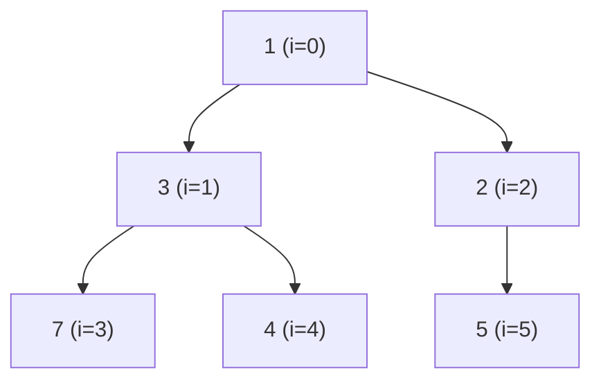

# Heaps and Priority Queues

> **Estimated Time:** 5 hr | **Difficulty:** Intermediate
> **Prerequisites:** [03 - JavaScript for DSA](../../00-foundations/03-javascript-for-dsa/README.md), [02 - Sorting](../../01-core-linear/02-sorting/README.md), [09 - Linked List](../../01-core-linear/09-linked-list/README.md), [04 - Greedy](../04-greedy/README.md)

---

## What You'll Learn

- You can explain how a heap lives inside a plain array and why push and pop cost O(log n).
- You can write sift-up, sift-down, heapify (O(n)) and heap sort from scratch.
- You can solve "k largest / k smallest / k most frequent" with a heap of size k.
- You can solve "median of a stream" and "sliding window median" with two heaps.
- You can pick the right heap trick for scheduling, merging and "always take the best next item" problems.

## The Big Idea

Think of a hospital emergency room. Patients do not leave in the order they arrived. The most urgent patient is always seen next, and new patients can arrive at any time. The nurse does not keep the whole waiting room sorted. She only needs to know who is the most urgent right now. That is a **priority queue**, and a **heap** is the usual way to build one.

A heap is a binary tree, stored in an array, with one rule: **every parent is better than (or equal to) its children**. In a **min-heap** "better" means smaller, so the smallest value is at the top. In a **max-heap** the biggest is at the top. The rule says nothing about left versus right, so a heap is NOT fully sorted. It only promises the top is the best. That weaker promise is why it is cheap: O(log n) to insert, O(log n) to remove the top, O(1) to look at the top.

Why interviewers love it: whenever a problem says "k-th", "top k", "median", "merge many sorted things" or "always pick the smallest/largest next", sorting everything is O(n log n) and often too slow or impossible for a stream. A heap of size k gives O(n log k).

### The array layout

Nodes are stored level by level. For a node at index `i` (0-based):

| Relation | Index |
|---|---|
| left child | `2i + 1` |
| right child | `2i + 2` |
| parent | `(i - 1) >> 1` (that is, floor((i-1)/2)) |

```
min-heap as a tree          as an array
        1                   index: 0  1  2  3  4  5
      /   \                 value: 1  3  2  7  4  5
     3     2
    / \   /
   7   4 5
```






The tree is always "complete" (every level full except maybe the last, filled left to right), so there are no gaps in the array and no pointers are needed. Height is about log2(n), and that is where every O(log n) comes from.

## How to Spot It

| If the problem says ... | think ... |
|---|---|
| "k-th largest / smallest" | heap of size k (min-heap for largest, max-heap for smallest) |
| "top k frequent / closest / largest" | count first, then heap of size k |
| "stream of numbers", "data keeps arriving" | heap, because you cannot sort what has not arrived |
| "median" of a stream or window | two heaps (max-heap for the low half, min-heap for the high half) |
| "merge k sorted lists/arrays" | min-heap holding one candidate from each list |
| "k-sorted array" (each item at most k away) | min-heap of size k + 1 |
| "smallest cost to combine / repeatedly take two smallest" | min-heap (Huffman style) |
| "repeatedly take the largest, smash/modify, put back" | max-heap |
| "schedule tasks with cooldown", "no two same neighbours" | max-heap by count |
| "pick the best available project/job as budget grows" | sort by unlock condition + max-heap of rewards |

## Core Concepts / Template

### Sift up and sift down

- **Sift up** (after push): put the new value at the end, then swap with its parent while it is better than the parent. At most height swaps.
- **Sift down** (after pop): move the last element to the root, then swap it with its better child while a child is better than it. At most height swaps.

Push 0 into the min-heap `[1, 3, 2, 7, 4, 5]`:

```
add at end        [1, 3, 2, 7, 4, 5, 0]   index 6, parent index 2 (value 2): 0 < 2, swap
                  [1, 3, 0, 7, 4, 5, 2]   index 2, parent index 0 (value 1): 0 < 1, swap
                  [0, 3, 1, 7, 4, 5, 2]   at root, stop
```

Pop from `[0, 3, 1, 7, 4, 5, 2]`:

```
take 0; move last (2) to root   [2, 3, 1, 7, 4, 5]
children of root: 3, 1 -> best is 1, 1 < 2, swap   [1, 3, 2, 7, 4, 5]
children of index 2: 5 -> 5 > 2, stop. Answer 0.
```

### A minimal heap you can paste

This is the same `Heap` from the JavaScript chapter, repeated so this chapter stands alone. `cmp(a, b) < 0` means `a` comes out first. JavaScript has no built-in heap, so on LeetCode (where a heap class is sometimes provided and sometimes not) you write this yourself.

```js
class Heap {
  constructor(cmp = (a, b) => a - b, items = []) {
    this.cmp = cmp;
    this.a = [];
    for (const x of items) this.push(x); // O(n log n); fine for interviews
  }
  get size() { return this.a.length; }
  peek() { return this.a[0]; }
  push(x) {
    const a = this.a;
    a.push(x);
    let i = a.length - 1;
    while (i > 0) {                       // sift up
      const p = (i - 1) >> 1;
      if (this.cmp(a[i], a[p]) >= 0) break;
      [a[i], a[p]] = [a[p], a[i]];
      i = p;
    }
  }
  pop() {
    const a = this.a;
    if (a.length === 0) return undefined;
    const top = a[0];
    const last = a.pop();
    if (a.length > 0) {
      a[0] = last;
      let i = 0;
      for (;;) {                          // sift down
        const l = 2 * i + 1, r = l + 1;
        let m = i;
        if (l < a.length && this.cmp(a[l], a[m]) < 0) m = l;
        if (r < a.length && this.cmp(a[r], a[m]) < 0) m = r;
        if (m === i) break;
        [a[i], a[m]] = [a[m], a[i]];
        i = m;
      }
    }
    return top;
  }
}
const MinHeap = (items) => new Heap((a, b) => a - b, items);
const MaxHeap = (items) => new Heap((a, b) => b - a, items);
```

For pairs or objects, pass a comparator on one field: `new Heap((a, b) => a[0] - b[0])`. Never use the default comparator on strings or mixed values. Several solutions below read `h.a` (the raw array) to dump the remaining items. That is fine for "the answer is whatever is left, any order".

### Min-heap vs max-heap, and the size-k trick

JavaScript has no max-heap, so you flip the comparator. The size-k trick feels backwards at first:

| Goal | Keep | Why |
|---|---|---|
| k largest | **min**-heap of size k | the top is the weakest of the k winners; when a new value beats it, kick it out |
| k smallest | **max**-heap of size k | the top is the worst of the k winners |

After the loop the heap holds the answer, and its top is the k-th element.

```js
// top-K template: k largest; peek() is the k-th largest
const h = MinHeap();
for (const x of nums) {
  h.push(x);
  if (h.size > k) h.pop();
}
```

Cost: n pushes of O(log k) each, so O(n log k) time, O(k) space.

### Heapify: building a heap in O(n)

Pushing n items one by one is O(n log n). There is a faster way: put all items in the array as they are, then sift down every non-leaf node from the **last parent back to the root**. The last parent is at index `n/2 - 1`.

Why is it O(n) and not O(n log n)? About half the nodes are leaves and need no work. A quarter are one level above the leaves and move at most 1 step. An eighth move at most 2 steps, and so on. The total is n/4 x 1 + n/8 x 2 + n/16 x 3 + ... which adds up to at most about n. Most nodes are near the bottom, where sifting is cheap.

Trace for `[4, 10, 3, 5, 1]` (n = 5, last parent index 1):

```
i = 1: value 10, children 5 and 1, best is 1 -> swap   [4, 1, 3, 5, 10]
i = 0: value 4,  children 1 and 3, best is 1 -> swap   [1, 4, 3, 5, 10]
        continue at index 1: children 5, 10 -> 4 is fine, stop
result [1, 4, 3, 5, 10]
```

### The two-heaps pattern

To get a median you need the middle of the data. Split the numbers into a **lower half** and an **upper half**:

- `lo` = max-heap holding the smaller half (its top is the biggest of the small numbers).
- `hi` = min-heap holding the larger half (its top is the smallest of the big numbers).

Keep `lo.size` equal to `hi.size` or one bigger. Then the median is `lo.peek()` (odd count) or the average of both tops (even count). Everything in `lo` is at most everything in `hi`, always.

```
numbers: 1 2 3 4 5
lo (max-heap): 3 2 1  top=3        hi (min-heap): 4 5  top=4
size 3 vs 2 -> median = lo.peek() = 3
```

## Problems (easy -> hard)

### 1. Kth Largest Element in a Stream — Easy
**Companies:** Amazon, Meta, Google
**Problem:** Design a class built with `k` and starting numbers. `add(x)` adds a number and returns the current k-th largest. `k=3, [4,5,8,2]`: add 3 -> 4, add 5 -> 5, add 10 -> 5, add 9 -> 8, add 4 -> 8.
**Intuition:** It is the size-k min-heap from the next problem, kept alive between calls. Sorting each time would be far too slow.
**Approach 1 - Brute force:** Keep a list, sort on every `add`. O(n log n) per call.
**Approach 2 - Optimal:** Min-heap of size k. Each `add` is O(log k), and the answer is always `peek()`.

```js
class KthLargest {
  constructor(k, nums) {
    this.k = k;
    this.h = MinHeap();
    for (const x of nums) this.add(x);
  }
  add(x) {
    this.h.push(x);
    if (this.h.size > this.k) this.h.pop();
    return this.h.peek();
  }
}
```

**Complexity:** Time O(log k) per `add`, Space O(k).
**Watch out:** If fewer than k numbers exist so far, `peek()` returns the smallest present. LeetCode guarantees at least k numbers exist after the first add, but say it out loud.

### 2. Last Stone Weight — Easy
**Companies:** Amazon, Google, Microsoft
**Problem:** Repeatedly take the two heaviest stones. If equal, both vanish; otherwise the difference stays. Return the last stone's weight (or 0). `[2,7,4,1,8,1] -> 1`.
**Intuition:** "Always take the biggest two" is exactly what a max-heap does.
**Approach 1 - Brute force:** Sort every round. O(n^2 log n).
**Approach 2 - Optimal:** Max-heap. Pop two, push back the difference if not zero.

```
[8,7,4,2,1,1] -> 8,7 -> push 1 -> [4,2,1,1,1]
4,2 -> push 2 -> [2,1,1,1] -> 2,1 -> push 1 -> [1,1,1] -> 1,1 gone -> [1] -> answer 1
```

```js
function lastStoneWeight(stones) {
  const h = MaxHeap(stones);
  while (h.size > 1) {
    const y = h.pop(), x = h.pop(); // y >= x
    if (y !== x) h.push(y - x);
  }
  return h.size ? h.peek() : 0;
}
```

**Complexity:** Time O(n log n), Space O(n).
**Watch out:** Empty heap at the end means 0. Do not push 0 back.

### 3. Check If an Array Is a Min-Heap — Easy
**Companies:** -
**Problem:** Given an array, decide whether it satisfies the min-heap rule as a complete binary tree. `[1,3,2,4,5] -> true`, `[1,3,2,4,0] -> false`.
**Intuition:** Every node must be <= its children. Since the array layout is always a valid complete tree, just check the rule for each parent.
**Approach 1 - Brute force:** For each index `i > 0`, compare with its parent `a[(i-1)>>1]`. O(n).
**Approach 2 - Optimal:** Loop only over parents (`2i + 1 < n`), compare with both children. Same O(n), half the iterations.

```js
function isMinHeap(a) {
  for (let i = 0; 2 * i + 1 < a.length; i++) {
    const l = 2 * i + 1, r = l + 1;
    if (a[i] > a[l] || (r < a.length && a[i] > a[r])) return false;
  }
  return true;
}
```

**Complexity:** Time O(n), Space O(1).
**Watch out:** The right child may not exist. Empty and single-element arrays are heaps. Equal values are allowed (use `>`, not `>=`).

### 4. Kth Largest Element in an Array — Medium
**Companies:** Amazon, Meta, Google, Microsoft, Apple
**Problem:** Return the k-th largest value (counting duplicates) in an unsorted array. `[3,2,1,5,6,4], k=2 -> 5`.
**Intuition:** You do not need the whole array sorted. Keep only the k biggest values seen so far in a min-heap. The smallest of those k is the k-th largest.
**Approach 1 - Brute force:** Sort descending, return index k-1. Time O(n log n), Space O(1) extra (or O(n) for a copy).
**Approach 2 - Better:** Quickselect (partition like quicksort, recurse into one side). Average O(n), worst O(n^2) without random pivots. Mention it, but it modifies the array and is harder to write bug-free.
**Approach 3 - Optimal (heap):** Min-heap of size k.

| x | heap after push/pop |
|---|---|
| 3 | [3] |
| 2 | [2,3] |
| 1 | [1,2,3] -> pop 1 -> [2,3] |
| 5 | [2,3,5] -> pop 2 -> [3,5] |
| 6 | [3,5,6] -> pop 3 -> [5,6] |
| 4 | [4,5,6] -> pop 4 -> [5,6] |

Top is 5.

```js
function findKthLargest(nums, k) {
  const h = MinHeap();
  for (const x of nums) {
    h.push(x);
    if (h.size > k) h.pop();
  }
  return h.peek();
}
```

**Complexity:** Time O(n log k), Space O(k).
**Watch out:** Min-heap for the largest, not max-heap. Duplicates count: `[5,5,4]`, k=2 gives 5.

### 5. Minimum Cost to Connect Ropes — Medium
**Companies:** Amazon, Google, Microsoft
**Problem:** Joining two ropes costs the sum of their lengths. Join all ropes into one at minimum total cost. `[4,3,2,6] -> 29`. (A classic from interview-prep sites; also known as the Huffman merge idea.)
**Intuition:** A rope joined early gets counted again in every later join. So join the smallest ropes first, so big ropes are added as few times as possible.
**Approach 1 - Brute force:** Try all join orders. Exponential.
**Approach 2 - Optimal (greedy + min-heap):** Always join the two shortest.

```
[2,3,4,6]: 2+3=5 (cost 5)  -> [4,5,6]
4+5=9 (cost 9, total 14)   -> [6,9]
6+9=15 (cost 15, total 29)
```

```js
function connectRopes(ropes) {
  const h = MinHeap(ropes);
  let cost = 0;
  while (h.size > 1) {
    const s = h.pop() + h.pop();
    cost += s;
    h.push(s);
  }
  return cost;
}
```

**Complexity:** Time O(n log n), Space O(n).
**Watch out:** One rope costs 0. Greedy is correct here because of the "early joins are paid again" argument; be ready to say it.

### 6. Top K Frequent Elements — Medium
**Companies:** Amazon, Meta, Google, Microsoft, Apple
**Problem:** Return the k most frequent values, any order. `[1,1,1,2,2,3], k=2 -> [1,2]`.
**Intuition:** Count with a map, then it is "top k by count", which is the size-k heap again, keyed on the count.
**Approach 1 - Brute force:** Count, sort all pairs by count. O(n log n).
**Approach 2 - Better:** Bucket sort: bucket index = count (at most n), then read buckets from the high end. O(n) time. Mention it as the follow-up.
**Approach 3 - Optimal (heap):** Min-heap of `[value, count]` by count, size k.

```
counts: 1->3, 2->2, 3->1, k=2
push (1,3) (2,2) (3,1): size 3 > 2, pop smallest count (3,1) -> heap holds 1 and 2
```

```js
function topKFrequent(nums, k) {
  const cnt = new Map();
  for (const x of nums) cnt.set(x, (cnt.get(x) || 0) + 1);
  const h = new Heap((a, b) => a[1] - b[1]); // min-heap on count
  for (const e of cnt) {                      // e = [value, count]
    h.push(e);
    if (h.size > k) h.pop();
  }
  return h.a.map((e) => e[0]);
}
```

**Complexity:** Time O(n log k), Space O(n) for the map plus O(k) heap.
**Watch out:** The heap compares the count, not the value. LeetCode promises a unique answer, so ties at the boundary do not happen there; in real life, ask what to do on ties.

### 7. K Closest Points to Origin — Medium
**Companies:** Amazon, Meta, Google, Microsoft, Uber
**Problem:** Given points `[x, y]`, return the k closest to (0, 0). `[[1,3],[-2,2]], k=1 -> [[-2,2]]`.
**Intuition:** "k smallest distances" means a max-heap of size k on distance. Compare squared distances, no square root needed (the order is the same and you avoid float error).
**Approach 1 - Brute force:** Sort by distance. O(n log n).
**Approach 2 - Better:** Quickselect on distance, average O(n).
**Approach 3 - Optimal (heap):** Max-heap of size k.

```
(1,3): d2=10 ; (-2,2): d2=8 ; k=1
push 10 -> [10]; push 8 -> [10,8] size 2 > 1 -> pop max 10 -> [8]
answer (-2,2)
```

```js
function kClosest(points, k) {
  const h = new Heap((a, b) => b[0] - a[0]); // max-heap on squared distance
  for (const [x, y] of points) {
    h.push([x * x + y * y, x, y]);
    if (h.size > k) h.pop();
  }
  return h.a.map((e) => [e[1], e[2]]);
}
```

**Complexity:** Time O(n log k), Space O(k).
**Watch out:** Max-heap here (k smallest). Do not call `Math.sqrt`.

### 8. Sort a K-Sorted Array — Medium
**Companies:** Amazon, Microsoft, Google
**Problem:** Every element is at most `k` places away from its sorted position. Sort the array faster than O(n log n). `[6,5,3,2,8,10,9], k=3 -> [2,3,5,6,8,9,10]`.
**Intuition:** The smallest element overall must be among the first k + 1 items. Keep a sliding min-heap of k + 1 items; its top is always safe to output next.
**Approach 1 - Brute force:** Normal sort, O(n log n).
**Approach 2 - Optimal:** Push items one by one. Once the heap has more than k items, pop the smallest into the output. At the end, drain the heap.

```
k=3, arr = 6 5 3 2 8 10 9
push 6,5,3 (size 3); push 2 (size 4 > 3) -> pop 2   out [2]
push 8 -> pop 3  out [2,3]      push 10 -> pop 5   out [2,3,5]
push 9 -> pop 6  out [2,3,5,6]  drain: 8 9 10
```

```js
function sortKSorted(arr, k) {
  const h = MinHeap(), out = [];
  for (const x of arr) {
    h.push(x);
    if (h.size > k) out.push(h.pop());
  }
  while (h.size) out.push(h.pop());
  return out;
}
```

**Complexity:** Time O(n log k), Space O(k) (plus the output).
**Watch out:** `k = 0` means already sorted; the code handles it (pops each item at once). Heap size is k + 1 at its peak.

### 9. Kth Smallest Element in a Sorted Matrix — Medium
**Companies:** Amazon, Google, Microsoft, Meta
**Problem:** An `n x n` matrix has sorted rows and sorted columns. Return the k-th smallest value overall. `[[1,5,9],[10,11,13],[12,13,15]], k=8 -> 13`.
**Intuition:** Each row is a sorted list. This is "merge n sorted lists, stop at the k-th item". Start with the first item of each row; pop the smallest k - 1 times, pushing the next item of the same row.
**Approach 1 - Brute force:** Flatten, sort, take index k-1. O(n^2 log n).
**Approach 2 - Better:** Binary search on the value range, counting how many cells are <= mid in O(n) using the sorted structure. O(n log(max - min)), O(1) space. Strong follow-up.
**Approach 3 - Heap:** Min-heap of `[value, row, col]`, seeded with the first column (only the first `min(n, k)` rows matter).

```js
function kthSmallest(matrix, k) {
  const n = matrix.length;
  const h = new Heap((a, b) => a[0] - b[0]);
  for (let r = 0; r < Math.min(n, k); r++) h.push([matrix[r][0], r, 0]);
  for (let i = 1; i < k; i++) {
    const [, r, c] = h.pop();
    if (c + 1 < n) h.push([matrix[r][c + 1], r, c + 1]);
  }
  return h.peek()[0];
}
```

**Complexity:** Time O(min(n,k) + k log min(n,k)), Space O(min(n,k)).
**Watch out:** k-th smallest counts duplicates (13 appears twice in the example). The answer is the top AFTER k - 1 pops.

### 10. Find K Pairs with Smallest Sums — Medium
**Companies:** Google, Amazon, Meta
**Problem:** Two sorted arrays. Pick one number from each to form a pair. Return the k pairs with the smallest sums. `[1,7,11], [2,4,6], k=3 -> [[1,2],[1,4],[1,6]]`.
**Intuition:** Think of a grid where cell (i, j) = `nums1[i] + nums2[j]`. Each row is sorted, so again it is "merge sorted rows", but the grid is never built. Start with `(i, 0)` for each i, and when you pop `(i, j)` push `(i, j+1)`.
**Approach 1 - Brute force:** Build all n x m pairs, sort. O(nm log(nm)), too big.
**Approach 2 - Optimal:** Min-heap of `[sum, i, j]`.

```
k=3, seeds: (0,0)=3, (1,0)=9, (2,0)=13
pop (0,0) sum 3 -> pair [1,2], push (0,1)=5
pop (0,1) sum 5 -> pair [1,4], push (0,2)=7
pop (0,2) sum 7 -> pair [1,6]  -> 3 pairs, stop
```

```js
function kSmallestPairs(nums1, nums2, k) {
  const h = new Heap((a, b) => a[0] - b[0]);
  for (let i = 0; i < Math.min(nums1.length, k); i++) h.push([nums1[i] + nums2[0], i, 0]);
  const res = [];
  while (h.size && res.length < k) {
    const [, i, j] = h.pop();
    res.push([nums1[i], nums2[j]]);
    if (j + 1 < nums2.length) h.push([nums1[i] + nums2[j + 1], i, j + 1]);
  }
  return res;
}
```

**Complexity:** Time O(k log min(n, k)), Space O(min(n, k)).
**Watch out:** There may be fewer than k pairs in total; the `while` handles it. No visited set is needed because each pair is only reachable from the one on its left.

### 11. Ugly Number II / Super Ugly Number — Medium
**Companies:** Amazon, Google, Microsoft, Apple
**Problem:** An ugly number has only prime factors 2, 3, 5. Return the n-th ugly number (1 is the first). `n=10 -> 12`. Super ugly: the allowed primes are given, e.g. `n=12, primes=[2,7,13,19] -> 32`.
**Intuition:** Every ugly number is (an earlier ugly number) x (an allowed prime). So the sequence is a merge of sorted lists: for each prime p, the list `p x ugly[0], p x ugly[1], ...`. Each list is sorted, so use a heap of one candidate per prime.
**Approach 1 - Brute force:** Test each integer 1, 2, 3... by dividing out the primes. Too slow for large n.
**Approach 2 - Better:** For 2, 3, 5 only: three pointers (one per prime), take the min of three candidates each step. O(n). The heap version below also covers any prime list.
**Approach 3 - Optimal (heap):** Heap items `[candidate, prime, index into ugly]`. Take the smallest candidate x, append it, then advance EVERY heap item equal to x (this removes duplicates like 6 = 2x3 = 3x2).

```
primes [2,3,5], ugly=[1]. heap: 2,3,5
take 2 -> ugly [1,2]; advance prime 2: 2*ugly[1]=4.   heap 3,4,5
take 3 -> [1,2,3]; prime 3: 3*2=6.                      heap 4,5,6
take 4 -> prime 2: 2*3=6.                               heap 5,6,6
take 5 -> prime 5: 5*2=10.                              heap 6,6,10
take 6 -> both 6s advance: 2*4=8, 3*3=9                 -> ugly 1,2,3,4,5,6
```

```js
function nthSuperUglyNumber(n, primes) {
  const ugly = [1];
  const h = new Heap((a, b) => a[0] - b[0]); // [value, prime, index into ugly]
  for (const p of primes) h.push([p, p, 0]);
  while (ugly.length < n) {
    const x = h.peek()[0];
    ugly.push(x);
    while (h.size && h.peek()[0] === x) { // advance all primes that made x
      const [, p, i] = h.pop();
      h.push([p * ugly[i + 1], p, i + 1]);
    }
  }
  return ugly[n - 1];
}
const nthUglyNumber = (n) => nthSuperUglyNumber(n, [2, 3, 5]);
```

**Complexity:** Time O(n x m x log m) worst case (m = number of primes), Space O(n + m).
**Watch out:** Forgetting to advance duplicates gives repeated values. `ugly[i + 1]` always exists because `i` is smaller than the current length.

### 12. Reorganize String — Medium
**Companies:** Amazon, Google, Meta, Microsoft
**Problem:** Rearrange letters so no two equal letters are adjacent; return `""` if impossible. `"aab" -> "aba"`, `"aaab" -> ""`.
**Intuition:** The most frequent letter is the danger. Each step, place the two most frequent different letters (they are different, so they cannot clash with each other), then put them back with one fewer. If the single letter left has more than one copy, it must touch itself, so fail.
**Approach 1 - Brute force:** Try all permutations. Exponential.
**Approach 2 - Better:** Count; if max count > ceil(n/2), impossible. Else place the most common letter at even indices 0, 2, 4, ..., then the rest. O(n), no heap, but the heap version generalizes (Task Scheduler, "k apart" variants).
**Approach 3 - Optimal (heap):** Max-heap by count.

```
"aabb": heap (a,2) (b,2)
pop a, b -> "ab", counts 1,1 -> push back
pop a, b -> "abab"  -> heap empty, done
"aaab": pop a,b -> "ab", a has 2 left, b gone. heap has (a,2), size 1 and count > 1 -> ""
```

```js
function reorganizeString(s) {
  const cnt = new Map();
  for (const ch of s) cnt.set(ch, (cnt.get(ch) || 0) + 1);
  const h = new Heap((a, b) => b[1] - a[1], [...cnt]); // max-heap on count
  let out = '';
  while (h.size > 1) {
    const a = h.pop(), b = h.pop();
    out += a[0] + b[0];
    if (--a[1] > 0) h.push(a);
    if (--b[1] > 0) h.push(b);
  }
  if (h.size === 1) {
    if (h.peek()[1] > 1) return '';
    out += h.peek()[0];
  }
  return out;
}
```

**Complexity:** Time O(n log A) where A is the alphabet size (at most 26, so effectively O(n)), Space O(A).
**Watch out:** A string of one letter like `"a"` is valid. The failure check must be done on the last leftover letter.

### 13. Task Scheduler — Medium
**Companies:** Amazon, Meta, Google, Microsoft, Uber
**Problem:** Tasks are letters. The same letter must be at least `n` slots apart (idle slots allowed). Return the least total time. `AAABBB, n=2 -> 8` (A B idle A B idle A B).
**Intuition:** Each unit of time, run the task with the most remaining copies that is not cooling down. Cooling tasks wait in a queue with the time they become ready.
**Approach 1 - Brute force:** Simulate with a plain scan for the best ready task each tick. O(time x tasks).
**Approach 2 - Better:** Closed form: with `maxCount` = highest frequency and `numMax` = how many letters share it, answer = `max(tasks.length, (maxCount - 1) * (n + 1) + numMax)`. O(n). Know this formula; interviewers often ask it as the follow-up.
**Approach 3 - Heap simulation:** Max-heap of remaining counts for "ready" tasks, plus a queue of `[readyTime, remaining]` for cooling ones.

```
AAABBB, n=2. counts A3 B3
slot 1: A (2 left, cooling)     slot 2: B (2 left, cooling)
slot 3: nothing ready -> idle   slot 4: A (1 left)   slot 5: B (1 left)
slot 6: idle                    slot 7: A (done)     slot 8: B (done)  -> 8
```

```js
function leastInterval(tasks, n) {
  const cnt = new Map();
  for (const t of tasks) cnt.set(t, (cnt.get(t) || 0) + 1);
  const ready = MaxHeap([...cnt.values()]);
  const cooling = []; // queue of [readyTime, remaining]; readyTime grows, so FIFO is sorted
  let head = 0, time = 0;
  while (ready.size || head < cooling.length) {
    time++;
    if (ready.size) {
      const left = ready.pop() - 1;
      if (left > 0) cooling.push([time + n, left]);
    } else {
      time = cooling[head][0]; // nothing ready: jump to when something is
    }
    while (head < cooling.length && cooling[head][0] <= time) ready.push(cooling[head++][1]);
  }
  return time;
}
```

**Complexity:** Time O(T log A) for T tasks, Space O(A).
**Watch out:** `n = 0` means no idle time (answer is just `tasks.length`). The answer is never below `tasks.length`, which is why the formula has that `max`.

### 14. Hand of Straights — Medium
**Companies:** Google, Amazon, Meta
**Problem:** Can the cards be split into groups of `groupSize` consecutive numbers? `[1,2,3,6,2,3,4,7,8], 3 -> true` (123, 234, 678).
**Intuition:** The smallest card left must start a group (nothing smaller exists to put it after). So repeatedly take the smallest and demand the next `groupSize - 1` numbers.
**Approach 1 - Brute force:** Sort, then repeatedly scan for the first unused card and find its followers. O(n^2).
**Approach 2 - Optimal:** Count map + min-heap of distinct values. Take the heap top as the group start, subtract one from each of `start .. start+groupSize-1`. If a count hits zero, that value must be the heap top (otherwise a smaller value is still waiting and would be stranded), so pop it.

```
hand 1 2 3 6 2 3 4 7 8, size 3. counts 1:1 2:2 3:2 4:1 6:1 7:1 8:1
start 1: take 1,2,3 -> 1 gone (pop), counts 2:1 3:1
start 2: take 2,3,4 -> 2,3,4 gone
start 6: take 6,7,8 -> done, true
```

```js
function isNStraightHand(hand, groupSize) {
  if (hand.length % groupSize) return false;
  const cnt = new Map();
  for (const x of hand) cnt.set(x, (cnt.get(x) || 0) + 1);
  const h = MinHeap([...cnt.keys()]);
  while (h.size) {
    const first = h.peek();
    for (let v = first; v < first + groupSize; v++) {
      if (!cnt.get(v)) return false;
      cnt.set(v, cnt.get(v) - 1);
      if (cnt.get(v) === 0) {
        if (v !== h.peek()) return false; // a smaller value is still alive: it can never be grouped
        h.pop();
      }
    }
  }
  return true;
}
```

**Complexity:** Time O(n log n), Space O(n).
**Watch out:** Check `hand.length % groupSize` first. `groupSize = 1` is always true. The same idea solves "Divide Array in Sets of K Consecutive Numbers".

### 15. Convert Min-Heap to Max-Heap — Medium
**Companies:** -
**Problem:** Given an array that is a min-heap, rearrange it into a max-heap. `[1,3,5,4,6,13,10,9,8,15,17]`: afterwards the top is 17 and every parent >= its children.
**Intuition:** The min-heap order tells you nothing useful for the max-heap, so just rebuild. Heapify with the opposite rule: sift down every parent from `n/2 - 1` to 0.
**Approach 1 - Brute force:** Pop everything into a new max-heap. O(n log n).
**Approach 2 - Optimal:** In-place heapify with "bigger goes up", O(n).

Reusable pieces (also used in Heap Sort):

```js
// before(x, y) is true when x belongs above y
function siftDown(a, i, n, before) {
  for (;;) {
    const l = 2 * i + 1, r = l + 1;
    let m = i;
    if (l < n && before(a[l], a[m])) m = l;
    if (r < n && before(a[r], a[m])) m = r;
    if (m === i) return;
    [a[i], a[m]] = [a[m], a[i]];
    i = m;
  }
}
function buildHeap(a, before) {
  for (let i = (a.length >> 1) - 1; i >= 0; i--) siftDown(a, i, a.length, before);
  return a;
}
const minToMaxHeap = (a) => buildHeap([...a], (x, y) => x > y); // copy; drop [...a] to do it in place
```

**Complexity:** Time O(n), Space O(1) in place (O(n) with the copy).
**Watch out:** Loop from the last parent DOWN to the root. Going root-first does not work, because the subtrees below are not heaps yet. State that heapify is O(n), not O(n log n).

### 16. Build Heap from Array and Heap Sort — Medium
**Companies:** -
**Problem:** (a) Turn any array into a heap in place. (b) Sort an array using a heap, in place, in O(n log n).
**Intuition:** (a) is `buildHeap` above. (b): build a max-heap, then repeatedly swap the top (the biggest) with the last slot of the heap region, shrink the region by one, and sift the new top down. The sorted part grows from the back.
**Approach 1 - Brute force:** Push all into a heap (O(n log n)), pop into a new array. Uses O(n) extra space.
**Approach 2 - Optimal (in place):**

```
[4, 10, 3, 5, 1] -> build max-heap [10, 5, 3, 4, 1]
swap top with last: [1, 5, 3, 4, | 10]  sift down in size 4 -> [5, 4, 3, 1 | 10]
swap: [1, 4, 3 | 5, 10] -> sift -> [4, 1, 3 | 5, 10]
swap: [3, 1, | 4, 5, 10] -> 3 > 1, nothing to sift
swap: [1 | 3, 4, 5, 10] -> sorted [1, 3, 4, 5, 10]
```

```js
// uses siftDown and buildHeap from Convert Min-Heap to Max-Heap
function heapSort(a) {
  buildHeap(a, (x, y) => x > y); // max-heap
  for (let end = a.length - 1; end > 0; end--) {
    [a[0], a[end]] = [a[end], a[0]];       // biggest goes to its final place
    siftDown(a, 0, end, (x, y) => x > y);  // heap now covers indexes 0..end-1
  }
  return a;
}
```

**Complexity:** Time O(n log n) in every case, Space O(1).
**Watch out:** Use a MAX-heap to sort ascending. Heap sort is not stable and has poor cache behaviour, so in practice quicksort or merge sort is faster; its selling point is the guaranteed O(n log n) with O(1) space. To get a build heap for a min-heap, pass `(x, y) => x < y` as `before`.

### 17. Merge K Sorted Lists — Hard
**Companies:** Amazon, Meta, Google, Microsoft, Apple
**Problem:** Merge `k` sorted linked lists into one sorted list. `[[1,4,5],[1,3,4],[2,6]] -> [1,1,2,3,4,4,5,6]`.
**Intuition:** The next output is the smallest among the k list heads. Keep exactly those heads in a min-heap. After you take one, push its successor.
**Approach 1 - Brute force:** Dump every value into an array and sort, then rebuild. O(N log N), N = total nodes.
**Approach 2 - Better:** Merge lists two at a time (divide and conquer): also O(N log k), no heap, O(1) extra space. Good alternative.
**Approach 3 - Optimal (heap):** Heap of at most k nodes, ordered by `val`.

```
heads: 1(a) 1(b) 2(c) -> pop 1(a), push 4(a)
heap: 1(b) 2(c) 4(a) -> pop 1(b), push 3(b)
heap: 2(c) 3(b) 4(a) -> pop 2(c), push 6(c) ... and so on
```

```js
class ListNode { constructor(val = 0, next = null) { this.val = val; this.next = next; } }

function mergeKLists(lists) {
  const h = new Heap((a, b) => a.val - b.val);
  for (const n of lists) if (n) h.push(n); // skip empty lists
  const dummy = new ListNode();
  let tail = dummy;
  while (h.size) {
    const n = h.pop();
    tail.next = n;
    tail = n;
    if (n.next) h.push(n.next);
  }
  return dummy.next;
}
```

For plain arrays, store `[value, listIndex, positionInList]` in the heap instead of nodes (see Smallest Range Covering Elements from K Lists).

**Complexity:** Time O(N log k), Space O(k).
**Watch out:** Some lists may be `null`; `lists` itself may be empty. Heap size stays at most k, which is why the log is `log k` and not `log N`.

### 18. Find Median from Data Stream — Hard
**Companies:** Amazon, Google, Meta, Microsoft, Apple
**Problem:** Design `addNum(x)` and `findMedian()`. After adding 1, 2 the median is 1.5; after adding 3 it is 2.
**Intuition:** The median only depends on the middle. Keep the lower half in a max-heap and the upper half in a min-heap, so both middle candidates sit on top.
**Approach 1 - Brute force:** Keep an array; sort on every query. O(n log n) per query. Or insertion into a sorted array: O(n) per add.
**Approach 2 - Better:** Sorted array + binary search insert: O(log n) to find, O(n) to shift.
**Approach 3 - Optimal (two heaps):** For each new number: push to `lo`, move `lo`'s top to `hi` (this keeps the order rule safe), then if `hi` got bigger than `lo`, move one back.

```
add 5: lo {5}      hi {}       median 5
add 2: lo {2}      hi {5}      median (2+5)/2 = 3.5   (2 goes to lo, lo's top 5 crosses to hi)
add 8: lo {5,2}    hi {8}      median 5               (8 crosses to hi, hi is too big, 5 moves back)
add 1: lo {2,1}    hi {5,8}    median (2+5)/2 = 3.5
```

```js
class MedianFinder {
  constructor() { this.lo = MaxHeap(); this.hi = MinHeap(); }
  addNum(x) {
    this.lo.push(x);
    this.hi.push(this.lo.pop());                      // largest of the low side crosses over
    if (this.hi.size > this.lo.size) this.lo.push(this.hi.pop()); // keep lo >= hi in size
  }
  findMedian() {
    return this.lo.size > this.hi.size ? this.lo.peek() : (this.lo.peek() + this.hi.peek()) / 2;
  }
}
```

**Complexity:** Time O(log n) per `addNum`, O(1) per `findMedian`, Space O(n).
**Watch out:** Call `findMedian` only after at least one add. Average of two numbers can be a fraction. Follow-ups: if all numbers are 0..100, use a count array; if 99% are in 0..100, count them and keep two small outlier buckets.

### 19. Sliding Window Median — Hard
**Companies:** Google, Amazon, Meta, Microsoft
**Problem:** Return the median of every window of size `k`. `[1,3,-1,-3,5,3,6,7], k=3 -> [1,-1,-1,3,5,6]`.
**Intuition:** It is the two-heaps median, but numbers also LEAVE the window. A heap cannot delete a middle item quickly. So use **lazy deletion**: note "this value is dead" in a map, and only really remove it when it reaches a heap top. Keep separate counts of alive items so the balance rule stays true.
**Approach 1 - Brute force:** Sort each window. O(n k log k).
**Approach 2 - Better:** Keep one sorted window array, binary search insert and remove (each O(k) shift). O(n k), simple and often accepted.
**Approach 3 - Optimal (two heaps + lazy delete):**

```
remove(x): mark x dead; decrease the alive count of the side x belongs to
           (x <= top of lo means x is in lo); prune that heap's top if dead; rebalance
prune(h):  while h's top is dead: pop it and use up one dead mark
```

```js
function medianSlidingWindow(nums, k) {
  const lo = MaxHeap(), hi = MinHeap();
  const dead = new Map(); // value -> number of lazily deleted copies
  let loN = 0, hiN = 0;   // alive sizes (heap.size also counts dead ones)
  const prune = (h) => {
    while (h.size && dead.get(h.peek()) > 0) {
      const x = h.pop();
      dead.set(x, dead.get(x) - 1);
    }
  };
  const balance = () => {
    if (loN > hiN + 1) { hi.push(lo.pop()); loN--; hiN++; prune(lo); }
    else if (loN < hiN) { lo.push(hi.pop()); hiN--; loN++; prune(hi); }
  };
  const add = (x) => {
    if (!loN || x <= lo.peek()) { lo.push(x); loN++; } else { hi.push(x); hiN++; }
    balance();
  };
  const remove = (x) => {
    dead.set(x, (dead.get(x) || 0) + 1);
    if (x <= lo.peek()) { loN--; prune(lo); } else { hiN--; prune(hi); }
    balance();
  };
  const res = [];
  for (let i = 0; i < nums.length; i++) {
    add(nums[i]);
    if (i >= k) remove(nums[i - k]);
    if (i >= k - 1) res.push(k % 2 ? lo.peek() : (lo.peek() + hi.peek()) / 2);
  }
  return res;
}
```

**Complexity:** Time O(n log k) amortized (each item is pushed and popped once), Space O(n) in the worst case because dead items can sit deep in a heap.
**Watch out:** Never use `heap.size` for balancing; use the alive counts. The heap tops must always be alive when you read them, hence the `prune` calls. Do not add two numbers with `+` blindly if values reach 2^31: JavaScript doubles handle it, but in other languages it overflows (say this).

### 20. IPO — Hard
**Companies:** Amazon, Google, Microsoft
**Problem:** You can finish at most `k` projects. Each has a profit and a minimum capital to start. Starting capital is `w`; profits are added to your capital. Maximize final capital. `k=2, w=0, profits=[1,2,3], capital=[0,1,1] -> 4`.
**Intuition:** At each step, among projects you can afford, take the one with the biggest profit (profit only helps, never costs). Affordable projects grow as capital grows. Sort projects by cost, feed the affordable ones into a max-heap of profits.
**Approach 1 - Brute force:** Each round scan all projects for the best affordable one. O(k x n).
**Approach 2 - Optimal:** Sort by capital + max-heap on profit.

```
projects (capital, profit): (0,1) (1,2) (1,3); w=0
round 1: affordable: (0,1) -> heap [1] -> take 1, w=1
round 2: now (1,2) and (1,3) affordable -> heap [3,2] -> take 3, w=4. done k=2
```

```js
function findMaximizedCapital(k, w, profits, capital) {
  const projects = profits.map((p, i) => [capital[i], p]).sort((a, b) => a[0] - b[0]);
  const best = MaxHeap();
  let i = 0;
  while (k-- > 0) {
    while (i < projects.length && projects[i][0] <= w) best.push(projects[i++][1]);
    if (!best.size) break; // nothing affordable: stop early
    w += best.pop();
  }
  return w;
}
```

**Complexity:** Time O(n log n + k log n), Space O(n).
**Watch out:** "At most k" means you may stop early. Projects with profit 0 never matter.

### 21. Smallest Range Covering Elements from K Lists — Hard
**Companies:** Google, Amazon, Meta, Microsoft
**Problem:** `k` sorted lists. Find the smallest range `[a, b]` that contains at least one number from every list. `[[4,10,15,24,26],[0,9,12,20],[5,18,22,30]] -> [20,24]`.
**Intuition:** Keep one number from each list in a min-heap. The range that covers them is `[heap min, current max]`. To shrink it, you can only improve by moving the smallest one forward (moving anything else cannot raise the minimum). Track the best range as you go; stop when a list runs out.
**Approach 1 - Brute force:** Try every number as range start, find the smallest end covering all lists. O(N k) or worse.
**Approach 2 - Better:** Merge all numbers with their list id, sort, then sliding window that covers all k ids. O(N log N), O(N) space.
**Approach 3 - Optimal (heap):** Heap of `[value, list, index]`, plus a running `max`.

```
start: heap holds 4, 0, 5; max = 5; best [0,5] (width 5)
pop 0 (width 5, no gain), push 9, max 9      pop 4 (width 5), push 10, max 10
pop 5 (width 5), push 18, max 18             pop 9 (9), push 12      pop 10 (8), push 15
pop 12 (6), push 20, max 20                  pop 15 (5), push 24, max 24
pop 18 (6), push 22                          pop 20: width 24-20 = 4 < 5 -> best [20,24]
later pops give wider ranges, then list 3 runs out and we stop
```

```js
function smallestRange(nums) {
  const h = new Heap((a, b) => a[0] - b[0]); // [value, list, index]
  let max = -Infinity;
  nums.forEach((l, i) => { h.push([l[0], i, 0]); max = Math.max(max, l[0]); });
  let range = [h.peek()[0], max];
  for (;;) {
    const [v, i, j] = h.pop();
    if (max - v < range[1] - range[0]) range = [v, max];
    if (j + 1 === nums[i].length) return range; // a list is used up: cannot cover it any more
    const nx = nums[i][j + 1];
    max = Math.max(max, nx);
    h.push([nx, i, j + 1]);
  }
}
```

**Complexity:** Time O(N log k) for N total numbers, Space O(k).
**Watch out:** Only update the answer on a strictly smaller width; on ties LeetCode wants the smaller start, which this gives because starts only increase. The max is only ever raised, never lowered.

## Common Mistakes

- **Wrong belief:** "A heap is a sorted array." **Fix:** only the parent-child rule holds. `[1, 3, 2]` is a valid min-heap, yet the array is not sorted. You cannot binary search a heap.
- **Wrong belief:** "For the k largest I need a max-heap." **Fix:** use a **min-heap of size k**. Its top is the k-th largest and the weakest one to evict. Mirror it for k smallest.
- **Wrong belief:** "JavaScript's `Array.sort()` with no comparator sorts numbers." **Fix:** it sorts as strings (`[10, 9, 1]` becomes `[1, 10, 9]`). Always write `(a, b) => a - b`, and keep the same discipline in a heap comparator.
- **Wrong belief:** "Heapify is O(n log n) because it sifts n nodes." **Fix:** most nodes are near the leaves and move very little. The sum is O(n).
- **Wrong belief:** "I can remove any item from a heap in O(log n)." **Fix:** only the top. Removing a middle item needs its index (a position map) or lazy deletion, as in the sliding window median.
- **Wrong belief:** "A max-heap of size n is fine for top k." **Fix:** that costs O(n log n) and O(n) space. The size-k heap is O(n log k) and O(k).
- **Wrong belief:** "Comparators can return a boolean." **Fix:** the comparator must return a number (negative, zero, positive). `(a, b) => a > b` breaks the heap silently.
- **Wrong belief:** "Sqrt is needed for distances." **Fix:** compare squared distances.

## Interview Tips

- Say it first: "JavaScript has no built-in heap, so I will write a small one. Push and pop are O(log n), peek is O(1)." Then write the class from memory. If the interviewer allows a library, say which one you would use in another language (priority queue / heapq).
- State the trick in one line: "I keep a min-heap of size k, so each item costs O(log k)." Then give the total O(n log k) and compare it with sorting at O(n log n).
- Name the alternatives: quickselect for k-th element (average O(n)), bucket sort for top k frequent (O(n)), binary search on the answer for k-th in a matrix, the formula for Task Scheduler. Interviewers often ask for these as follow-ups.
- Follow-ups to expect: "What if the data is a stream?" (heap, never sort). "What if the data does not fit in memory?" (heap of size k over a streamed file, external merge for k sorted files). "Can you do it in O(n)?" (quickselect or heapify). "What about ties?" (ask, then add a tie-break field in the comparator).
- Edge cases to mention: empty input, `k` larger than `n`, `k = 1`, duplicates, negative numbers, one list empty in a merge, stream with fewer than k items.
- Mention that heap sort is not stable and a heap does not support search or arbitrary delete.
- When you add a two-heap solution, say the invariant out loud: "every number in `lo` is at most every number in `hi`, and `lo` is never smaller than `hi` by size, and at most one larger."

## Practice List

**Easy**
- Kth Largest Element in a Stream
- Last Stone Weight
- Relative Ranks
- The K Weakest Rows in a Matrix
- Minimum Cost to Connect Sticks
- Maximum Product of Two Elements in an Array

**Medium**
- Kth Largest Element in an Array
- Top K Frequent Elements
- Top K Frequent Words
- K Closest Points to Origin
- Sort Characters By Frequency
- Task Scheduler
- Reorganize String
- Kth Smallest Element in a Sorted Matrix
- Find K Pairs with Smallest Sums
- Ugly Number II
- Hand of Straights
- Longest Happy String
- Furthest Building You Can Reach
- Meeting Rooms II (heap of end times)
- Car Pooling
- Find K Closest Elements
- Seat Reservation Manager
- Process Tasks Using Servers

**Hard**
- Merge k Sorted Lists
- Find Median from Data Stream
- Sliding Window Median
- IPO
- Smallest Range Covering Elements from K Lists
- Super Ugly Number
- Trapping Rain Water II
- The Skyline Problem (heap of heights)
- Minimum Number of Refueling Stops
- Design Twitter (merge k feeds)
- Maximum Performance of a Team
- Minimize Deviation in Array

## Key Takeaways

- A heap is a **complete binary tree stored in an array**; children of `i` are `2i+1` and `2i+2`, the parent is `(i-1)>>1`.
- A heap only guarantees **the top is the best**, not full order, which is why push and pop are O(log n) and peek is O(1).
- **Top k largest = min-heap of size k** (and k smallest = max-heap of size k); cost O(n log k).
- **Heapify is O(n)**: sift down every parent from `n/2 - 1` to 0; heap sort then runs in O(n log n) with O(1) space.
- **Two heaps** (max-heap for the low half, min-heap for the high half) give the **median of a stream** in O(log n) per number; removing items needs **lazy deletion**.
- "Merge k sorted things" and "k-th in a sorted matrix/pair space" are the same trick: **a heap holding one candidate per sorted list**.
- For scheduling and "no equal neighbours" problems, a **max-heap on remaining count** plus a cooldown queue is the standard pattern.

---

[← Previous: Greedy](../04-greedy/README.md) | [Next: Intervals and Sweep Line →](../06-intervals-and-sweep-line/README.md) | [Back to Intermediate Index](../README.md)
