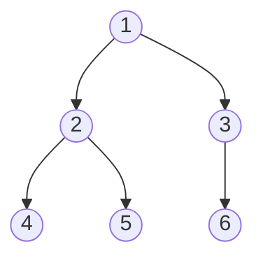
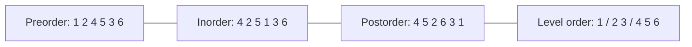

# Binary Tree Traversals

> **Estimated Time:** 6 hr | **Difficulty:** Intermediate
> **Prerequisites:** [Randomization and Sampling](../../02-intermediate/09-randomization-and-sampling/README.md) (any recursion and stack/queue basics are enough)

---

## What You'll Learn

- You can name the parts of a binary tree (root, leaf, height, depth, complete, balanced) and build one from a LeetCode-style array.
- You can write preorder, inorder, postorder and level order, both with recursion and with an explicit stack or queue.
- You can solve tree problems with the "ask the children, then combine" recursion pattern (depth, balance, diameter, max path sum).
- You can walk a tree in O(1) extra space with Morris traversal.
- You can handle the "shape" problems: boundary traversal and vertical order traversal.

## The Big Idea

Think of a company org chart. The CEO has two direct reports, and each of them has up to two reports, and so on. If you want to count everyone, you do not walk the whole chart yourself. You ask each of your two reports, "how many people are under you?", add the answers, and add one for yourself. Every manager does the same thing. A tree problem is almost always this: solve the same problem for the left child and the right child, then combine.

A **binary tree** is a set of nodes where each node has at most two children, called left and right. A **traversal** is a rule for visiting every node exactly once. The only real question is: when do you "visit" the current node compared to its children?

Why interviewers love it: trees test recursion (can you trust a function to solve the smaller problem?), stack/queue skills (can you replace recursion by hand?), and clean thinking about edge cases (empty tree, one child only). Almost every harder tree topic (BST, LCA, views, tries) is built on this chapter.

#### Terms

| Term | Meaning |
|---|---|
| Root | The top node. It has no parent. |
| Leaf | A node with no children. |
| Parent / child | A node directly above / below another. |
| Depth of a node | Number of edges from the root to it. Root has depth 0. |
| Height of a node | Number of edges on the longest path down to a leaf. |
| Max depth of the tree (LeetCode) | Number of **nodes** on the longest root-to-leaf path. A single node gives 1. |
| Full binary tree | Every node has 0 or 2 children. |
| Complete binary tree | Every level is full except maybe the last, which is filled left to right. |
| Perfect binary tree | All leaves on the same level, all inner nodes have 2 children. It has 2^h - 1 nodes for h levels. |
| Balanced | For every node, left and right heights differ by at most 1. |

Careful: "height" can count edges or nodes. LeetCode counts nodes for depth problems. Say which one you use.

#### The TreeNode and the array builder

LeetCode shows a tree as a level-order array where `null` means "no node here". Children of `null` are NOT listed. `[1,2,3,4,5,null,6]` is this tree:






Node 3 has only a right child (6), because the `null` took the left slot of node 3.

```js
class TreeNode {
  constructor(val = 0, left = null, right = null) {
    this.val = val; this.left = left; this.right = right;
  }
}

// [1,2,3,4,5,null,6] -> tree. Use it to test every solution below.
function buildTree(arr) {
  if (!arr.length || arr[0] === null) return null;
  const root = new TreeNode(arr[0]);
  const q = [root];
  let i = 1, head = 0;
  while (head < q.length && i < arr.length) {
    const node = q[head++];                 // next node waiting for children
    if (i < arr.length && arr[i] !== null) { node.left = new TreeNode(arr[i]); q.push(node.left); }
    i++;
    if (i < arr.length && arr[i] !== null) { node.right = new TreeNode(arr[i]); q.push(node.right); }
    i++;
  }
  return root;
}
```

We use `head++` instead of `q.shift()` because `shift` is O(n) in the worst case and the builder would become O(n^2) on big inputs.

## How to Spot It

| If the problem says ... | think ... |
|---|---|
| "visit nodes in root-left-right / left-root-right / left-right-root order" | Preorder / inorder / postorder |
| "level by level", "per level", "closest to root first", "zigzag" | BFS with a queue (or per-level array) |
| "height", "depth", "balanced", "diameter" | Post-order recursion: get left and right answers, then combine |
| "compare two trees", "mirror", "symmetric" | Recurse on two nodes at once |
| "path", "path sum" through any node | Recursion that returns a one-sided answer and updates a global best |
| "O(1) extra space" traversal | Morris traversal |
| "top view", "vertical", "column" | Track (row, col) for each node, then group |
| "complete tree, count nodes faster than O(n)" | Compare left height and right height |

## Core Concepts / Template

#### Recursion on trees

Every tree recursion has the same shape:

```js
function solve(node) {
  if (!node) return BASE;          // empty tree: the answer you would give for nothing
  const L = solve(node.left);      // trust it
  const R = solve(node.right);     // trust it
  return combine(node.val, L, R);  // build my answer from the children's answers
}
```

Where you put the work decides the traversal order:

```js
function walk(node) {
  if (!node) return;
  // PREORDER : visit(node) here   -> root, left, right
  walk(node.left);
  // INORDER  : visit(node) here   -> left, root, right
  walk(node.right);
  // POSTORDER: visit(node) here   -> left, right, root
}
```

Time O(n), because each node is touched once. Space O(h) for the call stack, where h is the height: O(log n) for a balanced tree, O(n) for a skewed (linked-list-shaped) tree. In JavaScript a skewed tree with about 10^4 to 10^5 nodes can overflow the call stack, which is one more reason to know the iterative versions.

#### The traversal orders on one tree

Same tree, `[1,2,3,4,5,null,6]`:




| Order | Rule | Result |
|---|---|---|
| Preorder | root, left, right | 1 2 4 5 3 6 |
| Inorder | left, root, right | 4 2 5 1 3 6 |
| Postorder | left, right, root | 4 5 2 6 3 1 |
| Level order | row by row | [1] [2,3] [4,5,6] |

Memory trick: the word in front tells where the ROOT goes. PRE = root first, IN = root in the middle, POST = root last. Left always comes before right.

Typical use: preorder copies a tree (parent before children), inorder on a BST gives sorted values, postorder deletes a tree or computes things bottom-up (children before parent).

#### Iterative template idea

Recursion uses the call stack. To do it by hand, keep your own stack. Preorder pops a node, visits it, pushes right then left. Inorder walks as far left as possible, pushing nodes, then pops and goes right. Postorder is the hardest one to do with one stack, and problem 3 shows two ways.

#### Level order (BFS) template

```js
function bfs(root) {
  if (!root) return [];
  let level = [root];
  while (level.length) {
    // process this whole level here
    const next = [];
    for (const n of level) { if (n.left) next.push(n.left); if (n.right) next.push(n.right); }
    level = next;
  }
}
```

Using one array per level avoids a "how many nodes are on this row" counter. Memory is O(width).

## Problems (easy -> hard)

### 1. Binary Tree Preorder Traversal — Easy
**Companies:** Amazon, Microsoft
**Problem:** Return the preorder (root, left, right) values of a binary tree. Example: `[1,2,3,4,5,null,6]` -> `[1,2,4,5,3,6]`.
**Intuition:** Visit the node before you look at its children. With a stack, the last thing pushed is the first thing popped, so push the right child first and the left second. Then left gets handled first.
**Approach 1 - Brute force:** Recursion: add the value, recurse left, recurse right. Time O(n), Space O(h) call stack.
**Approach 2 - Optimal (iterative):** Stack starts with the root. Pop, record, push right, push left. Time O(n), Space O(h).

| Step | Stack (top on right) | Output |
|---|---|---|
| start | [1] | [] |
| pop 1, push 3, 2 | [3,2] | [1] |
| pop 2, push 5, 4 | [3,5,4] | [1,2] |
| pop 4 | [3,5] | [1,2,4] |
| pop 5 | [3] | [1,2,4,5] |
| pop 3, push 6 | [6] | [1,2,4,5,3] |
| pop 6 | [] | [1,2,4,5,3,6] |

```js
function preorderRec(root, out = []) {
  if (!root) return out;
  out.push(root.val);
  preorderRec(root.left, out);
  preorderRec(root.right, out);
  return out;
}

function preorder(root) {
  const res = [], stack = root ? [root] : [];
  while (stack.length) {
    const n = stack.pop();
    res.push(n.val);
    if (n.right) stack.push(n.right); // right first, so left pops first
    if (n.left) stack.push(n.left);
  }
  return res;
}
```

**Complexity:** Time O(n), Space O(h) (stack holds at most about the height plus one level of siblings; O(n) worst case).
**Watch out:** Pushing left before right gives root-right-left. Handle `root === null` (return `[]`).

### 2. Binary Tree Inorder Traversal — Easy
**Companies:** Amazon, Microsoft, Google
**Problem:** Return the inorder (left, root, right) values. Example: `[1,2,3,4,5,null,6]` -> `[4,2,5,1,3,6]`.
**Intuition:** To print a node, everything on its left must already be printed. So dive left as far as you can, remembering the path on a stack. When you cannot go left, pop (that is the next node in order), record it, and move to its right subtree.
**Approach 1 - Brute force:** Recursion: left, record, right. Time O(n), Space O(h).
**Approach 2 - Optimal (iterative):** Pointer `cur` plus a stack. Loop: push all left nodes, pop one, record, set `cur` to its right child.

| Action | cur | Stack | Output |
|---|---|---|---|
| dive left | 1,2,4 pushed | [1,2,4] | [] |
| pop 4, go right (null) | null | [1,2] | [4] |
| pop 2, go right = 5 | 5 | [1] | [4,2] |
| dive: push 5, pop 5 | null | [1] | [4,2,5] |
| pop 1, go right = 3 | 3 | [] | [4,2,5,1] |
| push 3, pop 3, go right = 6 | 6 | [] | [4,2,5,1,3] |
| push 6, pop 6 | null | [] | [4,2,5,1,3,6] |

```js
function inorderRec(root, out = []) {
  if (!root) return out;
  inorderRec(root.left, out);
  out.push(root.val);
  inorderRec(root.right, out);
  return out;
}

function inorder(root) {
  const res = [], stack = [];
  let cur = root;
  while (cur || stack.length) {          // either a subtree to dive into, or nodes waiting
    while (cur) { stack.push(cur); cur = cur.left; }
    cur = stack.pop();
    res.push(cur.val);
    cur = cur.right;
  }
  return res;
}
```

**Complexity:** Time O(n), Space O(h).
**Watch out:** The loop condition needs BOTH `cur` and `stack.length`. Using only the stack stops too early at the start; using only `cur` stops while nodes are still waiting.

### 3. Binary Tree Postorder Traversal (2 stacks and 1 stack) — Medium
**Companies:** Amazon, Microsoft
**Problem:** Return the postorder (left, right, root) values. Example: `[1,2,3,4,5,null,6]` -> `[4,5,2,6,3,1]`.
**Intuition:** Postorder (left, right, root) is the reverse of "root, right, left". And "root, right, left" is just preorder with the children swapped. So do a mirrored preorder and reverse the result (the "2 stacks" idea: one stack to walk, one list/stack to hold the output you reverse). For a true single stack, you must know whether you came back from the left or from the right. Track the last node you finished.
**Approach 1 - Brute force:** Recursion: left, right, record. Time O(n), Space O(h).
**Approach 2 - Better (2 stacks):** Stack A pops a node and pushes it to stack B (the output); then A pushes left, then right. At the end, B popped from the top gives postorder. In code we use an array and `reverse()`, which is the same thing. Time O(n), Space O(n) extra.
**Approach 3 - Optimal (1 stack):** Dive left pushing nodes. Look at the top without popping. If it has a right child that we have not just finished, go to that right child. Otherwise record the top and pop it, remembering it as `last`.

Trace of the 1-stack version on `[1,2,3,4,5,null,6]` (top is the last item):

| Step | Stack | Top's right already done? | Action | Output |
|---|---|---|---|---|
| dive left | [1,2,4] | 4 has no right | record 4, last=4 | [4] |
| top=2 | [1,2] | right=5, not last | go to 5 | [4] |
| push 5 | [1,2,5] | no right | record 5, last=5 | [4,5] |
| top=2 | [1,2] | right=5 equals last | record 2, last=2 | [4,5,2] |
| top=1 | [1] | right=3, not last | go to 3, push | [4,5,2] |
| top=3 | [1,3] | right=6, not last | go to 6, push | [4,5,2] |
| top=6 | [1,3,6] | no right | record 6 | [4,5,2,6] |
| then 3, then 1 | [] | right was last | record 3, 1 | [4,5,2,6,3,1] |

```js
function postorderRec(root, out = []) {
  if (!root) return out;
  postorderRec(root.left, out);
  postorderRec(root.right, out);
  out.push(root.val);
  return out;
}

// 2 stacks idea: mirrored preorder (root, right, left), then reverse.
function postorder2Stacks(root) {
  const res = [], s = root ? [root] : [];
  while (s.length) {
    const n = s.pop();
    res.push(n.val);
    if (n.left) s.push(n.left);
    if (n.right) s.push(n.right);
  }
  return res.reverse();
}

// 1 stack: peek the top, go right if not yet finished, else record.
function postorder(root) {
  const res = [], stack = [];
  let cur = root, last = null;
  while (cur || stack.length) {
    if (cur) { stack.push(cur); cur = cur.left; continue; }
    const top = stack[stack.length - 1];
    if (top.right && top.right !== last) cur = top.right;
    else { res.push(top.val); last = stack.pop(); }
  }
  return res;
}
```

**Complexity:** 2 stacks: Time O(n), Space O(n). 1 stack: Time O(n), Space O(h).
**Watch out:** Forgetting the `last` check makes the loop bounce into the right child forever. In the 2-stack version, push LEFT then RIGHT (opposite of preorder).

### 4. Binary Tree Level Order Traversal — Medium
**Companies:** Amazon, Microsoft, Meta, Google, Bloomberg
**Problem:** Return node values level by level, top to bottom. Example: `[3,9,20,null,null,15,7]` -> `[[3],[9,20],[15,7]]`.
**Intuition:** A level is the children of the previous level. Keep the current level in an array, build the next one from the children, repeat.
**Approach 1 - Brute force:** DFS passing the depth, push the value to `res[depth]`. Time O(n), Space O(h) plus output.
**Approach 2 - Optimal:** BFS with a "current level" array (see the template above).

| Level | Current level | Next level |
|---|---|---|
| 0 | [3] | [9,20] |
| 1 | [9,20] | [15,7] |
| 2 | [15,7] | [] |

```js
function levelOrder(root) {
  const res = [];
  if (!root) return res;
  let q = [root];
  while (q.length) {
    const next = [];
    res.push(q.map(n => n.val));
    for (const n of q) { if (n.left) next.push(n.left); if (n.right) next.push(n.right); }
    q = next;
  }
  return res;
}
```

**Complexity:** Time O(n), Space O(w) where w is the widest level (up to n/2).
**Watch out:** Return `[]` (not `[[]]`) for an empty tree. If you use one queue instead, freeze the level size before the inner loop.

### 5. Maximum Depth of Binary Tree — Easy
**Companies:** Amazon, Microsoft, Google, Meta
**Problem:** Return the number of nodes on the longest path from root to a leaf. Example: `[3,9,20,null,null,15,7]` -> `3`.
**Intuition:** My depth is 1 plus the larger depth of my two children. An empty tree has depth 0.
**Approach 1 - Brute force:** BFS and count levels. Time O(n), Space O(w).
**Approach 2 - Optimal:** Recursion as above. Time O(n), Space O(h).

Trace: node 20 has children 15 and 7, each depth 1, so 20 has depth 2. Node 9 has depth 1. Root 3: 1 + max(1, 2) = 3.

```js
const maxDepth = r => (r ? 1 + Math.max(maxDepth(r.left), maxDepth(r.right)) : 0);
```

**Complexity:** Time O(n), Space O(h).
**Watch out:** Do not use `min` for "min depth": a node with one child is not a leaf, so min depth needs extra care.

### 6. Same Tree — Easy
**Companies:** Amazon, Google, Bloomberg
**Problem:** Check if two trees have the same shape and the same values. Example: `[1,2,3]` vs `[1,2,3]` -> `true`; `[1,2]` vs `[1,null,2]` -> `false`.
**Intuition:** Two trees are the same if the roots match and the left subtrees are the same and the right subtrees are the same. Both empty means same; one empty means different.
**Approach 1 - Brute force:** Serialize both trees (with nulls) and compare strings. Time O(n), Space O(n).
**Approach 2 - Optimal:** Recurse on two nodes at once. Time O(n), Space O(h).

```js
const isSameTree = (p, q) =>
  !p || !q ? p === q                       // both null -> true, one null -> false
           : p.val === q.val && isSameTree(p.left, q.left) && isSameTree(p.right, q.right);
```

**Complexity:** Time O(min(n, m)), Space O(h).
**Watch out:** If you serialize, you must record nulls, or `[1,2]` and `[1,null,2]` look equal.

### 7. Invert Binary Tree — Easy
**Companies:** Google, Amazon, Microsoft
**Problem:** Swap the left and right child of every node. Example: `[4,2,7,1,3,6,9]` -> `[4,7,2,9,6,3,1]`.
**Intuition:** Invert the left subtree, invert the right subtree, then swap them. The order of swap and recursion does not matter, as long as every node is swapped once.
**Approach 1 - Brute force:** BFS, swap children at each node. Time O(n), Space O(w).
**Approach 2 - Optimal:** Recursion, same cost with simpler code.

```js
function invertTree(r) {
  if (!r) return null;
  [r.left, r.right] = [invertTree(r.right), invertTree(r.left)];
  return r;
}
```

**Complexity:** Time O(n), Space O(h).
**Watch out:** This mutates the input. If the interviewer wants a new tree, create new nodes instead.

### 8. Symmetric Tree — Easy
**Companies:** Amazon, Microsoft, Bloomberg
**Problem:** Check whether a tree is a mirror of itself. Example: `[1,2,2,3,4,4,3]` -> `true`; `[1,2,2,null,3,null,3]` -> `false`.
**Intuition:** A tree is symmetric if its left subtree is the mirror of its right subtree. Two nodes mirror each other if values match, and `a.left` mirrors `b.right`, and `a.right` mirrors `b.left`.
**Approach 1 - Brute force:** Invert a copy of the left subtree and compare with Same Tree. Time O(n), Space O(n).
**Approach 2 - Optimal:** Recurse on the pair (left child, right child) with the crossed rule above.

```js
function isSymmetric(root) {
  const mirror = (a, b) =>
    !a || !b ? a === b : a.val === b.val && mirror(a.left, b.right) && mirror(a.right, b.left);
  return !root || mirror(root.left, root.right);
}
```

**Complexity:** Time O(n), Space O(h).
**Watch out:** Comparing `a.left` with `b.left` is a "same tree" check, not a mirror check. Cross them.

### 9. Balanced Binary Tree — Easy
**Companies:** Amazon, Microsoft, Bloomberg
**Problem:** A tree is balanced if for every node the heights of the two subtrees differ by at most 1. Return true or false. Example: `[3,9,20,null,null,15,7]` -> `true`; `[1,2,2,3,3,null,null,4,4]` -> `false`.
**Intuition:** The naive way calls `height` at every node, which repeats work. Instead, compute the height and the balance check together: return `-1` as a "this subtree is already broken" signal and pass it upward.
**Approach 1 - Brute force:** At each node compute both heights separately and compare. Time O(n^2) on a skewed tree, Space O(h).
**Approach 2 - Optimal:** One post-order pass returns the height or `-1`. Time O(n), Space O(h).

Trace on `[1,2,2,3,3,null,null,4,4]`: the left child 3 has two leaf children 4, so its height is 2, and its sibling 3 has height 1 (still balanced). The left 2 has height 3. The right 2 is a single node with height 1. At the root the difference is 2, so `h` returns `-1` and the answer is false.

```js
function isBalanced(root) {
  const h = n => {
    if (!n) return 0;
    const l = h(n.left);  if (l < 0) return -1;      // left already unbalanced
    const r = h(n.right); if (r < 0 || Math.abs(l - r) > 1) return -1;
    return 1 + Math.max(l, r);
  };
  return h(root) >= 0;
}
```

**Complexity:** Time O(n), Space O(h).
**Watch out:** Checking only the root's two heights is wrong. Every node must pass.

### 10. Diameter of Binary Tree — Easy
**Companies:** Meta, Amazon, Google, Microsoft
**Problem:** The diameter is the number of edges on the longest path between any two nodes (it may not pass through the root). Example: `[1,2,3,4,5]` -> `3` (path 4-2-1-3 or 5-2-1-3).
**Intuition:** The longest path "bends" at some node. At that node the path length is `leftHeight + rightHeight`. So compute heights bottom-up, and at each node try `l + r` as a candidate answer. The function returns the height (one side only), but a variable outside keeps the best bend.
**Approach 1 - Brute force:** For each node compute left and right heights separately. Time O(n^2) worst case, Space O(h).
**Approach 2 - Optimal:** One post-order pass with a running `best`. Time O(n), Space O(h).

| Node | l | r | l + r | best |
|---|---|---|---|---|
| 4 | 0 | 0 | 0 | 0 |
| 5 | 0 | 0 | 0 | 0 |
| 2 | 1 | 1 | 2 | 2 |
| 3 | 0 | 0 | 0 | 2 |
| 1 | 2 | 1 | 3 | 3 |

```js
function diameterOfBinaryTree(root) {
  let best = 0;
  const h = n => {
    if (!n) return 0;
    const l = h(n.left), r = h(n.right);
    best = Math.max(best, l + r);   // path that bends at n, counted in edges
    return 1 + Math.max(l, r);      // what the parent can use: one side only
  };
  h(root);
  return best;
}
```

**Complexity:** Time O(n), Space O(h).
**Watch out:** Return the one-sided height, not `l + r`. Also check whether the problem counts edges (LeetCode) or nodes (add 1).

### 11. Binary Tree Zigzag Level Order Traversal — Medium
**Companies:** Amazon, Microsoft, Meta, Bloomberg
**Problem:** Level order, but alternate direction: level 0 left to right, level 1 right to left, and so on. Example: `[3,9,20,null,null,15,7]` -> `[[3],[20,9],[15,7]]`.
**Intuition:** Do normal BFS. Only the order of values inside a level changes, so reverse every second level's list. The queue itself stays in normal order.
**Approach 1 - Brute force:** Run normal level order, then reverse odd rows afterwards. Time O(n), Space O(n).
**Approach 2 - Optimal:** Same idea inline: flip a boolean per level.

```js
function zigzagLevelOrder(root) {
  const res = [];
  if (!root) return res;
  let q = [root], ltr = true;
  while (q.length) {
    const vals = q.map(n => n.val);
    res.push(ltr ? vals : vals.reverse());
    ltr = !ltr;
    const next = [];
    for (const n of q) { if (n.left) next.push(n.left); if (n.right) next.push(n.right); }
    q = next;
  }
  return res;
}
```

**Complexity:** Time O(n), Space O(w).
**Watch out:** Do not change the order you push children to match the direction; just reverse the values of the row.

### 12. Preorder, Inorder and Postorder in One Traversal — Medium
**Companies:** Amazon, Microsoft (classic TUF problem)
**Problem:** Produce all three traversals with a single walk over the tree. Example: `[1,2,3,4,5,null,6]` -> pre `[1,2,4,5,3,6]`, in `[4,2,5,1,3,6]`, post `[4,5,2,6,3,1]`.
**Intuition:** Each node is "at" the stack top three times: before going left, after the left is done, after the right is done. Store a counter with each node. Counter 1: record in preorder, go left. Counter 2: record in inorder, go right. Counter 3: record in postorder, pop.
**Approach 1 - Brute force:** Call the three traversals separately. Time O(3n), Space O(h). Fine in practice but not "one pass".
**Approach 2 - Optimal:** One stack of `[node, state]`.

| Stack top | state | Action |
|---|---|---|
| [1,1] | 1 | pre += 1, state -> 2, push [2,1] |
| [4,1] | 1 | pre += 4, state -> 2 (no left) |
| [4,2] | 2 | in += 4, state -> 3 (no right) |
| [4,3] | 3 | post += 4, pop |
| [2,2] | 2 | in += 2, push [5,1] ... and so on |

```js
function allTraversals(root) {
  const pre = [], ino = [], post = [], stack = root ? [[root, 1]] : [];
  while (stack.length) {
    const top = stack[stack.length - 1];
    const [n, state] = top;
    if (state === 1) { pre.push(n.val); top[1] = 2; if (n.left) stack.push([n.left, 1]); }
    else if (state === 2) { ino.push(n.val); top[1] = 3; if (n.right) stack.push([n.right, 1]); }
    else { post.push(n.val); stack.pop(); }
  }
  return { pre, ino, post };
}
```

**Complexity:** Time O(n), Space O(h) stack plus the three output lists.
**Watch out:** Update the state before pushing the child, or you will revisit the same state forever.

### 13. Count Complete Tree Nodes — Medium
**Companies:** Google, Amazon, Meta
**Problem:** Count the nodes of a complete binary tree in better than O(n). Example: `[1,2,3,4,5,6]` -> `6`.
**Intuition:** In a complete tree, at least one of the two subtrees is perfect. Measure the leftmost depth `l` and the rightmost depth `r` from a node. If they are equal, the subtree is perfect and has `2^l - 1` nodes. If not, count `1 + left + right` and recurse. One side is always perfect, so one of the recursive calls ends instantly.
**Approach 1 - Brute force:** Visit all nodes. Time O(n), Space O(h).
**Approach 2 - Optimal:** The height trick. Each step costs O(log n) and goes down O(log n) levels, so Time O(log^2 n), Space O(log n).

Trace on `[1,2,3,4,5,6]`: root: left depth 3, right depth 2, not equal, so 1 + count(2) + count(3). Node 2 is perfect (depth 2 on both sides): 3 nodes. Node 3: left depth 2, right depth 1, so 1 + count(6) + count(null) = 1 + 1 + 0 = 2. Total 1 + 3 + 2 = 6.

```js
function countNodes(root) {
  if (!root) return 0;
  let l = 0, r = 0;
  for (let n = root; n; n = n.left) l++;
  for (let n = root; n; n = n.right) r++;
  if (l === r) return 2 ** l - 1;           // perfect tree
  return 1 + countNodes(root.left) + countNodes(root.right);
}
```

**Complexity:** Time O(log^2 n), Space O(log n).
**Watch out:** It only works if the tree really is complete. Use `2 ** l`, not `1 << l`, if depth could exceed 30 (it cannot here, but it is a good habit).

### 14. Morris Traversal (Inorder and Preorder in O(1) space) — Hard
**Companies:** Google, Amazon (asked as a follow-up: "can you do it without a stack?")
**Problem:** Traverse the tree without recursion and without a stack. Example: `[1,2,3,4,5,null,6]` -> inorder `[4,2,5,1,3,6]`.
**Intuition:** The stack exists only to remember where to come back to after finishing the left subtree. The rightmost node of a left subtree has a free `right` pointer. Temporarily point it back to the current node (a "thread"). Later, when you walk that thread, you know the left side is finished. Remove the thread so the tree is restored.
**Approach 1 - Brute force:** Recursion or a stack: Space O(h).
**Approach 2 - Optimal:** Morris. At each `cur`:
1. No left child: visit `cur`, go right (this might follow a thread).
2. Has left child: find the predecessor `pred` (rightmost node in the left subtree, stopping if its `right` already equals `cur`).
3. If `pred.right` is empty: set `pred.right = cur` (thread), go left. (Preorder visits `cur` here.)
4. If `pred.right === cur`: the left side is done. Remove the thread, visit `cur` (inorder visits here), go right.

Trace (inorder) on `[1,2,3,4,5,null,6]`:

| cur | Action | Output |
|---|---|---|
| 1 | has left; pred=5; thread 5->1; go to 2 | [] |
| 2 | has left; pred=4; thread 4->2; go to 4 | [] |
| 4 | no left; visit; go right (thread) to 2 | [4] |
| 2 | pred=4 already points to 2; unthread; visit; go to 5 | [4,2] |
| 5 | no left; visit; go right (thread) to 1 | [4,2,5] |
| 1 | pred=5 points to 1; unthread; visit; go to 3 | [4,2,5,1] |
| 3 | no left; visit; go to 6 | [4,2,5,1,3] |
| 6 | no left; visit; right is null | [4,2,5,1,3,6] |

```js
function morrisInorder(root) {
  const res = [];
  let cur = root;
  while (cur) {
    if (!cur.left) { res.push(cur.val); cur = cur.right; continue; }
    let pred = cur.left;
    while (pred.right && pred.right !== cur) pred = pred.right;
    if (!pred.right) { pred.right = cur; cur = cur.left; }          // make thread
    else { pred.right = null; res.push(cur.val); cur = cur.right; } // remove thread
  }
  return res;
}

function morrisPreorder(root) {
  const res = [];
  let cur = root;
  while (cur) {
    if (!cur.left) { res.push(cur.val); cur = cur.right; continue; }
    let pred = cur.left;
    while (pred.right && pred.right !== cur) pred = pred.right;
    if (!pred.right) { res.push(cur.val); pred.right = cur; cur = cur.left; } // visit before going left
    else { pred.right = null; cur = cur.right; }
  }
  return res;
}
```

**Complexity:** Time O(n) (each edge is walked at most about twice), Space O(1).
**Watch out:** The tree is modified while running. If you stop early (for example, "find k-th smallest"), you must still unthread, or the tree stays broken. It is also not safe if other threads read the tree at the same time. The only difference between the two versions is WHERE the visit happens.

### 15. Binary Tree Maximum Path Sum — Hard
**Companies:** Meta, Amazon, Google, Microsoft
**Problem:** A path is any chain of connected nodes (no need to include the root, no need to end at a leaf). Return the largest sum of values on a path. Example: `[-10,9,20,null,null,15,7]` -> `42` (15 + 20 + 7).
**Intuition:** This is the diameter idea with sums. At each node, the best path that bends here is `val + bestLeftGain + bestRightGain`. But what you hand to your parent can use only ONE side: `val + max(leftGain, rightGain)`. A negative gain hurts, so treat it as 0 (just do not take that branch).
**Approach 1 - Brute force:** For each node as the top, compute the best downward sums by DFS. Time O(n^2) worst case, Space O(h).
**Approach 2 - Optimal:** One post-order pass with a global best. Time O(n), Space O(h).

| Node | left gain | right gain | bend sum | returns up |
|---|---|---|---|---|
| 9 | 0 | 0 | 9 | 9 |
| 15 | 0 | 0 | 15 | 15 |
| 7 | 0 | 0 | 7 | 7 |
| 20 | 15 | 7 | 42 | 35 |
| -10 | 9 | 35 | 34 | 25 |

Best is 42.

```js
function maxPathSum(root) {
  let best = -Infinity;                       // not 0: all-negative trees exist
  const gain = n => {
    if (!n) return 0;
    const l = Math.max(0, gain(n.left)), r = Math.max(0, gain(n.right));
    best = Math.max(best, n.val + l + r);     // path that bends here
    return n.val + Math.max(l, r);            // one side only for the parent
  };
  gain(root);
  return best;
}
```

**Complexity:** Time O(n), Space O(h).
**Watch out:** Start `best` at `-Infinity`, not 0. A single node `[-3]` must return `-3`. Also never return `val + l + r` to the parent.

### 16. Boundary Traversal of Binary Tree — Medium
**Companies:** Amazon, Microsoft, Flipkart
**Problem:** Print the outer edge of the tree anti-clockwise: root, left boundary (top to bottom, without leaves), all leaves left to right, right boundary (bottom to top, without leaves). Example: `[1,2,3,4,5,6,7]` -> `[1,2,4,5,6,7,3]`.
**Intuition:** Split the edge into three independent parts so that nothing is printed twice: left edge (non-leaf nodes), leaves, right edge (non-leaf nodes, reversed). On each edge, go to the left child if it exists, otherwise the right child.
**Approach 1 - Brute force:** Compute level order and pick the first and last of each level plus leaves, then de-duplicate. Messy and misses inner leaves. Not recommended.
**Approach 2 - Optimal:** Three small walks.

For `[1,2,3,4,5,6,7]`: left edge (no leaves): 2. Leaves: 4 5 6 7. Right edge (no leaves): 3, reversed gives 3. Result: 1, 2, 4, 5, 6, 7, 3.

```js
function boundary(root) {
  if (!root) return [];
  const isLeaf = n => !n.left && !n.right;
  const res = isLeaf(root) ? [] : [root.val];      // a lone root is printed once, by the leaf pass
  for (let n = root.left; n; n = n.left || n.right) if (!isLeaf(n)) res.push(n.val);
  const leaves = n => { if (!n) return; if (isLeaf(n)) res.push(n.val); leaves(n.left); leaves(n.right); };
  leaves(root);
  const right = [];
  for (let n = root.right; n; n = n.right || n.left) if (!isLeaf(n)) right.push(n.val);
  return res.concat(right.reverse());
}
```

**Complexity:** Time O(n), Space O(h) (recursion for leaves) plus output.
**Watch out:** Do not repeat the root or any leaf. A tree with only a root gives `[root]`. A left edge that has only right children (for example `[1,null,2,null,3]`) still follows them, giving `[1,3,2]`.

### 17. Vertical Order Traversal of a Binary Tree — Hard
**Companies:** Amazon, Meta, Google, Microsoft, Bloomberg
**Problem:** Give each node a coordinate: root is (row 0, col 0); a left child is (row+1, col-1), a right child is (row+1, col+1). Return the values grouped by column from left to right. Inside a column, sort by row, and break ties by value. Example: `[3,9,20,null,null,15,7]` -> `[[9],[3,15],[20],[7]]`.
**Intuition:** Walk the tree and write down `(col, row, val)` for every node. Then sort by those three keys and cut the sorted list into groups by column. The tie rule (same row and column: smaller value first) is exactly the sort order.
**Approach 1 - Brute force:** DFS or BFS to collect triples, then sort. Time O(n log n), Space O(n).
**Approach 2 - Optimal:** There is no asymptotically better general approach because of the sorting rule. A bucket map by column with per-column sorting has the same bound; the sort-everything version is the shortest to write.

Trace on the example:

| node | row | col |
|---|---|---|
| 3 | 0 | 0 |
| 9 | 1 | -1 |
| 20 | 1 | 1 |
| 15 | 2 | 0 |
| 7 | 2 | 2 |

Sort by col: -1: [9]; 0: [3 (row 0), 15 (row 2)]; 1: [20]; 2: [7].

```js
function verticalTraversal(root) {
  const cells = [];
  let q = [[root, 0, 0]];
  while (q.length) {
    const next = [];
    for (const [n, row, col] of q) {
      if (!n) continue;
      cells.push([col, row, n.val]);
      next.push([n.left, row + 1, col - 1], [n.right, row + 1, col + 1]);
    }
    q = next;
  }
  cells.sort((a, b) => a[0] - b[0] || a[1] - b[1] || a[2] - b[2]);
  const res = [];
  let prev = null;
  for (const [col, , v] of cells) {
    if (col !== prev) { res.push([]); prev = col; }
    res[res.length - 1].push(v);
  }
  return res;
}
```

**Complexity:** Time O(n log n), Space O(n).
**Watch out:** JavaScript's default `sort()` compares as strings, so always pass a numeric comparator. The older "Vertical Order Traversal" (GFG / premium version) does NOT sort by value inside the same cell; it keeps top-to-bottom, left-to-right BFS order. Ask which rule applies.

## Common Mistakes

- **"Height of a leaf is 1."** It depends on the definition. Edges: leaf = 0. Nodes: leaf = 1. LeetCode "max depth" counts nodes; "diameter" counts edges. State your choice.
- **"A node with one child is a leaf."** A leaf has NO children. This breaks min depth and boundary traversal.
- **"Checking only the root makes a tree balanced."** Balance is a property of every node.
- **"Return `l + r` from the recursion."** Return the one-sided value to the parent and keep the bent value in a global. This is the core of diameter and max path sum.
- **"Initialize the best path sum to 0."** All-negative trees break this. Use `-Infinity`.
- **"`sort()` sorts numbers."** In JS it sorts as strings. Pass `(a, b) => a - b`.
- **"Morris leaves the tree as it found it."** Only if the loop runs to the end. Break early and you must clean up threads.
- **"Recursion is always fine."** A skewed tree with 10^5 nodes can overflow the JS call stack. Know the iterative version.
- **"BFS needs `queue.shift()`."** It works but can be O(n) per call. Use a per-level array or a head index.

## Interview Tips

- Start by asking: Are values unique? Can the tree be empty? How large (recursion depth)? Do you count height in edges or nodes?
- Say the recursion contract out loud: "`h(node)` returns the height of the subtree at `node`, and I update `best` along the way."
- Always name the space cost: O(h) for recursion is O(log n) balanced and O(n) skewed.
- Walk one small example by hand, including a node with only one child.
- Follow-ups you will hear:
  - "Do it iteratively." (Problems 1, 2, 3.)
  - "Do it in O(1) space." (Morris.)
  - "What if the tree is huge or skewed?" (Iterative, to avoid stack overflow.)
  - "Can you avoid recomputing heights?" (Return a sentinel like -1, as in the balanced tree check.)
  - "What if the tree is a BST?" (Inorder is sorted; see the Binary Search Trees chapter.)
- Edge cases to mention: empty tree, single node, skewed left/right, duplicates, negative values, all-negative values for path sums.
- If a problem says "any path" or "longest path between two nodes", think "bend at a node" immediately.

## Practice List

**Easy**
- Minimum Depth of Binary Tree
- Path Sum
- Subtree of Another Tree
- Merge Two Binary Trees
- Binary Tree Paths
- Sum of Left Leaves
- Univalued Binary Tree
- Cousins in Binary Tree
- Average of Levels in Binary Tree
- Binary Tree Level Order Traversal II
- Convert Sorted Array to Binary Search Tree

**Medium**
- Binary Tree Right Side View
- Populating Next Right Pointers in Each Node
- Flatten Binary Tree to Linked List
- Path Sum II
- Sum Root to Leaf Numbers
- Count Good Nodes in Binary Tree
- Binary Tree Level Order Traversal (N-ary version)
- Find Largest Value in Each Tree Row
- Construct Binary Tree from Preorder and Inorder Traversal
- Lowest Common Ancestor of a Binary Tree
- Maximum Width of Binary Tree
- Serialize and Deserialize Binary Tree (see the next chapters)

**Hard**
- Binary Tree Cameras
- Recover Binary Search Tree (Morris traversal)
- Vertical Order Traversal of a Binary Tree (with ties)
- Longest Path With Different Adjacent Characters
- Binary Tree Maximum Path Sum (variants: path from root to leaf only)

## Key Takeaways

- A tree problem is usually **"solve left, solve right, combine"** with a base case for the empty node.
- **Preorder, inorder, postorder differ only in when you visit the node**: before, between, or after its children.
- **Post-order recursion** is the tool for anything bottom-up: height, balance, diameter, max path sum.
- For **diameter and max path sum, return one side and record the bent path in a global**.
- **Level order is BFS**; keep one array per level and zigzag is just reversing every other level.
- **An explicit stack replaces recursion**; the one-stack postorder needs a "last visited" pointer.
- **Morris traversal gets O(1) space** by threading the predecessor's right pointer, and it must remove the thread afterward.
- **Always state your definition of height** (edges or nodes) and the space cost O(h).

---
[← Previous: Randomization and Sampling](../../02-intermediate/09-randomization-and-sampling/README.md) | [Next: Tree Construction and Views →](../02-tree-construction-and-views/README.md) | [Back to Trees Index](../README.md)
