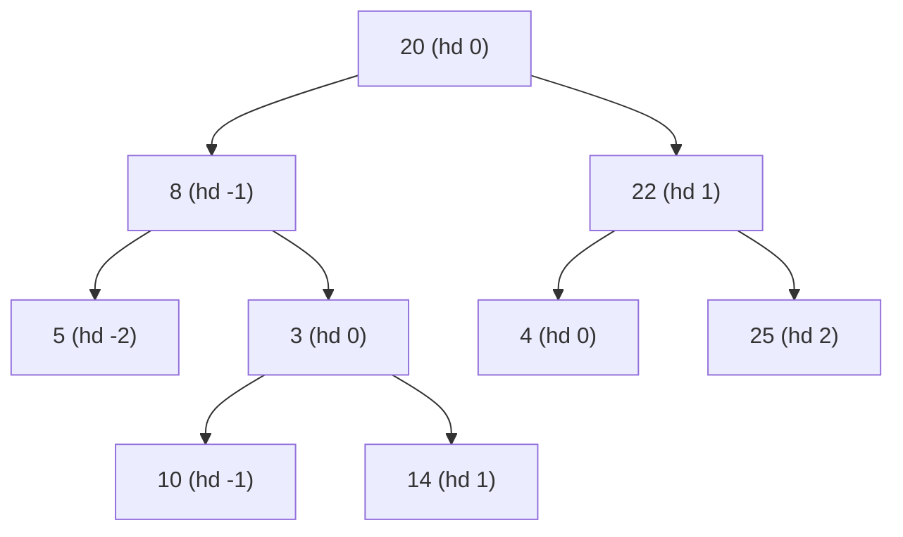

# Tree Construction and Views

> **Estimated Time:** 5 hr | **Difficulty:** Intermediate
> **Prerequisites:** [01 - Recursion](../../02-intermediate/01-recursion/README.md), [10 - Stack and Queue](../../01-core-linear/10-stack-and-queue/README.md), [01 - Binary Tree Traversals](../01-binary-tree-traversals/README.md)

---

## What You'll Learn
- You can print the left, right, top, bottom and vertical views of a tree using BFS with a column number.
- You can rebuild a tree from two traversals (pre+in, in+post, pre+post) in O(n).
- You can turn a tree into a string and back (serialize / deserialize), and build a tree from a level array.
- You can reshape trees in place: flatten to a list, connect next pointers, fix the children sum.
- You can solve "distance" problems (K away, burn time) by treating the tree as a graph.

## The Big Idea
Think of a tree as a building seen from different sides. Standing on the left you see the first window of every floor. Looking from above you see the roof of each vertical strip. Looking from below you see the floor of each strip. All "views" are the same tree, just read with a different rule.

Construction is the reverse game. Someone gives you the guest list in two different orders (for example "who arrived first" and "who sits left to right"). You must rebuild the seating plan. One order tells you the root, the other tells you where the left side ends.

Interviewers love this chapter because it checks three things at once: do you know the traversals deeply, can you pick BFS vs DFS on purpose, and can you carry extra information (depth, column, index) through a recursion without a mess.

## How to Spot It
| If the problem says ... | think ... |
|---|---|
| "visible from the right / left" | BFS, take last / first of each level (or DFS with depth) |
| "top view", "bottom view", "vertical order" | BFS (or DFS) carrying a column number, a map keyed by column |
| "construct from two traversals" | one gives the root, the other splits left and right; use a value -> index map |
| "serialize", "to string and back" | BFS or preorder with explicit `null` markers |
| "flatten", "in place", "O(1) space" | Morris-like rewiring: link the rightmost node of the left part |
| "next right pointer" | walk level by level using the next pointers you already built |
| "width of a tree" | give nodes heap indexes (2i, 2i+1) and compare first vs last per level |
| "distance K", "time to burn / infect" | add parent links, then BFS outward in 3 directions |
| "complete tree" | BFS; after the first gap no real node may appear |

## Core Concepts / Template

#### 1. Level-by-level BFS (the base of every view)
Take `size = queue length - head` at the start of each round. Exactly `size` nodes belong to this level.

The full code is in problem 1 below. Reuse it as your template.

#### 2. BFS with a column number
Push `[node, hd]`. Left child gets `hd - 1`, right gets `hd + 1`. A `Map` from column to value gives top view (first write wins) or bottom view (last write wins). Sort the keys at the end.

#### 3. Build from traversals
- Preorder: root first. Postorder: root last. Inorder: left, root, right.
- Find the root in inorder: everything left of it is the left subtree, everything right is the right subtree.
- Put inorder values in a `Map` (value -> index) so each lookup is O(1). Without it, the total is O(n^2).
- Keep one moving pointer into preorder (or postorder) instead of slicing arrays. Slicing copies and makes it O(n^2).

#### 4. Tree as a graph
A tree only points downward. To go up you need the parent. One DFS fills `Map(node -> parent)`. After that a plain BFS over `left, right, parent` with a `seen` set works like graph BFS.

#### 5. One picture
Why top view needs BFS and not plain DFS: two nodes can share a column, and the one closer to the root must win.






Column 0 holds 20, 3 and 4. Top view picks 20 (smallest depth). Bottom view picks 4 (last seen in BFS at the deepest level, left to right).

The `TreeNode` class used in all code below:

```js
class TreeNode {
  constructor(val, left = null, right = null) { this.val = val; this.left = left; this.right = right; }
}
```

## Problems (easy -> hard)

### 1. Binary Tree Level Order Traversal II (Bottom-Up) — Easy
**Companies:** Amazon, Microsoft, Bloomberg
**Problem:** Return the node values level by level, but from the deepest level up to the root. Example: `[3,9,20,null,null,15,7]` -> `[[15,7],[9,20],[3]]`.
**Intuition:** The normal level order is already correct inside each level. Only the order of the levels flips.
**Approach 1 - Brute force:** Do normal level order, then `unshift` each level at the front. Time O(n^2) in the worst case because `unshift` shifts all items.
**Approach 2 - Optimal:** Do normal BFS, push each level, and `reverse()` once at the end. Time O(n), Space O(n).

Trace: levels collected `[[3],[9,20],[15,7]]` -> reverse -> `[[15,7],[9,20],[3]]`.

```js
function levelOrderBottom(root) {
  const res = [];
  if (!root) return res;
  const q = [root];
  for (let head = 0; head < q.length; ) {
    const size = q.length - head, level = [];
    for (let i = 0; i < size; i++) {
      const n = q[head++];
      level.push(n.val);
      if (n.left) q.push(n.left);
      if (n.right) q.push(n.right);
    }
    res.push(level);
  }
  return res.reverse();
}
```

**Complexity:** Time O(n), Space O(n).
**Watch out:** Empty tree returns `[]`. Do not call `queue.shift()` in a hot loop on huge inputs.

### 2. Convert Sorted Array to Height-Balanced BST — Easy
**Companies:** Amazon, Meta, Microsoft, Apple
**Problem:** Build a BST from a sorted array so that left and right heights differ by at most 1. Example: `[-10,-3,0,5,9]` -> root 0 (or -3, both valid).
**Intuition:** The middle element as root splits the rest into two equal halves. Inorder of a BST is sorted, so the array is the inorder; picking the middle keeps it balanced.
**Approach 1 - Brute force:** Insert elements one by one into a BST. Sorted input gives a linked list of height n. Bad.
**Approach 2 - Optimal:** Recursively pick `mid`, build left from `[lo, mid-1]`, right from `[mid+1, hi]`.

Trace `[1,2,3,4]`: lo=0,hi=3 -> mid=1 (value 2) -> left `[1]`, right `[3,4]` -> mid of right = 3 -> left none, right 4.

```js
function sortedArrayToBST(nums) {
  const build = (lo, hi) => {
    if (lo > hi) return null;
    const mid = (lo + hi) >> 1;
    return new TreeNode(nums[mid], build(lo, mid - 1), build(mid + 1, hi));
  };
  return build(0, nums.length - 1);
}
```

**Complexity:** Time O(n), Space O(log n) recursion.
**Watch out:** For even lengths there are two valid answers. Do not slice the array each time (O(n log n) copying).

### 3. Binary Tree Right Side View (and Left Side View) — Medium
**Companies:** Meta, Amazon, Microsoft, Google
**Problem:** Return the values you see standing on the right side, top to bottom. Example: `[1,2,3,null,5,null,4]` -> `[1,3,4]`.
**Intuition:** On each level the visible node is the last one (right view) or the first one (left view). A hidden left node can still be visible if the right side is shorter.
**Approach 1 - Brute force:** BFS all levels, take the last value of each. Time O(n), Space O(n).
**Approach 2 - Optimal:** DFS visiting right child first. The first node you reach at a new depth is the visible one: if `depth === res.length`, record it. Swap the visit order for the left view. Space O(h).

Trace on `[1,2,3,null,5,null,4]`: visit 1 (depth 0, record 1) -> right 3 (depth 1, record 3) -> right 4 (depth 2, record 4) -> back, left side 2 (depth 1, already have), 5 (depth 2, already have). Result `[1,3,4]`.

```js
function rightSideView(root) {
  const res = [];
  (function dfs(n, d) {
    if (!n) return;
    if (d === res.length) res.push(n.val); // first node seen at this depth
    dfs(n.right, d + 1);
    dfs(n.left, d + 1);
  })(root, 0);
  return res;
}
// Left view: same code, call dfs(n.left) first, then dfs(n.right).
```

**Complexity:** Time O(n), Space O(h) for recursion (h = height).
**Watch out:** Do not walk only the right edge. For `[1,2,3,4]` the right view is `[1,3,4]`, and 4 is a left child.

### 4. Top View of Binary Tree — Medium
**Companies:** Amazon, Microsoft, Flipkart, Adobe
**Problem:** Return the nodes visible when you look from above, left to right. Example: tree in the picture above -> `[5, 8, 20, 22, 25]`.
**Intuition:** Give every node a column. For each column, the node nearest to the root hides the others. BFS reaches nodes in order of depth, so the first node you meet in a column is the answer for it.
**Approach 1 - Brute force:** DFS storing `(depth, value)` per column, keep the smaller depth. Works, but ties at equal depth need care.
**Approach 2 - Optimal:** BFS with `[node, hd]`. Write to the map only if the column is new. Sort columns at the end (or track min and max column).

Trace (BFS order): 20(0) new, 8(-1) new, 22(1) new, 5(-2) new, 3(0) skip, 4(0) skip, 25(2) new, ... Sorted columns -2..2 -> `[5,8,20,22,25]`.

```js
function topView(root) {
  if (!root) return [];
  const seen = new Map(); // hd -> val
  const q = [[root, 0]];
  for (let h = 0; h < q.length; h++) {
    const [n, hd] = q[h];
    if (!seen.has(hd)) seen.set(hd, n.val); // first one at this column wins
    if (n.left) q.push([n.left, hd - 1]);
    if (n.right) q.push([n.right, hd + 1]);
  }
  return [...seen.keys()].sort((a, b) => a - b).map(k => seen.get(k));
}
```

**Complexity:** Time O(n log n) because of sorting the columns (O(n) if you track min/max column), Space O(n).
**Watch out:** Plain DFS (preorder) is wrong here: it may visit a deep node of a column before a shallow one.

### 5. Bottom View of Binary Tree — Medium
**Companies:** Amazon, Microsoft, Flipkart, Samsung
**Problem:** Return the nodes visible from below, left to right. Same tree -> `[5, 10, 4, 14, 25]`.
**Intuition:** Same as top view, but now the deepest node of a column wins. In BFS later means deeper (or same depth and more to the right), so just overwrite.
**Approach 1 - Brute force:** DFS keeping the max depth per column.
**Approach 2 - Optimal:** BFS, always `set` the column. Last write wins.

Trace: column 0 is written by 20, then 3, then 4 -> final 4. Column -1 gets 8, then 10 -> 10. Column 1 gets 22, then 14 -> 14.

```js
function bottomView(root) {
  if (!root) return [];
  const seen = new Map();
  const q = [[root, 0]];
  for (let h = 0; h < q.length; h++) {
    const [n, hd] = q[h];
    seen.set(hd, n.val); // later one overwrites
    if (n.left) q.push([n.left, hd - 1]);
    if (n.right) q.push([n.right, hd + 1]);
  }
  return [...seen.keys()].sort((a, b) => a - b).map(k => seen.get(k));
}
```

**Complexity:** Time O(n log n) (O(n) with min/max column), Space O(n).
**Watch out:** When two nodes share the same column and depth, the usual rule is "the later one in left-to-right BFS wins". Ask the interviewer which tie rule they want.

### 6. Vertical Order Traversal of a Binary Tree — Hard
**Companies:** Meta, Amazon, Google, Microsoft, Uber
**Problem:** Group nodes by column, left to right. Inside a column order by row (top to bottom); if row ties, by value. Example: `[3,9,20,null,null,15,7]` -> `[[9],[3,15],[20],[7]]`.
**Intuition:** Every node is a triple `(col, row, val)`. Sorting the triples by that exact priority gives the answer. Then cut the sorted list whenever the column changes.
**Approach 1 - Brute force:** Collect triples with any traversal, sort, group. Time O(n log n), Space O(n).
**Approach 2 - Optimal:** The triple sort above is simple and safe. If ties do not matter (the easier "vertical order" version), BFS with `Map(col -> list)` is O(n) apart from sorting the columns. With the value tie-break you cannot easily beat n log n.

Trace on `[1,2,3,4,5,6,7]`: triples `(0,0,1) (-1,1,2) (1,1,3) (-2,2,4) (0,2,5) (0,2,6) (2,2,7)`. Sorted by col: -2:[4], -1:[2], 0:[1,5,6] (5 and 6 tie on row, smaller value first), 1:[3], 2:[7].

```js
function verticalTraversal(root) {
  const nodes = []; // [col, row, val]
  (function dfs(n, r, c) {
    if (!n) return;
    nodes.push([c, r, n.val]);
    dfs(n.left, r + 1, c - 1);
    dfs(n.right, r + 1, c + 1);
  })(root, 0, 0);
  nodes.sort((a, b) => a[0] - b[0] || a[1] - b[1] || a[2] - b[2]);
  const res = [];
  let prev = null;
  for (const [c, , v] of nodes) {
    if (c !== prev) { res.push([]); prev = c; }
    res[res.length - 1].push(v);
  }
  return res;
}
```

**Complexity:** Time O(n log n), Space O(n).
**Watch out:** JS `sort()` without a comparator sorts as strings. Always pass a numeric comparator. Do not sort by row only inside the same column and forget the value tie-break.

### 7. Check Completeness of a Binary Tree — Medium
**Companies:** Amazon, Google, Microsoft
**Problem:** A complete tree has all levels full except possibly the last, which is filled left to right. Return true/false. Example: `[1,2,3,4,5,6]` -> true; `[1,2,3,4,5,null,7]` -> false.
**Intuition:** Read the tree level by level including `null` slots. In a complete tree all `null`s come after all real nodes. One real node after a `null` means a hole.
**Approach 1 - Brute force:** Number nodes as a heap (root 1, children 2i, 2i+1); complete iff the max index equals node count. Time O(n), Space O(n) (careful: huge indexes in skewed trees).
**Approach 2 - Optimal:** BFS that also enqueues `null` children. Once a `null` is seen, any later real node returns false.

Trace `[1,2,3,4,5,null,7]`: queue order 1,2,3,4,5,null,7 -> at 7 `seenNull` is true -> false.

```js
function isCompleteTree(root) {
  if (!root) return true;
  const q = [root];
  let seenNull = false;
  for (let h = 0; h < q.length; h++) {
    const n = q[h];
    if (!n) { seenNull = true; continue; }
    if (seenNull) return false; // a real node after a gap
    q.push(n.left, n.right);
  }
  return true;
}
```

**Complexity:** Time O(n), Space O(n).
**Watch out:** Complete is not the same as full or perfect. A tree with only a left child under a node is still complete if it is on the last level.

### 8. Children Sum Property — Medium
**Companies:** Amazon, Microsoft, Adobe, Flipkart
**Problem:** Change the tree so every non-leaf node equals the sum of its children. You may only increase values (classic version). Example: `[2,35,10,2,3,5,2]` becomes a tree where each parent equals its children's sum.
**Intuition:** Going down, if the children's sum is smaller than the parent, push the parent value into the children (this only increases them). If the sum is already bigger, raise the parent. Going back up, set each parent to the exact sum of its (now fixed) children.
**Approach 1 - Check only:** If the question is just "does it hold", recurse and compare `val === l + r` at every non-leaf. Time O(n).
**Approach 2 - Optimal (modify):** On the way down fix children; on the way up fix the parent. Time O(n), Space O(h).

Trace: root 50 with children 7 and 2 (both leaves). Sum 9 < 50 -> set both children to 50. Leaves need nothing more. On the way back the root becomes 50 + 50 = 100. Parent equals the sum and no value was decreased.

```js
function childrenSum(root) {
  if (!root) return;
  const kids = (root.left ? root.left.val : 0) + (root.right ? root.right.val : 0);
  if (kids >= root.val) root.val = kids;
  else { if (root.left) root.left.val = root.val; if (root.right) root.right.val = root.val; }
  childrenSum(root.left);
  childrenSum(root.right);
  // children may have grown, so recompute the parent
  if (root.left || root.right) root.val = (root.left ? root.left.val : 0) + (root.right ? root.right.val : 0);
}
```

**Complexity:** Time O(n), Space O(h).
**Watch out:** A leaf always satisfies the property. Missing children count as 0. If the problem allows decreasing, a different (simpler) answer exists, so ask which version it is.

### 9. Construct Binary Tree from Preorder and Inorder — Medium
**Companies:** Amazon, Meta, Microsoft, Google, Bloomberg
**Problem:** Given `preorder` and `inorder` of a tree with unique values, rebuild the tree. Example: `pre=[3,9,20,15,7]`, `in=[9,3,15,20,7]` -> `[3,9,20,null,null,15,7]`.
**Intuition:** The first preorder value is the root. Its position in inorder cuts the rest into left and right parts. Preorder visits the whole left part before the right part, so a moving pointer into preorder always lands on the next root.
**Approach 1 - Brute force:** For each root, linearly search inorder and slice arrays. Time O(n^2).
**Approach 2 - Optimal:** `Map(value -> inorder index)`, one shared pointer `p` into preorder, recursion on inorder bounds `[lo, hi]`. Build left before right.

Trace: p=0 root 3 (in idx 1) -> left range [0,0]: p=1 root 9 -> its children ranges empty -> right range [2,4]: p=2 root 20 (idx 3) -> left [2,2] p=3 root 15 -> right [4,4] p=4 root 7.

```js
function buildTreePreIn(preorder, inorder) {
  const pos = new Map(inorder.map((v, i) => [v, i]));
  let p = 0;
  const build = (lo, hi) => {
    if (lo > hi) return null;
    const node = new TreeNode(preorder[p++]);
    const m = pos.get(node.val);
    node.left = build(lo, m - 1);   // left must be built first
    node.right = build(m + 1, hi);
    return node;
  };
  return build(0, inorder.length - 1);
}
```

**Complexity:** Time O(n), Space O(n) for the map plus O(h) stack.
**Watch out:** Values must be unique, or the map is wrong. Building right before left breaks the pointer order. A skewed tree of 10^5 nodes can overflow the JS call stack; mention an iterative version if asked.

### 10. Construct Binary Tree from Inorder and Postorder — Medium
**Companies:** Amazon, Microsoft, Google, Bloomberg
**Problem:** Rebuild the tree from `inorder` and `postorder`. Example: `in=[9,3,15,20,7]`, `post=[9,15,7,20,3]` -> `[3,9,20,null,null,15,7]`.
**Intuition:** Postorder is left, right, root, so the LAST value is the root. Read postorder backwards and you get root, right, left. So build the right subtree first.
**Approach 1 - Brute force:** Slice arrays and linear search. O(n^2).
**Approach 2 - Optimal:** Same as the previous problem, but pointer `p` starts at the end and moves left, and you build `right` before `left`.

Trace: p=4 root 3 (in idx 1) -> right range [2,4]: p=3 root 20 (idx 3) -> right [4,4]: p=2 root 7 -> left [2,2]: p=1 root 15 -> back to root's left [0,0]: p=0 root 9.

```js
function buildTreeInPost(inorder, postorder) {
  const pos = new Map(inorder.map((v, i) => [v, i]));
  let p = postorder.length - 1;
  const build = (lo, hi) => {
    if (lo > hi) return null;
    const node = new TreeNode(postorder[p--]);
    const m = pos.get(node.val);
    node.right = build(m + 1, hi); // right first
    node.left = build(lo, m - 1);
    return node;
  };
  return build(0, inorder.length - 1);
}
```

**Complexity:** Time O(n), Space O(n).
**Watch out:** The classic bug is building left first. Remember: preorder pointer goes forward and builds left first; postorder pointer goes backward and builds right first.

### 11. Construct Binary Tree from Preorder and Postorder (Full Tree) — Medium
**Companies:** Google, Amazon, Microsoft
**Problem:** Rebuild a tree from `preorder` and `postorder`. Without inorder the answer is unique only for a full tree (every node has 0 or 2 children); for others LeetCode accepts any valid tree. Example: `pre=[1,2,4,5,3,6,7]`, `post=[4,5,2,6,7,3,1]` -> perfect tree of 7.
**Intuition:** `pre[0]` is the root. `pre[1]` is the root of the left subtree. Find it in postorder: everything up to and including it belongs to the left subtree. That gives the left size.
**Approach 1 - Brute force:** Linear search for `pre[1]` in postorder at each step. O(n^2).
**Approach 2 - Optimal:** Map value -> postorder index. Recursion on a preorder range `[pl, pr]` and the postorder start `ql`: `leftSize = pos(pre[pl+1]) - ql + 1`.

Trace on the 7-node example: root 1, `pre[1]=2` sits at post index 2, `ql=0` -> leftSize 3 -> left uses `pre[1..3]`, right uses `pre[4..6]`. Repeat.

```js
function buildTreePrePost(preorder, postorder) {
  const pos = new Map(postorder.map((v, i) => [v, i]));
  const build = (pl, pr, ql) => { // pre[pl..pr], post range starts at ql
    if (pl > pr) return null;
    const node = new TreeNode(preorder[pl]);
    if (pl === pr) return node;
    const leftSize = pos.get(preorder[pl + 1]) - ql + 1;
    node.left = build(pl + 1, pl + leftSize, ql);
    node.right = build(pl + leftSize + 1, pr, ql + leftSize);
    return node;
  };
  return build(0, preorder.length - 1, 0);
}
```

**Complexity:** Time O(n), Space O(n).
**Watch out:** If a node has one child, pre and post cannot tell left from right. This code then treats it as a left child, which is a valid answer on LeetCode. Say this out loud in an interview.

### 12. Construct Tree from Level Order — Medium
**Companies:** Amazon, Microsoft, Meta
**Problem:** Build a tree from a level-order array where missing nodes are `null` (the LeetCode input format). Example: `[1,2,3,null,4]` -> 1 with children 2 and 3; 2 has right child 4.
**Intuition:** Every real node, in the order BFS finds it, takes the next two array slots as its left and right child. A queue remembers whose turn it is. (This is also how you create test trees. For a BST given in level order, insert each value in order with the standard BST insert: O(n h).)
**Approach 1 - Brute force (complete tree only):** If there are no `null`s, children of index `i` are `2i+1` and `2i+2`. Fails when `null` slots are skipped.
**Approach 2 - Optimal:** Queue of nodes waiting for children; read two array items per node.

Trace `[1,2,3,null,4]`: root 1, queue [1]. Take 1: slots 2,3 -> children. Take 2: slots `null`,4 -> left none, right 4. Done.

```js
function buildFromLevelArray(arr) {
  if (!arr.length || arr[0] === null) return null;
  const root = new TreeNode(arr[0]);
  const q = [root];
  let i = 1;
  for (let h = 0; h < q.length && i < arr.length; h++) {
    const n = q[h];
    if (i < arr.length && arr[i] !== null) { n.left = new TreeNode(arr[i]); q.push(n.left); }
    i++;
    if (i < arr.length && arr[i] !== null) { n.right = new TreeNode(arr[i]); q.push(n.right); }
    i++;
  }
  return root;
}
```

**Complexity:** Time O(n), Space O(n).
**Watch out:** A `null` takes a slot but creates no node, and its (non-existent) children take NO slots. That is the part people get wrong with the `2i+1` formula.

### 13. Serialize and Deserialize Binary Tree — Hard
**Companies:** Meta, Amazon, Google, Microsoft, LinkedIn
**Problem:** Turn a tree into a string and rebuild the exact same tree from that string. Example: tree `[1,2,3,null,null,4,5]` -> `"1,2,3,null,null,4,5,null,null,null,null"` -> same tree.
**Intuition:** One traversal is not enough to define a tree, but a traversal that also writes `null` for every missing child is. The `null` markers tell the reader where each branch ends.
**Approach 1 - Brute force:** Store inorder and preorder together (needs unique values, doubles the size).
**Approach 2 - Better:** Preorder DFS with `null` markers, rebuilt with a pointer. Short, but deep recursion on skewed trees.
**Approach 3 - Optimal:** BFS with `null` markers (same format as LeetCode). Deserialize with the same queue trick as in problem 12.

Trace: tree 1 -> (2, 3). Serialize: queue 1, 2, 3, then null, null (kids of 2), null, null (kids of 3). Output `1,2,3,null,null,null,null`.

```js
function serialize(root) {
  const out = [];
  const q = [root];
  for (let h = 0; h < q.length; h++) {
    const n = q[h];
    if (!n) { out.push("null"); continue; }
    out.push(String(n.val));
    q.push(n.left, n.right);
  }
  return out.join(",");
}
function deserialize(data) {
  const t = data.split(",");
  if (t[0] === "null") return null;
  const root = new TreeNode(Number(t[0]));
  const q = [root];
  let i = 1;
  for (let h = 0; h < q.length; h++) {
    const n = q[h];
    if (t[i] !== "null") { n.left = new TreeNode(Number(t[i])); q.push(n.left); }
    i++;
    if (t[i] !== "null") { n.right = new TreeNode(Number(t[i])); q.push(n.right); }
    i++;
  }
  return root;
}
```

**Complexity:** Time O(n), Space O(n).
**Watch out:** Use a delimiter (`,`) because values can have many digits or be negative. Convert back with `Number`, not `parseInt` on the whole string. Empty tree must round-trip too (`"null"`).

### 14. Construct Binary Tree from String, and Print Binary Tree — Medium
**Companies:** Meta, Amazon, Google
**Problem (a):** Parse `"4(2(3)(1))(6(5))"` into a tree: an integer, then an optional `(left)` then optional `(right)`. **Problem (b):** Print a tree in a grid, root in the middle of the top row, each child centred under its parent (LeetCode "Print Binary Tree").
**Intuition (a):** The string itself is recursive. Read a number, then if you see `(` parse a subtree, skip `)`, and repeat once for the right side. **(b):** A tree of height `h` fits in a grid `h` rows by `2^h - 1` columns. A node's column is the middle of its allowed range; children get the left and right halves.
**Approach 1 - Brute force (a):** Use a stack and scan character by character. Works, but more bookkeeping.
**Approach 2 - Optimal (a):** Recursive descent with one shared index `i`. For (b) use recursion with column bounds.

Trace (a) on `"1(2)(3)"`: read 1 -> see `(` -> parse 2 -> skip `)` -> see `(` -> parse 3 -> skip `)`.

```js
function str2tree(s) {
  let i = 0;
  const parse = () => {
    let j = i;
    if (s[j] === "-") j++;
    while (j < s.length && s[j] >= "0" && s[j] <= "9") j++;
    if (j === i) return null; // empty slot like "()" or end of string
    const node = new TreeNode(Number(s.slice(i, j)));
    i = j;
    if (s[i] === "(") { i++; node.left = parse(); i++; } // skip ( and )
    if (s[i] === "(") { i++; node.right = parse(); i++; }
    return node;
  };
  return parse();
}

function printTree(root) {
  const height = (n) => (n ? 1 + Math.max(height(n.left), height(n.right)) : 0);
  const h = height(root), w = 2 ** h - 1;
  const grid = Array.from({ length: h }, () => Array(w).fill(""));
  (function fill(n, r, lo, hi) {
    if (!n) return;
    const mid = (lo + hi) >> 1;
    grid[r][mid] = String(n.val);
    fill(n.left, r + 1, lo, mid - 1);
    fill(n.right, r + 1, mid + 1, hi);
  })(root, 0, 0, w - 1);
  return grid;
}
```

**Complexity:** (a) Time O(n), Space O(h). (b) Time O(h * 2^h) to build the grid, Space the same.
**Watch out:** Negative numbers need the `-` check. A tree with only a right child is written `1()(3)`, so the empty `()` must produce `null`. Use `Array.from` for the grid; `Array(h).fill([])` shares one row.

### 15. Flatten Binary Tree to Linked List — Medium
**Companies:** Meta, Amazon, Microsoft, Google, Bloomberg
**Problem:** In place, turn the tree into a "linked list" using the right pointers in preorder order; all left pointers become null. Example: `[1,2,5,3,4,null,6]` -> `1->2->3->4->5->6`.
**Intuition:** The node that comes right before `cur.right` in preorder is the rightmost node of `cur.left`. Hook the old right subtree onto it, then slide the left subtree to the right.
**Approach 1 - Brute force:** Preorder into an array, then rewire each node. O(n) extra space.
**Approach 2 - Better:** Recursion that flattens right, then left, using a `prev` pointer (reverse postorder). O(h) space.
**Approach 3 - Optimal:** Iterative, Morris-style, O(1) extra space: for each `cur` with a left child, find the rightmost of the left subtree, attach `cur.right` there, move left to right, null the left.

Trace on `1(2(3,4),5(,6))`: cur=1, rightmost of left (2's subtree) is 4 -> 4.right=5, 1.right=2, 1.left=null. Move to 2: rightmost of its left is 3 -> 3.right=4, 2.right=3. Then 3, 4, 5, 6 have no left kid. List 1,2,3,4,5,6.

```js
function flatten(root) {
  let cur = root;
  while (cur) {
    if (cur.left) {
      let p = cur.left;
      while (p.right) p = p.right; // rightmost of left subtree
      p.right = cur.right;
      cur.right = cur.left;
      cur.left = null;
    }
    cur = cur.right;
  }
}
```

**Complexity:** Time O(n) (each edge walked a constant number of times), Space O(1).
**Watch out:** Set `cur.left = null` or the checker sees a cycle-like mess. Do not lose `cur.right` before saving it on `p.right`.

### 16. Populating Next Right Pointers in Each Node (I and II) — Medium
**Companies:** Meta, Amazon, Microsoft, Bloomberg
**Problem:** Each node has an extra `next` field. Set it to the node on its right at the same level (or leave `undefined`/null at the end of the level). I: perfect tree. II: any tree. Example: `[1,2,3,4,5,null,7]` -> 2.next=3, 4.next=5, 5.next=7.
**Intuition:** When you are on level L and its `next` links already exist, you can walk across level L like a linked list. While walking, you link the children (level L+1) together. No queue needed.
**Approach 1 - Brute force:** BFS level by level, link neighbours. Time O(n), Space O(n).
**Approach 2 - Optimal:** Level walker with a dummy head. For each node on the current level, append its non-null children to a growing chain starting at `dummy`. The next level starts at `dummy.next`. This single code solves both I and II. Space O(1).

Trace on `[1,2,3,4,5,null,7]`: level 0 = [1] -> chain: 2 -> 3. Level 1 walk 2 then 3: chain 4 -> 5 -> 7. Level 2 has no children -> stop.

```js
function connect(root) {
  let head = root;
  while (head) {
    const dummy = new TreeNode(0);
    let tail = dummy;
    for (let n = head; n; n = n.next) {
      if (n.left) { tail.next = n.left; tail = tail.next; }
      if (n.right) { tail.next = n.right; tail = tail.next; }
    }
    head = dummy.next;
  }
  return root;
}
```

**Complexity:** Time O(n), Space O(1) (the recursion-free loop; the output is in the nodes themselves).
**Watch out:** The "perfect tree" shortcut (`left.next = right`, `right.next = parent.next.left`) breaks on problem II. A fresh `dummy` per level also resets old pointers. Fresh nodes have `next` undefined in JS, which counts as the end.

### 17. Maximum Width of Binary Tree — Medium
**Companies:** Amazon, Meta, Microsoft, Google
**Problem:** The width of a level is the distance between its leftmost and rightmost real nodes, counting the empty slots between them. Return the maximum width. Example: `[1,3,2,5,null,null,9,6,null,7]` -> 7.
**Intuition:** Number the nodes like a heap: root 0, children `2i` and `2i+1`. Then width of a level = `last - first + 1`.
**Approach 1 - Brute force:** Fill the whole tree with `null`s up to the last level and count. Memory explodes (2^height).
**Approach 2 - Optimal:** BFS storing `[node, index]`. At each level subtract the first index from all indexes before doubling, so numbers stay small. Use BigInt, because a skewed tree of height > ~1000 makes the plain number `Infinity`.

Trace `[1,3,2,5,3,null,9]`: level 0 idx 0 -> width 1. Level 1: indexes 0,1 -> 2. Level 2: 5(0), 3(1), 9(3) -> 3-0+1 = 4. Answer 4.

```js
function widthOfBinaryTree(root) {
  if (!root) return 0;
  let best = 0n, level = [[root, 0n]];
  while (level.length) {
    const first = level[0][1];
    const last = level[level.length - 1][1];
    if (last - first + 1n > best) best = last - first + 1n;
    const next = [];
    for (const [n, idx] of level) {
      const k = idx - first; // shift so numbers stay small
      if (n.left) next.push([n.left, 2n * k]);
      if (n.right) next.push([n.right, 2n * k + 1n]);
    }
    level = next;
  }
  return Number(best);
}
```

**Complexity:** Time O(n), Space O(w) for the widest level (BigInt keeps values exact).
**Watch out:** Many accepted C++/Java answers rely on 32/64-bit overflow behaviour. In JS use the offset trick (and BigInt) for deep, thin trees. In an interview, the offset trick alone is the expected answer.

### 18. All Nodes Distance K in Binary Tree — Medium
**Companies:** Meta, Amazon, Google, Microsoft, Uber
**Problem:** Given a tree, a target node and an integer `k`, return all values exactly `k` edges from the target. Example: tree `[3,5,1,6,2,0,8,null,null,7,4]`, target 5, k=2 -> `[7,4,1]`.
**Intuition:** Nodes at distance k can be below the target, or above it (through the parent) and then down a different branch. Tree nodes do not know their parent, so give them one. Then it is plain BFS on an undirected graph.
**Approach 1 - Brute force:** For every node compute its distance to the target with LCA. Time O(n^2) or heavy code.
**Approach 2 - Optimal:** One DFS builds `parent`. BFS from the target for exactly `k` rounds, moving to left, right and parent, with a `seen` set. The last frontier is the answer.

Trace target 5, k=2: frontier [5] -> round 1: [6,2,3] (its two kids and its parent) -> round 2: 6 adds nothing, 2 adds 7 and 4, 3 adds 1 -> `[7,4,1]`.

```js
function distanceK(root, target, k) {
  const parent = new Map();
  (function dfs(n, p) {
    if (!n) return;
    parent.set(n, p);
    dfs(n.left, n);
    dfs(n.right, n);
  })(root, null);
  const seen = new Set([target]);
  let frontier = [target];
  for (let d = 0; d < k && frontier.length; d++) {
    const next = [];
    for (const n of frontier)
      for (const m of [n.left, n.right, parent.get(n)])
        if (m && !seen.has(m)) { seen.add(m); next.push(m); }
    frontier = next;
  }
  return frontier.map(n => n.val);
}
```

**Complexity:** Time O(n), Space O(n).
**Watch out:** The target is a node reference, not a value (LeetCode passes the node). Without `seen` you walk back to where you came from. k=0 returns `[target.val]`. If the frontier empties early the result is `[]`.

### 19. Minimum Time to Burn a Binary Tree / Amount of Time to Infect — Medium
**Companies:** Amazon, Microsoft, Flipkart, Google
**Problem:** Fire starts at the node with value `start`. Every minute it spreads to all neighbours (left, right, parent). Return the minutes until the whole tree burns. Example: `[1,5,3,null,4,10,6,9,2]`, start=3 -> 4.
**Intuition:** It is the same graph as the previous problem. The answer is the largest BFS distance from `start`, i.e. the number of BFS rounds minus one.
**Approach 1 - Brute force:** For each node compute the distance to start through the LCA. Complicated, O(n^2) worst case.
**Approach 2 - Optimal:** Parent map plus BFS from the start node. Count rounds; the first round contains only the start (minute 0).
(A single-DFS version without a parent map exists, but it is harder to explain.)

Trace start=3 (node 3 has kids 10, 6 and parent 1; 5 has right child 4; 4 has kids 9, 2): rounds are [3] -> [10,6,1] -> [5] -> [4] -> [9,2]. That is 5 rounds, so minutes = 4.

```js
function amountOfTime(root, start) {
  const parent = new Map();
  let src = null;
  (function dfs(n, p) {
    if (!n) return;
    parent.set(n, p);
    if (n.val === start) src = n;
    dfs(n.left, n);
    dfs(n.right, n);
  })(root, null);
  const seen = new Set([src]);
  let frontier = [src], minutes = -1;
  while (frontier.length) {
    minutes++;
    const next = [];
    for (const n of frontier)
      for (const m of [n.left, n.right, parent.get(n)])
        if (m && !seen.has(m)) { seen.add(m); next.push(m); }
    frontier = next;
  }
  return minutes;
}
```

**Complexity:** Time O(n), Space O(n).
**Watch out:** Start at `minutes = -1`, because minute 0 is the start node alone. Single node tree returns 0. Fire goes UP to the parent too, not only down.

## Common Mistakes
- **"Top view = look at the leftmost and rightmost paths."** Wrong. Nodes deep inside can still be the top node of their column. Use BFS with columns.
- **"DFS is fine for top view."** Wrong, DFS may reach a deep node of a column before a shallow one. Use BFS, or DFS storing the depth.
- **"Slicing arrays is fine when building from traversals."** It makes the build O(n^2). Use bounds plus a value -> index map.
- **"Build the left subtree first in the postorder version."** Wrong order. Postorder read backwards is root, right, left.
- **"Pre + post give a unique tree."** Only for full trees. With one-child nodes the shape is ambiguous.
- **"Level-order array index `2i+1` always works."** Not when `null` slots are skipped (LeetCode format). Use the queue method.
- **"`sort()` sorts numbers."** In JS the default sort is by string. Always pass `(a, b) => a - b`.

## Interview Tips
- Say first: "Is this a BST or any binary tree? Are values unique? Can the tree be empty or skewed?" Unique values decide whether the construction problems are even solvable.
- For views, say out loud: "I carry a column number with each node, left is minus one, right is plus one, and I use BFS so the shallower node is seen first."
- For construction, state the invariant: "Preorder gives the root, inorder tells me the left size. I use a map so each split is O(1)."
- Mention stack depth: recursive builders can hit the JS call stack limit on a 10^5-node skewed tree. Offer an iterative version only if asked.
- Common follow-ups: "Do it in O(1) extra space" (flatten via Morris-style rewiring, next pointers with level walking), "do it without a map" (use a pointer and an inorder value stop), "what if values repeat" (not uniquely buildable), "serialize a BST in a smaller form" (preorder only, no nulls, rebuild with bounds).
- Edge cases to name: empty tree, single node, skewed tree, negative values, k larger than the tree height, start node not found (clarify), duplicates.

## Practice List
**Easy**
- Invert Binary Tree
- Minimum Depth of Binary Tree
- Convert Sorted List to Binary Search Tree (the linked-list twin of problem 2)

**Medium**
- Average of Levels in Binary Tree
- Binary Tree Zigzag Level Order Traversal
- Find Bottom Left Tree Value
- Construct Binary Search Tree from Preorder Traversal
- Construct String from Binary Tree
- Binary Tree Vertical Order Traversal
- Serialize and Deserialize BST
- Populating Next Right Pointers in Each Node (the original perfect-tree version)

**Hard**
- Count Complete Tree Nodes (use the completeness shape to beat O(n))
- Recover Binary Search Tree

## Key Takeaways
- **Every view is BFS plus one extra number**: depth for left/right view, column for top, bottom and vertical views.
- **Top view keeps the first node per column, bottom view keeps the last**, in BFS order.
- **Preorder / postorder give the root, inorder gives the split**. A value -> index map makes the build O(n).
- **Preorder builds left then right; postorder (read backwards) builds right then left.**
- **Serialization needs null markers.** BFS with `null` is the LeetCode format and the easiest to rebuild.
- **Tree distance problems become graph BFS once you add parent pointers.**
- **Flatten and next-pointer problems reach O(1) space** by rewiring links you already own.

---
[← Previous: Binary Tree Traversals](../01-binary-tree-traversals/README.md) | [Next: Paths, LCA and Tree Properties →](../03-paths-lca-and-tree-properties/README.md) | [Back to Trees Index](../README.md)
