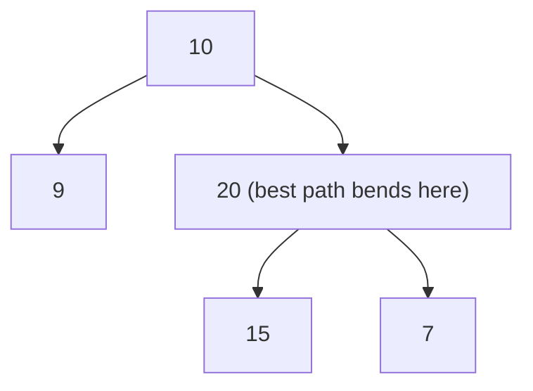

# Paths, LCA and Tree Properties

> **Estimated Time:** 4 hr | **Difficulty:** Intermediate
> **Prerequisites:** [01 - Binary Tree Traversals](../01-binary-tree-traversals/README.md), [02 - Tree Construction and Views](../02-tree-construction-and-views/README.md), [01 - Recursion](../../02-intermediate/01-recursion/README.md)

---

## What You'll Learn

- You can find and print root-to-node and root-to-leaf paths, and use backtracking to build them.
- You can solve the whole "path sum" family (I, II, III) and know when a prefix-sum map is needed.
- You can use the "return one thing, update another" pattern for diameter, max path sum, longest univalue path and cameras.
- You can find the lowest common ancestor (LCA) in a binary tree, in a BST, and with binary lifting.
- You can compare and fingerprint subtrees (same tree, subtree of another tree, duplicate subtrees).

## The Big Idea

Think of a family tree. To find the closest shared grandparent of two cousins, you ask each branch: "do you contain one of them?" If both branches say yes, you are standing on the answer. Many tree questions work like this. You ask each child a question, get a small answer back, and combine the answers at the current node.

Almost every problem here is a DFS where each call does two jobs:

1. **Return** a small value to the parent (a height, a gain, a status).
2. **Update** a global answer using what the children returned.

The value you return and the answer you record are often different things. That one idea solves diameter, max path sum, cameras and more.

Interviewers love this topic because it tests recursion thinking. Can you define exactly what a function returns, trust it for the children, and combine at the node? Weak candidates mix up "what I return" and "what I record". Strong candidates say it out loud first.

## How to Spot It

| If the problem says ... | think ... |
|---|---|
| "path from root to a node / to every leaf" | DFS with a `path` array, push before recursing, pop after (backtracking) |
| "root-to-leaf sum equals target" | pass the remaining sum down; check only at leaves |
| "path may start and end anywhere" | prefix sums with a hash map (Path Sum III), or "bent path" DP |
| "longest path / best path through a node" | return the best one-sided chain, update the answer with left + right |
| "lowest common ancestor" | post-order: a node is the LCA if both sides report a find |
| "BST" plus LCA | no recursion needed: walk down using the BST order |
| "compare two trees / is it a subtree" | recursion on both trees at once |
| "duplicate subtrees" | turn each subtree into a unique id (serialize it) and count ids |
| "minimum number of cameras / robbers" | return a small state (enum or pair), greedy or DP on states |
| "many LCA queries on a big tree" | binary lifting (or Euler tour plus sparse table) |

## Core Concepts / Template

Every tree here is built from this node:

```js
class TreeNode {
  constructor(val, left = null, right = null) {
    this.val = val; this.left = left; this.right = right;
  }
}
```

### Template 1: top-down (pass info DOWN)

Information flows from root to leaves as parameters: remaining sum, current number, maximum so far, the path so far.

```js
function topDown(root) {
  const path = [];
  function dfs(node, info) {
    if (!node) return;
    path.push(node.val);                 // choose
    if (!node.left && !node.right) {
      // leaf: use `info` / `path` here
    } else {
      dfs(node.left, /* new info */ info);
      dfs(node.right, /* new info */ info);
    }
    path.pop();                          // un-choose (backtrack)
  }
  dfs(root, 0);
}
```

Use it for: root-to-node, all paths, Path Sum I/II, Sum Root to Leaf Numbers, Good Nodes.

### Template 2: bottom-up (pass info UP), the "return one, update another" pattern

```js
function bottomUp(root) {
  let answer = 0;                        // the thing the problem asks for
  function dfs(node) {                   // returns the thing the PARENT needs
    if (!node) return 0;
    const l = dfs(node.left);
    const r = dfs(node.right);
    answer = Math.max(answer, l + r);    // best answer that BENDS at this node
    return 1 + Math.max(l, r);           // best one-sided chain to hand upward
  }
  dfs(root);
  return answer;
}
```

The key sentence: **a parent can only extend ONE child's chain, so we return one side, but the answer may use BOTH sides.**






In the tree above, the best path is 15 -> 20 -> 7. Node 20 can use both children for the answer, but when it reports upward to 10 it can only offer `20 + max(15, 7)`.

### Trace of Template 2 (diameter, height-based)

Tree: `1` with children `2` and `3`; `2` has children `4` and `5`.

| node | l | r | answer = max(answer, l+r) | returns 1+max(l,r) |
|---|---|---|---|---|
| 4 | 0 | 0 | 0 | 1 |
| 5 | 0 | 0 | 0 | 1 |
| 2 | 1 | 1 | 2 | 2 |
| 3 | 0 | 0 | 2 | 1 |
| 1 | 2 | 1 | 3 | 3 |

Diameter (in edges) is 3: path 4 -> 2 -> 1 -> 3.

## Problems (easy -> hard)

### 1. Maximum Depth of N-ary Tree — Easy
**Companies:** Amazon, Google, Meta
**Problem:** Each node has a list `children`. Return the number of nodes on the longest root-to-leaf path. Example: root 1 with children [3 (children 5, 6), 2, 4] -> 3.
**Intuition:** Same as binary tree depth. Ask every child for its depth, take the biggest, add 1.
**Approach 1 - Brute force:** BFS level by level, count levels. Time O(n), Space O(width).
**Approach 2 - Optimal:** DFS. Depth of a node = 1 + max depth of its children. A leaf has an empty loop, so it returns 1.

```js
function maxDepthN(root) { if (!root) return 0; let d = 0; for (const c of root.children) d = Math.max(d, maxDepthN(c)); return d + 1; }
```

**Complexity:** Time O(n), Space O(h) for recursion (h = height; up to n for a chain).
**Watch out:** An empty tree returns 0. Do not call `Math.max(...[])` on an empty children list (it gives `-Infinity`); a loop avoids that.

### 2. Minimum Depth of Binary Tree — Easy
**Companies:** Amazon, Meta, LinkedIn
**Problem:** Return the number of nodes on the shortest path from root to a LEAF. Example: [3,9,20,null,null,15,7] -> 2.
**Intuition:** It is tempting to copy max depth and swap `max` for `min`. That is wrong: a node with only one child is NOT a leaf, so the missing side must not count as depth 0.
**Approach 1 - Brute force:** Compute all root-to-leaf depths, take the min. Time O(n), Space O(h).
**Approach 2 - Optimal:** If one child is missing, only follow the other. If both exist, take the min. (BFS also works and stops at the first leaf.)

Trace on a right-leaning chain 2 -> 3 -> 4 -> 5 -> 6: each node has no left child, so we follow right: 1+1+1+1+1 = 5. (The naive version would say 1.)

```js
function minDepth(root) {
  if (!root) return 0;
  if (!root.left) return 1 + minDepth(root.right);
  if (!root.right) return 1 + minDepth(root.left);
  return 1 + Math.min(minDepth(root.left), minDepth(root.right));
}
```

**Complexity:** Time O(n), Space O(h).
**Watch out:** The "single child" case is the whole problem. The naive `1 + min(left, right)` gives 1 for a chain.

### 3. Sum of Left Leaves — Easy
**Companies:** Amazon, Meta, Google
**Problem:** Add up the values of all leaves that are the LEFT child of their parent. Example: [3,9,20,null,null,15,7] -> 9 + 15 = 24.
**Intuition:** A leaf cannot know if it is a left child. So the parent tells it, using a flag passed down.
**Approach 1 - Brute force:** Traverse, and at each node check `node.left` is a leaf. Time O(n), Space O(h).
**Approach 2 - Optimal:** Pass `isLeft` down. At a leaf return its value if `isLeft`, else 0.

```js
function sumOfLeftLeaves(root, isLeft = false) {
  if (!root) return 0;
  if (!root.left && !root.right) return isLeft ? root.val : 0;
  return sumOfLeftLeaves(root.left, true) + sumOfLeftLeaves(root.right, false);
}
```

**Complexity:** Time O(n), Space O(h).
**Watch out:** A lone root is a leaf but not a left child, so it adds 0.

### 4. Root to Node Path — Easy
**Companies:** Amazon, Microsoft, Flipkart
**Problem:** Given a root and a target value, return the values from root down to that node. Example: tree [1,2,3,4,5,null,6], target 5 -> [1,2,5]. Return `[]` if not found.
**Intuition:** Walk down, adding nodes to a path. If a branch does not contain the target, undo the step (backtrack). The function returns `true` the moment the target is found, so we stop without undoing.
**Approach 1 - Brute force:** Store a parent pointer for every node, then walk up from the target and reverse. Time O(n), Space O(n).
**Approach 2 - Optimal:** DFS with a shared `path` array. Push the node. If it is the target, or left or right found it, return true. Otherwise pop and return false.

Trace for target 5: push 1, push 2, push 4 (no), pop 4. push 5 -> found. Path = [1, 2, 5].

```js
function rootToNode(root, target) {
  const path = [];
  function dfs(n) {
    if (!n) return false;
    path.push(n.val);
    if (n.val === target || dfs(n.left) || dfs(n.right)) return true;
    path.pop(); return false;
  }
  return dfs(root) ? path : [];
}
```

**Complexity:** Time O(n), Space O(h).
**Watch out:** Pop only when the node is NOT on the answer path. If you pop on success you lose the path.

### 5. Binary Tree Paths (All Root-to-Leaf Paths) — Easy
**Companies:** Amazon, Google, Meta
**Problem:** Return every root-to-leaf path as a string like `"1->2->5"`. Example: [1,2,3,null,5] -> ["1->2->5","1->3"].
**Intuition:** This is Template 1. At a leaf, record the path. Then backtrack.
**Approach 1 - Brute force:** Build a new string or array copy at every call (passing `path + [x]`). Works, but copies a lot: Time O(n * h).
**Approach 2 - Optimal:** One shared array, push and pop. Join only at leaves.

```js
function binaryTreePaths(root) {
  const res = [], path = [];
  (function dfs(n) {
    if (!n) return;
    path.push(n.val);
    if (!n.left && !n.right) res.push(path.join('->'));
    else { dfs(n.left); dfs(n.right); }
    path.pop();
  })(root);
  return res;
}
```

**Complexity:** Time O(n * h) in the worst case (each leaf joins a path of length up to h), Space O(h) besides the output.
**Watch out:** Check for a leaf (`!left && !right`), not for `!node`. Otherwise you record each path twice (once per missing child).

### 6. Path Sum — Easy
**Companies:** Amazon, Microsoft, Meta
**Problem:** Is there a root-to-leaf path whose values add up to `target`? Example: [5,4,8,11,null,13,4,7,2,null,null,5,1], 22 -> true (5+4+11+2).
**Intuition:** Instead of adding up, subtract. Pass `target - node.val` down. At a leaf, the remaining value must equal the leaf's value.
**Approach 1 - Brute force:** Generate all paths, sum each. Time O(n * h), Space O(h).
**Approach 2 - Optimal:** DFS with remaining sum, short-circuit with `||`.

```js
function hasPathSum(n, t) {
  if (!n) return false;
  if (!n.left && !n.right) return n.val === t;
  return hasPathSum(n.left, t - n.val) || hasPathSum(n.right, t - n.val);
}
```

**Complexity:** Time O(n), Space O(h).
**Watch out:** Check the leaf condition. For tree `[1,2]` and target 1, the root has one child, so it is not a leaf and the answer is false. Also values can be negative, so you cannot stop early when the remainder goes below 0.

### 7. Path Sum II — Medium
**Companies:** Amazon, Meta, Microsoft
**Problem:** Return all root-to-leaf paths that add up to `target`. Same tree, target 22 -> [[5,4,11,2],[5,8,4,5]].
**Intuition:** Path Sum I plus Binary Tree Paths. Keep a path array and a remaining sum. At a leaf with remaining 0, save a COPY of the path.
**Approach 1 - Brute force:** Collect all paths, then filter by sum. Time O(n * h), Space O(n * h).
**Approach 2 - Optimal:** One DFS with backtracking and the remaining sum (the same cost class, but no extra storage for failed paths).

```js
function pathSumII(root, t) {
  const res = [], path = [];
  (function dfs(n, rem) {
    if (!n) return;
    path.push(n.val); rem -= n.val;
    if (!n.left && !n.right) { if (rem === 0) res.push([...path]); }
    else { dfs(n.left, rem); dfs(n.right, rem); }
    path.pop();
  })(root, t);
  return res;
}
```

**Complexity:** Time O(n * h) in the worst case (copying paths), Space O(h) besides the output.
**Watch out:** `res.push(path)` without copying stores a reference that later becomes empty. Always `[...path]`.

### 8. Sum Root to Leaf Numbers — Medium
**Companies:** Amazon, Meta, Microsoft
**Problem:** Each root-to-leaf path is a number made from its digits. Return the sum of all these numbers. Example: [1,2,3] -> 12 + 13 = 25.
**Intuition:** Walking down, the number so far becomes `cur * 10 + digit`, like reading digits left to right.
**Approach 1 - Brute force:** Build every path as a string, convert, add. Time O(n * h), Space O(h).
**Approach 2 - Optimal:** Pass `cur` down. At a leaf return `cur`. Elsewhere return the sum of both children.

Trace on [4,9,0,5,1]:

| node | cur |
|---|---|
| 4 | 4 |
| 9 | 49 |
| 5 (leaf) | 495 |
| 1 (leaf) | 491 |
| 0 | 40 |

Node 0 has no children, so it is a leaf with value 40. Total = 495 + 491 + 40 = 1026.

```js
function sumNumbers(root) {
  function dfs(n, cur) {
    if (!n) return 0;
    cur = cur * 10 + n.val;
    if (!n.left && !n.right) return cur;
    return dfs(n.left, cur) + dfs(n.right, cur);
  }
  return dfs(root, 0);
}
```

**Complexity:** Time O(n), Space O(h).
**Watch out:** Return `cur` only at leaves. If you add at every node you count prefixes too.

### 9. Count Good Nodes in Binary Tree — Medium
**Companies:** Amazon, Microsoft, Google
**Problem:** A node is "good" if no node on the path from the root to it has a bigger value. Count good nodes. Example: [3,1,4,3,null,1,5] -> 4.
**Intuition:** Carry the maximum seen so far down the path. A node is good if `node.val >= max`.
**Approach 1 - Brute force:** For each node, walk up (needs parent pointers) and check. Time O(n * h), Space O(n).
**Approach 2 - Optimal:** DFS, passing `max` down.

Trace: 3 (max -inf) good -> max 3. Child 1: 1 < 3 not good. Its child 3: 3 >= 3 good. Child 4: good, max 4. Its children 1 (no), 5 (yes). Good = 3, 3, 4, 5 = 4 nodes.

```js
function goodNodes(root) {
  function dfs(n, mx) {
    if (!n) return 0;
    const good = n.val >= mx ? 1 : 0;
    mx = Math.max(mx, n.val);
    return good + dfs(n.left, mx) + dfs(n.right, mx);
  }
  return dfs(root, -Infinity);
}
```

**Complexity:** Time O(n), Space O(h).
**Watch out:** Use `>=` (equal counts as good). Start with `-Infinity`, not 0, since values can be negative.

### 10. Same Tree and Subtree of Another Tree — Easy
**Companies:** Amazon, Meta, Microsoft, Google
**Problem:** (a) Are two trees identical in shape and values? (b) Does `root` contain a subtree that is identical to `sub`? Example: root [3,4,5,1,2], sub [4,1,2] -> true.
**Intuition:** (a) Walk both trees together. (b) At each node of `root`, ask "is the tree starting here the same as `sub`?"
**Approach 1 - Brute force:** For (b), run `isSameTree` at every node. Time O(n * m), Space O(h).
**Approach 2 - Better:** Serialize both trees (with null markers, so shapes are unique) and check substring. Time O(n + m) with KMP, but easy to get wrong.
**Approach 3 - What to code:** The brute force is what most interviewers accept. Mention the serialization trick as a follow-up.

```js
function isSameTree(a, b) {
  if (!a || !b) return a === b;
  return a.val === b.val && isSameTree(a.left, b.left) && isSameTree(a.right, b.right);
}
function isSubtree(root, sub) {
  if (!root) return !sub;
  return isSameTree(root, sub) || isSubtree(root.left, sub) || isSubtree(root.right, sub);
}
```

**Complexity:** Time O(n * m), Space O(h).
**Watch out:** In `isSameTree`, `if (!a || !b) return a === b` handles both-null (true) and one-null (false) in one line. If you serialize, mark nulls and put separators around values, or `[12]` can match inside `[2]`.

### 11. Lowest Common Ancestor of a Binary Tree — Medium
**Companies:** Amazon, Meta, Google, Microsoft, LinkedIn
**Problem:** Given nodes `p` and `q` (both in the tree), return their lowest common ancestor: the deepest node that has both as descendants (a node counts as its own descendant). Example: tree [3,5,1,6,2,0,8,null,null,7,4], p=5, q=1 -> 3. p=5, q=4 -> 5.
**Intuition:** Ask each subtree "do you contain p or q?" The function returns the node it found (or null). If both left and right return something, the current node is where the two paths split: it is the LCA. If only one side returns something, pass it up.
**Approach 1 - Brute force:** Find the root-to-p path and the root-to-q path (Problem 4), then walk both and keep the last equal node. Time O(n), Space O(h).
**Approach 2 - Optimal:** One post-order DFS, no extra arrays.

Trace for p=7, q=4 (both under node 2):

| node | left result | right result | returns |
|---|---|---|---|
| 7 | - | - | 7 (it is p) |
| 4 | - | - | 4 (it is q) |
| 2 | 7 | 4 | 2 (both sides: LCA) |
| 5 | null (from 6), 2 (from 2) | - | 2 |
| 3 | 2 | null from 1 | 2 |

```js
function lowestCommonAncestor(root, p, q) {
  if (!root || root === p || root === q) return root;
  const L = lowestCommonAncestor(root.left, p, q);
  const R = lowestCommonAncestor(root.right, p, q);
  return L && R ? root : L || R;
}
```

**Complexity:** Time O(n), Space O(h).
**Watch out:** The early `root === p || root === q` return is what makes "a node is its own ancestor" work: if p is above q, we return p without searching below. This code assumes both nodes exist. If they might be missing, you need counters or a found-both check.

### 12. Lowest Common Ancestor of a BST (reference) — Medium
**Companies:** Amazon, Meta, Microsoft
**Problem:** Same as above, but the tree is a BST. Example: BST [6,2,8,0,4,7,9,null,null,3,5], p=2, q=8 -> 6.
**Intuition:** BST order tells us where to go. If both values are smaller than the node, the LCA is on the left. If both are bigger, on the right. Otherwise the current node splits them, so it is the answer. (More on BSTs in [04 - Binary Search Trees](../04-binary-search-trees/README.md).)
**Approach 1 - Brute force:** Use the general LCA from Problem 11. Time O(n).
**Approach 2 - Optimal:** Walk down in a loop. Time O(h), Space O(1).

```js
function lcaBST(root, p, q) {
  while (root) {
    if (p.val < root.val && q.val < root.val) root = root.left;
    else if (p.val > root.val && q.val > root.val) root = root.right;
    else return root;
  }
  return null;
}
```

**Complexity:** Time O(h), Space O(1).
**Watch out:** If one of p, q equals the current node, the `else` branch returns it, which is correct. Do not use this on a non-BST tree.

### 13. Diameter of Binary Tree (recap) — Easy
**Companies:** Meta, Amazon, Google, Microsoft
**Problem:** The diameter is the number of edges on the longest path between any two nodes. Example: [1,2,3,4,5] -> 3.
**Intuition:** The longest path "bends" at one node (its highest node). At that node the length is `leftHeight + rightHeight`. Try every node as the bend and take the best.
**Approach 1 - Brute force:** For each node, compute the heights of both sides separately. Time O(n^2) on a skewed tree, Space O(h).
**Approach 2 - Optimal:** Compute height bottom-up and update the best in the same pass (the trace is in Core Concepts).

```js
function diameterOfBinaryTree(root) {
  let best = 0;
  (function h(n) {
    if (!n) return 0;
    const l = h(n.left), r = h(n.right);
    best = Math.max(best, l + r);
    return 1 + Math.max(l, r);
  })(root);
  return best;
}
```

**Complexity:** Time O(n), Space O(h).
**Watch out:** The answer is not always through the root. Also, the diameter counts edges; if the question counts nodes, add 1.

### 14. Path Sum III — Medium
**Companies:** Meta, Amazon, Google, Microsoft
**Problem:** Count paths (going downward only, starting and ending at any nodes) whose sum equals `target`. Example: [10,5,-3,3,2,null,11,3,-2,null,1], 8 -> 3.
**Intuition:** This is "subarray sum equals K" on a tree. Keep a running sum from the root. A downward path ending here with sum `target` exists for every earlier prefix on the CURRENT root path whose value is `current - target`. A hash map counts those prefixes.
**Approach 1 - Brute force:** From every node, start a DFS and count paths. Time O(n^2) worst case (O(n log n) on a balanced tree), Space O(h).
**Approach 2 - Optimal:** Prefix sums with a map of `prefix -> how many times seen on the current path`.

Trace on the chain 1 -> 2 -> 3 with target 3 (map starts `{0:1}`):

| node | running sum | look for (sum - 3) | found | map after |
|---|---|---|---|---|
| 1 | 1 | -2 | 0 | {0:1, 1:1} |
| 2 | 3 | 0 | 1 (path 1,2) | {0:1, 1:1, 3:1} |
| 3 | 6 | 3 | 1 (path 3) | {0:1, 1:1, 3:1, 6:1} |

Count = 2. The map entries are removed on the way back up.

```js
function pathSumIII(root, target) {
  const seen = new Map([[0, 1]]); let count = 0;
  (function dfs(n, sum) {
    if (!n) return;
    sum += n.val;
    count += seen.get(sum - target) || 0;
    seen.set(sum, (seen.get(sum) || 0) + 1);
    dfs(n.left, sum); dfs(n.right, sum);
    seen.set(sum, seen.get(sum) - 1);
  })(root, 0);
  return count;
}
```

**Complexity:** Time O(n), Space O(h).
**Watch out:** (1) Seed the map with `{0: 1}` or paths that start at the root are missed. (2) Undo the count when leaving a node, or sums from other branches leak in. (3) Paths need NOT end at leaves.

### 15. Longest Univalue Path — Medium
**Companies:** Google, Meta, Amazon
**Problem:** Find the longest path (number of edges) where every node has the same value. The path may bend, and need not pass through the root. Example: [5,4,5,1,1,null,5] -> 2.
**Intuition:** Same shape as diameter, with one rule: a child only joins the chain if it has the same value as the current node.
**Approach 1 - Brute force:** For each node, DFS to measure both sides separately. Time O(n^2), Space O(h).
**Approach 2 - Optimal:** Bottom-up. Return the longest one-sided same-value chain going down. Update the answer with `leftChain + rightChain`.

```js
function longestUnivaluePath(root) {
  let best = 0;
  (function down(n) {
    if (!n) return 0;
    const l = down(n.left), r = down(n.right);
    const a = n.left && n.left.val === n.val ? l + 1 : 0;
    const b = n.right && n.right.val === n.val ? r + 1 : 0;
    best = Math.max(best, a + b);
    return Math.max(a, b);
  })(root);
  return best;
}
```

**Complexity:** Time O(n), Space O(h).
**Watch out:** If the child's value differs, its chain counts as 0 for this node, even if the child has a long chain of its own. That chain was already recorded when we were at the child.

### 16. Binary Tree Maximum Path Sum — Hard
**Companies:** Meta, Amazon, Google, Microsoft, Uber
**Problem:** A path is any sequence of connected nodes (no node twice), starting and ending anywhere. Return the largest sum. Example: [-10,9,20,null,null,15,7] -> 42 (15+20+7).
**Intuition:** Diameter again, but with weights, and negatives. A negative branch hurts, so treat its gain as 0 (do not take it).
**Approach 1 - Brute force:** For every node as the bend, compute best left gain and best right gain separately. Time O(n^2), Space O(h).
**Approach 2 - Optimal:** `gain(node)` returns the best sum of a downward chain starting at `node`. Update `best` with `node.val + leftGain + rightGain`. Return `node.val + max(leftGain, rightGain)`.

Trace on [-10,9,20,null,null,15,7]:

| node | left gain | right gain | best candidate | returns |
|---|---|---|---|---|
| 9 | 0 | 0 | 9 | 9 |
| 15 | 0 | 0 | 15 | 15 |
| 7 | 0 | 0 | 7 | 7 |
| 20 | 15 | 7 | 42 | 35 |
| -10 | 9 | 35 | 34 | 25 |

Best = 42.

```js
function maxPathSum(root) {
  let best = -Infinity;
  (function gain(n) {
    if (!n) return 0;
    const l = Math.max(0, gain(n.left)), r = Math.max(0, gain(n.right));
    best = Math.max(best, n.val + l + r);
    return n.val + Math.max(l, r);
  })(root);
  return best;
}
```

**Complexity:** Time O(n), Space O(h).
**Watch out:** Start `best` at `-Infinity`, not 0: a tree with only negatives (like [-3]) must return -3. Clamp only the child gains with `max(0, ...)`, never the node itself. The path must contain at least one node.

### 17. Lowest Common Ancestor of Deepest Leaves — Medium
**Companies:** Amazon, Google, Meta
**Problem:** Return the smallest subtree node that contains ALL the deepest leaves. Example: [3,5,1,6,2,0,8,null,null,7,4] -> node 2 (deepest leaves are 7 and 4).
**Intuition:** Each call returns a pair `(depth, lca)`. If one side is deeper, the answer lives there, so pass that side's pair up. If both sides are equally deep, the current node is the split point.
**Approach 1 - Brute force:** Find the max depth, collect all deepest leaves, then fold them with the LCA from Problem 11. Time O(n), Space O(n).
**Approach 2 - Optimal:** One DFS returning `[depth, lca]`.

```js
function lcaDeepestLeaves(root) {
  function dfs(n) { // returns [depth, lca]
    if (!n) return [0, null];
    const [ld, ll] = dfs(n.left), [rd, rl] = dfs(n.right);
    if (ld > rd) return [ld + 1, ll];
    if (rd > ld) return [rd + 1, rl];
    return [ld + 1, n];
  }
  return dfs(root)[1];
}
```

**Complexity:** Time O(n), Space O(h).
**Watch out:** For [0,1,3,null,2] the only deepest leaf is 2, so the answer is 2 itself, not the root. A single deepest leaf is its own LCA.

### 18. Find Duplicate Subtrees — Medium
**Companies:** Amazon, Google, Meta
**Problem:** Return one root of each group of duplicate subtrees (same shape and values). Example: [1,2,3,4,null,2,4,null,null,4] -> nodes with subtrees `[2,4]` and `[4]`.
**Intuition:** Give every distinct subtree a small integer id. Two subtrees are equal exactly when their (left id, value, right id) triples are equal. Count ids; when a count reaches 2, save that node.
**Approach 1 - Brute force:** Serialize every subtree to a string, store in a map. Time O(n^2) since strings can be long, Space O(n^2).
**Approach 2 - Optimal:** Replace the long string by the triple key and an id. Each key stays short, so total Time O(n) (expected, with hash map).

Trace on [2,1,1] (leaf 1 twice): leaf has key `0,1,0`, id 1. Second leaf: same key, id 1, count becomes 2, save it. Root key `1,2,1`, id 2, count 1. Result: one node.

```js
function findDuplicateSubtrees(root) {
  const ids = new Map(), count = new Map(), res = [];
  (function id(n) {
    if (!n) return 0;
    const key = `${id(n.left)},${n.val},${id(n.right)}`;
    if (!ids.has(key)) ids.set(key, ids.size + 1);
    const i = ids.get(key);
    count.set(i, (count.get(i) || 0) + 1);
    if (count.get(i) === 2) res.push(n);
    return i;
  })(root);
  return res;
}
```

**Complexity:** Time O(n) expected, Space O(n).
**Watch out:** Push when the count hits exactly 2, so a subtree that appears 3 times is returned once. Use 0 for null so ids start at 1. Include the null markers in the key; `(1, 2, null)` and `(null, 2, 1)` are different trees.

### 19. House Robber III (reference to DP) — Medium
**Companies:** Amazon, Google, Meta
**Problem:** Houses form a binary tree. You cannot rob a parent and its child on the same night. Maximize the money. Example: [3,2,3,null,3,null,1] -> 7 (3 + 3 + 1). DP background is in [11 - Tree and Digit DP](../../05-dynamic-programming/11-tree-and-digit-dp/README.md).
**Intuition:** Each node returns two numbers: best if I skip this node, and best if I take it. If I take it, children must be skipped. If I skip it, each child can do its best of either.
**Approach 1 - Brute force:** Recurse on "take or skip" without memo. Time O(2^n) worst case, since grandchildren get recomputed.
**Approach 2 - Better:** Memoize on node. Time O(n), Space O(n).
**Approach 3 - Optimal:** Return a pair `[skip, take]` from each node, so nothing is stored.

```js
function rob(root) {
  function dfs(n) { // [skip, take]
    if (!n) return [0, 0];
    const [ls, lt] = dfs(n.left), [rs, rt] = dfs(n.right);
    return [Math.max(ls, lt) + Math.max(rs, rt), n.val + ls + rs];
  }
  return Math.max(...dfs(root));
}
```

**Complexity:** Time O(n), Space O(h).
**Watch out:** `skip` is `max(l) + max(r)`, not `lSkip + rSkip`: skipping a parent does not force you to skip the children.

### 20. Binary Tree Cameras — Hard
**Companies:** Google, Amazon, Meta
**Problem:** A camera on a node watches itself, its parent and its children. Return the minimum cameras to watch every node. Example: [0,0,null,0,0] -> 1.
**Intuition:** Greedy, from the leaves up. Never place a camera on a leaf: its parent covers more. So each node reports a state: `0` = I need cover, `1` = I am covered but have no camera, `2` = I have a camera. A null child counts as `1` (covered, so it never forces a camera).
**Approach 1 - Brute force:** Try every subset of nodes. Time O(2^n).
**Approach 2 - Better:** Tree DP with three states per node (camera here / covered by child / covered by parent). Time O(n).
**Approach 3 - Optimal:** The greedy state machine below. If any child needs cover (0), put a camera here (2). Else if any child has a camera (2), I am covered (1). Else I need cover (0), my parent will deal with it.

Trace on [0,0,null,0,0] (root A, left child B, B has leaves C, D):

| node | children states | decision | state |
|---|---|---|---|
| C | null, null (1, 1) | nothing | 0 |
| D | null, null (1, 1) | nothing | 0 |
| B | 0, 0 | add camera | 2 (cams = 1) |
| A | B=2, null=1 | covered by B | 1 |

Root state is 1, so no extra camera. Answer 1.

```js
function minCameraCover(root) {
  let cams = 0;
  // 0 = needs cover, 1 = covered no camera, 2 = has camera
  function dfs(n) {
    if (!n) return 1;
    const l = dfs(n.left), r = dfs(n.right);
    if (l === 0 || r === 0) { cams++; return 2; }
    if (l === 2 || r === 2) return 1;
    return 0;
  }
  if (dfs(root) === 0) cams++;
  return cams;
}
```

**Complexity:** Time O(n), Space O(h).
**Watch out:** After the DFS, if the root's state is still `0`, it has no parent to cover it, so add one more camera. A single-node tree needs 1.

### 21. Binary Lifting LCA (brief intro) — Hard
**Companies:** -
**Problem:** You have a tree of `n` nodes and many queries `lca(a, b)`. Answer each fast.
**Intuition:** Store for each node its 1st, 2nd, 4th, 8th ... ancestor in a table `up[k][v]` (the `2^k`-th ancestor of v). Any jump distance is a sum of powers of two, like binary numbers. So you can jump up in `O(log n)` steps.
**Approach 1 - Brute force:** For each query, climb both nodes using parent pointers. Time O(h) per query, which is O(n) on a chain.
**Approach 2 - Optimal:** (1) Lift the deeper node up by the depth difference, bit by bit. (2) If they are equal, done. (3) Otherwise, for `k` from high to low, jump both if their `2^k` ancestors differ. (4) The parent of either node is the LCA.

Example on a chain 0-1-2-3 with a branch 2-4 (root 0): `lca(3, 4)`. Depths: 3 is at 3, 4 is at 3. Same depth. `up[1]`: both 3 and 4 have 2-up ancestor = 1, equal, so do not jump. `up[0]`: parents are 2 and 2, equal, so do not jump. Answer: `up[0][3] = 2`.

```js
class LCA {
  constructor(n, edges, root = 0) {
    this.LOG = Math.max(1, Math.ceil(Math.log2(n)) + 1);
    const adj = Array.from({ length: n }, () => []);
    for (const [a, b] of edges) { adj[a].push(b); adj[b].push(a); }
    this.depth = new Array(n).fill(0);
    this.up = Array.from({ length: this.LOG }, () => new Array(n).fill(root));
    const stack = [[root, root]];
    while (stack.length) { // iterative: no stack overflow on a long chain
      const [u, p] = stack.pop();
      this.up[0][u] = p;
      for (const v of adj[u]) if (v !== p) { this.depth[v] = this.depth[u] + 1; stack.push([v, u]); }
    }
    for (let k = 1; k < this.LOG; k++)
      for (let v = 0; v < n; v++) this.up[k][v] = this.up[k - 1][this.up[k - 1][v]];
  }
  lca(a, b) {
    if (this.depth[a] < this.depth[b]) [a, b] = [b, a];
    let diff = this.depth[a] - this.depth[b];
    for (let k = 0; diff; k++, diff >>= 1) if (diff & 1) a = this.up[k][a];
    if (a === b) return a;
    for (let k = this.LOG - 1; k >= 0; k--)
      if (this.up[k][a] !== this.up[k][b]) { a = this.up[k][a]; b = this.up[k][b]; }
    return this.up[0][a];
  }
}
```

**Complexity:** Preprocessing Time O(n log n) and Space O(n log n). Each query Time O(log n).
**Watch out:** The root's ancestor is itself (so jumps never fall off the tree). The build above is iterative to avoid stack overflow on a 10^5-long chain. For one or two queries, Problem 11 is simpler. An alternative with O(1) queries is an Euler tour plus a sparse table (see [03 - Sparse Table and Sqrt](../../06-advanced/03-sparse-table-and-sqrt/README.md)).

## Common Mistakes

- **"Min depth is like max depth with `min`."** No. A node with one child is not a leaf. Follow the existing child only.
- **"I can push `path` into the result directly."** No. `path` is reused and mutated. Push a copy: `[...path]`.
- **"Forgot to pop."** Every `push` needs a matching `pop` on every exit, or later paths contain stale nodes.
- **"Return the answer from the recursive function."** For bending-path problems the return value (one-sided chain) and the answer (both sides) are different. Keep a separate variable.
- **"Path sum can stop when the sum goes negative or too big."** Values can be negative. Only stop at leaves (for root-to-leaf) or never (for Path Sum III).
- **"LCA needs parent pointers."** It does not. Post-order recursion is enough.
- **"Use the BST LCA on any tree."** It only works when left < node < right holds.
- **"Max path sum starts at 0."** Start at `-Infinity`. An all-negative tree has a negative answer.

## Interview Tips

- Say the contract first: "`gain(node)` returns the best downward chain starting at node. I update the global answer with left plus right." This shows you have a clear mental model before coding.
- Ask: are values negative? Can nodes repeat? Is it a BST? Are `p` and `q` guaranteed to be in the tree? Is a path measured in nodes or edges? Does it need to end at a leaf?
- Mention both the recursive and iterative options. Deep skewed trees (about 10^5 nodes) can overflow the JS call stack; say you would switch to an explicit stack.
- Edge cases to name: empty tree, single node, skewed tree, all-negative values, duplicate values (for LCA, compare node references, not values).
- Follow-ups interviewers ask: "LCA with parent pointers?" (use the linked-list intersection trick: climb both, and when one hits null, jump to the other's start). "LCA when a node may be missing?" (count how many of p, q you found). "Many LCA queries?" (binary lifting or Euler tour plus sparse table). "Do it iteratively?" (explicit stack, or a parent map built by BFS).
- State complexity as `O(n)` time and `O(h)` space, and note `h` ranges from `log n` (balanced) to `n` (skewed).

## Practice List

**Easy**
- Balanced Binary Tree
- Symmetric Tree
- Invert Binary Tree
- Binary Tree Tilt
- Path Sum (revisit with iterative DFS)
- Leaf-Similar Trees
- Cousins in Binary Tree
- Diameter of N-ary Tree (practice variant)

**Medium**
- Smallest Subtree with all the Deepest Nodes
- Lowest Common Ancestor of a Binary Tree II
- Lowest Common Ancestor of a Binary Tree III
- Lowest Common Ancestor of a Binary Tree IV
- Binary Tree Longest Consecutive Sequence
- Count Univalue Subtrees
- Delete Nodes And Return Forest
- Distribute Coins in Binary Tree
- Sum of Nodes with Even-Valued Grandparent
- Path In Zigzag Labelled Binary Tree
- Maximum Difference Between Node and Ancestor
- Amount of Time for Binary Tree to Be Infected
- All Nodes Distance K in Binary Tree
- Kth Ancestor of a Tree Node
- Maximum Product of Splitted Binary Tree
- Binary Tree Longest Consecutive Sequence II

**Hard**
- Binary Tree Maximum Path Sum (redo without notes)
- Longest Path With Different Adjacent Characters
- Count Paths That Can Form a Palindrome in a Tree

## Key Takeaways

- **Top-down passes info down** (remaining sum, max so far, current number). **Bottom-up passes info up** (height, gain, state).
- **Return one thing, update another:** the parent can extend only one child chain, but the answer may combine both.
- **Backtracking means push, recurse, pop.** Copy the path when you save it.
- **Leaf means no left AND no right.** Missing one child does not make a node a leaf.
- **LCA is the node where left and right both report a find.** The early return on `p` or `q` handles the "ancestor of itself" case.
- **Path Sum III is prefix sums on a tree.** Seed the map with `{0: 1}` and undo on the way back.
- **For BSTs, use the order** and for many LCA queries on one tree, use **binary lifting**.

---

[← Previous: Tree Construction and Views](../02-tree-construction-and-views/README.md) | [Next: Binary Search Trees →](../04-binary-search-trees/README.md) | [Back to Trees Index](../README.md)
