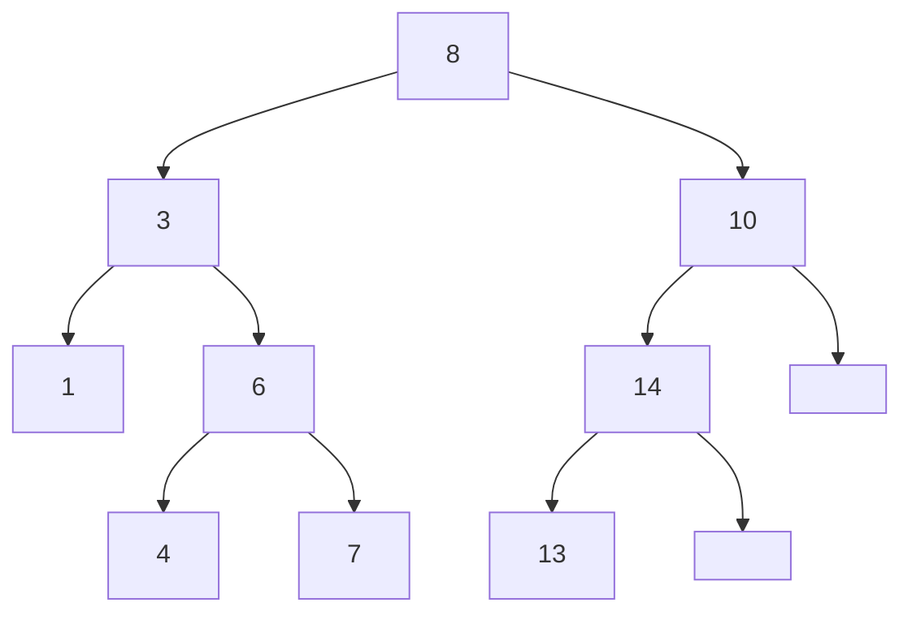

# Binary Search Trees

> **Estimated Time:** 5 hr | **Difficulty:** Intermediate
> **Prerequisites:** [01 - Binary Tree Traversals](../01-binary-tree-traversals/README.md), [08 - Binary Search](../../01-core-linear/08-binary-search/README.md)

---

## What You'll Learn
- You can state the BST property and use it to throw away half the tree at every step.
- You can explain why an inorder walk of a BST is sorted, and use that to solve many problems.
- You can insert, search and delete (all 3 delete cases), both recursively and iteratively.
- You can validate a BST correctly (with bounds, not just parent checks) and recover a BST with two swapped nodes.
- You can explain why a BST can degrade to O(n) and what AVL / red-black trees do about it.

## The Big Idea

Think of a dictionary. You open it in the middle, see a word that comes after yours, and flip left. You never read the pages on the right. A binary search tree is a dictionary you can grow: every node is a "middle page" that says "smaller things this way, bigger things that way".

**The BST property:** for every node, all values in its left subtree are **smaller**, and all values in its right subtree are **bigger**. (Not just the two children. The whole subtree.) Most interview problems say "no duplicates". If duplicates are allowed, the problem tells you which side they go to.






Because of this rule:
- **Search / insert / delete** follow one path from the root down. Cost is O(h), where h is the height. You do not look at the other half.
- **Inorder (left, node, right) gives a sorted list.** Left subtree is all smaller, then the node, then all bigger. The same holds recursively. For the tree above: `1 3 4 6 7 8 10 13 14`.
- The **minimum** is the leftmost node. The **maximum** is the rightmost node.

**Height is everything.** If the tree is balanced, h is about log n. If you insert already sorted values (1, 2, 3, 4, ...), every node only has a right child. The tree is a linked list with h = n, and every O(h) operation becomes O(n). This is the skewed-tree worst case.

```
Insert 1,2,3,4 in order:      Insert 2,1,3,4... in a good order:
1                                  2
 \                                / \
  2                              1   3
   \                                  \
    3                                  4
     \
      4      h = n = 4            h = 3
```

**Self-balancing trees (concept only).** AVL and red-black trees fix the skew problem. After each insert or delete they do small local rewiring called **rotations** so the height stays O(log n). AVL keeps the two subtree heights of every node within 1 of each other (stricter, faster lookups). Red-black trees use node colours and looser rules (fewer rotations on writes). Both guarantee O(log n) for search, insert and delete. You almost never write one in an interview. Know the idea. The internals are in [06 - Data Structure Internals](../../06-advanced/06-data-structure-internals/README.md).

JavaScript has no built-in balanced tree. `Map` and `Set` are hash based and unordered by key. If an interviewer wants an ordered set, you build a BST or say "in Java this is a TreeMap".

**Why interviewers love it:** it tests whether you use the extra structure (ordering) instead of treating it like any binary tree. A candidate who does a full O(n) scan for "search in BST" has missed the point.

## How to Spot It

| If the problem says ... | think ... |
|---|---|
| "binary search tree", "BST" | use the ordering, go left or right, do not visit both |
| "sorted order", "kth smallest", "in order" | inorder traversal (iterative with a stack to stop early) |
| "is it a valid BST" | pass `(lo, hi)` bounds down, or check inorder is strictly increasing |
| "closest value", "floor", "ceil", "successor" | walk down, remember the last candidate where you went left or right |
| "two nodes swapped" | inorder has 1 or 2 "dips" (a value bigger than the next) |
| "build from sorted array or list" | pick the middle as root, recurse on both halves |
| "build from preorder" | root first, then use an upper bound to split left and right |
| "next() / hasNext() with O(h) memory" | stack holding only the left spine |
| "largest BST inside a binary tree" | post-order, each child returns (isBST, size, min, max) |

## Core Concepts / Template

### 1. Walk down using the property (search template)

```js
function searchBST(root, target) {
  while (root && root.val !== target) {
    root = target < root.val ? root.left : root.right;
  }
  return root; // node or null
}
```

Almost all "one path" problems (search, insert, floor, ceil, LCA, successor) are this loop with a small change.

### 2. Inorder = sorted (iterative template)

```js
function inorderIter(root) {
  const out = [], st = [];
  let cur = root;
  while (cur || st.length) {
    while (cur) { st.push(cur); cur = cur.left; } // go as far left as possible
    cur = st.pop();                                // visit
    out.push(cur.val);
    cur = cur.right;                               // then the right side
  }
  return out;
}
```

The iterative version matters because you can **stop early** (kth smallest) or **pause** (iterator).

### 3. Bounds template (validate, trim, from-preorder)

A node is only legal inside a window `(lo, hi)`. Going left shrinks `hi` to the node value. Going right raises `lo` to the node value.

### Trace: search 4 in the tree above

| step | node | compare | move |
|---|---|---|---|
| 1 | 8 | 4 < 8 | left |
| 2 | 3 | 4 > 3 | right |
| 3 | 6 | 4 < 6 | left |
| 4 | 4 | equal | found |

4 steps, not 9. That is the whole point.

All code below was run in Node with assert tests (examples, empty tree, single node, duplicates, and randomized checks for delete, count-smaller and list-to-BST).

Common helper used in all solutions:

```js
class TreeNode {
  constructor(val, left = null, right = null) {
    this.val = val; this.left = left; this.right = right;
  }
}
```

## Problems (easy -> hard)

### 1. Search in a BST — Easy
**Companies:** -
**Problem:** Given the root of a BST and a value, return the node with that value, or null. Example: search 6 in the tree above -> the node 6 (with children 4 and 7).
**Intuition:** At each node the property tells you which half the answer must be in. Ignore the other half.
**Approach 1 - Brute force:** Traverse the whole tree and compare. Time O(n), Space O(h). Ignores the BST property.
**Approach 2 - Optimal:** Loop: smaller -> go left, bigger -> go right, equal -> return. Dry run is the trace in Core Concepts.

```js
function searchBST(root, target) {
  while (root && root.val !== target) {
    root = target < root.val ? root.left : root.right;
  }
  return root;
}
```

**Complexity:** Time O(h), Space O(1).
**Watch out:** h is n for a skewed tree, so say "O(h), which is O(log n) only if balanced".

### 2. Range Sum of BST — Easy
**Companies:** Meta, Amazon
**Problem:** Sum all node values in the inclusive range [lo, hi]. Example: BST above, lo=4, hi=10 -> 4+6+7+8+10 = 35.
**Intuition:** If a node is below `lo`, its whole left subtree is even smaller, so skip it. If above `hi`, skip its right subtree.
**Approach 1 - Brute force:** Visit all nodes, add those in range. Time O(n), Space O(h).
**Approach 2 - Optimal:** Prune. At node 3 (< 4) we only go right. At node 14 (> 10) we only go left.

```js
function rangeSumBST(root, lo, hi) {
  if (!root) return 0;
  if (root.val < lo) return rangeSumBST(root.right, lo, hi);
  if (root.val > hi) return rangeSumBST(root.left, lo, hi);
  return root.val + rangeSumBST(root.left, lo, hi) + rangeSumBST(root.right, lo, hi);
}
```

**Complexity:** Time O(h + k) where k is the number of nodes in range (worst case O(n)), Space O(h).
**Watch out:** the range is inclusive. A node equal to `lo` or `hi` counts and you still search both sides.

### 3. Convert Sorted Array to Height-Balanced BST — Easy
**Companies:** Amazon, Meta, Microsoft
**Problem:** Build a height-balanced BST from a sorted array. Example: `[-10,-3,0,5,9]` -> root 0, left subtree from `[-10,-3]`, right from `[5,9]` (any valid balanced answer works).
**Intuition:** The middle element must be the root so both sides have about the same count. Then the same job repeats on each half.
**Approach 1 - Brute force:** Insert elements one by one in order. You get a skewed list, h = n. Time O(n^2) for the inserts, and not balanced. Wrong answer for this problem.
**Approach 2 - Optimal:** Recursion on index ranges `[l, r]`; middle is root. Trace for `[-10,-3,0,5,9]`: range 0..4 -> mid 2 (0); left 0..1 -> mid 0 (-10), its right 1..1 -> -3; right 3..4 -> mid 3 (5), its right -> 9.

```js
function sortedArrayToBST(a, l = 0, r = a.length - 1) {
  if (l > r) return null;
  const m = (l + r) >> 1;
  return new TreeNode(a[m], sortedArrayToBST(a, l, m - 1), sortedArrayToBST(a, m + 1, r));
}
```

**Complexity:** Time O(n), Space O(log n) recursion (plus the output tree).
**Watch out:** do not slice the array in each call (that is O(n log n) copying). Pass indices.

**Variant: sorted linked list.** You cannot jump to the middle of a list in O(1). Trick: count the nodes, then build **in inorder**. Recurse left first, then take the current list node as the root, advance the pointer, then recurse right. The list pointer moves in sorted order, exactly like an inorder walk.

```js
function sortedListToBST(head) {
  let n = 0;
  for (let p = head; p; p = p.next) n++;
  let cur = head;
  function build(lo, hi) {
    if (lo > hi) return null;
    const m = (lo + hi) >> 1;
    const left = build(lo, m - 1);          // consumes the first half of the list
    const node = new TreeNode(cur.val);     // cur is now exactly the middle
    cur = cur.next;
    node.left = left;
    node.right = build(m + 1, hi);
    return node;
  }
  return build(0, n - 1);
}
```

Time O(n), Space O(log n). (Slow-fast pointers to find the middle each time also works but is O(n log n).)

### 4. Two Sum IV - Input is a BST — Easy
**Companies:** Amazon, Meta
**Problem:** Return true if two different nodes sum to `k`. Example: BST above, k=17 (3+14) -> true; k=100 -> false.
**Intuition:** Inorder gives a sorted array. Sorted array + target sum = two pointers.
**Approach 1 - Brute force:** For each node, search the BST for `k - val` (skip itself). Time O(n h), Space O(h).
**Approach 2 - Better:** Hash set while traversing: if `k - val` is in the set, return true. Time O(n), Space O(n).
**Approach 3 - Optimal (space):** Two BST iterators (one ascending, one descending, see problem 12) do the two-pointer walk with O(h) memory. The simple version below stores the inorder list. Trace for k=17 on `[1,3,4,6,7,8,10,13,14]`: 1+14=15 < 17 -> i++; 3+14=17 found.

```js
function findTarget(root, k) {
  const a = [];
  (function go(n) { if (n) { go(n.left); a.push(n.val); go(n.right); } })(root);
  let i = 0, j = a.length - 1;
  while (i < j) {
    const s = a[i] + a[j];
    if (s === k) return true;
    if (s < k) i++; else j--;
  }
  return false;
}
```

**Complexity:** Time O(n), Space O(n).
**Watch out:** `i < j`, not `i <= j`. A node cannot pair with itself (single node with k = 2*val must be false).

### 5. Insert into a BST — Medium
**Companies:** -
**Problem:** Insert a value (not already present) and return the root. Example: insert 5 into `4,2,7,1,3` -> 5 becomes the left child of 7.
**Intuition:** Search for where the value would be. The empty spot you reach is where the new node goes. New nodes are always leaves, so nothing else moves.
**Approach 1 - Optimal:** Recurse down; at null, create the node; reattach the returned child on the way back.

```js
function insert(root, val) {
  if (!root) return new TreeNode(val);
  if (val < root.val) root.left = insert(root.left, val);
  else root.right = insert(root.right, val);
  return root;
}
```

**Complexity:** Time O(h), Space O(h) recursion (O(1) with a loop that tracks the parent).
**Watch out:** the pattern `root.left = f(root.left)` is the trick that avoids tracking a parent. Remember it, delete and trim use it too.

### 6. Validate Binary Search Tree — Medium
**Companies:** Amazon, Meta, Microsoft, Google
**Problem:** Return true if the tree is a valid BST (strictly smaller on the left, strictly bigger on the right, for the whole subtree).
**Intuition:** Checking only `left.val < node.val < right.val` is the classic wrong answer. Example: root 5, right child 6, whose left child is 3. Locally fine (3 < 6), but 3 is in the right subtree of 5, so it is illegal. Every node must fit a window handed down from above.
**Approach 1 - Brute force:** For every node, check max of left subtree < node < min of right subtree. Time O(n^2) (or O(n h)).
**Approach 2 - Better:** Inorder traversal, check it is strictly increasing. Time O(n), Space O(h).
**Approach 3 - Optimal:** Pass `(lo, hi)`. Trace on `5 (4, 6 (3, 7))`:

| node | window (lo, hi) | ok? |
|---|---|---|
| 5 | (-inf, inf) | yes |
| 4 | (-inf, 5) | yes |
| 6 | (5, inf) | yes |
| 3 | (5, 6) | 3 <= 5, **invalid** |

```js
function isValidBST(root, lo = -Infinity, hi = Infinity) {
  if (!root) return true;
  if (root.val <= lo || root.val >= hi) return false; // strict: no duplicates
  return isValidBST(root.left, lo, root.val) && isValidBST(root.right, root.val, hi);
}
```

**Complexity:** Time O(n), Space O(h).
**Watch out:** do not use `Number.MIN_VALUE` as the start (it is a tiny positive number in JS). Use `-Infinity`. Ask whether duplicates are allowed. If yes on one side, change one comparison to `<` / `>`.

### 7. Floor and Ceil in a BST — Medium
**Companies:** -
**Problem:** Floor of x = largest value <= x. Ceil of x = smallest value >= x. Example: BST above, x=5 -> floor 4, ceil 6. Return null if none.
**Intuition:** Walk down like a search. Each time you go right, the current node is a possible floor (it is <= x). Remember the latest one, it is the closest. Ceil is the mirror image.
**Approach 1 - Brute force:** Inorder list, scan or binary search it. Time O(n), Space O(n).
**Approach 2 - Optimal:** Trace for floor of 5: node 8 (> 5, go left); node 3 (< 5, ans=3, go right); node 6 (> 5, go left); node 4 (< 5, ans=4, go right); null -> floor 4.

```js
function floorBST(root, x) {
  let ans = null;
  while (root) {
    if (root.val === x) return x;
    if (root.val < x) { ans = root.val; root = root.right; }
    else root = root.left;
  }
  return ans;
}
function ceilBST(root, x) {
  let ans = null;
  while (root) {
    if (root.val === x) return x;
    if (root.val > x) { ans = root.val; root = root.left; }
    else root = root.right;
  }
  return ans;
}
```

**Complexity:** Time O(h), Space O(1).
**Watch out:** forgetting the "exact match returns immediately" case. The same loop solves "Closest BST Value" (track the better of floor and ceil).

### 8. Kth Smallest Element in a BST (and Kth Largest) — Medium
**Companies:** Amazon, Meta, Google, Microsoft
**Problem:** Return the k-th smallest value (1-indexed). Example: BST above, k=3 -> 4.
**Intuition:** Inorder is sorted, so the k-th node visited is the answer. Stop as soon as you reach it.
**Approach 1 - Brute force:** Full inorder into an array, return `a[k-1]`. Time O(n), Space O(n).
**Approach 2 - Optimal:** Iterative inorder with a counter. Stops after k pops. Trace for k=3: push 8,3,1; pop 1 (k=2); right of 1 is null; pop 3 (k=1); go right to 6, push 6,4; pop 4 (k=0) -> answer 4.

```js
function kthSmallest(root, k) {
  const st = [];
  let cur = root;
  while (cur || st.length) {
    while (cur) { st.push(cur); cur = cur.left; }
    cur = st.pop();
    if (--k === 0) return cur.val;
    cur = cur.right;
  }
  return null; // k > number of nodes
}
```

**Kth largest:** mirror it. Go right first (reverse inorder), then left.

```js
function kthLargest(root, k) {
  const st = [];
  let cur = root;
  while (cur || st.length) {
    while (cur) { st.push(cur); cur = cur.right; }
    cur = st.pop();
    if (--k === 0) return cur.val;
    cur = cur.left;
  }
  return null;
}
```

**Complexity:** Time O(h + k), Space O(h).
**Follow-up (the interviewer will ask):** "The tree is modified often and you call kth-smallest often. How do you make it fast?" Store a `size` (node count of the subtree) in every node. Then at a node with `L = size(left)`: if `k == L + 1` the node is the answer; if `k <= L` go left; else set `k -= L + 1` and go right. That is O(h) per query. Insert and delete must update `size` on the path. For a balanced tree that is O(log n).

```js
// every node has .size = 1 + size(left) + size(right)
function kthBySize(root, k) {
  const sz = (n) => (n ? n.size : 0);
  while (root) {
    const L = sz(root.left);
    if (k === L + 1) return root.val;
    if (k <= L) root = root.left;
    else { k -= L + 1; root = root.right; }
  }
  return null;
}
```

**Watch out:** k is 1-indexed. Decrement before comparing to 0, as written.

### 9. Lowest Common Ancestor of a BST — Medium
**Companies:** Amazon, Meta, Microsoft, LinkedIn
**Problem:** Find the lowest node that has both `p` and `q` in its subtree (a node counts as its own descendant). Example: BST above, p=4, q=7 -> 6. p=1, q=14 -> 8.
**Intuition:** If both values are smaller than the node, the answer is on the left. If both are bigger, on the right. The first node where they **split** (or where it equals one of them) is the LCA.
**Approach 1 - Brute force:** The generic binary-tree LCA (see [03 - Paths, LCA and Tree Properties](../03-paths-lca-and-tree-properties/README.md)) works but is O(n). Time O(n), Space O(h).
**Approach 2 - Optimal:** Trace p=4, q=7: node 8 (both < 8, go left); node 3 (both > 3, go right); node 6 (4 < 6 < 7, split) -> 6.

```js
function lcaBST(root, p, q) {
  while (root) {
    if (p < root.val && q < root.val) root = root.left;
    else if (p > root.val && q > root.val) root = root.right;
    else return root; // split, or root equals p or q
  }
  return null;
}
```

**Complexity:** Time O(h), Space O(1).
**Watch out:** this uses values. If `p` and `q` are node objects, use `p.val`. It also assumes both exist in the tree.

### 10. Inorder Successor and Predecessor in a BST — Medium
**Companies:** Meta, Amazon, Microsoft
**Problem:** Given a value `x`, return the node with the smallest value > x (successor), or the largest value < x (predecessor). Example: BST above, successor of 7 -> 8; predecessor of 8 -> 7; successor of 14 -> null.
**Intuition:** Same idea as ceil/floor, but strictly greater / smaller. Going left from a node means "this node is bigger than x, a candidate successor". Remember it.
**Approach 1 - Brute force:** Inorder list, find x, take the neighbour. Time O(n), Space O(n).
**Approach 2 - Optimal:** Trace successor of 7: 8 (> 7, ans=8, go left); 3 (< 7, go right); 6 (< 7, go right); 7 (not > 7, go right); null -> 8. This does not need parent pointers and works even if `x` is not in the tree.

```js
function successor(root, x) {
  let ans = null;
  while (root) {
    if (root.val > x) { ans = root; root = root.left; }
    else root = root.right;
  }
  return ans;
}
function predecessor(root, x) {
  let ans = null;
  while (root) {
    if (root.val < x) { ans = root; root = root.right; }
    else root = root.left;
  }
  return ans;
}
```

**Complexity:** Time O(h), Space O(1).
**Watch out:** the textbook rule is "if the node has a right child, the successor is the leftmost node of the right subtree; otherwise it is the lowest ancestor for which the node is in its left subtree". The loop above covers both cases at once. Use `>` strictly so the node is not its own successor.

### 11. Delete Node in a BST — Medium
**Companies:** Amazon, Meta, Microsoft
**Problem:** Delete the node with value `key` (if present) and return the new root, keeping the BST valid.
**Intuition:** Find the node first. Then there are exactly three cases:

| Case | What to do |
|---|---|
| Leaf (no children) | remove it (return null to the parent) |
| One child | replace the node by that child |
| Two children | replace its value with the **inorder successor** (smallest in the right subtree), then delete that successor from the right subtree. (Inorder predecessor works too.) |

Why the successor: it is the next value in sorted order, so it is bigger than everything on the left and not bigger than anything on the right. Putting it in the node's place keeps the property. The successor has no left child, so deleting it falls into case 1 or 2.

**Approach 1 - Recursive:**

```js
function deleteNode(root, key) {
  if (!root) return null;
  if (key < root.val) root.left = deleteNode(root.left, key);
  else if (key > root.val) root.right = deleteNode(root.right, key);
  else {
    if (!root.left) return root.right;   // covers leaf and right-only
    if (!root.right) return root.left;
    let s = root.right;
    while (s.left) s = s.left;           // inorder successor
    root.val = s.val;
    root.right = deleteNode(root.right, s.val);
  }
  return root;
}
```

Trace: delete 3 from the tree above (children 1 and 6). Successor = leftmost of right subtree (6 -> 4) = 4. Copy 4 into the node, delete the old 4 (a leaf) from the right subtree. Result: node 4 with children 1 and 6 (6 now has only right child 7). Inorder is still sorted.

**Approach 2 - Iterative (O(1) space):** find the node and its parent with a loop. For the two-children case, instead of copying values, **hang the left subtree under the leftmost node of the right subtree**, then let the right subtree take the deleted node's place. Everything in `cur.left` is smaller than everything in `cur.right`, so it fits to the left of that minimum.

```js
function deleteNodeIter(root, key) {
  let parent = null, cur = root;
  while (cur && cur.val !== key) {
    parent = cur;
    cur = key < cur.val ? cur.left : cur.right;
  }
  if (!cur) return root;                 // key not found
  let repl;
  if (!cur.left) repl = cur.right;
  else if (!cur.right) repl = cur.left;
  else {
    let s = cur.right;
    while (s.left) s = s.left;
    s.left = cur.left;                   // attach whole left subtree
    repl = cur.right;
  }
  if (!parent) return repl;              // deleted the root
  if (parent.left === cur) parent.left = repl; else parent.right = repl;
  return root;
}
```

The iterative way can make the tree a bit taller, since the left subtree is pushed down. It is still a valid BST.

**Complexity:** Time O(h), Space O(h) recursive / O(1) iterative.
**Watch out:** returning the new root matters (`root = deleteNode(root, key)`), the root itself may be deleted. Deleting a missing key must leave the tree unchanged.

### 12. Binary Search Tree Iterator — Medium
**Companies:** Meta, Amazon, Google, LinkedIn
**Problem:** Implement `next()` (return the next smallest number) and `hasNext()`. Both should be O(1) average and use O(h) memory.
**Intuition:** It is the iterative inorder, paused after each visit. The stack holds only the path to the next node (the left spine), not the whole tree.
**Approach 1 - Brute force:** Flatten the inorder into an array in the constructor. `next` is O(1), but memory is O(n).
**Approach 2 - Optimal:** Stack with the left spine. `next()`: pop, then push the left spine of its right child. Each node is pushed and popped once, so n calls cost O(n) total, that is O(1) amortized. Trace on the tree above: constructor pushes 8,3,1. `next()` pops 1 (no right child). `next()` pops 3, pushes 6,4. `next()` pops 4. `next()` pops 6, pushes 7.

```js
class BSTIterator {
  constructor(root) { this.st = []; this._left(root); }
  _left(n) { while (n) { this.st.push(n); n = n.left; } }
  next() {
    const n = this.st.pop();
    this._left(n.right);
    return n.val;
  }
  hasNext() { return this.st.length > 0; }
}
```

**Complexity:** `next` amortized O(1) (worst single call O(h)), `hasNext` O(1), Space O(h).
**Watch out:** say "amortized" out loud. For a reverse iterator swap left and right. With one forward and one reverse iterator you can solve Two Sum IV in O(h) memory.

### 13. Construct BST from Preorder Traversal — Medium
**Companies:** Amazon, Google, Microsoft
**Problem:** Given the preorder list of a BST (distinct values), rebuild the tree. Example: `[8,5,1,7,10,12]` -> root 8, left 5 (1, 7), right 10 (right child 12).
**Intuition:** The first value is the root. Following values smaller than the root belong to the left. The first bigger one starts the right. Instead of searching for that split, pass an **upper bound**: a node can only be created if its value is below the bound.
**Approach 1 - Brute force:** Take `pre[0]` as root, find the first bigger index by scanning, recurse on both slices. Time O(n^2) worst case (skewed), because of repeated scans.
**Approach 2 - Better:** Sort the preorder to get inorder, then build from preorder + inorder. Time O(n log n).
**Approach 3 - Optimal:** One global index `i` and an upper bound. Left child gets bound = parent value. Right child gets the parent's bound. Trace `[8,5,1,7,10,12]`: 8 (bound inf); left: 5 (bound 8); left: 1 (bound 5); left of 1: next is 7, 7 > 1 -> null; right of 1 (bound 5): 7 > 5 -> null; back at 5, right (bound 8): 7 fits; its children: 10 > 7, null, null; back at 8, right (bound inf): 10; left (bound 10): 12 > 10 null; right: 12.

```js
function bstFromPreorder(pre) {
  let i = 0;
  function build(hi) {
    if (i === pre.length || pre[i] > hi) return null;
    const node = new TreeNode(pre[i++]);
    node.left = build(node.val);
    node.right = build(hi);
    return node;
  }
  return build(Infinity);
}
```

**Complexity:** Time O(n), Space O(h).
**Watch out:** `i` is shared across calls, so it must live outside `build`. (A tree is not uniquely defined by preorder alone, but a BST is, because values decide the sides.)

### 14. Trim a Binary Search Tree — Medium
**Companies:** Meta, Amazon
**Problem:** Remove all nodes outside `[lo, hi]` and keep the relative structure. Return the new root (it may change). Example: tree `3 (left 0 (right 2 (left 1)), right 4)`, `lo=1, hi=3` -> `3 (left 2 (left 1))`.
**Intuition:** If a node is too small, it AND its left subtree are too small, so the answer is whatever trimming the right subtree gives. If too big, mirror. If in range, keep it and trim both children.
**Approach 1 - Brute force:** Collect values in range, rebuild by inserting. Time O(n h), changes the structure.
**Approach 2 - Optimal:** Recursion that returns the trimmed subtree. Trace for tree `3 (0 (-, 2 (1)), 4)`, lo=1, hi=3: node 3 in range; left: node 0 < 1 -> trim its right = node 2, which keeps its child 1; right: node 4 > 3 -> trim its left = null. Result `3 (2 (1))`.

```js
function trimBST(root, lo, hi) {
  if (!root) return null;
  if (root.val < lo) return trimBST(root.right, lo, hi);
  if (root.val > hi) return trimBST(root.left, lo, hi);
  root.left = trimBST(root.left, lo, hi);
  root.right = trimBST(root.right, lo, hi);
  return root;
}
```

**Complexity:** Time O(n) worst case (O(h + kept) if you count only visited), Space O(h).
**Watch out:** do not just delete the bad node and continue. You must **skip to the correct child**, because that child's subtree can still hold good nodes.

### 15. Recover Binary Search Tree — Hard
**Companies:** Amazon, Microsoft, Google, Meta
**Problem:** Exactly two nodes of a BST had their values swapped by mistake. Fix the tree without changing its structure. Example: `3 (1, 4 (2))` -> inorder is `1 3 2 4`, swap 3 and 2.
**Intuition:** A valid BST has a strictly increasing inorder. Swapping two values creates "dips" (a value bigger than the one after it):
- If the two nodes are **not** neighbours: `1 [6] 3 4 [2] 7` has two dips (6 > 3 and 4 > 2). The wrong nodes are the **first** of the first dip (6) and the **second** of the last dip (2).
- If they **are** neighbours: `1 [3] [2] 4` has one dip. The two nodes of that dip are the answer.

So: do an inorder walk, remember `prev`. At each dip, set `first` once (the `prev` of the first dip) and always set `second` (the current node). Swap the values at the end.

**Approach 1 - Brute force:** Inorder into an array, sort a copy, compare to find the 2 differences, fix values. Time O(n log n), Space O(n).
**Approach 2 - Optimal:** Inorder with a `prev` pointer, one pass. Time O(n), Space O(h). (Morris traversal brings space to O(1), see the internals chapter if you want it.)

```js
function recoverTree(root) {
  let prev = null, first = null, second = null;
  (function go(n) {
    if (!n) return;
    go(n.left);
    if (prev && prev.val > n.val) {
      if (!first) first = prev; // only the first dip sets first
      second = n;               // the last dip decides second
    }
    prev = n;
    go(n.right);
  })(root);
  [first.val, second.val] = [second.val, first.val];
}
```

Trace on `1 3 2 4`: pairs (1,3) ok, (3,2) dip -> first=3, second=2, (2,4) ok. Swap -> `1 2 3 4`.

**Complexity:** Time O(n), Space O(h).
**Watch out:** the common bug is using `if (!first) first = prev; else second = n;`. That breaks the adjacent case (one dip), where `second` is never set. Always set `second` on every dip. Swap **values**, not nodes.

### 16. Merge Two BSTs — Hard
**Companies:** -
**Problem:** Return all values of two BSTs in sorted order (the classic version is "All Elements in Two Binary Search Trees"). Example: `[2,1,4]` and `[1,0,3]` -> `[0,1,1,2,3,4]`.
**Intuition:** Each inorder is already sorted. Merging two sorted lists is the merge step of merge sort.
**Approach 1 - Brute force:** Insert every node of one tree into the other. Time O(m h), the result can be skewed. Or put everything in one array and sort: O(n log n), ignores the structure.
**Approach 2 - Optimal:** Two inorder lists, then merge with two pointers. Time O(m + n), Space O(m + n). (Use two BST iterators from problem 12 to cut the extra space to O(h1 + h2).)

```js
function mergeBSTs(a, b) {
  const inorder = (r, o = []) => {
    if (r) { inorder(r.left, o); o.push(r.val); inorder(r.right, o); }
    return o;
  };
  const x = inorder(a), y = inorder(b), out = [];
  let i = 0, j = 0;
  while (i < x.length || j < y.length) {
    if (j === y.length || (i < x.length && x[i] <= y[j])) out.push(x[i++]);
    else out.push(y[j++]);
  }
  return out;
}
```

**Complexity:** Time O(m + n), Space O(m + n).
**Watch out:** if the task is to return a **BST** (not a list), run `sortedArrayToBST` (problem 3) on the merged array. That gives a balanced tree for free.

### 17. Largest BST Subtree in a Binary Tree — Hard
**Companies:** Amazon, Microsoft, Google
**Problem:** In a normal binary tree, find the size (node count) of the largest subtree that is a valid BST. Example: `10 (5 (1, 8), 15 (-, 7))` -> 3 (the subtree `5 (1, 8)`). The whole tree fails because 7 sits in the right subtree of 10 but is smaller than 10 (and 15 has a smaller right child).
**Intuition:** A node's subtree is a BST if both children are BSTs, `max(left) < node < min(right)`. So each call must return four facts about its subtree. Do it **post-order** (children first).
**Approach 1 - Brute force:** For each node run `isValidBST` and count nodes. Time O(n^2) worst case (skewed), Space O(h).
**Approach 2 - Optimal:** One post-order pass returning `[isBST, size, min, max]`. Empty subtree = `[true, 0, +inf, -inf]`, so the checks pass automatically. Trace on the example: leaf 1 -> `[T,1,1,1]`; leaf 8 -> `[T,1,8,8]`; node 5: 1 < 5 < 8 -> `[T,3,1,8]`, best=3; leaf 7 -> `[T,1,7,7]`; node 15: the check `15 < min(right) = 7` fails -> not a BST; root 10 has a non-BST child -> fails. Answer 3.

```js
function largestBST(root) {
  let best = 0;
  function go(n) { // [isBST, size, min, max]
    if (!n) return [true, 0, Infinity, -Infinity];
    const [lb, ls, lmin, lmax] = go(n.left);
    const [rb, rs, rmin, rmax] = go(n.right);
    if (lb && rb && lmax < n.val && n.val < rmin) {
      const size = ls + rs + 1;
      best = Math.max(best, size);
      return [true, size, Math.min(lmin, n.val), Math.max(rmax, n.val)];
    }
    return [false, 0, 0, 0]; // min/max unused once not a BST
  }
  go(root);
  return best;
}
```

**Complexity:** Time O(n), Space O(h).
**Watch out:** the empty-tree `min = +inf, max = -inf` trick. Without it you need many null checks. Once a subtree is not a BST, no ancestor can be one, so its size is not used upward (but `best` already holds any BST found below).

### 18. Count of Smaller Numbers After Self — Hard
**Companies:** Amazon, Google, Microsoft
**Problem:** For each `nums[i]`, count how many elements to its right are smaller. Example: `[5,2,6,1]` -> `[2,1,1,0]`.
**Intuition:** Go from right to left and insert each number into a BST. While walking down to insert, we can count how many already-inserted (right-side) values are smaller. For that, each node stores `leftCount` (how many values went into its left subtree) and `dup` (copies of itself).
**Approach 1 - Brute force:** For each i, scan the rest. Time O(n^2), Space O(1).
**Approach 2 - BST (this chapter):** At each node on the path: if `x <= node.val`, bump `leftCount` and go left (x equal: add `leftCount`, stop). If `x > node.val`, add `leftCount + dup` (the node and its whole left side are smaller), go right. Average O(n log n), but **O(n^2) on sorted input** (skewed tree).
**Approach 3 - Reference:** Merge sort with index tracking, or a Fenwick tree over compressed values, give guaranteed O(n log n). See [02 - Segment Tree and Fenwick](../../06-advanced/02-segment-tree-and-fenwick/README.md).

```js
function countSmaller(nums) {
  const res = new Array(nums.length).fill(0);
  let root = null;
  for (let i = nums.length - 1; i >= 0; i--) {
    const x = nums[i];
    const node = { val: x, left: null, right: null, dup: 1, leftCount: 0 };
    if (!root) { root = node; continue; }
    let cur = root, cnt = 0;
    for (;;) {
      if (x === cur.val) { cnt += cur.leftCount; cur.dup++; break; }
      if (x < cur.val) {
        cur.leftCount++;
        if (!cur.left) { cur.left = node; break; }
        cur = cur.left;
      } else {
        cnt += cur.leftCount + cur.dup;
        if (!cur.right) { cur.right = node; break; }
        cur = cur.right;
      }
    }
    res[i] = cnt;
  }
  return res;
}
```

Trace `[5,2,6,1]`, right to left: insert 1 (count 0). Insert 6: 6 > 1 -> cnt = 0 + 1 = 1 (res 1). Insert 2: 2 > 1 -> cnt = 1, go right to 6, 2 < 6 -> leftCount of 6 becomes 1, insert as left of 6 (res 1). Insert 5: 5 > 1 -> cnt 1, go right to 6, 5 < 6 -> leftCount(6)=2, go left to 2, 5 > 2 -> cnt += 0 + 1 = 2 (res 2). Result `[2,1,1,0]`.

**Complexity:** Time O(n log n) average, O(n^2) worst, Space O(n).
**Watch out:** equal values must not count as smaller. In the `x === cur.val` branch we add only `leftCount`, not `dup`. Mention that the worst case is why the production answer is merge sort or a Fenwick tree.

## Common Mistakes
- **"A node only needs to be bigger than its left child and smaller than its right child."** Wrong. The rule covers the whole subtree. Validate with `(lo, hi)` bounds or an inorder check.
- **Starting bounds with `Number.MIN_VALUE`.** That is the smallest *positive* number (about 5e-324). Use `-Infinity`/`Infinity` (or `null` bounds).
- **"BST operations are O(log n)."** Only if balanced. A sorted insert order gives O(n). Always say O(h).
- **Building a BST from a sorted array by repeated insert.** It produces a skewed chain. Use the middle element as root.
- **Forgetting to return the (possibly new) root** in insert / delete / trim, or not reassigning `root.left = f(root.left)`.
- **Deleting a node with two children by removing it and "hoping".** Replace with the inorder successor (or predecessor), then delete that node.
- **Recover BST: setting `second` only when `first` is already set.** That fails for adjacent swapped nodes.
- **Treating duplicates casually.** Ask: not allowed, or goes left, or goes right? Strict `<` / `>` in the validator assumes none.
- **Traversing the whole tree for search-type problems** (kth smallest with a full array, floor/ceil with an inorder list). Correct, but you lose the point of the BST.

## Interview Tips
- First sentence out loud: "It is a BST, so I can use the ordering. Search is O(h), and inorder is sorted."
- Always ask: duplicates? Are all values distinct? Can the tree be empty? Is it guaranteed to be balanced?
- State complexity as O(h) and add "O(log n) balanced, O(n) skewed".
- For a "validate" problem, say the wrong local-check approach exists and explain why it fails with the 5 / 6 / 3 example. Interviewers watch for that.
- Follow-ups you should expect:
  - "Kth smallest with many updates?" -> store subtree sizes (problem 8).
  - "O(1) extra space inorder?" -> Morris traversal (temporarily thread the predecessor's right pointer to the current node).
  - "How do you keep the tree balanced?" -> AVL / red-black rotations; or build once from a sorted array. No need to code it.
  - "Why not a hash map?" -> a BST keeps keys ordered: range queries, floor/ceil, successor, sorted iteration. A hash map does not.
  - "Two Sum IV with O(h) space?" -> forward and reverse BST iterators.
- Edge cases to mention: empty tree, single node, key not found, deleting the root, k larger than the node count, negative values, `-Infinity` bounds, values at the exact boundary of a range.
- If the problem gives you a **binary tree** (not BST), say so. The ordering tricks do not apply, and that is exactly what problem 17 tests.

## Practice List

**Easy**
- Minimum Absolute Difference in BST
- Closest Binary Search Tree Value
- Convert BST to Greater Tree
- Increasing Order Search Tree
- Find Mode in Binary Search Tree

**Medium**
- Binary Search Tree to Greater Sum Tree
- Inorder Successor in BST II (with parent pointers)
- Convert BST to Sorted Doubly Linked List
- Unique Binary Search Trees (count by DP)
- Unique Binary Search Trees II (generate all)
- Serialize and Deserialize BST
- Kth Smallest Element in a BST (with updates, size-augmented)
- Balance a Binary Search Tree
- Closest Binary Search Tree Value II

**Hard**
- Recover Binary Search Tree with O(1) space (Morris)
- Count of Range Sum
- Count of Smaller Numbers After Self (merge sort / Fenwick version)
- Contains Duplicate III (ordered-set thinking)
- Maximum Sum BST in Binary Tree
- Reverse Pairs

## Key Takeaways
- **BST property:** the whole left subtree is smaller and the whole right subtree is bigger, not just the direct children.
- **Inorder of a BST is sorted**, so "sorted order", "kth", "iterator", "validate" and "recover" problems all reduce to an inorder walk.
- **Operations cost O(h).** That is O(log n) balanced but O(n) when the tree is skewed (for example sorted inserts).
- **Delete has 3 cases:** leaf, one child, two children (swap with the inorder successor, then delete that node).
- **Validate with bounds `(lo, hi)`**, never with parent-child checks only, and use `-Infinity` / `Infinity`.
- **Floor, ceil, successor, predecessor, LCA** are one downward loop that remembers the last useful candidate.
- **Self-balancing trees (AVL, red-black)** keep h at O(log n) with rotations. Know the idea, not the code.

---
[← Previous: Paths, LCA and Tree Properties](../03-paths-lca-and-tree-properties/README.md) | [Next: Trie →](../05-trie/README.md) | [Back to Trees Index](../README.md)
