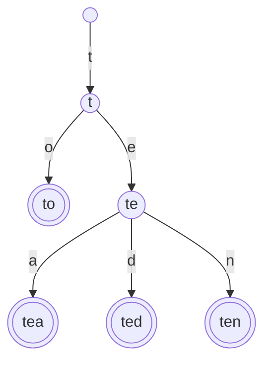

# Trie (Prefix Tree)

> **Estimated Time:** 4 hr | **Difficulty:** Intermediate
> **Prerequisites:** [03 - Hashing](../../01-core-linear/03-hashing/README.md), [04 - Strings](../../01-core-linear/04-strings/README.md), [07 - Bit Manipulation](../../02-intermediate/07-bit-manipulation/README.md), [02 - Backtracking](../../02-intermediate/02-backtracking/README.md), [04 - Binary Search Trees](../04-binary-search-trees/README.md)

---

## What You'll Learn
- You can build a trie from scratch and write `insert`, `search` and `startsWith` without looking.
- You can choose between an array-of-26 node and a `Map` node, and explain the memory trade-off.
- You can add counters to a trie (prefix counts, erase, running sums, top-k lists).
- You can solve grid and stream problems by walking a trie together with DFS or a pointer.
- You can build a binary trie over the bits of numbers to solve "maximum XOR" problems.

## The Big Idea

Think of a paper dictionary with thumb tabs. You do not scan every word. You jump to the tab "c", then the page group "ca", then "cat". Each step cuts the search down to words that share what you have typed so far. A trie is that idea as a tree.

A trie (say "try") is a tree where each edge is one character. A path from the root spells a prefix. Words that share a prefix share the same path. A flag on a node says "a word ends here".

Why not a hash set of words? A set answers "is this exact word present?" fast. It cannot answer "does any word start with `ca`?" without checking every word. A trie answers both in O(length of the query), no matter how many words are stored.

Why interviewers love it: it tests whether you can design your own data structure, and every trie problem is a small twist (a counter, a wildcard, a DFS on a grid, bits instead of letters).

Words: `to`, `tea`, `ted`, `ten`. Double-circle nodes are word ends.






Notice that `tea`, `ted` and `ten` share the nodes `t` and `te`.

**Two ways to store children**

| | Array of 26 | `Map` (or object) |
|---|---|---|
| Child lookup | `kids[ch.charCodeAt(0) - 97]`, very fast | hash lookup, a bit slower |
| Memory per node | always 26 slots, even if 1 is used | only the children that exist |
| Alphabet | fixed (a-z only) | any characters (digits, spaces, unicode) |
| Iterate children in sorted order | free (just loop 0..25) | needs sorting |
| Best for | dense tries, small fixed alphabet, speed | sparse tries, unknown alphabet |

Memory in the worst case is O(total characters x alphabet) for arrays, and O(total characters) for maps. With 10^5 words of length 10, that is up to 10^6 nodes, so 26 million slots for arrays. In JavaScript that is heavy, so a `Map` is often the safer default when the alphabet is not small and fixed. In an interview, say the trade-off out loud and pick one.

## How to Spot It

| If the problem says ... | think ... |
|---|---|
| "starts with", "prefix", "common prefix" | trie |
| many words, many prefix queries | trie, not a set scan |
| "autocomplete", "suggestions", "top k for a prefix" | trie with a list or counter per node |
| search with wildcard `.` | trie plus DFS on the wildcard |
| find many words in a grid | trie plus backtracking (Word Search II) |
| "shortest root / prefix that is a word" | walk the trie, stop at the first word end |
| characters arrive one by one, check suffixes | trie of reversed words |
| "maximum XOR of two numbers" | binary trie, greedy opposite bit |
| count distinct substrings | insert every suffix, count new nodes |

## Core Concepts / Template

**1. The basic trie (array of 26)**

```js
class TrieNode {
  constructor() {
    this.kids = new Array(26).fill(null);
    this.end = false;
  }
}
class Trie {
  constructor() { this.root = new TrieNode(); }
  insert(word) {
    let n = this.root;
    for (const ch of word) {
      const i = ch.charCodeAt(0) - 97;
      if (!n.kids[i]) n.kids[i] = new TrieNode();
      n = n.kids[i];
    }
    n.end = true;
  }
  // shared helper: follow the word, return the last node or null
  _walk(s) {
    let n = this.root;
    for (const ch of s) {
      n = n.kids[ch.charCodeAt(0) - 97];
      if (!n) return null;
    }
    return n;
  }
  search(word)     { const n = this._walk(word); return n !== null && n.end; }
  startsWith(pref) { return this._walk(pref) !== null; }
}
```

The only difference between `search` and `startsWith` is the `end` flag. Write `_walk` once and reuse it.

**2. The Map version (any characters)**

```js
const makeNode = () => ({ kids: new Map(), end: false });
// insert: if (!n.kids.has(ch)) n.kids.set(ch, makeNode()); n = n.kids.get(ch);
```

**3. Trace: insert `tea`, `ted`, then `search("te")`**

| Step | Action | State |
|---|---|---|
| insert tea | create t, e, a; mark a as end | root - t - e - a(end) |
| insert ted | reuse t, e; create d; mark end | e now has kids a, d |
| search "te" | walk t, e; node exists | but `end` is false, so return false |
| startsWith "te" | walk t, e; node exists | return true |

**4. Counters on nodes**

Most variations only add a number to each node: how many words pass through it (`pass`), how many end at it (`end`), a running sum, or a list of top suggestions. Update the counters while you walk down in `insert`.

**5. Binary trie**

Same idea, but the alphabet is {0, 1} and a number is a path of 31 bits (from the top bit down). Each node has two children. To maximize `x ^ y`, walk down and at each bit try to go to the child with the opposite bit, because a different bit gives a 1 in the XOR, and higher bits matter more than all the lower bits together. This greedy choice is why a trie works here.

## Problems (easy -> hard)

### 1. Longest Common Prefix — Easy
**Companies:** Amazon, Google, Microsoft, Apple
**Problem:** Given an array of strings, return the longest prefix shared by all of them, or `""`. Example: `["flower","flow","flight"]` -> `"fl"`.
**Intuition:** Put all words in a trie. The common prefix is the path from the root where every node has exactly one child, and stops as soon as a node branches or a word ends.
**Approach 1 - Brute force:** Compare column by column (character i of every word). Time O(total characters), Space O(1). This is already the simplest answer in an interview.
**Approach 2 - Trie:** Insert all words, then walk down while the node has one child and is not a word end. Time O(total characters), Space O(total characters). Use it when the interviewer asks for a trie, or when you will ask many such questions.

Trace on `flower, flow, flight`: root has only `f`, then only `l`. After `fl` the node has children `o` and `i`, so we stop. Answer `fl`.

```js
function longestCommonPrefix(strs) {
  const root = {};
  for (const s of strs) {
    let n = root;
    for (const ch of s) { if (!n[ch]) n[ch] = {}; n = n[ch]; }
    n.end = true; // 'end' cannot clash: real keys are single characters
  }
  let out = '', n = root;
  while (true) {
    const keys = Object.keys(n).filter(k => k !== 'end');
    if (keys.length !== 1 || n.end) break; // branch, leaf, or a word stops here
    out += keys[0];
    n = n[keys[0]];
  }
  return out;
}
```

**Complexity:** Time O(S) where S is the total number of characters, Space O(S).
**Watch out:** an empty string in the list (the answer is `""`), and a word that is itself a prefix of the others (`["ab","a"]` -> `"a"`), which is why we also stop on `n.end`.

### 2. Index Pairs of a String — Easy
**Companies:** Amazon, Google
**Problem:** Given `text` and a list of `words`, return all `[i, j]` such that `text[i..j]` is one of the words, sorted by `i`, then `j`. Example: `text = "ababa"`, `words = ["aba","ab"]` -> `[[0,1],[0,2],[2,3],[2,4]]`.
**Intuition:** For each start index, walk the trie as far as the text allows. Every time you land on a word end, you found a pair. Stop when the path breaks.
**Approach 1 - Brute force:** For every substring, check a set of words. Time O(n^2 x L) for hashing substrings, Space O(W).
**Approach 2 - Trie:** For each start `i`, walk `j = i, i+1, ...` in the trie. Time O(n x L) where L is the longest word length, Space O(total word characters).

Trace for start `i = 0` on `ababa`: a -> b (word `ab` ends: push [0,1]) -> a (word `aba` ends: push [0,2]) -> b (no child, stop).

```js
function indexPairs(text, words) {
  const root = new Map();
  for (const w of words) {
    let n = root;
    for (const ch of w) { if (!n.has(ch)) n.set(ch, new Map()); n = n.get(ch); }
    n.set('$', true); // '$' marks a word end (real keys are single letters)
  }
  const res = [];
  for (let i = 0; i < text.length; i++) {
    let n = root;
    for (let j = i; j < text.length; j++) {
      n = n.get(text[j]);
      if (!n) break;
      if (n.has('$')) res.push([i, j]);
    }
  }
  return res;
}
```

**Complexity:** Time O(n x L + S), Space O(S) for S word characters.
**Watch out:** do not stop at the first word end; longer words starting at the same index also count. Output order comes out sorted for free because of the loop order.

### 3. Longest Word in Dictionary — Easy
**Companies:** Amazon, Google
**Problem:** Return the longest word that can be built one character at a time by other words in the list (every prefix must also be in the list). Ties go to the smallest lexicographic word. Example: `["a","banana","app","appl","ap","apply","apple"]` -> `"apple"`.
**Intuition:** In the trie, a word is "buildable" if every node on its path is a word end. So DFS from the root, and only step into a child that is a word end.
**Approach 1 - Brute force:** Put words in a set; for each word check all its prefixes. Time O(S x L), Space O(S).
**Approach 2 - Sort:** Sort, then keep a set of buildable words. Time O(S log n).
**Approach 3 - Trie + DFS:** Insert all, DFS only through `end` nodes, track the best. Time O(S).

Trace: `a`, `ap`, `app`, `appl`, `apple`, `apply` are all reachable through end nodes. `apple` and `apply` both have length 5; `apple` is smaller. `banana` is never reached because `b` is not a word.

```js
function longestWord(words) {
  const root = { next: new Map(), end: false };
  for (const w of words) {
    let n = root;
    for (const ch of w) {
      if (!n.next.has(ch)) n.next.set(ch, { next: new Map(), end: false });
      n = n.next.get(ch);
    }
    n.end = true;
  }
  let best = '';
  const dfs = (n, path) => {
    for (const [ch, c] of n.next) {
      if (!c.end) continue; // a missing prefix word breaks the chain
      const w = path + ch;
      if (w.length > best.length || (w.length === best.length && w < best)) best = w;
      dfs(c, w);
    }
  };
  dfs(root, '');
  return best;
}
```

**Complexity:** Time O(S), Space O(S).
**Watch out:** the tie-break must compare with `<` on the string. Return `""` when no one-letter word exists.

### 4. Implement Trie (Prefix Tree) — Medium
**Companies:** Amazon, Google, Microsoft, Meta, Apple
**Problem:** Build a class with `insert(word)`, `search(word)` (exact word) and `startsWith(prefix)`. Example: insert `apple`; `search("apple")` true; `search("app")` false; `startsWith("app")` true.
**Intuition:** One node per character, an `end` flag per node, and a shared walk helper.
**Approach 1 - Brute force:** Keep an array or set of words. `startsWith` scans every word: O(N x L).
**Approach 2 - Trie:** Each operation walks at most L nodes.

The code is the `Trie` class from the Core Concepts section above (array of 26).

**Complexity:** Time O(L) per operation, Space O(total characters x 26) in the worst case.
**Watch out:** `search("app")` after inserting only `apple` must be false: a path existing is not the same as a word ending there.

### 5. Implement Trie II (Prefix Tree with Counts and Erase) — Medium
**Companies:** Google, Amazon (commonly seen in TUF sheets)
**Problem:** Support `insert(word)` (duplicates allowed), `countWordsEqualTo(word)`, `countWordsStartingWith(prefix)` and `erase(word)` (the word is guaranteed to exist). Example: insert `apple` twice -> equal count 2, prefix `app` count 2; erase once -> 1 and 1.
**Intuition:** Two counters per node. `pass` = how many inserted words go through this node. `end` = how many words stop here. Erase is just the reverse of insert: decrement along the same path.
**Approach 1 - Brute force:** A map of word -> count. Equal count is O(L); prefix count is O(N x L).
**Approach 2 - Trie with counters:** Every operation is O(L).

Trace: insert `apple` twice -> nodes a, p, p, l, e each have `pass = 2`, last node `end = 2`. Erase once -> all `pass = 1`, `end = 1`. Erase again -> all 0. The nodes stay in memory, but they are harmless because every query checks the counters.

```js
class TrieNode2 {
  constructor() { this.kids = new Array(26).fill(null); this.pass = 0; this.end = 0; }
}
class Trie2 {
  constructor() { this.root = new TrieNode2(); }
  insert(w) {
    let n = this.root;
    for (const ch of w) {
      const i = ch.charCodeAt(0) - 97;
      if (!n.kids[i]) n.kids[i] = new TrieNode2();
      n = n.kids[i];
      n.pass++;
    }
    n.end++;
  }
  _walk(s) {
    let n = this.root;
    for (const ch of s) { n = n.kids[ch.charCodeAt(0) - 97]; if (!n) return null; }
    return n;
  }
  countWordsEqualTo(w)      { const n = this._walk(w); return n ? n.end : 0; }
  countWordsStartingWith(p) { const n = this._walk(p); return n ? n.pass : 0; }
  erase(w) { // the problem promises w exists
    let n = this.root;
    for (const ch of w) {
      n = n.kids[ch.charCodeAt(0) - 97];
      n.pass--;
    }
    n.end--;
  }
}
```

**Complexity:** Time O(L) per operation, Space O(total characters x 26).
**Watch out:** do not delete nodes, just decrement. If you do want to free memory, delete a child only when its `pass` hits 0. Do not count `pass` on the root, it is never read.

### 6. Map Sum Pairs — Medium
**Companies:** Google, Amazon
**Problem:** `insert(key, val)` sets the value of a key (overwrites if it exists). `sum(prefix)` returns the sum of values of all keys starting with the prefix. Example: insert (`apple`,3), sum(`ap`)=3; insert (`app`,2), sum(`ap`)=5; insert (`apple`,2), sum(`ap`)=4.
**Intuition:** Store at each node the sum of values of all keys passing through it. Then `sum(prefix)` is a single read at the prefix node. For an overwrite, add only the difference (`new - old`), so keep a map of the old value of each key.
**Approach 1 - Brute force:** A map of key -> value; `sum` scans all keys. O(N x L).
**Approach 2 - Trie with sums:** `insert` O(L), `sum` O(L).

Trace: insert (`apple`,3): a,p,p,l,e all get +3. Insert (`app`,2): a,p,p get +2, so `ap` = 5. Insert (`apple`,2): delta = 2 - 3 = -1, so `ap` = 4.

```js
class MapSum {
  constructor() { this.root = { kids: new Map(), sum: 0 }; this.val = new Map(); }
  insert(key, v) {
    const delta = v - (this.val.get(key) || 0); // overwrite adds only the change
    this.val.set(key, v);
    let n = this.root;
    for (const ch of key) {
      if (!n.kids.has(ch)) n.kids.set(ch, { kids: new Map(), sum: 0 });
      n = n.kids.get(ch);
      n.sum += delta;
    }
  }
  sum(prefix) {
    let n = this.root;
    for (const ch of prefix) { n = n.kids.get(ch); if (!n) return 0; }
    return n.sum;
  }
}
```

**Complexity:** Time O(L) per call, Space O(total characters).
**Watch out:** the overwrite case. Adding the new value without removing the old one is the classic bug.

### 7. Replace Words — Medium
**Companies:** Amazon, Google, Uber
**Problem:** Given a dictionary of roots and a sentence, replace each word with the shortest root that is a prefix of it. Example: roots `cat, bat, rat`, sentence `the cattle was rattled by the battery` -> `the cat was rat by the bat`.
**Intuition:** Walk each word in the trie. The first time you land on a word end, that is the shortest root, so stop and cut there. If the path breaks first, keep the word.
**Approach 1 - Brute force:** For each word, test every root with `startsWith`. Time O(words x roots x L).
**Approach 2 - Trie:** Time O(total characters of the sentence + roots).

Trace for `cattle`: c -> a -> t (word end, root `cat`) -> return `cat`. For `the`: `t` is not in the trie -> keep `the`.

```js
function replaceWords(dictionary, sentence) {
  const root = new Map();
  for (const w of dictionary) {
    let n = root;
    for (const ch of w) { if (!n.has(ch)) n.set(ch, new Map()); n = n.get(ch); }
    n.set('$', true);
  }
  const shortest = (word) => {
    let n = root;
    for (let i = 0; i < word.length; i++) {
      n = n.get(word[i]);
      if (!n) return word;                    // no root matches
      if (n.has('$')) return word.slice(0, i + 1); // first end = shortest root
    }
    return word;
  };
  return sentence.split(' ').map(shortest).join(' ');
}
```

**Complexity:** Time O(D + S), Space O(D) where D is root characters and S sentence characters.
**Watch out:** stop at the FIRST end node. With roots `cat` and `catt`, a word like `cattle` must become `cat`.

### 8. Design Add and Search Words Data Structure — Medium
**Companies:** Meta, Amazon, Google, Microsoft
**Problem:** `addWord(word)` and `search(word)` where `search` may contain `.` meaning any one letter. Example: add `bad, dad, mad`; `search("pad")` false, `search(".ad")` true, `search("b..")` true.
**Intuition:** A normal letter follows one child. A `.` must try every child, so use recursion: for `.`, loop over all children and return true if any works. This is a small backtracking search over the trie.
**Approach 1 - Brute force:** Keep all words in a list, compare each against the pattern. O(N x L) per search.
**Approach 2 - Trie + DFS:** Normal letters cost O(1) per step; each `.` branches. Worst case (all dots) visits every node of that depth: O(26^L) in theory, but bounded by the number of nodes actually stored.

Trace for `b..` with words bad, dad, mad: `b` -> only child `a`; first `.` matches `a`; second `.` tries children of `a`: `d` exists and the word ends -> true.

```js
class WordDictionary {
  constructor() { this.root = { kids: new Map(), end: false }; }
  addWord(w) {
    let n = this.root;
    for (const ch of w) {
      if (!n.kids.has(ch)) n.kids.set(ch, { kids: new Map(), end: false });
      n = n.kids.get(ch);
    }
    n.end = true;
  }
  search(w) {
    const go = (n, i) => {
      if (i === w.length) return n.end;
      if (w[i] === '.') {
        for (const c of n.kids.values()) if (go(c, i + 1)) return true;
        return false;
      }
      const c = n.kids.get(w[i]);
      return c ? go(c, i + 1) : false;
    };
    return go(this.root, 0);
  }
}
```

**Complexity:** `addWord` O(L). `search` O(L) with no dots, up to O(nodes) with many dots. Space O(total characters).
**Watch out:** at the end of the pattern return `n.end`, not `true` (`search("b.")` must be false when only `bad` is stored).

### 9. Maximum XOR of Two Numbers in an Array — Medium
**Companies:** Amazon, Google, Meta, Microsoft
**Problem:** Return the maximum `nums[i] XOR nums[j]` over all pairs. Example: `[3,10,5,25,2,8]` -> `28` (from `5 ^ 25`).
**Intuition:** XOR is largest when the two numbers differ at the highest possible bits. Store all numbers as 31-bit paths in a binary trie. For each number, walk down and at each bit prefer the child with the opposite bit; if it does not exist, take the same bit.
**Approach 1 - Brute force:** Try all pairs. Time O(n^2), Space O(1).
**Approach 2 - Better:** Build the answer bit by bit using a hash set of prefixes. Time O(31 n).
**Approach 3 - Optimal (binary trie):** Time O(31 n), Space O(31 n).

Trace with 5-bit numbers: `5 = 00101` and `25 = 11001`. Query 5 against a trie holding 25 (and others): top bit, 5 has 0, we want 1, 25 offers 1, take it (answer bit 1). Next bit, 5 has 0, 25 has 1, take it (answer bit 1). Next bit, 5 has 1, 25 has 0, take it (answer bit 1). Last two bits: 5 has `01`, 25 has `01`, same, so they add 0. Result `11100 = 28`.

```js
function findMaximumXOR(nums) {
  const root = [null, null];
  const insert = (x) => {
    let n = root;
    for (let b = 30; b >= 0; b--) {
      const bit = (x >> b) & 1;
      if (!n[bit]) n[bit] = [null, null];
      n = n[bit];
    }
  };
  const best = (x) => {
    let n = root, r = 0;
    for (let b = 30; b >= 0; b--) {
      const bit = (x >> b) & 1;
      if (n[1 - bit]) { r |= (1 << b); n = n[1 - bit]; } // opposite bit gives a 1
      else n = n[bit];
    }
    return r;
  };
  let ans = 0;
  insert(nums[0]);
  for (let i = 1; i < nums.length; i++) { // query before insert: pairs i != j
    ans = Math.max(ans, best(nums[i]));
    insert(nums[i]);
  }
  return ans;
}
```

**Complexity:** Time O(31 n), Space O(31 n) nodes.
**Watch out:** JavaScript bit operators work on signed 32-bit ints; with values below 2^31 and bits 30..0 you never touch the sign bit. A one-element array returns 0 (the loop never runs).

### 10. Count Distinct Substrings — Medium
**Companies:** -
**Problem:** Count the distinct substrings of a string (this is the TakeUForward version, which also counts the empty substring). Example: `"abab"` -> `8`: `a, b, ab, ba, aba, bab, abab` and the empty string.
**Intuition:** Every substring is a prefix of some suffix. Insert every suffix into a trie. Each time you create a NEW node, you found a new distinct substring, because a node is a unique path.
**Approach 1 - Brute force:** Put every substring in a set. Time O(n^3) because of slicing, Space O(n^3).
**Approach 2 - Trie of suffixes:** Time O(n^2), Space O(n^2) nodes. 
**Approach 3 - Suffix array / automaton:** O(n log n) or O(n). Mention it; see [01 - String Algorithms](../../06-advanced/01-string-algorithms/README.md).

Trace on `aba`: suffix `aba` creates a, b, a (3 new nodes). Suffix `ba`: root has no `b` child, so `b` and `a` are new (2 new). Suffix `a`: already there (0 new). That is 5 non-empty substrings: `a, ab, aba, b, ba`. Add 1 for the empty string if the problem asks for it.

```js
function countDistinctSubstrings(s) {
  const root = new Map();
  let count = 1; // the empty substring, as the TUF version counts it
  for (let i = 0; i < s.length; i++) {
    let n = root;
    for (let j = i; j < s.length; j++) {
      if (!n.has(s[j])) { n.set(s[j], new Map()); count++; }
      n = n.get(s[j]);
    }
  }
  return count;
}
```

**Complexity:** Time O(n^2), Space O(n^2).
**Watch out:** read the statement: LeetCode-style versions that exclude the empty string want `count - 1`. Ask the interviewer.

### 11. Design Search Autocomplete System — Hard
**Companies:** Amazon, Google, Meta, Uber
**Problem:** Start with `sentences[]` and `times[]`. Each `input(c)` is one typed character: return the top 3 historical sentences (most frequent first, ties broken by ASCII order) that start with everything typed so far. The character `#` ends the sentence: record it with count +1 and return `[]`. Example: after typing `i`, `" "`, `a`, `#`, the sentence `"i a"` is stored with count 1.
**Intuition:** A trie where each node keeps a map `sentence -> count` for every sentence passing through it. Typing a character moves one step down; the suggestions are the top 3 of that node's map. Keep a current-node pointer so each keystroke is O(1) to move. If the path breaks, mark it dead until `#`.
**Approach 1 - Brute force:** Keep a map of all sentences; on every keystroke filter by prefix and sort. O(N x L + N log N) per keystroke.
**Approach 2 - Trie with per-node maps:** Moving is O(1); sorting the node's map costs O(m log m) where m is sentences under that prefix. Fine for interview scale.
**Approach 3 - Better:** Keep only the top 3 per node and update on insert; faster to read, more bookkeeping. Mention it as a follow-up.

Trace (sentences `i love you`:5, `island`:3, `iroman`:2, `i love leetcode`:2):

| Input | Node | Candidates (count) | Output |
|---|---|---|---|
| `i` | i | i love you 5, island 3, iroman 2, i love leetcode 2 | i love you, island, i love leetcode (tie 2: `"i love leetcode"` < `"iroman"`) |
| ` ` | `i ` | i love you 5, i love leetcode 2 | both |
| `a` | `i a` missing | dead | [] |
| `#` | reset, store `i a` +1 | | [] |

```js
class AutocompleteSystem {
  constructor(sentences, times) {
    this.root = { kids: new Map(), hot: new Map() }; // hot: sentence -> count
    this.cur = ''; this.node = this.root; this.dead = false;
    sentences.forEach((s, i) => this._add(s, times[i]));
  }
  _add(s, t) {
    let n = this.root;
    for (const ch of s) {
      if (!n.kids.has(ch)) n.kids.set(ch, { kids: new Map(), hot: new Map() });
      n = n.kids.get(ch);
      n.hot.set(s, (n.hot.get(s) || 0) + t);
    }
  }
  input(c) {
    if (c === '#') {
      this._add(this.cur, 1);
      this.cur = ''; this.node = this.root; this.dead = false;
      return [];
    }
    this.cur += c;
    if (!this.dead) {
      this.node = this.node.kids.get(c);
      if (!this.node) this.dead = true; // stay dead until '#'
    }
    if (this.dead) return [];
    return [...this.node.hot.entries()]
      .sort((a, b) => b[1] - a[1] || (a[0] < b[0] ? -1 : 1)) // count desc, then ASCII
      .slice(0, 3)
      .map(e => e[0]);
  }
}
```

**Complexity:** Time per `input`: O(1) to move plus O(m log m) to rank; `#` costs O(L). Space O(total characters x sentences per prefix), which is large: every node stores the sentences below it.
**Watch out:** once the path breaks, later characters must still be recorded in `cur` but must not move the pointer. Compare strings with `<`, not `localeCompare` (the problem uses ASCII order, where space comes before letters).

### 12. Stream of Characters — Hard
**Companies:** Google, Amazon, Microsoft
**Problem:** Given a list of words, `query(c)` receives the next character of a stream and returns true if some suffix of the stream so far is one of the words. Example: words `cd, f, kl`; stream `a b c d` -> the query on `d` is true because the stream ends with `cd`.
**Intuition:** We care about the END of the stream, so store the words reversed. On each query, walk the trie from the newest character backwards through the stream. Return true the moment you hit a word end.
**Approach 1 - Brute force:** For each query, test every word against the end of the stream. O(N x L).
**Approach 2 - Forward trie with many pointers:** Keep a list of active trie nodes (like parallel pointers); each query advances all of them. Works but the list can grow to the number of words.
**Approach 3 - Reversed trie:** Keep only the last `maxLen` characters. Each query walks at most `maxLen` nodes.

Trace for words `cd, f, kl`, reversed trie: `d-c`, `f`, `l-k`. Stream `... c d`: newest char `d` -> node d (not a word end) -> previous char `c` -> node c, word end -> true.

```js
class StreamChecker {
  constructor(words) {
    this.root = { kids: new Map(), end: false };
    this.maxLen = 0;
    for (const w of words) {
      let n = this.root;
      for (let i = w.length - 1; i >= 0; i--) { // insert reversed
        if (!n.kids.has(w[i])) n.kids.set(w[i], { kids: new Map(), end: false });
        n = n.kids.get(w[i]);
      }
      n.end = true;
      this.maxLen = Math.max(this.maxLen, w.length);
    }
    this.stream = [];
  }
  query(c) {
    this.stream.push(c);
    // shortcut: shift is O(maxLen); use a ring buffer if that ever matters
    if (this.stream.length > this.maxLen) this.stream.shift();
    let n = this.root;
    for (let i = this.stream.length - 1; i >= 0; i--) {
      n = n.kids.get(this.stream[i]);
      if (!n) return false;
      if (n.end) return true; // some suffix is a word
    }
    return false;
  }
}
```

**Complexity:** Time O(maxLen) per query, Space O(total characters + maxLen).
**Watch out:** return true on the FIRST word end while walking back; you do not need the longest match. Do not keep the whole stream forever; only `maxLen` characters can matter.

### 13. Maximum XOR With an Element From Array — Hard
**Companies:** Google, Amazon (commonly seen in TUF sheets)
**Problem:** For each query `[x, m]`, return the maximum `x ^ nums[j]` among `nums[j] <= m`, or `-1` if no such number exists. Example: `nums = [0,1,2,3,4]`, queries `[[3,1],[1,3],[5,6]]` -> `[3,3,7]`.
**Intuition:** The limit `m` changes per query, so a single trie does not fit. Trick: answer queries OFFLINE. Sort numbers ascending and queries by `m`. Move through queries in that order and insert into the trie only the numbers `<= m`. The trie then holds exactly the allowed set, and we run the same greedy walk as problem 9.
**Approach 1 - Brute force:** For each query scan all numbers. Time O(q x n).
**Approach 2 - Offline sort + binary trie:** Time O((n + q) x 30 + n log n + q log q), Space O(30 n).

Trace for `nums = [0,1,2,3,4]`, queries sorted by m: `(x=3,m=1)`, `(x=1,m=3)`, `(x=5,m=6)`. Query 1: insert 0, 1; best of `3^0=3`, `3^1=2` -> 3. Query 2: also insert 2, 3; best of `1^0, 1^1, 1^2=3, 1^3=2` -> 3. Query 3: insert 4; `5^2=7` -> 7. Results are written back to the original query index.

```js
function maximizeXor(nums, queries) {
  nums = [...nums].sort((a, b) => a - b);
  const qs = queries.map((q, i) => [q[0], q[1], i]).sort((a, b) => a[1] - b[1]);
  const root = [null, null];
  const insert = (x) => {
    let n = root;
    for (let b = 29; b >= 0; b--) { // values are below 2^30
      const bit = (x >> b) & 1;
      if (!n[bit]) n[bit] = [null, null];
      n = n[bit];
    }
  };
  const best = (x) => {
    let n = root, r = 0;
    for (let b = 29; b >= 0; b--) {
      const bit = (x >> b) & 1;
      if (n[1 - bit]) { r |= (1 << b); n = n[1 - bit]; } else n = n[bit];
    }
    return r;
  };
  const ans = new Array(queries.length);
  let p = 0, any = false;
  for (const [x, m, idx] of qs) {
    while (p < nums.length && nums[p] <= m) { insert(nums[p++]); any = true; }
    ans[idx] = any ? best(x) : -1; // empty trie => no allowed number
  }
  return ans;
}
```

**Complexity:** Time O(n log n + q log q + 30 (n + q)), Space O(30 n + q).
**Watch out:** an empty trie would make `best` crash (null child), so track `any`. Store the original index before sorting, or the answers come back in the wrong order. This assumes values below 2^30 (the usual 10^9 limit); use 31 bits if values can reach 2^30 or more.

### 14. Word Search II — Hard
**Companies:** Google, Amazon, Microsoft, Meta, Uber
**Problem:** Given a letter grid and a list of words, return all words that can be formed by walking adjacent cells (up/down/left/right) without reusing a cell in one word. Example: the board `oaan / etae / ihkr / iflv` with words `oath, pea, eat, rain` -> `["oath","eat"]`.
**Intuition:** Running Word Search I once per word repeats work. Put all words in a trie and run ONE DFS from every cell. The trie tells you instantly when the current path is not a prefix of any word, so you stop early. When you reach a node that stores a word, record it.
**Approach 1 - Brute force:** For each word, DFS from each cell. Time O(W x R x C x 4^L).
**Approach 2 - Trie + backtracking:** Walk the board and the trie together. Time O(R x C x 4^L) worst case but heavily pruned.
**Approach 3 - Optimal pruning:** Also (a) store the whole word at its end node so you do not rebuild strings, (b) set `word = null` after finding it so duplicates are not added, (c) delete leaf nodes that have no children and no word, so dead branches are never walked again.

Trace for `oath`: start at `o` (0,0) -> trie child `o` exists -> move to `a` (1,0 is `e`, no; 0,1 is `a`, yes) -> `t` (1,1) -> `h` (2,1) -> node stores `oath`: push it. Mark the visited cell with `#` while going down, restore on the way back.

```js
function findWords(board, words) {
  const root = { kids: new Map(), word: null };
  for (const w of words) {
    let n = root;
    for (const ch of w) {
      if (!n.kids.has(ch)) n.kids.set(ch, { kids: new Map(), word: null });
      n = n.kids.get(ch);
    }
    n.word = w; // store the word itself at its end
  }
  const res = [], R = board.length, C = board[0].length;
  const dfs = (r, c, parent) => {
    const ch = board[r][c];
    const node = parent.kids.get(ch);
    if (!node) return;
    if (node.word !== null) { res.push(node.word); node.word = null; } // no duplicates
    board[r][c] = '#'; // visited
    for (const [dr, dc] of [[1, 0], [-1, 0], [0, 1], [0, -1]]) {
      const nr = r + dr, nc = c + dc;
      if (nr >= 0 && nr < R && nc >= 0 && nc < C && board[nr][nc] !== '#') dfs(nr, nc, node);
    }
    board[r][c] = ch; // undo
    if (node.kids.size === 0 && node.word === null) parent.kids.delete(ch); // prune
  };
  for (let r = 0; r < R; r++) for (let c = 0; c < C; c++) dfs(r, c, root);
  return res;
}
```

**Complexity:** Time O(R x C x 3^L) in practice (4 directions at the first step, 3 after), Space O(total word characters + L) for trie and recursion.
**Watch out:** do not keep walking past a found word without checking longer words (`a` and `aa` can both be found). Restore the cell after the loop. The code changes the input board temporarily; mention that, and say you could copy it if mutation is not allowed.

### 15. Palindrome Pairs — Hard
**Companies:** Google, Amazon, Airbnb, Meta
**Problem:** Given distinct words, return all pairs of indices `(i, j)`, `i != j`, such that `words[i] + words[j]` is a palindrome. Example: `["abcd","dcba","lls","s","sssll"]` -> `[[0,1],[1,0],[3,2],[2,4]]` (order does not matter).
**Intuition:** For `a + b` to be a palindrome, `b` must mirror `a` at the ends. Insert every word REVERSED into a trie. Then walk word `a` forward through the trie. Three situations:
1. `a` ends exactly where a reversed word ends: they are exact mirrors, pair works.
2. The trie word ends early (`b` shorter than `a`): the rest of `a` must be a palindrome.
3. `a` ends but the trie path goes on (`b` longer than `a`): the leftover part of `b` must be a palindrome. Precompute at each node the list of word indices whose unwalked remainder is a palindrome.
**Approach 1 - Brute force:** Test all pairs. Time O(n^2 x L), Space O(1).
**Approach 2 - Hash map of reversed words:** For each word, split at every position and look up the mirror. Time O(n x L^2).
**Approach 3 - Trie:** same worst-case idea as Approach 2 but handled in one walk. Time O(n x L^2) worst case (palindrome checks), Space O(n x L).

Trace for `s` and `lls`: reversed `lls` is `sll`, stored as s-l-l. Walk `s`: node `s` after one step. Case 3: leftover of `sll` after `s` is `ll`, a palindrome, so `lls` is in that node's `rest` list. Pair `(s, lls)` -> `"slls"`, a palindrome. In the output that is `[3,2]`.

```js
function palindromePairs(words) {
  // trie of reversed words; rest = indices whose unwalked part is a palindrome
  const root = { kids: new Map(), idx: -1, rest: [] };
  const isPal = (s, i, j) => { while (i < j) if (s[i++] !== s[j--]) return false; return true; };
  words.forEach((w, k) => {
    let n = root;
    for (let i = w.length - 1; i >= 0; i--) {
      if (isPal(w, 0, i)) n.rest.push(k); // w[0..i] is the part still to walk
      if (!n.kids.has(w[i])) n.kids.set(w[i], { kids: new Map(), idx: -1, rest: [] });
      n = n.kids.get(w[i]);
    }
    n.idx = k;
    n.rest.push(k); // nothing left: the empty rest is a palindrome
  });
  const res = [];
  words.forEach((w, k) => {
    let n = root, i = 0;
    for (; i < w.length; i++) {
      // case 2: a shorter reversed word ends here and the rest of w is a palindrome
      if (n.idx >= 0 && n.idx !== k && isPal(w, i, w.length - 1)) res.push([k, n.idx]);
      n = n.kids.get(w[i]);
      if (!n) return;
    }
    // cases 1 and 3: w fully walked, every word in rest completes a palindrome
    for (const j of n.rest) if (j !== k) res.push([k, j]);
  });
  return res;
}
```

**Complexity:** Time O(n x L^2) worst case, Space O(n x L) for the trie plus the rest lists (each word is added to at most L+1 lists, so up to O(n x L) entries).
**Watch out:** the empty string `""` pairs with every palindrome word in both orders (the code handles it: the root has `idx` set and `isPal` on an empty range is true). Skip `j === k`. Words are distinct in the problem, so no duplicate pairs appear.

## Common Mistakes
- **Wrong belief:** "A path in the trie means the word exists." -> Only if the last node has `end = true`. `search("app")` after inserting only `apple` is false.
- **Wrong belief:** "Array of 26 is always better." -> It wastes memory when the trie is sparse or the alphabet is bigger than lowercase letters. Say the trade-off and pick.
- **Wrong belief:** "Erase means deleting nodes." -> Decrementing counters is enough and simpler. Prune only if memory matters.
- Forgetting to restore the board cell (or the `#` marker) in Word Search II, which corrupts later searches.
- Adding the same word twice to the result in Word Search II. Clear the stored word after finding it.
- In Map Sum, adding the new value on overwrite instead of the difference.
- In Replace Words, returning the longest matching root instead of the shortest.
- In Maximum XOR, going down the SAME bit instead of the OPPOSITE bit, or iterating bits from low to high. The greedy only works from the top bit down.

## Interview Tips
- Start by saying why a trie: "I need prefix queries, and a hash set only answers exact matches." Then state the node shape and the choice of children storage.
- Write `_walk` once and build `search` and `startsWith` on it. It shows clean thinking and avoids duplicate bugs.
- Say the complexity in terms of word length L, not number of words: insert, search and startsWith are O(L).
- Mention memory: worst case O(total characters x alphabet) with arrays. Offer a `Map` or compressed (radix) trie as the fix; you do not need to code it.
- Follow-ups you may hear: "support delete" (counters, or prune nodes on the way back), "case-insensitive or unicode" (use a Map), "top-k suggestions fast" (store top-k per node), "too big for memory" (compressed trie, disk-based structure), "what if the dictionary changes while streaming".
- Edge cases to say out loud: empty string, one word being a prefix of another, duplicate words, a query longer than any stored word, no match at all.
- For XOR problems: explain why the greedy opposite-bit choice is correct (a higher bit outweighs all lower bits together).

## Practice List
**Easy:** Longest Common Prefix, Index Pairs of a String, Longest Word in Dictionary, Counting Words With a Given Prefix, Check If a Word Occurs As a Prefix of Any Word in a Sentence.
**Medium:** Implement Trie (Prefix Tree), Implement Trie II, Design Add and Search Words Data Structure, Replace Words, Map Sum Pairs, Maximum XOR of Two Numbers in an Array, Search Suggestions System, Short Encoding of Words, Count Prefix and Suffix pairs, Sum of Prefix Scores of Strings, Count Pairs With XOR in a Range.
**Hard:** Word Search II, Design Search Autocomplete System, Stream of Characters, Maximum XOR With an Element From Array, Palindrome Pairs, Concatenated Words, Maximum Genetic Difference Query, Prefix and Suffix Search, Word Squares.

## Key Takeaways
- A trie stores words as shared **character paths**, so prefix queries cost **O(length of the word)**, not O(number of words).
- **Search needs the end flag**; `startsWith` does not. One walk helper serves both.
- Choose **array of 26** for speed on a small fixed alphabet, **Map** for sparse tries or large alphabets.
- Most variations just add a **counter per node** (pass count, end count, running sum, top-k list).
- For grids, walk the **trie and the board together** and prune dead branches; for streams, **reverse the words** and walk the stream backwards.
- A **binary trie** with the greedy "take the opposite bit, top bit first" solves maximum-XOR problems in O(31 n); offline sorting handles per-query limits.
- Counting distinct substrings = **inserting every suffix** and counting newly created nodes.

---
[← Previous: Binary Search Trees](../04-binary-search-trees/README.md) | [Next: Graph Basics, BFS and DFS →](../../04-graphs/01-graph-basics-bfs-dfs/README.md) | [Back to Trees Index](../README.md)
