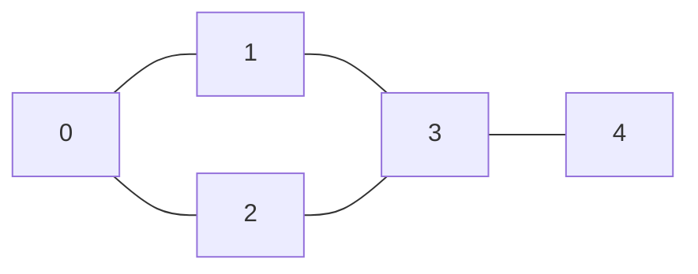

# Graph Basics, BFS and DFS

> **Estimated Time:** 6 hr | **Difficulty:** Intermediate
> **Prerequisites:** [10 - Stack and Queue](../../01-core-linear/10-stack-and-queue/README.md), [01 - Recursion](../../02-intermediate/01-recursion/README.md), [01 - Binary Tree Traversals](../../03-trees/01-binary-tree-traversals/README.md)

---

## What You'll Learn
- You can describe any graph with the right words: directed, undirected, weighted, degree, component.
- You can turn an edge list into an adjacency list in JavaScript in one short function.
- You can write BFS and DFS (recursive and iterative) from memory, and explain when to use which.
- You can use BFS to find the shortest path when every edge costs the same.
- You can set the visited marker at the right moment, so your code never loops forever and never does extra work.

## The Big Idea

Think of a city map. Places are dots, roads are lines between dots. You stand at one place and want to know: "Where can I get to? What is the fewest number of roads to reach the bakery?" That is a graph question. A tree is just a graph with no loops and one clear root. A graph is the general version: loops are allowed, there may be no root, and parts of it may be cut off from other parts.

Two ways to explore:
- **BFS (breadth first):** like a ripple in a pond. First everything 1 step away, then everything 2 steps away, and so on. Uses a **queue**.
- **DFS (depth first):** like walking a maze with a ball of string. Go as deep as you can, hit a dead end, walk back, try the next turn. Uses a **stack** (or recursion, which is a stack in disguise).

Why interviewers love it: graphs hide inside many problems (word changes, locks, rooms, courses, grids, friends). If you can see "these are nodes, these are edges", then a 15-line BFS or DFS solves the problem. The test is mostly: do you model it correctly, and do you handle `visited` correctly?

### Vocabulary

| Word | Meaning |
|---|---|
| Node / vertex | One dot (a city, a person, a word) |
| Edge | A line between two nodes |
| Undirected | Edge works both ways (friendship). Store it twice. |
| Directed | Edge has an arrow (follow, prerequisite). Store it once. |
| Weighted | Each edge has a cost (distance, price) |
| Degree | Number of edges at a node. Directed: **in-degree** (arrows in) and **out-degree** (arrows out). |
| Path | A walk from one node to another along edges |
| Cycle | A path that returns to where it started |
| Connected | Undirected graph where every node can reach every other |
| Component | One "island" of nodes that can reach each other |
| Tree | Connected graph with no cycle. A tree with `n` nodes has `n - 1` edges. |
| Sparse / dense | Few edges (about `n`) / many edges (about `n^2`) |

Small example used in the traces below (5 nodes, undirected):




### Adjacency list vs adjacency matrix

| | Adjacency list | Adjacency matrix |
|---|---|---|
| Idea | `adj[u]` = array of neighbours of `u` | `m[u][v] = 1` if edge `u-v` exists |
| Space | O(V + E) | O(V^2) |
| Walk all neighbours of `u` | O(degree of u) | O(V) |
| "Is there an edge u-v?" | O(degree of u) | O(1) |
| Best for | Most problems, sparse graphs | Dense graphs, tiny `V`, or when the input is already a matrix |

Default to the adjacency list. Interview graphs are almost always sparse.

### Building a graph from an edge list

Input is usually `n` and `edges = [[u, v], ...]`. Nodes are numbered `0..n-1` (sometimes `1..n`; then make the array size `n + 1`).

```js
function buildGraph(n, edges, directed = false) {
  const g = Array.from({ length: n }, () => []); // NOT new Array(n).fill([]) -> shared array bug
  for (const [u, v] of edges) {
    g[u].push(v);
    if (!directed) g[v].push(u); // undirected = store both ways
  }
  return g;
}
```

For weighted edges, push `[v, w]` pairs. For string nodes (words), use a `Map` of arrays or build neighbours on the fly (see Word Ladder).

## How to Spot It

| If the problem says ... | think ... |
|---|---|
| "fewest steps / minimum moves / shortest path", all moves cost 1 | **BFS** (levels = distance) |
| "can I reach X", "is there a path", "are they connected" | BFS or DFS, either works |
| "count groups / islands / provinces / components" | Loop over nodes, start a search from each unvisited one, count starts |
| "all paths", "all combinations of moves" | DFS with backtracking |
| "copy / clone a structure with cycles" | Traverse + Map from old node to new node |
| "a state changes one small step at a time" (lock digits, word letters, gene letters) | Each state is a node; BFS over states |
| "A depends on B", "order of tasks" | Directed graph; see [Topological Sort](../04-topological-sort/README.md) |
| Grid with 4 or 8 moves | Graph in disguise; see [Grid and Islands](../02-grid-and-islands/README.md) |
| Edges have different costs | Not plain BFS; see [Shortest Paths](../05-shortest-paths/README.md) |

## Core Concepts / Template

### The visited-set rules (read this twice)

1. A graph can have cycles, so without `visited` your search runs forever.
2. **Mark a node visited at the moment you put it in the queue (BFS), not when you take it out.** If you mark on removal, the same node can be pushed many times before it is popped. The answer stays right but the queue gets big, and in dense graphs it becomes slow.
3. For DFS, mark when you enter the node (first line of the recursive function).
4. Visited is per search, not per path. Exception: when the problem asks for **all paths** in a DAG, you do not use visited at all; you backtrack instead.
5. For undirected cycle detection, ignore the node you came from (the parent). That is covered in the cycle chapter.
6. Disconnected graph? One search only covers one component. Wrap it in `for (s = 0; s < n; s++) if (!seen[s]) ...`.

### BFS template (queue, levels, shortest path)

Use an array and a moving index `i` instead of `queue.shift()`. `shift()` can cost O(n) per call on a big array; the index trick is O(1).

```js
function bfs(adj, start) {
  const dist = new Array(adj.length).fill(-1); // -1 means "not visited", doubles as visited
  dist[start] = 0;
  const q = [start];
  for (let i = 0; i < q.length; i++) {        // i is the front of the queue
    const u = q[i];
    for (const v of adj[u]) {
      if (dist[v] === -1) {                   // first time we see v
        dist[v] = dist[u] + 1;                // one more edge than its parent
        q.push(v);                            // marked on push
      }
    }
  }
  return dist; // dist[x] = fewest edges from start to x, -1 if unreachable
}
```

Why BFS gives the shortest path: it visits nodes in order of distance. All nodes at distance 1 are taken before any at distance 2. So the first time you reach a node, you reached it by the fewest edges. This is true only when every edge costs the same.

Trace on the example graph, start = 0 (adjacency: 0:[1,2], 1:[0,3], 2:[0,3], 3:[1,2,4], 4:[3]):

| Pop | Push (new neighbours) | Queue after | dist |
|---|---|---|---|
| 0 | 1, 2 | [1, 2] | 0:0, 1:1, 2:1 |
| 1 | 3 (0 is seen) | [2, 3] | 3:2 |
| 2 | none (0, 3 seen) | [3] | |
| 3 | 4 | [4] | 4:3 |
| 4 | none | [] | |

Order: 0, 1, 2, 3, 4.

To process level by level (for example, "return a list per level"), freeze the queue size at the start of each round:

```js
function bfsLevels(adj, start) {
  const seen = new Array(adj.length).fill(false);
  seen[start] = true;
  let level = [start];
  const levels = [];
  while (level.length) {
    levels.push(level);
    const next = [];
    for (const u of level) for (const v of adj[u]) if (!seen[v]) { seen[v] = true; next.push(v); }
    level = next;
  }
  return levels;
}
```

### DFS template (recursive and iterative)

```js
function dfs(adj, u, seen) {          // recursive
  seen[u] = true;
  for (const v of adj[u]) if (!seen[v]) dfs(adj, v, seen);
}

function dfsIterative(adj, start) {   // explicit stack
  const seen = new Array(adj.length).fill(false);
  const st = [start];
  while (st.length) {
    const u = st.pop();
    if (seen[u]) continue;            // here we mark on POP, because a node can be pushed twice
    seen[u] = true;
    for (let i = adj[u].length - 1; i >= 0; i--) st.push(adj[u][i]); // reverse so order matches recursion
  }
}
```

Trace of recursive DFS on the example, start 0: enter 0, go to 1, from 1 go to 3 (0 seen), from 3 the neighbours are [1, 2, 4]: 1 is seen, go to 2 (its neighbours 0 and 3 are seen, return), go to 4, return all the way. Order: 0, 1, 3, 2, 4.

Note the two different "mark" moments. In BFS you mark when pushing. In iterative DFS the simple version marks when popping (it is allowed to push a node twice). Both are correct; just do not mix them up inside one function.

Recursion depth: JavaScript stacks overflow somewhere around 10,000 frames deep (the exact number varies). For a path-like graph with 100,000 nodes use iterative DFS or BFS. In an interview, mention this.

### BFS vs DFS: which one?

| | BFS | DFS |
|---|---|---|
| Data structure | Queue | Stack / recursion |
| Finds shortest path (unweighted) | Yes | No |
| Memory | Up to the widest level | Up to the deepest path |
| Natural for | Distances, levels, minimum moves | All paths, components, cycles, backtracking, ordering |
| Time | O(V + E) | O(V + E) |

Both visit every node once and every edge once (twice if undirected), so both are O(V + E) time and O(V) extra space.

## Problems (easy -> hard)

### 1. BFS of Graph — Easy
**Companies:** Amazon, Microsoft, Flipkart
**Problem:** Given an adjacency list of a connected undirected graph with nodes `0..V-1`, return the BFS order starting from node 0. Visit neighbours in the order they are stored. Example: `adj = [[1,2],[0,3],[0,3],[1,2,4],[3]]` -> `[0,1,2,3,4]`.
**Intuition:** Ripple in a pond. A queue keeps "who is next in line". Mark a node the moment it joins the line.
**Approach 1 - Brute force:** No simpler method exists; BFS itself is the baseline. Time O(V + E), Space O(V).
**Approach 3 - Optimal:** Queue with a moving index. Trace is in the BFS template above (order 0, 1, 2, 3, 4).

```js
function bfsOfGraph(adj) {
  const seen = new Array(adj.length).fill(false);
  const order = [];
  const q = [0];
  seen[0] = true;
  for (let i = 0; i < q.length; i++) {
    const u = q[i];
    order.push(u);
    for (const v of adj[u]) if (!seen[v]) { seen[v] = true; q.push(v); }
  }
  return order;
}
```

**Complexity:** Time O(V + E), Space O(V).
**Watch out:** If the graph might be disconnected, loop over all start nodes. Also handle the one-node graph `[[]]` -> `[0]`.

### 2. DFS of Graph — Easy
**Companies:** Amazon, Microsoft, Flipkart
**Problem:** Same input as above; return the DFS order from node 0, visiting neighbours in stored order. Example: `adj = [[1,2],[0,3],[0,3],[1,2,4],[3]]` -> `[0,1,3,2,4]`.
**Intuition:** Walk as deep as possible, then come back. Recursion remembers the way back for you.
**Approach 1 - Brute force:** None; DFS is the baseline. Time O(V + E), Space O(V).
**Approach 3 - Optimal:** Recursive DFS. Dry run: enter 0 -> 1 -> 3 -> (1 seen) -> 2 -> back -> 4. Order 0, 1, 3, 2, 4.

```js
function dfsOfGraph(adj) {
  const seen = new Array(adj.length).fill(false);
  const order = [];
  (function dfs(u) {
    seen[u] = true;
    order.push(u);
    for (const v of adj[u]) if (!seen[v]) dfs(v);
  })(0);
  return order;
}
```

**Complexity:** Time O(V + E), Space O(V) for `seen` and the recursion stack.
**Watch out:** Deep graphs can overflow the call stack; the iterative version in the template avoids that.

### 3. Find if Path Exists in Graph — Easy
**Companies:** Amazon, Google, Meta
**Problem:** Undirected graph with `n` nodes and an edge list. Return true if a path exists from `source` to `destination`. Example: `n = 3, edges = [[0,1],[1,2],[2,0]], source = 0, destination = 2` -> `true`.
**Intuition:** "Can I get from A to B" = "does the search from A ever touch B".
**Approach 1 - Brute force:** Try every path (DFS without visited). Exponential, and it loops on cycles.
**Approach 2 - Better:** Union-Find also works in near O(E) (see the Union-Find chapter).
**Approach 3 - Optimal:** BFS from `source`, stop early when `destination` is popped. Example 2: `edges = [[0,1],[0,2],[3,5],[5,4],[4,3]]`, 0 to 5: from 0 we reach {0, 1, 2} only, never 5 -> false.

```js
function validPath(n, edges, source, destination) {
  const g = Array.from({ length: n }, () => []);
  for (const [u, v] of edges) { g[u].push(v); g[v].push(u); }
  const seen = new Array(n).fill(false);
  const q = [source];
  seen[source] = true;
  for (let i = 0; i < q.length; i++) {
    const u = q[i];
    if (u === destination) return true;
    for (const v of g[u]) if (!seen[v]) { seen[v] = true; q.push(v); }
  }
  return false;
}
```

**Complexity:** Time O(V + E), Space O(V + E).
**Watch out:** `source === destination` must return true (the code does, since the first pop matches). Edges are two-way.

### 4. Find Center of Star Graph — Easy
**Companies:** Amazon, Google
**Problem:** A star graph has one centre node joined to all others. Given its edges, return the centre. Example: `[[1,2],[2,3],[4,2]]` -> `2`.
**Intuition:** The centre appears in every edge. So it appears in the first two edges too. No graph traversal needed.
**Approach 1 - Brute force:** Count degrees for all nodes; the one with degree `n - 1` wins. Time O(E), Space O(n).
**Approach 3 - Optimal:** Compare the first two edges. The node they share is the centre. For `[1,2]` and `[2,3]`, the shared node is 2.

```js
function findCenter(edges) {
  const [a, b] = edges[0];
  const [c, d] = edges[1];
  return a === c || a === d ? a : b;
}
```

**Complexity:** Time O(1), Space O(1).
**Watch out:** The input is guaranteed to be a valid star with at least 3 nodes, so two edges always exist. Say that assumption out loud.

### 5. Find the Town Judge — Easy
**Companies:** Amazon, Google, Meta
**Problem:** In a town of `n` people (labelled `1..n`), `trust = [[a, b]]` means `a` trusts `b`. The judge trusts nobody and is trusted by everyone else. Return the judge or -1. Example: `n = 3, trust = [[1,3],[2,3]]` -> `3`.
**Intuition:** This is a directed graph. The judge has in-degree `n - 1` and out-degree 0. One counter per person: +1 when trusted, -1 when they trust someone. The judge's score is exactly `n - 1`.
**Approach 1 - Brute force:** For each person, scan all pairs to check the two conditions. O(n * T).
**Approach 3 - Optimal:** One score array. Trace for `[[1,3],[2,3]]`: after (1,3): score[1] = -1, score[3] = 1. After (2,3): score[2] = -1, score[3] = 2 = n - 1 -> judge is 3.

```js
function findJudge(n, trust) {
  const score = new Array(n + 1).fill(0);
  for (const [a, b] of trust) { score[a]--; score[b]++; }
  for (let p = 1; p <= n; p++) if (score[p] === n - 1) return p;
  return -1;
}
```

**Complexity:** Time O(n + T), Space O(n).
**Watch out:** `n = 1, trust = []` -> judge is 1 (score 0 = n - 1). The "minus one when you trust" part is what stops a person who trusts someone from reaching `n - 1`.

### 6. Number of Provinces — Medium
**Companies:** Amazon, Google, Microsoft, Meta
**Problem:** `isConnected[i][j] = 1` means city `i` and `j` are directly connected. A province is a group of directly or indirectly connected cities. Count provinces. Example: `[[1,1,0],[1,1,0],[0,0,1]]` -> `2`.
**Intuition:** Count components. Each time you find a city not yet visited, that is a new province; flood it with DFS so its members are not counted again.
**Approach 1 - Brute force:** Compare every pair and merge group labels by hand. Slow and messy.
**Approach 2 - Better:** Union-Find; answer = `n` minus successful unions.
**Approach 3 - Optimal:** DFS on the matrix. Trace: city 0 unvisited -> count 1, DFS visits 0, 1. City 1 seen. City 2 unvisited -> count 2. Answer 2.

```js
function findCircleNum(isConnected) {
  const n = isConnected.length;
  const seen = new Array(n).fill(false);
  let count = 0;
  const dfs = (u) => {
    seen[u] = true;
    for (let v = 0; v < n; v++) if (isConnected[u][v] === 1 && !seen[v]) dfs(v);
  };
  for (let i = 0; i < n; i++) if (!seen[i]) { count++; dfs(i); }
  return count;
}
```

**Complexity:** Time O(n^2) (the matrix is `n^2` big), Space O(n).
**Watch out:** The input is a matrix, not an edge list, so there is no need to convert it. The diagonal is always 1; the `!seen[v]` check handles it.

### 7. Number of Connected Components in an Undirected Graph — Medium
**Companies:** Amazon, Google, LinkedIn
**Problem:** `n` nodes, `edges` list. Return how many connected components. Example: `n = 5, edges = [[0,1],[1,2],[3,4]]` -> `2`.
**Intuition:** Same as provinces, but the input is an edge list, so build the adjacency list first. Isolated nodes (no edges) count as their own component.
**Approach 1 - Brute force:** Repeated merging of label arrays. O(n * E).
**Approach 2 - Better:** Union-Find, O(E * alpha(n)).
**Approach 3 - Optimal:** Build the list, then count how many times you have to start a fresh search. Trace for the example: start 0 -> reaches 0, 1, 2 (count 1). Start 3 -> reaches 3, 4 (count 2).

```js
function countComponents(n, edges) {
  const g = Array.from({ length: n }, () => []);
  for (const [u, v] of edges) { g[u].push(v); g[v].push(u); }
  const seen = new Array(n).fill(false);
  let count = 0;
  for (let s = 0; s < n; s++) {
    if (seen[s]) continue;
    count++;
    seen[s] = true;
    const st = [s];
    while (st.length) {
      const u = st.pop();
      for (const v of g[u]) if (!seen[v]) { seen[v] = true; st.push(v); }
    }
  }
  return count;
}
```

**Complexity:** Time O(V + E), Space O(V + E).
**Watch out:** `edges = []` gives `n` components. Here visited is marked on push, so the stack never holds duplicates.

### 8. Reachable Nodes With Restrictions — Medium
**Companies:** -
**Problem:** An undirected tree of `n` nodes (0..n-1) and a list of `restricted` nodes. Starting at node 0, return how many nodes you can reach without stepping on a restricted node. Example: `n = 7, edges = [[0,1],[1,2],[3,1],[4,0],[0,5],[5,6]], restricted = [4,5]` -> `4` (nodes 0, 1, 2, 3).
**Intuition:** This is the "number of nodes reachable" question. A blocked node is just a node that is already marked visited. Then plain BFS never enters it. Count the queue length at the end.
**Approach 1 - Brute force:** For every node, run a separate path search from 0. O(n * (n + E)).
**Approach 3 - Optimal:** Pre-mark restricted nodes as seen, BFS from 0. Trace: seen = {4, 5}, queue [0]. Pop 0: neighbours 1 (add), 4 (seen), 5 (seen). Pop 1: neighbours 0 (seen), 2 (add), 3 (add). Queue = [0, 1, 2, 3] -> 4.

```js
function reachableNodes(n, edges, restricted) {
  const g = Array.from({ length: n }, () => []);
  for (const [u, v] of edges) { g[u].push(v); g[v].push(u); }
  const seen = new Array(n).fill(false);
  for (const r of restricted) seen[r] = true; // blocked = pre-visited
  if (seen[0]) return 0;
  seen[0] = true;
  const q = [0];
  for (let i = 0; i < q.length; i++)
    for (const v of g[q[i]]) if (!seen[v]) { seen[v] = true; q.push(v); }
  return q.length;
}
```

**Complexity:** Time O(n + E), Space O(n + E).
**Watch out:** The "pre-mark blocked cells as visited" trick works in grids too. In the original problem 0 is never restricted, but the guard is cheap.

### 9. Keys and Rooms — Medium
**Companies:** Amazon, Google, Microsoft
**Problem:** `rooms[i]` lists keys found in room `i`; each key opens the room with that number. You start in room 0 (open). Can you visit all rooms? Example: `[[1],[2],[3],[]]` -> `true`; `[[1,3],[3,0,1],[2],[0]]` -> `false`.
**Intuition:** Rooms are nodes, keys are directed edges. Question: "can room 0 reach everything?" Count the rooms reached.
**Approach 1 - Brute force:** Repeatedly scan all rooms until no new room opens. O(n * total keys).
**Approach 3 - Optimal:** DFS from 0, count visited rooms. Trace for the second example: 0 -> keys 1, 3. Room 3 -> key 0 (seen). Room 1 -> keys 3, 0, 1 (all seen). Visited {0, 1, 3} = 3 of 4 -> false (room 2 is never reachable, only room 2's own key opens it).

```js
function canVisitAllRooms(rooms) {
  const seen = new Array(rooms.length).fill(false);
  const st = [0];
  seen[0] = true;
  let count = 1;
  while (st.length) {
    for (const k of rooms[st.pop()]) if (!seen[k]) { seen[k] = true; count++; st.push(k); }
  }
  return count === rooms.length;
}
```

**Complexity:** Time O(n + K) where K is the total number of keys, Space O(n).
**Watch out:** The graph is **directed**. Do not add reverse edges.

### 10. All Paths From Source to Target — Medium
**Companies:** Amazon, Google
**Problem:** A directed acyclic graph (DAG) with nodes `0..n-1` is given as `graph[i]` = list of nodes `i` points to. Return all paths from 0 to `n-1`. Example: `[[1,2],[3],[3],[]]` -> `[[0,1,3],[0,2,3]]`.
**Intuition:** We want every path, so we must be allowed to visit the same node again via a different route. So: no `seen` array. Because the graph has no cycle, the recursion always ends. Keep a current path, add on enter, remove on leave (backtracking).
**Approach 1 - Brute force:** This is the standard approach; the output itself can be exponential.
**Approach 3 - Optimal:** DFS with backtracking. Trace for the example: path [0] -> go 1: [0,1] -> go 3: target, save [0,1,3] -> pop 3, pop 1 -> go 2: [0,2] -> go 3: save [0,2,3].

```js
function allPathsSourceTarget(graph) {
  const res = [];
  const path = [0];
  const target = graph.length - 1;
  (function dfs(u) {
    if (u === target) { res.push([...path]); return; } // copy: path keeps changing
    for (const v of graph[u]) {
      path.push(v);
      dfs(v);
      path.pop();
    }
  })(0);
  return res;
}
```

**Complexity:** Time O(2^n * n) in the worst case (a DAG can have about 2^(n-2) paths, and each copy costs O(n)), Space O(n) for recursion plus the output.
**Watch out:** Forgetting `[...path]` stores the same array many times. This approach is only safe because the graph is a DAG; with cycles you would need visited-on-current-path.

### 11. Clone Graph — Medium
**Companies:** Meta, Amazon, Google, Microsoft
**Problem:** Given a node of a connected undirected graph (each node has `val` and `neighbors`), return a deep copy. Example: a 4-cycle 1-2-3-4-1 -> a new, separate 4-cycle with the same values.
**Intuition:** Copy a node when you first see it, and remember it in a `Map` from original to copy. The map is both your "visited" set and your lookup of "which copy do I connect to". Cycles then stop naturally.
**Approach 1 - Brute force:** Copy without a map. Infinite loop on any cycle.
**Approach 3 - Optimal:** BFS with a Map. Trace on the 4-cycle (1:[2,4], 2:[1,3], 3:[2,4], 4:[1,3]): create copy of 1. Pop 1: see 2 and 4 are new, copy them, link copy1 to copy2, copy4. Pop 2: 1 exists (link), 3 new (copy, link). Pop 4: link to copy1, copy3. Pop 3: link to copy2, copy4.

```js
function cloneGraph(node) {
  if (!node) return null;
  const copy = new Map([[node, new Node(node.val)]]);
  const q = [node];
  for (let i = 0; i < q.length; i++) {
    const u = q[i];
    for (const v of u.neighbors) {
      if (!copy.has(v)) { copy.set(v, new Node(v.val)); q.push(v); }
      copy.get(u).neighbors.push(copy.get(v)); // link the copies, never the originals
    }
  }
  return copy.get(node);
}
// Node is { val, neighbors } as given by the problem
```

**Complexity:** Time O(V + E), Space O(V).
**Watch out:** Empty input (`null`) -> return `null`. A single node with no neighbours must still produce a new node. Linking `copy.get(u)` to `v` itself (instead of `copy.get(v)`) is the classic bug: it shares nodes with the original.

### 12. Shortest Path in an Unweighted Graph — Medium
**Companies:** Amazon, Google, Microsoft
**Problem:** Undirected, unweighted graph, a source and a destination. Return the minimum number of edges between them, or -1 if unreachable. Example: `n = 5, edges = [[0,1],[1,2],[0,3],[3,2],[2,4]], 0 -> 4` -> `3`.
**Intuition:** BFS levels are distances. `dist[v] = dist[u] + 1` the first time we see `v`.
**Approach 1 - Brute force:** DFS exploring all simple paths and keeping the minimum. Exponential.
**Approach 2 - Better:** Dijkstra works but is overkill when all weights are equal.
**Approach 3 - Optimal:** BFS with a `dist` array. Trace: dist[0]=0. Pop 0 -> 1 and 3 get 1. Pop 1 -> 2 gets 2. Pop 3 -> 2 already set. Pop 2 -> 4 gets 3. Answer 3.

```js
function shortestPath(n, edges, src, dst) {
  const g = Array.from({ length: n }, () => []);
  for (const [u, v] of edges) { g[u].push(v); g[v].push(u); }
  const dist = new Array(n).fill(-1);
  dist[src] = 0;
  const q = [src];
  for (let i = 0; i < q.length; i++) {
    const u = q[i];
    for (const v of g[u]) if (dist[v] === -1) { dist[v] = dist[u] + 1; q.push(v); }
  }
  return dist[dst];
}
```

**Complexity:** Time O(V + E), Space O(V + E).
**Watch out:** `src === dst` -> 0. If the interviewer wants the actual path, store a `parent[v] = u` and walk back from `dst`. Weighted edges break this; say so and name Dijkstra.

### 13. Shortest Path in Binary Matrix — Medium
**Companies:** Amazon, Meta, Google, Bloomberg
**Problem:** `grid` is `n x n` of 0 (open) and 1 (blocked). Find the length of the shortest path from the top-left to the bottom-right moving in 8 directions through open cells. Length counts cells. Return -1 if none. Example: `[[0,1],[1,0]]` -> `2`; `[[0,0,0],[1,1,0],[1,1,0]]` -> `4`.
**Intuition:** Each open cell is a node with up to 8 neighbours. All moves cost 1, so BFS.
**Approach 1 - Brute force:** DFS over all paths. Exponential.
**Approach 3 - Optimal:** BFS carrying the distance in the queue. Mark cells visited by writing 1 into the grid (saves a `seen` array; copy the grid first if you must not change the input). Trace on the second example: (0,0) d=1 -> (0,1) d=2 -> (0,2) d=3, (1,2) d=3 -> from (0,1) or (0,2), (1,2) is reached at d=3 -> (2,2) d=4. Answer 4.

```js
function shortestPathBinaryMatrix(grid) {
  const n = grid.length;
  if (grid[0][0] === 1 || grid[n - 1][n - 1] === 1) return -1;
  const q = [[0, 0, 1]];
  grid[0][0] = 1; // visited (mutates input)
  for (let i = 0; i < q.length; i++) {
    const [r, c, d] = q[i];
    if (r === n - 1 && c === n - 1) return d;
    for (let dr = -1; dr <= 1; dr++) for (let dc = -1; dc <= 1; dc++) {
      const nr = r + dr, nc = c + dc;
      if (nr >= 0 && nc >= 0 && nr < n && nc < n && grid[nr][nc] === 0) {
        grid[nr][nc] = 1;
        q.push([nr, nc, d + 1]);
      }
    }
  }
  return -1;
}
```

**Complexity:** Time O(n^2), Space O(n^2) for the queue.
**Watch out:** Check start and end cells first. A 1x1 grid `[[0]]` -> 1 (the answer counts cells, not moves). The `(0, 0)` offset is skipped automatically because that cell is already marked.

### 14. Minimum Genetic Mutation — Medium
**Companies:** Amazon, Google
**Problem:** A gene is an 8-letter string of `A C G T`. One mutation changes one letter. Only genes in `bank` are valid. Return the fewest mutations from `start` to `end`, or -1. Example: `start = "AACCGGTT", end = "AAACGGTA", bank = ["AACCGGTA","AACCGCTA","AAACGGTA"]` -> `2`.
**Intuition:** Genes are nodes; two genes are joined if they differ in one letter and the next gene is in the bank. Do not build the graph; generate neighbours on the fly (8 positions x 3 other letters at most). Fewest steps = BFS.
**Approach 1 - Brute force:** Build the graph by comparing all pairs of bank strings: O(B^2 * 8). Fine for a small bank, but the on-the-fly way is simpler.
**Approach 3 - Optimal:** BFS over gene strings with a `seen` Set. Trace: AACCGGTT -> AACCGGTA (in bank, d=1) -> AAACGGTA (in bank, d=2) = end. Answer 2.

```js
function minMutation(start, end, bank) {
  const valid = new Set(bank);
  if (!valid.has(end)) return -1;
  const seen = new Set([start]);
  const q = [[start, 0]];
  for (let i = 0; i < q.length; i++) {
    const [s, d] = q[i];
    if (s === end) return d;
    for (let p = 0; p < s.length; p++) for (const ch of 'ACGT') {
      const nxt = s.slice(0, p) + ch + s.slice(p + 1);
      if (valid.has(nxt) && !seen.has(nxt)) { seen.add(nxt); q.push([nxt, d + 1]); }
    }
  }
  return -1;
}
```

**Complexity:** Time O(B * L * 4 * L) where `B` is the bank size and `L = 8` (slicing a string costs O(L)), Space O(B).
**Watch out:** `start` need not be in the bank. If `start === end`, the answer is 0. If `end` is not in the bank, return -1 early.

### 15. Open the Lock — Medium
**Companies:** Amazon, Google, Meta
**Problem:** A lock has 4 wheels (digits 0-9, wrapping 9 <-> 0). Start at `"0000"`. One move turns one wheel by one step. `deadends` are states that jam the lock for good. Return the fewest moves to reach `target`, or -1. Example: `deadends = ["0201","0101","0102","1212","2002"], target = "0202"` -> `6`.
**Intuition:** There are 10,000 states, each with 8 neighbours (4 wheels x up/down). Dead ends are just pre-visited nodes. Shortest moves = BFS.
**Approach 1 - Brute force:** DFS trying every sequence of moves; no shortest guarantee and it loops.
**Approach 3 - Optimal:** BFS from `"0000"`; put deadends in the seen set up front. If `"0000"` itself is a deadend, return -1. Short trace: with `deadends = ["8888"], target = "0009"`: from 0000, turning the last wheel down (0 -> 9) gives 0009 = target after 1 move.

```js
function openLock(deadends, target) {
  const seen = new Set(deadends);
  if (seen.has('0000') || seen.has(target)) return -1;
  if (target === '0000') return 0;
  seen.add('0000');
  const q = [['0000', 0]];
  for (let i = 0; i < q.length; i++) {
    const [s, d] = q[i];
    for (let p = 0; p < 4; p++) for (const step of [1, 9]) { // +1 and -1 (mod 10)
      const nxt = s.slice(0, p) + ((+s[p] + step) % 10) + s.slice(p + 1);
      if (nxt === target) return d + 1;
      if (!seen.has(nxt)) { seen.add(nxt); q.push([nxt, d + 1]); }
    }
  }
  return -1;
}
```

**Complexity:** Time O(10^4 * 8) = constant for 4 wheels (in general O(10^W * W)), Space O(10^4).
**Watch out:** Check `"0000"` and the target against the deadends first. Compare to `target` when generating a neighbour, before the `seen` check, so you return as early as possible.

### 16. Word Ladder — Hard
**Companies:** Amazon, Google, Meta, Microsoft, Snapchat
**Problem:** Change `beginWord` into `endWord` one letter at a time; every intermediate word must be in `wordList`. Return the number of words in the shortest sequence (counting both ends), or 0. Example: `hit -> cog` with `["hot","dot","dog","lot","log","cog"]` -> `5` (hit, hot, dot, dog, cog).
**Intuition:** Words are nodes; an edge joins words that differ in one letter. The shortest transformation is BFS. The hard part is making neighbour search fast, so generate neighbours by changing each position to each of 26 letters and checking a Set.
**Approach 1 - Brute force:** Build the whole graph by comparing every pair of words: O(N^2 * L). Too slow for N = 5000.
**Approach 2 - Better:** Wildcard buckets: map `h*t`, `*it`, `hi*` to the words that match them. Same speed class; handy when the alphabet is large.
**Approach 3 - Optimal:** BFS, 26 letters x L positions per word. Removing a word from the Set when it is first seen doubles as the `visited` mark. Trace: hit(1) -> hot(2) -> dot(3), lot(3) -> dog(4), log(4) -> cog(5).

```js
function ladderLength(beginWord, endWord, wordList) {
  const words = new Set(wordList);
  if (!words.has(endWord)) return 0;
  const q = [[beginWord, 1]];
  words.delete(beginWord);
  for (let i = 0; i < q.length; i++) {
    const [w, d] = q[i];
    if (w === endWord) return d;
    for (let p = 0; p < w.length; p++) for (let c = 97; c < 123; c++) {
      const nxt = w.slice(0, p) + String.fromCharCode(c) + w.slice(p + 1);
      if (words.delete(nxt)) q.push([nxt, d + 1]); // true only if it was present: unseen word
    }
  }
  return 0;
}
```

**Complexity:** Time O(N * L * 26 * L) (the extra `L` is string building), Space O(N * L).
**Watch out:** If `endWord` is not in the list, answer 0 at once. The answer counts words, not edges (so a one-letter change gives 2). `beginWord` need not be in the list.

**Follow-up: Word Ladder II (concept).** Return **all** shortest sequences, not just the length. Plan: (1) BFS from `beginWord`, recording each word's level and, for every word, the list of parents on the previous level (only same-shortest-distance edges). Do not delete words until a whole level is processed, since several words on level `k` may share a child on level `k+1`. (2) Stop after the level that contains `endWord`. (3) DFS backwards from `endWord` through the parent lists to rebuild all paths. A faster trick is bidirectional BFS: search from both ends and always expand the smaller frontier. The number of answers can be huge, so this problem is mostly about avoiding wasted work. Know the plan; the full code is rarely required.

### 17. Course Schedule (Directed Graph Intro) — Medium
**Companies:** Amazon, Google, Meta, Microsoft
**Problem:** `numCourses` courses, `prerequisites[i] = [a, b]` means "take `b` before `a`". Can you finish all courses? Example: `2, [[1,0]]` -> `true`; `2, [[1,0],[0,1]]` -> `false`.
**Intuition:** Draw an arrow `b -> a` for each rule. You can finish everything exactly when the directed graph has **no cycle**. A cycle means each course waits on another forever.
**Approach 1 - Brute force:** Try all orders of courses: O(n!).
**Approach 2 - Better:** Kahn's algorithm (BFS using in-degree): the full treatment, which also gives the actual order, is in [Topological Sort](../04-topological-sort/README.md).
**Approach 3 - Optimal (this chapter's tool):** DFS with three states per node: 0 = not seen, 1 = on the current path, 2 = finished. If DFS reaches a node with state 1, it found a back edge = cycle. Trace for `[[1,0],[0,1]]`: edges 0 -> 1 and 1 -> 0. DFS(0): state[0]=1, go 1: state[1]=1, neighbour 0 has state 1 -> cycle -> false.

```js
function canFinish(numCourses, prerequisites) {
  const g = Array.from({ length: numCourses }, () => []);
  for (const [a, b] of prerequisites) g[b].push(a); // b must come before a
  const state = new Array(numCourses).fill(0);       // 0 new, 1 on current path, 2 done
  const hasCycle = (u) => {
    state[u] = 1;
    for (const v of g[u]) {
      if (state[v] === 1) return true;
      if (state[v] === 0 && hasCycle(v)) return true;
    }
    state[u] = 2;
    return false;
  };
  for (let i = 0; i < numCourses; i++) if (state[i] === 0 && hasCycle(i)) return false;
  return true;
}
```

**Complexity:** Time O(V + E), Space O(V + E).
**Watch out:** A plain boolean `seen` is not enough in a directed graph: a node reached twice by different routes is not a cycle. You need the "on the current path" state. Direction of the edge (`[a, b]` means `b -> a`) is a classic mix-up. Cycle detection is covered fully in [Cycle and Bipartite](../03-cycle-and-bipartite/README.md).

## Common Mistakes
- **"`new Array(n).fill([])` makes n empty lists."** It makes `n` references to one shared list. Use `Array.from({ length: n }, () => [])`.
- **"I can mark visited when I pop from the queue."** It is correct but can push the same node many times. Mark on push in BFS.
- **"BFS gives shortest paths in any graph."** Only when all edges cost the same. With weights, use Dijkstra.
- **"Undirected means one edge entry."** You must store both `u -> v` and `v -> u`. Directed graphs store one.
- **"One BFS covers the whole graph."** Only the start's component. Loop over all nodes for disconnected graphs.
- **"Use `queue.shift()`, it is fine."** `shift()` can be O(n) on a large array. Use an index pointer.
- **"Recursion is always safe."** A path-shaped graph with 10^5 nodes can overflow the stack. Switch to iterative.
- **"Visited works the same for 'all paths'."** Marking visited hides valid routes. For all-paths, backtrack (add, recurse, remove).
- **Nodes numbered from 1.** Allocate `n + 1` slots, or your last node writes outside the array.

## Interview Tips
- First sentence: "I will treat X as nodes and Y as edges." Then say directed or undirected and whether there are cycles.
- Ask: Is the graph connected? Can there be self-loops or duplicate edges? Are nodes `0..n-1` or `1..n`? How large is `n` (affects recursion depth)?
- Say the representation: "Adjacency list, because the graph is sparse. It takes O(V + E) space."
- State the rule: "I will mark a node as visited when I enqueue it so it enters the queue at most once."
- Before using BFS for shortest path, confirm all edges cost the same. If not, say "this needs Dijkstra."
- Typical follow-ups: return the path itself (use a `parent` array); do it iteratively; do it with Union-Find; do it bidirectionally (Word Ladder); what if the graph does not fit in memory?
- Edge cases to name: empty graph, one node, disconnected graph, source equals target, self-loop, cycle, duplicate edges.
- For counting components, mention both approaches (DFS and Union-Find) and their cost.

## Practice List
**Easy**
- Flood Fill
- Find the Celebrity
- Employee Importance
- Island Perimeter

**Medium**
- Rotting Oranges
- Number of Islands
- Possible Bipartition
- Is Graph Bipartite?
- Course Schedule II
- Pacific Atlantic Water Flow
- Surrounded Regions
- Evaluate Division
- Minimum Number of Vertices to Reach All Nodes
- Snakes and Ladders
- Jump Game III
- Shortest Bridge
- Network Delay Time (weighted; see the shortest path chapter)

**Hard**
- Word Ladder II
- Bus Routes
- Alien Dictionary
- Shortest Path Visiting All Nodes
- Minimum Knight Moves
- Sliding Puzzle

## Key Takeaways
- A graph is **nodes plus edges**; store it as an **adjacency list** unless the graph is dense or small.
- Build an undirected graph by **adding each edge in both directions**; a directed graph gets one entry.
- **BFS uses a queue and finds the shortest path when all edges cost the same.** Levels are distances.
- **DFS uses a stack or recursion** and fits components, all paths, cycles and ordering.
- **Mark visited when you enqueue** (BFS) or when you enter (DFS), never later, so each node is handled once.
- Both BFS and DFS cost **O(V + E)** time and O(V) extra space.
- If the "graph" is states (lock digits, words, genes), **generate neighbours on the fly** and BFS over the states.

---

[← Previous: Trie](../../03-trees/05-trie/README.md) | [Next: Grid and Islands →](../02-grid-and-islands/README.md) | [Back to Graphs Index](../README.md)
