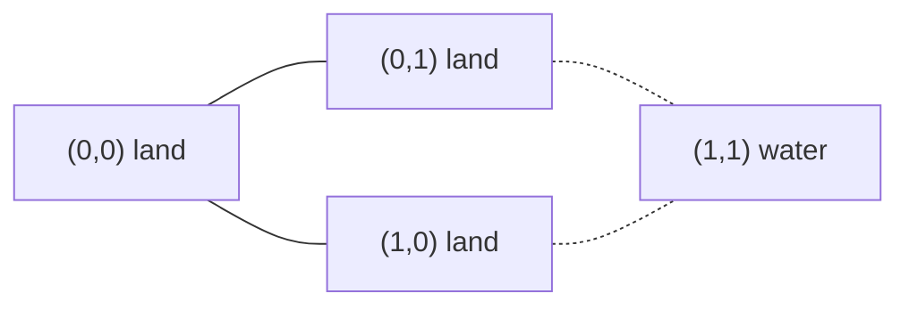

# Grid and Islands

> **Estimated Time:** 4 hr | **Difficulty:** Intermediate
> **Prerequisites:** [01 - Graph Basics, BFS and DFS](../01-graph-basics-bfs-dfs/README.md), [08 - Matrix](../../02-intermediate/08-matrix/README.md), [10 - Stack and Queue](../../01-core-linear/10-stack-and-queue/README.md)

---

## What You'll Learn
- You can see a 2D grid as a graph without building any adjacency list.
- You can write a flood fill (DFS) and a level-by-level BFS on a grid from memory, with correct bounds checks.
- You can pick between DFS and BFS: counting and marking use DFS or BFS, shortest steps use BFS only.
- You can run multi-source BFS (start from many cells at once) and boundary DFS (start from the border and work inward).
- You can solve about 20 classic island, distance and "grid as a state graph" problems.

## The Big Idea

Think of a map of a flooded city seen from a plane. Some blocks are land, some are water. If you stand on one land block, you can walk to any touching land block. The set of all blocks you can reach is one island. To count islands, you walk to every block you can reach from a start, mark them "visited", then look for a new unvisited land block and repeat.

A grid is a graph in disguise. Each cell is a node. Each cell is joined to its neighbours (up, down, left, right, and sometimes the four diagonals). You never store the edges. You compute them on the fly with a small list of direction offsets. So everything from the graph basics chapter works here: DFS, BFS, visited sets, connected components, shortest path in an unweighted graph.






Solid lines are edges you may walk. Dotted lines go to water, so they do not exist for the walk.

Why interviewers love it: it is short to code, it hides a graph problem inside a simple picture, and small mistakes (bounds, visited marking, 4 vs 8 directions) show up fast. Almost every company asks at least one grid problem.

## How to Spot It

| If the problem says ... | think ... |
|---|---|
| "count islands / regions / connected groups" | DFS or BFS from each unvisited cell, count the starts |
| "area / size of the biggest group" | DFS that returns a count |
| "fill / paint / recolor connected cells" | flood fill (DFS or BFS) |
| "minimum steps / minutes / moves" | BFS, count levels |
| "distance to the nearest X" for every cell | multi-source BFS from all X at once |
| "everything spreads at the same time" (rot, fire, flood) | multi-source BFS, one level = one time unit |
| "not touching the border / surrounded / enclosed" | boundary DFS: mark what touches the border, then flip the rest |
| "can reach both edges" (two oceans) | boundary DFS from each edge, reverse the direction, intersect |
| "same shape / distinct islands" | DFS that records a path or relative coordinates |
| "board game with squares / knight moves" | the state is a node, BFS over states |

## Core Concepts / Template

#### 1. Directions and bounds

Use a list of offsets (every solution below uses this `DIRS`). Four directions for most problems, eight (add diagonals) when the problem says "8-directionally connected".

```js
const DIRS = [[1, 0], [-1, 0], [0, 1], [0, -1]]; // 4 directions
const DIRS8 = [...DIRS, [1, 1], [1, -1], [-1, 1], [-1, -1]];
```

Always check bounds before you read the cell: `r >= 0 && c >= 0 && r < R && c < C`. The most common bug in this topic is reading `grid[-1][c]` or `grid[r][C]`.

#### 2. Visited: mark the grid or keep a separate array

- Mutating the input (turn `'1'` into `'0'`, "sink" the island) is the shortest code. In an interview, say "I will modify the grid; if we must keep it, I will use a visited array." Ask first if mutation is allowed.
- A separate `visited` matrix costs O(R*C) extra but is safe.

#### 3. DFS flood fill (recursive)

DFS means: go as deep as you can along one direction, then come back. It is the shortest to write.

```js
function dfs(grid, r, c) {
  if (r < 0 || c < 0 || r >= grid.length || c >= grid[0].length) return;
  if (grid[r][c] !== 1) return; // water or already visited
  grid[r][c] = 2; // mark visited
  for (const [dr, dc] of DIRS) dfs(grid, r + dr, c + dc);
}
```

Recursion depth can reach R*C (a snake-shaped island). In JavaScript the call stack is limited to roughly ten thousand frames. A 1000 x 1000 all-land grid can overflow it. Say this out loud, and offer an explicit stack or BFS.

#### 4. BFS on a grid

BFS uses a queue. It visits cells in order of distance from the start, so the first time you reach a cell is the shortest way. Mark a cell visited when you push it, not when you pop it. Otherwise the same cell enters the queue many times.

```js
function bfs(grid, sr, sc) {
  const R = grid.length, C = grid[0].length;
  const q = [[sr, sc]];
  grid[sr][sc] = 2;
  for (let i = 0; i < q.length; i++) { // index pointer: no O(n) shift()
    const [r, c] = q[i];
    for (const [dr, dc] of DIRS) {
      const nr = r + dr, nc = c + dc;
      if (nr >= 0 && nc >= 0 && nr < R && nc < C && grid[nr][nc] === 1) {
        grid[nr][nc] = 2; // mark on push
        q.push([nr, nc]);
      }
    }
  }
}
```

`Array.prototype.shift()` is O(n) in the worst case, so a loop with a moving index (as above) is the cheap way to get a queue in JavaScript.

#### 5. DFS or BFS?

| Need | Use |
|---|---|
| Count components, area, mark everything reachable | either. DFS is shorter, BFS has no stack-depth risk |
| Fewest steps, minutes, moves | BFS only. DFS does not find shortest paths |
| Many starting points spreading together | BFS with all starts in the queue first |
| Shape of an island | DFS (a fixed visiting order gives a fixed signature) |

#### 6. Level-by-level BFS

To count steps, process the queue one level at a time. Everything in the queue at the start of a round is at the same distance.

```js
let steps = 0;
for (let head = 0; head < q.length;) {
  const end = q.length; // freeze this level
  for (; head < end; head++) {
    // pop q[head], push neighbours
  }
  steps++;
}
```

#### 7. Multi-source BFS

Put every source cell in the queue at distance 0 before you start. The BFS then grows from all sources at the same speed, like ripples from many stones dropped in a pond at once. Each cell gets the distance to its nearest source for free. The wrong way is to run one BFS per source: that is O((R*C)^2) in the worst case.

```
Sources S at the corners, distance written as BFS runs:

S . . S        S 1 1 S
. . . .   ->   1 2 2 1
. . . .        1 2 2 1
S . . S        S 1 1 S
```

#### 8. Boundary DFS (the reverse trick)

Some questions ask "which cells are NOT connected to the border". Checking each region for a border touch is clumsy. Flip the question: start DFS from every border cell and mark everything reachable. What is not marked is the answer. This is the same idea as multi-source BFS: start where the answer is known.

#### Short trace: Number of Islands on a small grid

```
1 1 0        start (0,0): sink (0,0),(0,1),(1,0)  -> count = 1
1 0 0        next land found at (2,2): sink it    -> count = 2
0 0 1
```

## Problems (easy -> hard)

### 1. Flood Fill — Easy
**Companies:** Amazon, Google, Microsoft, Adobe
**Problem:** Given an image grid, a start cell and a new colour, recolour the start cell and every cell connected to it (4 directions) that has the same original colour. Example: `[[1,1,1],[1,1,0],[1,0,1]]`, start (1,1), colour 2 -> `[[2,2,2],[2,2,0],[2,0,1]]`.
**Intuition:** It is the paint bucket tool. Paint the cell, then spread to same-coloured neighbours. The only trap: if the new colour equals the old colour, the "visited" check never changes and the DFS loops forever.
**Approach 1 - Brute force:** There is no simpler method than a traversal. Time O(R*C), Space O(R*C) for recursion.
**Approach 3 - Optimal:** DFS (or BFS). Remember the old colour. Return early if old equals new. A cell is valid if it is in bounds and has the old colour. Painting it with the new colour doubles as the visited mark.
Trace on the example: paint (1,1), then spread to (0,1), (1,0) and onward. (1,2) and (2,1) are 0, so the spread stops there. The bottom-right 1 touches only 0s, so it stays 1.

```js
function floodFill(image, sr, sc, color) {
  const old = image[sr][sc];
  if (old === color) return image; // else infinite loop
  const R = image.length, C = image[0].length;
  const dfs = (r, c) => {
    if (r < 0 || c < 0 || r >= R || c >= C || image[r][c] !== old) return;
    image[r][c] = color;
    for (const [dr, dc] of DIRS) dfs(r + dr, c + dc);
  };
  dfs(sr, sc);
  return image;
}
```

**Complexity:** Time O(R*C), Space O(R*C) worst-case recursion depth.
**Watch out:** the `old === color` early return. Without it you get a stack overflow.

### 2. Number of Islands — Medium
**Companies:** Amazon, Google, Meta, Microsoft, Bloomberg
**Problem:** A grid of `'1'` (land) and `'0'` (water). Count islands, where land joins only in 4 directions. Example: 4 rows `11000 / 11000 / 00100 / 00011` -> 3.
**Intuition:** Scan the grid. The first time you hit unvisited land, you found a new island: count it, then sink the whole island so you never count it again.
**Approach 1 - Brute force:** Use a `visited` matrix beside the grid. Same time, extra O(R*C) space.
**Approach 2 - Better:** Sink land in place (turn `'1'` into `'0'`). No extra matrix.
**Approach 3 - Optimal:** Either DFS or BFS is optimal at O(R*C). Pick BFS if you worry about stack depth (code below the DFS). Union-Find also works and is useful when land is added over time (see the Union-Find chapter).

```js
function numIslands(grid) {
  const R = grid.length, C = grid[0].length;
  let count = 0;
  const sink = (r, c) => {
    if (r < 0 || c < 0 || r >= R || c >= C || grid[r][c] !== '1') return;
    grid[r][c] = '0';
    for (const [dr, dc] of DIRS) sink(r + dr, c + dc);
  };
  for (let r = 0; r < R; r++)
    for (let c = 0; c < C; c++)
      if (grid[r][c] === '1') { count++; sink(r, c); }
  return count;
}
```

BFS version (same idea, no recursion):

```js
function numIslandsBFS(grid) {
  const R = grid.length, C = grid[0].length;
  let count = 0;
  for (let r = 0; r < R; r++) for (let c = 0; c < C; c++) {
    if (grid[r][c] !== '1') continue;
    count++;
    grid[r][c] = '0';
    const q = [[r, c]];
    for (let i = 0; i < q.length; i++) {
      const [x, y] = q[i];
      for (const [dr, dc] of DIRS) {
        const nr = x + dr, nc = y + dc;
        if (nr >= 0 && nc >= 0 && nr < R && nc < C && grid[nr][nc] === '1') {
          grid[nr][nc] = '0'; // mark when pushed
          q.push([nr, nc]);
        }
      }
    }
  }
  return count;
}
```

**Complexity:** Time O(R*C), each cell is pushed at most once. Space O(R*C) worst case (recursion or queue).
**Watch out:** the grid holds strings `'1'`, not numbers. Comparing `grid[r][c] !== 1` is a silent bug.

### 3. Max Area of Island — Medium
**Companies:** Amazon, Google, Facebook, Microsoft
**Problem:** Binary grid, 4-directional. Return the size of the biggest island (0 if none). Example: `[[0,1,1],[0,1,0],[1,0,1]]` -> 3.
**Intuition:** The same as counting islands, but the DFS now returns how many cells it sank. Area = 1 + the sum of the neighbours' areas.
**Approach 3 - Optimal:** DFS returns a size. Keep the maximum over all starts.
Trace: start (0,1): 1 + (0,2)=1 + (1,1)=1 -> 3. Then (2,0) -> 1, (2,2) -> 1. Max is 3.

```js
function maxAreaOfIsland(grid) {
  const R = grid.length, C = grid[0].length;
  const area = (r, c) => {
    if (r < 0 || c < 0 || r >= R || c >= C || grid[r][c] !== 1) return 0;
    grid[r][c] = 0;
    let s = 1;
    for (const [dr, dc] of DIRS) s += area(r + dr, c + dc);
    return s;
  };
  let best = 0;
  for (let r = 0; r < R; r++) for (let c = 0; c < C; c++) best = Math.max(best, area(r, c));
  return best;
}
```

**Complexity:** Time O(R*C), Space O(R*C) recursion worst case.
**Watch out:** reset nothing between islands, because the cells are sunk. Return 0 for water and for visited cells.

### 4. Island Perimeter — Easy
**Companies:** Google, Amazon, Facebook
**Problem:** The grid has exactly one island (no lakes inside). Return its perimeter. Example: `[[0,1,0,0],[1,1,1,0],[0,1,0,0],[1,1,0,0]]` -> 16.
**Intuition:** No traversal needed. Each land cell has 4 sides. Every shared side between two land cells hides 2 sides (one from each cell). So perimeter = 4 * land - 2 * shared edges.
**Approach 1 - Brute force:** For each land cell, count neighbours that are water or out of bounds. Time O(R*C), Space O(1).
**Approach 3 - Optimal:** Count shared edges by looking only up and left, so each pair is seen once.
Trace: 7 land cells -> 28. Shared edges: 3 horizontal + 3 vertical = 6. So 28 - 2*6 = 16.

```js
function islandPerimeter(grid) {
  let p = 0;
  for (let r = 0; r < grid.length; r++) for (let c = 0; c < grid[0].length; c++) {
    if (!grid[r][c]) continue;
    p += 4;
    if (r > 0 && grid[r - 1][c]) p -= 2; // shared edge counted once per side
    if (c > 0 && grid[r][c - 1]) p -= 2;
  }
  return p;
}
```

**Complexity:** Time O(R*C), Space O(1).
**Watch out:** do not look at all four neighbours and subtract 2 each time, that double counts.

### 5. Number of Enclaves — Medium
**Companies:** Amazon, Google, Microsoft
**Problem:** 1 = land, 0 = sea. A land cell is an enclave if you cannot walk off the grid from it. Return the number of land cells in enclaves. Example: `[[0,0,0,0],[1,0,1,0],[0,1,1,0],[0,0,0,0]]` -> 3.
**Intuition:** Walk off the grid = reach the border. So start from every border land cell, sink everything reachable. Any land left is an enclave. This is the boundary DFS.
**Approach 1 - Brute force:** For each island, DFS and check if it touches the border. Works, but needs a flag and two passes.
**Approach 3 - Optimal:** Border DFS first, then count the remaining 1s.
Trace: the border has no 1s in the example, so nothing is sunk; the three 1s remain -> 3.

```js
function numEnclaves(grid) {
  const R = grid.length, C = grid[0].length;
  const dfs = (r, c) => {
    if (r < 0 || c < 0 || r >= R || c >= C || grid[r][c] !== 1) return;
    grid[r][c] = 0;
    for (const [dr, dc] of DIRS) dfs(r + dr, c + dc);
  };
  for (let r = 0; r < R; r++) { dfs(r, 0); dfs(r, C - 1); }
  for (let c = 0; c < C; c++) { dfs(0, c); dfs(R - 1, c); }
  let n = 0;
  for (const row of grid) for (const v of row) n += v;
  return n;
}
```

**Complexity:** Time O(R*C), Space O(R*C) worst case recursion.
**Watch out:** call the border DFS on all four edges, including the corners (they are covered by both loops, which is fine).

### 6. Number of Closed Islands — Medium
**Companies:** Amazon, Google, Microsoft
**Problem:** Here 0 = land and 1 = water (opposite of the usual). A closed island is a group of 0s completely surrounded by 1s in 4 directions (no 0 on the border). Count them. Example: a 5x8 grid from LeetCode gives 2.
**Intuition:** Same as enclaves, but you count islands instead of cells. First erase every island that touches the border. Then count the remaining islands with the normal island count.
**Approach 3 - Optimal:** Boundary flood, then count components.

```js
function closedIsland(grid) {
  const R = grid.length, C = grid[0].length;
  const fill = (r, c) => {
    if (r < 0 || c < 0 || r >= R || c >= C || grid[r][c] !== 0) return;
    grid[r][c] = 1;
    for (const [dr, dc] of DIRS) fill(r + dr, c + dc);
  };
  for (let r = 0; r < R; r++) { fill(r, 0); fill(r, C - 1); }
  for (let c = 0; c < C; c++) { fill(0, c); fill(R - 1, c); }
  let n = 0;
  for (let r = 0; r < R; r++) for (let c = 0; c < C; c++)
    if (grid[r][c] === 0) { n++; fill(r, c); }
  return n;
}
```

**Complexity:** Time O(R*C), Space O(R*C) worst case.
**Watch out:** read which value means land. This problem flips it, and it is a classic place to lose time.

### 7. Surrounded Regions — Medium
**Companies:** Amazon, Google, Meta, Microsoft
**Problem:** A board of `'X'` and `'O'`. Flip every region of `'O'` that is fully surrounded by `'X'` (not touching the border) into `'X'`, in place. Example: the only `'O'` group on the bottom row (touching the border) stays; the inner group flips.
**Intuition:** Same boundary trick. Mark every `'O'` reachable from the border with a temporary symbol. Then one final pass: leftover `'O'` becomes `'X'`, and the temporary symbol turns back into `'O'`.
**Approach 1 - Brute force:** For each `'O'` region, search and decide if it touches the border, then flip. Two passes per region, more code.
**Approach 3 - Optimal:** Border DFS with a marker `'#'`, then a single sweep to resolve.
Trace on the sample: border `'O'` at (3,1) -> `'#'`. Inner O's (1,1),(1,2),(2,2) are not reached. Sweep: `'O'` -> `'X'`, `'#'` -> `'O'`.

```js
function solve(board) {
  const R = board.length, C = board[0].length;
  const mark = (r, c) => {
    if (r < 0 || c < 0 || r >= R || c >= C || board[r][c] !== 'O') return;
    board[r][c] = '#';
    for (const [dr, dc] of DIRS) mark(r + dr, c + dc);
  };
  for (let r = 0; r < R; r++) { mark(r, 0); mark(r, C - 1); }
  for (let c = 0; c < C; c++) { mark(0, c); mark(R - 1, c); }
  for (let r = 0; r < R; r++) for (let c = 0; c < C; c++) {
    if (board[r][c] === 'O') board[r][c] = 'X';
    else if (board[r][c] === '#') board[r][c] = 'O';
  }
}
```

**Complexity:** Time O(R*C), Space O(R*C) worst case.
**Watch out:** do not flip while searching. You need the temporary marker, otherwise you cannot tell safe cells from unsafe ones.

### 8. Count Sub Islands — Medium
**Companies:** -
**Problem:** Two grids, `grid1` and `grid2`. An island in `grid2` is a sub-island if every one of its cells is also land in `grid1`. Count sub-islands. Example from LeetCode gives 3.
**Intuition:** Explore each island of `grid2`. While exploring, if any cell is water in `grid1`, the island fails. But you must still sink the full island, otherwise the leftover cells look like a new island later.
**Approach 3 - Optimal:** DFS on `grid2` returning a boolean. Combine children without short-circuiting.

```js
function countSubIslands(grid1, grid2) {
  const R = grid2.length, C = grid2[0].length;
  const dfs = (r, c) => {
    if (r < 0 || c < 0 || r >= R || c >= C || grid2[r][c] !== 1) return true;
    grid2[r][c] = 0;
    let ok = grid1[r][c] === 1;
    for (const [dr, dc] of DIRS) if (!dfs(r + dr, c + dc)) ok = false; // no short-circuit: must sink whole island
    return ok;
  };
  let n = 0;
  for (let r = 0; r < R; r++) for (let c = 0; c < C; c++)
    if (grid2[r][c] === 1 && dfs(r, c)) n++;
  return n;
}
```

**Complexity:** Time O(R*C), Space O(R*C) worst case.
**Watch out:** `ok = ok && dfs(...)` skips the call once `ok` is false and leaves the island half-explored. Always run all four recursive calls first.

### 9. Rotting Oranges — Medium
**Companies:** Amazon, Microsoft, Google, Meta, Walmart
**Problem:** Cells: 0 empty, 1 fresh orange, 2 rotten orange. Each minute, every fresh orange next to a rotten one (4 directions) rots. Return the minutes until no fresh orange is left, or -1 if impossible. Example: `[[2,1,1],[1,1,0],[0,1,1]]` -> 4.
**Intuition:** All rotten oranges spread at the same time. That is multi-source BFS: one BFS level equals one minute.
**Approach 1 - Brute force:** Simulate minute by minute, scanning the whole grid each minute. Time O((R*C)^2) worst case.
**Approach 3 - Optimal:** Put all rotten oranges in the queue, count fresh ones. Process level by level. When a fresh orange rots, decrement the counter. At the end, `fresh === 0` means success.
Trace:

| minute | newly rotten | fresh left |
|---|---|---|
| 0 | start: (0,0) | 6 |
| 1 | (0,1), (1,0) | 4 |
| 2 | (0,2), (1,1) | 2 |
| 3 | (2,1) | 1 |
| 4 | (2,2) | 0 |

Answer 4.

```js
function orangesRotting(grid) {
  const R = grid.length, C = grid[0].length;
  const q = [];
  let fresh = 0;
  for (let r = 0; r < R; r++) for (let c = 0; c < C; c++) {
    if (grid[r][c] === 2) q.push([r, c]);
    else if (grid[r][c] === 1) fresh++;
  }
  let minutes = 0;
  for (let head = 0; head < q.length && fresh > 0;) {
    const end = q.length; // one level = one minute
    for (; head < end; head++) {
      const [r, c] = q[head];
      for (const [dr, dc] of DIRS) {
        const nr = r + dr, nc = c + dc;
        if (nr >= 0 && nc >= 0 && nr < R && nc < C && grid[nr][nc] === 1) {
          grid[nr][nc] = 2; fresh--; q.push([nr, nc]);
        }
      }
    }
    minutes++;
  }
  return fresh === 0 ? minutes : -1;
}
```

**Complexity:** Time O(R*C), Space O(R*C).
**Watch out:** if there are zero fresh oranges, the answer is 0, not -1, even with no rotten orange. Do not count the final empty round as a minute.

### 10. 01 Matrix — Medium
**Companies:** Amazon, Google, Meta, Microsoft
**Problem:** For each cell, return the distance to the nearest 0 (4 directions). Example: `[[0,0,0],[0,1,0],[1,1,1]]` -> `[[0,0,0],[0,1,0],[1,2,1]]`.
**Intuition:** Do not search from each 1 to find a 0. Search the other way: start from all 0s together, and the BFS wave tells each 1 its distance. This is multi-source BFS.
**Approach 1 - Brute force:** BFS from every 1. Time O((R*C)^2).
**Approach 2 - Better:** Two-pass DP: sweep top-left to bottom-right, then bottom-right to top-left, taking `min(self, neighbour + 1)`. O(R*C), no queue.
**Approach 3 - Optimal:** Multi-source BFS. Use -1 as "not yet visited" in the distance grid.

```js
function updateMatrix(mat) {
  const R = mat.length, C = mat[0].length;
  const dist = mat.map(row => row.map(v => (v === 0 ? 0 : -1)));
  const q = [];
  for (let r = 0; r < R; r++) for (let c = 0; c < C; c++) if (mat[r][c] === 0) q.push([r, c]);
  for (let i = 0; i < q.length; i++) {
    const [r, c] = q[i];
    for (const [dr, dc] of DIRS) {
      const nr = r + dr, nc = c + dc;
      if (nr >= 0 && nc >= 0 && nr < R && nc < C && dist[nr][nc] === -1) {
        dist[nr][nc] = dist[r][c] + 1;
        q.push([nr, nc]);
      }
    }
  }
  return dist;
}
```

**Complexity:** Time O(R*C), Space O(R*C).
**Watch out:** if the grid has no 0 at all, the problem guarantees at least one 0. Without that guarantee, the answer would stay -1 or be infinity.

### 11. Walls and Gates — Medium
**Companies:** Google, Facebook, Amazon, Snapchat
**Problem:** Rooms: -1 wall, 0 gate, `2147483647` (INF) empty room. Fill each empty room with the distance to its nearest gate. Unreachable rooms stay INF. (LeetCode Premium problem 286.)
**Intuition:** Exactly the 01 Matrix idea. Start from all gates together. The INF value works as a built-in "not visited" mark.
**Approach 3 - Optimal:** Multi-source BFS, update in place.

```js
function wallsAndGates(rooms) {
  const INF = 2147483647, R = rooms.length, C = rooms[0].length;
  const q = [];
  for (let r = 0; r < R; r++) for (let c = 0; c < C; c++) if (rooms[r][c] === 0) q.push([r, c]);
  for (let i = 0; i < q.length; i++) {
    const [r, c] = q[i];
    for (const [dr, dc] of DIRS) {
      const nr = r + dr, nc = c + dc;
      if (nr >= 0 && nc >= 0 && nr < R && nc < C && rooms[nr][nc] === INF) {
        rooms[nr][nc] = rooms[r][c] + 1;
        q.push([nr, nc]);
      }
    }
  }
  return rooms;
}
```

**Complexity:** Time O(R*C), Space O(R*C).
**Watch out:** only enter cells that are still INF. Walls are -1 and gates are 0, so both are skipped automatically.

### 12. As Far from Land as Possible — Medium
**Companies:** Amazon, Google
**Problem:** Grid of 0 (water) and 1 (land). Find the water cell whose distance to the nearest land is the largest, and return that distance. Return -1 if there is no land or no water. Distance is Manhattan. Example: `[[1,0,1],[0,0,0],[1,0,1]]` -> 2.
**Intuition:** Again multi-source BFS, from all land cells. The last BFS level is the farthest water cell. The answer is the number of levels that added water.
**Approach 3 - Optimal:** Queue all land, check the two edge cases, run level BFS, and return the final level index.
Trace: land at the four corners. Level 0 = corners. Level 1 = the four edge-midpoints. Level 2 = the centre. Last level index = 2.

```js
function maxDistance(grid) {
  const n = grid.length;
  const q = [];
  for (let r = 0; r < n; r++) for (let c = 0; c < n; c++) if (grid[r][c] === 1) q.push([r, c]);
  if (q.length === 0 || q.length === n * n) return -1;
  let level = -1;
  for (let head = 0; head < q.length;) {
    const end = q.length;
    for (; head < end; head++) {
      const [r, c] = q[head];
      for (const [dr, dc] of DIRS) {
        const nr = r + dr, nc = c + dc;
        if (nr >= 0 && nc >= 0 && nr < n && nc < n && grid[nr][nc] === 0) {
          grid[nr][nc] = 1; q.push([nr, nc]);
        }
      }
    }
    level++;
  }
  return level;
}
```

**Complexity:** Time O(N^2) for an N x N grid, Space O(N^2).
**Watch out:** the `level` starts at -1 because the first round processes land (distance 0) and finds no new distance. Check all-land and all-water first.

### 13. Pacific Atlantic Water Flow — Medium
**Companies:** Google, Amazon, Meta, Microsoft, Bloomberg
**Problem:** A grid of heights. Water flows from a cell to a neighbour of equal or lower height. The Pacific touches the top and left edges, the Atlantic touches the bottom and right edges. Return every cell from which water can reach both oceans.
**Intuition:** Forward simulation from every cell is slow. Reverse it: start at each ocean's edge and climb uphill (to neighbours with height >= current). Everything you reach can flow down to that ocean. The answer is the intersection of the two reach sets.
**Approach 1 - Brute force:** DFS from every cell, downhill, checking both oceans. Time O((R*C)^2) worst case.
**Approach 3 - Optimal:** Two boundary DFS runs with two `seen` matrices, then intersect.

```js
function pacificAtlantic(h) {
  const R = h.length, C = h[0].length;
  const reach = () => Array.from({ length: R }, () => new Array(C).fill(false));
  const pac = reach(), atl = reach();
  const dfs = (r, c, seen) => {
    seen[r][c] = true;
    for (const [dr, dc] of DIRS) {
      const nr = r + dr, nc = c + dc;
      if (nr >= 0 && nc >= 0 && nr < R && nc < C && !seen[nr][nc] && h[nr][nc] >= h[r][c]) dfs(nr, nc, seen); // climb uphill
    }
  };
  for (let r = 0; r < R; r++) { dfs(r, 0, pac); dfs(r, C - 1, atl); }
  for (let c = 0; c < C; c++) { dfs(0, c, pac); dfs(R - 1, c, atl); }
  const out = [];
  for (let r = 0; r < R; r++) for (let c = 0; c < C; c++) if (pac[r][c] && atl[r][c]) out.push([r, c]);
  return out;
}
```

**Complexity:** Time O(R*C), Space O(R*C).
**Watch out:** the climb condition is `>=`, not `>`. Water also flows across equal heights.

### 14. Number of Distinct Islands — Medium
**Companies:** Amazon, Google, Meta, Microsoft
**Problem:** Count islands that have different shapes. Two islands are the same if one can be moved (translated) onto the other. No rotation or reflection. (LeetCode Premium problem 694.) Example: two 2x2 blocks -> 1 distinct island.
**Intuition:** Describe each island in a way that ignores where it sits. Record every cell relative to the first cell found (the top-left in scan order). Run DFS with a fixed direction order, so the same shape always produces the same list. Store the list as a string in a Set.
**Approach 1 - Brute force:** Compare every pair of islands by trying to align them. Slow and messy.
**Approach 3 - Optimal:** Signature with relative coordinates, then `Set.size`.

```js
function numDistinctIslands(grid) {
  const R = grid.length, C = grid[0].length;
  const shapes = new Set();
  const walk = (r, c, r0, c0, cells) => {
    if (r < 0 || c < 0 || r >= R || c >= C || grid[r][c] !== 1) return;
    grid[r][c] = 0;
    cells.push(`${r - r0},${c - c0}`); // position relative to the first cell
    for (const [dr, dc] of DIRS) walk(r + dr, c + dc, r0, c0, cells);
  };
  for (let r = 0; r < R; r++) for (let c = 0; c < C; c++) {
    if (grid[r][c] !== 1) continue;
    const cells = [];
    walk(r, c, r, c, cells);
    shapes.add(cells.join('|')); // same DFS order for same shape
  }
  return shapes.size;
}
```

**Complexity:** Time O(R*C), Space O(R*C) for signatures.
**Watch out:** absolute coordinates would make every island unique. An alternative signature is the DFS path with a "back" marker for every return; without the marker, different shapes can give the same direction string.

### 15. Snakes and Ladders — Medium
**Companies:** Amazon, Google, Uber, Microsoft
**Problem:** An N x N board numbered 1..N*N in a zig-zag starting from the bottom-left. A cell value of -1 is normal, otherwise it is the square you jump to (snake or ladder). From square s, one move goes to s+1..s+6. Return the minimum moves from square 1 to square N*N, or -1.
**Intuition:** The squares are nodes, a dice roll gives up to 6 edges, and every move costs 1. Fewest moves in an unweighted graph is BFS. The only hard part is mapping a square number to a (row, col) in the zig-zag.
**Approach 3 - Optimal:** BFS by levels. For each rolled square, if the cell has a jump, follow it once (you do not chain jumps in one move). Mark the final landing square visited.
Square to cell: `k = s - 1`, row from the bottom is `k / N`, column is `k % N` on even rows and mirrored (`N - 1 - k % N`) on odd rows.

```js
function snakesAndLadders(board) {
  const n = board.length;
  const cell = (s) => { // square number -> [row, col]
    const k = s - 1, rowFromBottom = Math.floor(k / n);
    const col = rowFromBottom % 2 === 0 ? k % n : n - 1 - (k % n);
    return [n - 1 - rowFromBottom, col];
  };
  const seen = new Array(n * n + 1).fill(false);
  seen[1] = true;
  let q = [1], moves = 0;
  while (q.length) {
    const next = [];
    for (const s of q) {
      if (s === n * n) return moves;
      for (let d = 1; d <= 6 && s + d <= n * n; d++) {
        const [r, c] = cell(s + d);
        const t = board[r][c] === -1 ? s + d : board[r][c];
        if (!seen[t]) { seen[t] = true; next.push(t); }
      }
    }
    q = next; moves++;
  }
  return -1;
}
```

**Complexity:** Time O(N^2), Space O(N^2).
**Watch out:** take a jump only once per move, and mark the destination of the jump (not the square you rolled onto) as visited.

### 16. Minimum Knight Moves — Medium
**Companies:** Amazon, Google, Uber
**Problem:** A knight starts at (0,0) on an infinite board. Return the fewest moves to reach (x, y). Example: (2,1) -> 1, (5,5) -> 4. (LeetCode Premium problem 1197.)
**Intuition:** Positions are nodes, the 8 knight jumps are edges. BFS gives the fewest moves. The board is infinite, so cut it down: by symmetry use `|x|` and `|y|`, and do not wander far below zero.
**Approach 1 - Brute force:** BFS in all four quadrants, unbounded. It works but visits many more cells.
**Approach 3 - Optimal:** BFS on the first quadrant plus a small margin of 2 below zero (the knight sometimes needs to step back to reach the target).
**Another way:** a DP with memo `f(x,y) = 1 + min(f(|x-1|,|y-2|), f(|x-2|,|y-1|))` also works.

```js
function minKnightMoves(x, y) {
  x = Math.abs(x); y = Math.abs(y); // symmetry
  const K = [[1, 2], [2, 1], [-1, 2], [-2, 1], [1, -2], [2, -1], [-1, -2], [-2, -1]];
  const seen = new Set(['0,0']);
  let q = [[0, 0]], steps = 0;
  while (q.length) {
    const next = [];
    for (const [a, b] of q) {
      if (a === x && b === y) return steps;
      for (const [da, db] of K) {
        const na = a + da, nb = b + db;
        // small negative margin is enough to go around the target
        if (na < -2 || nb < -2) continue;
        const key = na + ',' + nb;
        if (!seen.has(key)) { seen.add(key); next.push([na, nb]); }
      }
    }
    q = next; steps++;
  }
}
```

**Complexity:** Time and Space O(x*y) cells visited, in the order of the target distance squared.
**Watch out:** the margin. If you forbid all negative coordinates, a case like (1,1) breaks: it needs (2,-1) or similar. The answer is 2.

### 17. Shortest Path in Binary Matrix — Medium
**Companies:** Amazon, Google, Meta, Apple
**Problem:** Binary N x N grid. A clear path goes from (0,0) to (N-1,N-1) through 0 cells, moving in 8 directions. Return its length (number of cells), or -1. Example: `[[0,0,0],[1,1,0],[1,1,0]]` -> 4.
**Intuition:** This is "cheapest path with BFS levels": every move costs the same (1), so BFS levels equal the cost. With 8 directions the only change is the list of offsets. If the costs differed (some cells cost more), you would need Dijkstra, or 0-1 BFS when costs are only 0 or 1 (see the Shortest Paths chapter).
**Approach 3 - Optimal:** BFS from (0,0). If the start or end is blocked, return -1. Start with length 1 (counting cells).

```js
function shortestPathBinaryMatrix(grid) {
  const n = grid.length;
  if (grid[0][0] || grid[n - 1][n - 1]) return -1;
  grid[0][0] = 1;
  let q = [[0, 0]], len = 1;
  while (q.length) {
    const next = [];
    for (const [r, c] of q) {
      if (r === n - 1 && c === n - 1) return len;
      for (let dr = -1; dr <= 1; dr++) for (let dc = -1; dc <= 1; dc++) {
        const nr = r + dr, nc = c + dc;
        if (nr >= 0 && nc >= 0 && nr < n && nc < n && grid[nr][nc] === 0) {
          grid[nr][nc] = 1; next.push([nr, nc]);
        }
      }
    }
    q = next; len++;
  }
  return -1;
}
```

**Complexity:** Time O(N^2), Space O(N^2).
**Watch out:** the length counts cells, so a single-cell grid returns 1. Check that the start is open before you push it.

### 18. Shortest Bridge — Medium
**Companies:** Amazon, Google, Meta
**Problem:** The grid has exactly two islands. You may flip 0s to 1s. Return the smallest number of flips to join them. Example: `[[0,1,0],[0,0,0],[0,0,1]]` -> 2.
**Intuition:** Two phases. First, find one island with DFS and mark it (here with 2) while adding all its cells to the queue. Second, run multi-source BFS from that whole island outward through water. The first time the wave touches a cell with value 1 (the other island), the number of levels crossed is the answer.
**Approach 1 - Brute force:** Compute the distance between every pair of cells from the two islands. Time O((R*C)^2).
**Approach 3 - Optimal:** DFS to paint the first island and fill the queue, then BFS by levels.
Trace on the example: island A = (0,1). Round 0 expands (0,1) to (0,0),(0,2),(1,1) and steps becomes 1. Round 1 expands those to (1,0),(1,2),(2,1) and steps becomes 2. In round 2, (1,2) looks at (2,2), which is a 1 (the other island), so return steps = 2.

```js
function shortestBridge(grid) {
  const n = grid.length;
  const q = [];
  const paint = (r, c) => {
    if (r < 0 || c < 0 || r >= n || c >= n || grid[r][c] !== 1) return;
    grid[r][c] = 2; q.push([r, c]);
    for (const [dr, dc] of DIRS) paint(r + dr, c + dc);
  };
  outer: for (let r = 0; r < n; r++) for (let c = 0; c < n; c++)
    if (grid[r][c] === 1) { paint(r, c); break outer; }
  let steps = 0;
  for (let head = 0; head < q.length;) {
    const end = q.length;
    for (; head < end; head++) {
      const [r, c] = q[head];
      for (const [dr, dc] of DIRS) {
        const nr = r + dr, nc = c + dc;
        if (nr < 0 || nc < 0 || nr >= n || nc >= n || grid[nr][nc] === 2) continue;
        if (grid[nr][nc] === 1) return steps;
        grid[nr][nc] = 2; q.push([nr, nc]);
      }
    }
    steps++;
  }
  return -1;
}
```

**Complexity:** Time O(N^2), Space O(N^2).
**Watch out:** return the level count when you meet the target island (at the neighbour check), not after the loop.

### 19. Making A Large Island — Hard
**Companies:** Google, Amazon, Meta, Microsoft
**Problem:** You may change at most one 0 to 1. Return the size of the largest island you can get. Example: `[[1,0],[0,1]]` -> 3.
**Intuition:** Try each 0 as the flip. If you re-run a DFS for each 0, that is too slow. Instead, label each island with an id and store its size once. For each 0, look at its four neighbours, collect the distinct island ids, and add their sizes plus 1.
**Approach 1 - Brute force:** For every 0, flip it and run DFS for the area. Time O((R*C)^2).
**Approach 3 - Optimal:** Label islands (ids start at 2 so they do not clash with 0 and 1), then one scan over the zeros with a Set of neighbour ids.

```js
function largestIsland(grid) {
  const n = grid.length;
  const size = [0, 0]; // ids start at 2
  const label = (r, c, id) => {
    if (r < 0 || c < 0 || r >= n || c >= n || grid[r][c] !== 1) return 0;
    grid[r][c] = id;
    let s = 1;
    for (const [dr, dc] of DIRS) s += label(r + dr, c + dc, id);
    return s;
  };
  for (let r = 0; r < n; r++) for (let c = 0; c < n; c++)
    if (grid[r][c] === 1) size[size.length] = label(r, c, size.length);
  let best = Math.max(0, ...size);
  for (let r = 0; r < n; r++) for (let c = 0; c < n; c++) {
    if (grid[r][c] !== 0) continue;
    const ids = new Set();
    for (const [dr, dc] of DIRS) {
      const nr = r + dr, nc = c + dc;
      if (nr >= 0 && nc >= 0 && nr < n && nc < n && grid[nr][nc] > 1) ids.add(grid[nr][nc]);
    }
    let s = 1;
    for (const id of ids) s += size[id];
    best = Math.max(best, s);
  }
  return best;
}
```

**Complexity:** Time O(N^2), Space O(N^2).
**Watch out:** use a Set of ids, or a 0 touching the same island from two sides would add that island's size twice. If the grid has no 0, the answer is the total size (the code's `best` covers it); if it is all water, the answer is 1.

## Common Mistakes
- **"Bounds check after reading the cell is fine."** It is not: `grid[-1]` is `undefined`, and reading `undefined[c]` throws. Check bounds first.
- **"Mark visited when I pop from the queue."** That lets the same cell enter the queue many times. Mark when you push.
- **"DFS finds the shortest path too."** It does not. DFS finds some path. Use BFS for fewest steps.
- **"One BFS per source is fine."** It turns O(R*C) into O((R*C)^2). Put all sources in the queue first.
- **"Strings and numbers are the same in the grid."** Number of Islands uses `'1'`. Others use `1`. Match the type.
- **"I can keep the input as is and still mark visited."** If you mutate, you destroy the input. State it, or use a `visited` array.
- **"Recursion is always fine."** A long snake-shaped island can exceed the JavaScript call stack. Mention BFS or an explicit stack.
- **"Using `queue.shift()` is fine."** It is O(n) per call in the worst case. Use an index pointer.
- **"4 and 8 directions are interchangeable."** They change the answer. Read the problem: diagonals count as connected only when it says so.

## Interview Tips
- First say: "I treat each cell as a node and neighbours as edges." This shows you see the graph.
- Ask: grid size, 4 or 8 directions, can I modify the input, what do the symbols mean (`'1'` vs `1`, which value is land).
- State the choice: "DFS for counting, BFS because the problem asks for the shortest time/steps."
- Spot "everything at once" (rot, fire, spreading) and say "multi-source BFS, one level per time unit".
- Spot "not touching the border" and say "boundary DFS: start from the border instead of from the inside".
- Edge cases to mention: empty grid, 1 x 1 grid, all land, all water, no fresh oranges, no path, start equal to target.
- Follow-ups you may hear: "do it iteratively", "the grid does not fit in memory" (process by rows with Union-Find), "land is added one cell at a time" (Number of Islands II with Union-Find), "make it work with 8 directions", "return the path, not the length" (keep a parent matrix).
- Complexity line you can reuse: "Every cell is visited at most once and does O(1) work for its 4 neighbours, so O(R*C) time."

## Practice List
**Easy:** Flood Fill, Island Perimeter, Lucky Numbers in a Matrix, Count Negative Numbers in a Sorted Matrix.
**Medium:** Max Area of Island, Number of Islands, Surrounded Regions, Number of Enclaves, Number of Closed Islands, Pacific Atlantic Water Flow, Rotting Oranges, 01 Matrix, Walls and Gates, As Far from Land as Possible, Count Sub Islands, Shortest Path in Binary Matrix, Snakes and Ladders, Minimum Knight Moves, Shortest Bridge, Number of Distinct Islands, Shortest Path in a Grid with Obstacles Elimination, Path With Minimum Effort, Map of Highest Peak, Nearest Exit from Entrance in Maze, Detonate the Maximum Bombs.
**Hard:** Making A Large Island, Number of Islands II (Union-Find), Swim in Rising Water, Bus Routes (BFS over routes), Minimum Number of Days to Disconnect Island, Shortest Path to Get All Keys, Cut Off Trees for Golf Event, Escape a Large Maze.

## Key Takeaways
- A grid is a graph: **cells are nodes, direction offsets are the edges**. No adjacency list needed.
- Always **check bounds before reading** a cell, and mark visited **when you push** (BFS) or **when you enter** (DFS).
- **DFS for counting and area, BFS for shortest steps.** DFS never gives you a shortest path.
- **Multi-source BFS** (all starts in the queue at distance 0) solves "distance to the nearest X" and "everything spreads together" in O(R*C).
- **Boundary DFS** turns "not connected to the border" into "mark what is connected to the border, take the rest".
- For island shapes, record **relative coordinates** in a fixed visiting order; for sub-islands, never short-circuit the DFS.
- When a problem is a board game or a knight, **the state is the node**; BFS over states gives the fewest moves.

---
[← Previous: Graph Basics, BFS and DFS](../01-graph-basics-bfs-dfs/README.md) | [Next: Cycle Detection and Bipartite →](../03-cycle-and-bipartite/README.md) | [Back to Graphs Index](../README.md)
