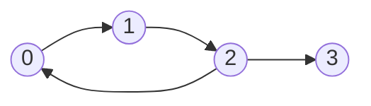
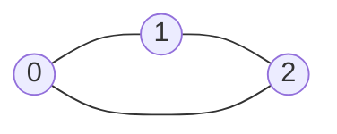

# Cycle Detection and Bipartite Graphs

> **Estimated Time:** 3 hr | **Difficulty:** Intermediate
> **Prerequisites:** [01 - Graph Basics, BFS and DFS](../../04-graphs/01-graph-basics-bfs-dfs/README.md), [02 - Grid and Islands](../../04-graphs/02-grid-and-islands/README.md)

---

## What You'll Learn

- You can detect a cycle in an **undirected** graph with BFS or DFS using a "parent" check.
- You can detect a cycle in a **directed** graph with DFS colors (white, gray, black) and with Kahn's algorithm.
- You can check if a graph is **bipartite** by 2-coloring it, and explain why odd cycles break it.
- You can find **safe (terminal) states** by working backward from nodes with no outgoing edges.
- You can turn "can I finish all courses?" and "which edge is extra?" into cycle questions.

## The Big Idea

Imagine a group of friends passing a secret note. In an undirected group, if the note can walk away from you and come back to you through someone other than the person who handed it over, there is a loop. In a one-way street map, a loop means you can drive and end up where you started without ever turning back. A loop in a task list ("A needs B, B needs A") is a dead end: nothing can ever start.

Cycle questions are really "is there a loop?" questions. The hard part is to avoid false alarms. In an undirected graph, the edge you just walked on looks like a path back to a visited node, but it is not a loop. In a directed graph, a node you visited earlier may be fine; only a node that is still "in progress" on your current path is a loop.

Bipartite is a cousin question: "can I paint every node with one of two colors so no edge joins two nodes of the same color?" Think of splitting people into two teams where every rivalry pair must be on opposite teams. This works if and only if the graph has no odd-length cycle.

Interviewers love this topic because it is a small tweak on plain BFS/DFS. You only add a little state (parent, color, in-degree), and that state is where people make mistakes.

## How to Spot It

| If the problem says ... | think ... |
|---|---|
| "Is there a cycle?" in an undirected graph | DFS/BFS with parent, or DSU |
| "Is there a cycle?" in a directed graph | DFS with colors, or Kahn (topological sort) |
| "Can all courses be finished", "dependencies", "deadlock" | directed cycle detection |
| "Split into two groups", "no two adjacent in the same group", "enemies", "dislikes" | bipartite, 2-coloring |
| "Which nodes always end at a terminal node?", "safe states" | reverse graph + Kahn, or DFS colors |
| "Which edge to remove to make a tree?" | undirected cycle, DSU (see the union-find chapter) |
| "Longest cycle", each node has at most one outgoing edge | functional graph, walk with step numbers |
| "Cycle of the same letter in a grid" | grid DFS with parent cell |

## Core Concepts / Template

### Idea 1: Undirected cycle: the parent check

While exploring from `u`, you see a neighbor `v` that is already visited.
- If `v` is the node you came from (the parent), that is just the edge you used. Ignore it.
- Otherwise `v` was reached some other way, so there are two different paths between `u` and `v`. That is a cycle.

Small trap: with parallel edges (two edges between the same pair) the parent check by node says "no cycle", but there is one. Compare the **edge id** instead of the node if parallel edges are possible.

### Idea 2: Directed cycle: three colors

In a directed graph, "visited" is not enough.

```
A -> B, A -> C, B -> D, C -> D      (a diamond: NO cycle, D is reached twice)
A -> B, B -> C, C -> A              (a real cycle)
```

Use three states:
- **white (0):** not seen.
- **gray (1):** on the current DFS path (the recursion stack).
- **black (2):** finished, all descendants done, no cycle found through it.

If DFS meets a **gray** node, it came back to a node on its own path. That is a cycle. Meeting a black node is safe.






DFS from 0: color 0 gray, 1 gray, 2 gray. From 2 we see 0, which is gray, so we found a cycle 0 -> 1 -> 2 -> 0. Node 3 would be black and harmless.

### Idea 3: Kahn's algorithm as a cycle detector

Repeatedly remove nodes that have in-degree 0 (nothing points to them). Each removal lowers the in-degree of its neighbors. If you can remove all `n` nodes, there is no cycle. If some nodes are never removed, they sit on a cycle or are reachable only through one. Count the removed nodes: `count < n` means cycle.

### Idea 4: Bipartite: 2-coloring

Color the start node 0. Every neighbor must get the other color. If you meet a neighbor that already has the **same** color as you, the graph is not bipartite. Run it from every uncolored node, because the graph can be disconnected.






A triangle is an odd cycle (3 nodes). Colors would have to go 0, 1, 0, and then the edge back to the first node joins two 0s. No valid coloring exists.

### Template: DFS cycle check on directed graph (colors)

```js
function hasCycleDirectedDFS(n, edges) {
  const adj = Array.from({ length: n }, () => []);
  for (const [u, v] of edges) adj[u].push(v);
  const color = new Array(n).fill(0); // 0 white, 1 gray, 2 black
  function dfs(u) {
    color[u] = 1;
    for (const v of adj[u]) {
      if (color[v] === 1) return true;          // back edge
      if (color[v] === 0 && dfs(v)) return true;
    }
    color[u] = 2;                               // leave the path
    return false;
  }
  for (let s = 0; s < n; s++) if (color[s] === 0 && dfs(s)) return true;
  return false;
}
```

### Template: BFS 2-coloring

```js
function isBipartite(graph) {
  const color = new Array(graph.length).fill(-1);
  for (let s = 0; s < graph.length; s++) {
    if (color[s] !== -1) continue;
    color[s] = 0;
    const q = [s];
    for (let i = 0; i < q.length; i++) {       // index pointer: O(1) dequeue
      const u = q[i];
      for (const v of graph[u]) {
        if (color[v] === -1) { color[v] = 1 - color[u]; q.push(v); }
        else if (color[v] === color[u]) return false;
      }
    }
  }
  return true;
}
```

### Short trace: Kahn on edges 0->1, 1->2, 2->0, 2->3

In-degrees (nodes 0,1,2,3) are 1,1,1,1. No node has in-degree 0, so the queue starts empty and removed = 0 < 4. Cycle found.

Compare with edges 0->1, 1->2, 2->3: in-degrees are 0,1,1,1. Queue [0]. Remove 0, then 1, then 2, then 3. Removed = 4 = n, so no cycle.

## Problems (easy -> hard)

### 1. Check if a Path Forms a Cycle in a Directed Graph — Easy
**Companies:** -
**Problem:** Given a directed graph as an adjacency list and a list of nodes `path`, return true if `path` is a cycle: it starts and ends at the same node, every step follows an existing edge, and no node repeats in the middle. Example: graph `[[1],[2],[0,3],[]]`, path `[0,1,2,0]` -> true.
**Intuition:** A cycle is just a closed walk with no repeated inner node. You can check each rule one by one. No search needed.
**Approach 1 - Brute force:** Check the rules directly: first equals last, inner nodes are distinct, each consecutive pair is an edge. Time O(L * d) where L is path length and d is max out-degree (the `includes` scan), Space O(L).
**Approach 2 - Better:** Put each adjacency list in a Set for O(1) edge checks. Time O(L) after building, Space O(E).
**Approach 3 - Optimal:** For a one-off query the direct check is already optimal. Trace on `[0,1,2,0]`: first = last = 0; inner `{0,1,2}` has 3 distinct for length-1 = 3; edges 0->1, 1->2, 2->0 all exist -> true. On `[0,1,3,0]`: edge 1->3 does not exist -> false.

```js
function isCyclePath(graph, path) {
  if (path.length < 2 || path[0] !== path[path.length - 1]) return false;
  const inner = new Set(path.slice(0, -1));
  if (inner.size !== path.length - 1) return false; // repeated inner node
  for (let i = 0; i + 1 < path.length; i++) {
    if (!graph[path[i]].includes(path[i + 1])) return false;
  }
  return true;
}
```

**Complexity:** Time O(L * d), Space O(L).
**Watch out:** A self-loop `[0,0]` is a valid cycle of length 1 if edge 0->0 exists. A path like `[0,1,2,1,0]` repeats node 1 inside, so it is a closed walk but not a simple cycle. Ask the interviewer which one they mean. This problem is a variation, not a fixed LeetCode title.

### 2. Detect Cycle in an Undirected Graph — Medium
**Companies:** Amazon, Microsoft, Flipkart, Adobe
**Problem:** Given `n` nodes and a list of undirected edges, return true if the graph has a cycle. The graph may be disconnected. Example: `n=5`, edges `[[0,1],[1,2],[2,0],[3,4]]` -> true.
**Intuition:** When you step from `u` to `v`, then `v` sees `u` as already visited. That is not a cycle, it is the edge you came by. Any other visited neighbor means a second path, so a loop.
**Approach 1 - Brute force:** For every edge, remove it and check if its two ends are still connected. If yes, it was on a cycle. Time O(E * (V + E)), Space O(V + E).
**Approach 2 - Better:** Use DSU: if both ends of an edge are already in the same set, that edge closes a cycle (see the union-find chapter). Near O(E).
**Approach 3 - Optimal:** BFS or DFS carrying the parent. Run from every unvisited node. Trace for edges 0-1, 1-2, 2-0: visit 0 (parent -1) -> 1 (parent 0) -> 2 (parent 1). Node 2 sees neighbor 0: visited and not its parent -> cycle.

BFS version:

```js
function hasCycleUndirectedBFS(n, edges) {
  const adj = Array.from({ length: n }, () => []);
  for (const [u, v] of edges) { adj[u].push(v); adj[v].push(u); }
  const seen = new Array(n).fill(false);
  for (let s = 0; s < n; s++) {
    if (seen[s]) continue;
    seen[s] = true;
    const q = [[s, -1]];                     // [node, parent]
    for (let i = 0; i < q.length; i++) {
      const [u, p] = q[i];
      for (const v of adj[u]) {
        if (!seen[v]) { seen[v] = true; q.push([v, u]); }
        else if (v !== p) return true;
      }
    }
  }
  return false;
}
```

DFS version (compares the edge id so parallel edges count as a cycle):

```js
function hasCycleUndirectedDFS(n, edges) {
  const adj = Array.from({ length: n }, () => []);
  edges.forEach(([u, v], id) => { adj[u].push([v, id]); adj[v].push([u, id]); });
  const seen = new Array(n).fill(false);
  function dfs(u, parentEdge) {
    seen[u] = true;
    for (const [v, id] of adj[u]) {
      if (id === parentEdge) continue;
      if (seen[v] || dfs(v, id)) return true;
    }
    return false;
  }
  for (let s = 0; s < n; s++) if (!seen[s] && dfs(s, -1)) return true;
  return false;
}
```

**Complexity:** Time O(V + E), Space O(V + E).
**Watch out:** Loop over all start nodes, or you miss a cycle in another component. The BFS version compares the parent by node, so it misses parallel edges (`[[3,4],[4,3]]`). If the input can contain them, track the edge id as in the DFS version. Do not use this for directed graphs.

### 3. Is Graph Bipartite? — Medium
**Companies:** Amazon, Google, Meta, Microsoft
**Problem:** Given an undirected graph as an adjacency list, return true if you can split the nodes into two sets so every edge goes between the sets. Example: `[[1,3],[0,2],[1,3],[0,2]]` -> true; `[[1,2,3],[0,2],[0,1,3],[0,2]]` -> false.
**Intuition:** Once you fix the color of one node, every neighbor's color is forced (the opposite one). So just propagate and look for a conflict.
**Approach 1 - Brute force:** Try all 2^n assignments and check every edge. Time O(2^n * E), Space O(n).
**Approach 2 - Better:** Check for an odd cycle with BFS levels: a conflict exists only when an edge joins two nodes in the same level parity. This is the same idea as coloring.
**Approach 3 - Optimal:** BFS coloring from each uncolored node (the template above). Trace for `[[1,3],[0,2],[1,3],[0,2]]`: color 0 -> 0; neighbors 1,3 -> 1; from 1, neighbor 2 -> 0; from 3, neighbor 2 already 0 and 3 is 1, fine; from 2, neighbors 1,3 are 1, fine -> true.

BFS version is in the template. DFS version:

```js
function isBipartiteDFS(graph) {
  const color = new Array(graph.length).fill(-1);
  const dfs = (u, c) => {
    color[u] = c;
    for (const v of graph[u]) {
      if (color[v] === -1 ? !dfs(v, 1 - c) : color[v] === c) return false;
    }
    return true;
  };
  for (let s = 0; s < graph.length; s++) {
    if (color[s] === -1 && !dfs(s, 0)) return false;
  }
  return true;
}
```

**Complexity:** Time O(V + E), Space O(V).
**Watch out:** Disconnected graphs: start from every uncolored node. A graph with no edges is bipartite. Do not stop after the first component.

### 4. Possible Bipartition — Medium
**Companies:** Amazon, Google, Microsoft
**Problem:** `n` people are labeled 1..n. Given pairs that dislike each other, can you split them into two groups so no pair that dislikes each other is in the same group? Example: `n=4`, `[[1,2],[1,3],[2,4]]` -> true; `n=3`, `[[1,2],[1,3],[2,3]]` -> false.
**Intuition:** Each dislike is an undirected edge. "Two groups, no edge inside a group" is exactly bipartite.
**Approach 1 - Brute force:** Try all 2^n splits. Too slow.
**Approach 2 - Better:** Same as Problem 3, but you must build the graph yourself.
**Approach 3 - Optimal:** Build the adjacency list with 0-based nodes (subtract 1), then call `isBipartite`. Trace for the triangle 1-2, 1-3, 2-3: 1 gets 0, then 2 and 3 get 1, but 2 and 3 are joined -> same color -> false.

```js
function possibleBipartition(n, dislikes) {
  const g = Array.from({ length: n }, () => []);
  for (const [a, b] of dislikes) { g[a - 1].push(b - 1); g[b - 1].push(a - 1); }
  return isBipartite(g); // the BFS 2-coloring from the template
}
```

**Complexity:** Time O(n + E), Space O(n + E).
**Watch out:** Labels start at 1, array indexes at 0. People with no dislikes are isolated nodes, and the outer loop handles them.

### 5. Detect Cycle in a Directed Graph — Medium
**Companies:** Amazon, Microsoft, Flipkart, Adobe
**Problem:** Given `n` nodes (0..n-1) and directed edges, return true if the graph has a cycle. Example: `n=4`, edges `[[0,1],[1,2],[2,0]]` -> true; `[[0,1],[0,2],[1,3],[2,3]]` -> false.
**Intuition:** A directed cycle exists exactly when DFS reaches a node that is still on the current path. Or: if there is a cycle, those nodes can never reach in-degree 0.
**Approach 1 - Brute force:** For each node, run a DFS and see if you can get back to it. Time O(V * (V + E)), Space O(V).
**Approach 2 - Better:** DFS with colors (template above). Time O(V + E), Space O(V) for recursion.
**Approach 3 - Optimal:** Kahn's algorithm. Same big-O, but it is iterative, so no stack overflow on a long chain. Trace for `[[0,1],[0,2],[1,3],[2,3]]`: in-degrees 0,1,1,2. Queue [0]. Remove 0 -> in-degree of 1,2 become 0 -> queue 1,2. Remove 1 -> 3 has 1 left. Remove 2 -> 3 is 0. Remove 3. Removed 4 = n -> no cycle.

DFS colors is the template. Kahn version:

```js
function hasCycleDirectedKahn(n, edges) {
  const adj = Array.from({ length: n }, () => []);
  const indeg = new Array(n).fill(0);
  for (const [u, v] of edges) { adj[u].push(v); indeg[v]++; }
  const q = [];
  for (let i = 0; i < n; i++) if (indeg[i] === 0) q.push(i);
  let done = 0;
  for (let i = 0; i < q.length; i++) {
    done++;
    for (const v of adj[q[i]]) if (--indeg[v] === 0) q.push(v);
  }
  return done < n;
}
```

**Complexity:** Time O(V + E), Space O(V + E).
**Watch out:** A self-loop `[0,0]` is a cycle (both versions catch it). Do not reuse the undirected parent trick here: in a diamond, the second visit to node 3 is fine, and "visited" alone would give a false alarm.

### 6. Course Schedule — Medium
**Companies:** Amazon, Google, Meta, Microsoft, Apple
**Problem:** There are `numCourses` courses. `prerequisites[i] = [a, b]` means you must take `b` before `a`. Return true if you can finish all courses. Example: `2, [[1,0]]` -> true; `2, [[1,0],[0,1]]` -> false.
**Intuition:** Each prerequisite is a directed edge `b -> a`. You can finish everything if and only if the graph has no cycle.
**Approach 1 - Brute force:** For every course, DFS through its prerequisites to see if it needs itself. Time O(V * (V + E)).
**Approach 2 - Better:** DFS with colors, as in the template.
**Approach 3 - Optimal:** Kahn: the order you remove nodes is a valid study order, and removing all `n` proves it is possible. Trace for `[[1,0],[0,1]]`: edges 0->1 and 1->0, in-degrees 1,1, queue empty, removed 0 < 2 -> false.

```js
function canFinish(numCourses, prerequisites) {
  // flip [a, b] to the edge b -> a, then "no cycle" is the answer
  return !hasCycleDirectedKahn(numCourses, prerequisites.map(([a, b]) => [b, a]));
}
```

**Complexity:** Time O(V + E), Space O(V + E).
**Watch out:** Direction does not change cycle existence, but get it right anyway, because Course Schedule II (the actual order) needs it. Courses with no prerequisites are fine. See the topological sort chapter for returning the order.

### 7. Find Eventual Safe States — Medium
**Companies:** Amazon, Google, Microsoft
**Problem:** In a directed graph, a node is **terminal** if it has no outgoing edges. A node is **safe** if every path starting from it ends at a terminal node. Return all safe nodes in ascending order. Example: `[[1,2],[2,3],[5],[0],[5],[],[]]` -> `[2,4,5,6]`.
**Intuition:** A node is unsafe if it can reach a cycle (or is on one). Terminals are safe. A node is safe when all its outgoing neighbors are safe. That "all neighbors are safe" rule is Kahn's algorithm run on the reversed graph.
**Approach 1 - Brute force:** For each node, DFS to see if any path reaches a cycle. Time O(V * (V + E)).
**Approach 2 - Better:** DFS with memo: state 1 = visiting, 2 = safe. If DFS hits a visiting node, there is a cycle, so the node stays unsafe. Time O(V + E), but recursion depth can be O(V).
**Approach 3 - Optimal:** Reverse every edge. Start with nodes whose out-degree is 0 (terminals). Remove one and lower the out-degree of everything that pointed to it. When a node's out-degree hits 0, all its outs are safe, so the node is safe. Trace for `[[1,2],[2,3],[5],[0],[5],[],[]]`: out-degrees 2,2,1,1,1,0,0. Queue [5,6]. Remove 5: nodes 2 and 4 drop to 0 -> queue 2,4. Remove 6 (nobody points to it). Remove 2: node 0 drops to 1, node 1 drops to 1. Remove 4. Queue ends. Nodes 0, 1, 3 keep out-degree 1 or more, because they sit on the cycle 0 -> 1 -> 3 -> 0. Result sorted: `[2,4,5,6]`.

```js
function eventualSafeNodes(graph) {
  const n = graph.length;
  const rev = Array.from({ length: n }, () => []);
  const outdeg = new Array(n).fill(0);
  for (let u = 0; u < n; u++) {
    outdeg[u] = graph[u].length;
    for (const v of graph[u]) rev[v].push(u);
  }
  const q = [];
  for (let i = 0; i < n; i++) if (outdeg[i] === 0) q.push(i);
  for (let i = 0; i < q.length; i++) {
    for (const p of rev[q[i]]) if (--outdeg[p] === 0) q.push(p);
  }
  return q.sort((a, b) => a - b);
}
```

**Complexity:** Time O(V + E + V log V) for the final sort, Space O(V + E).
**Watch out:** The answer must be sorted. In JS, `sort()` without a comparator sorts as strings (10 comes before 2), so always pass `(a, b) => a - b`. A node that only reaches a cycle, but is not on it, is still unsafe.

### 8. Redundant Connection — Medium
**Companies:** Amazon, Google, Meta, Microsoft
**Problem:** A tree with `n` nodes (labeled 1..n) had one extra edge added. Given the `n` edges, return the edge that can be removed to make it a tree again. If several answers work, return the one that appears last. Example: `[[1,2],[1,3],[2,3]]` -> `[2,3]`.
**Intuition:** A tree has no cycle. The extra edge is the one that closes a cycle. Add edges one by one; the first edge whose two ends are already connected is the answer, and since we go in input order, it is the last valid one.
**Approach 1 - Brute force:** For each new edge, run DFS/BFS on the graph so far to see if its ends are already connected. Time O(E^2), Space O(V + E).
**Approach 2 - Better:** Build the whole graph, find the cycle, and return the last cycle edge in input order. More code, same cost O(V + E).
**Approach 3 - Optimal:** Union-Find (details in the union-find chapter). For each edge, find both roots. Same root -> this edge makes a cycle, return it. Otherwise union. Trace for `[[1,2],[2,3],[3,4],[1,4],[1,5]]`: union 1-2, 2-3, 3-4. Edge 1-4: root of 1 and root of 4 are equal -> return `[1,4]`.

```js
function findRedundantConnection(edges) {
  const parent = Array.from({ length: edges.length + 1 }, (_, i) => i);
  const find = (x) => {                      // path halving
    while (parent[x] !== x) { parent[x] = parent[parent[x]]; x = parent[x]; }
    return x;
  };
  for (const [u, v] of edges) {
    const a = find(u), b = find(v);
    if (a === b) return [u, v];
    parent[a] = b;
  }
  return [];
}
```

**Complexity:** Time O(E * alpha(V)), basically O(E). Space O(V).
**Watch out:** Nodes are 1-indexed, so the parent array needs size `n + 1`. This is the undirected version. Redundant Connection II is the directed variant and is much trickier (a node can have two parents); name it as a follow-up but do not start it unless asked.

### 9. Detect Cycles in a 2D Grid — Medium
**Companies:** Amazon, Google, Microsoft
**Problem:** Given a grid of letters, return true if there is a cycle of length 4 or more where all cells have the same letter and each step moves up, down, left or right. You may not step straight back to the cell you just came from. Example: a 4x4 grid with `a` on the border and `b` in the middle -> true.
**Intuition:** Treat each cell as a node and link neighbors with the same letter. Then it is just "undirected cycle" with the parent being the previous cell.
**Approach 1 - Brute force:** For every cell, try all paths of same-letter cells and see if one returns. Exponential.
**Approach 2 - Better:** DFS with `visited` and the parent cell. A visited neighbor that is not the parent means a cycle. Time O(m * n). Recursion can be 250,000 deep on a 500x500 grid, which overflows the JS stack.
**Approach 3 - Optimal:** The same idea with an explicit stack. Mark cells when they are pushed. If a same-letter neighbor is already seen and is not the parent cell, a cycle exists. Trace for a 2x2 grid of `a`: start (0,0), push (1,0) and (0,1) with parent (0,0). Pop (0,1): neighbor (1,1) is new, mark and push. Pop (1,1): neighbor (1,0) is already seen and is not its parent (0,1) -> true.

```js
function containsCycle(grid) {
  const m = grid.length, n = grid[0].length;
  const seen = Array.from({ length: m }, () => new Array(n).fill(false));
  const dirs = [[1, 0], [-1, 0], [0, 1], [0, -1]];
  for (let r0 = 0; r0 < m; r0++) for (let c0 = 0; c0 < n; c0++) {
    if (seen[r0][c0]) continue;
    seen[r0][c0] = true;
    const stack = [[r0, c0, -1, -1]];        // row, col, parent row, parent col
    while (stack.length) {
      const [r, c, pr, pc] = stack.pop();
      for (const [dr, dc] of dirs) {
        const nr = r + dr, nc = c + dc;
        if (nr < 0 || nc < 0 || nr >= m || nc >= n || grid[nr][nc] !== grid[r][c]) continue;
        if (nr === pr && nc === pc) continue;
        if (seen[nr][nc]) return true;
        seen[nr][nc] = true;
        stack.push([nr, nc, r, c]);
      }
    }
  }
  return false;
}
```

**Complexity:** Time O(m * n), Space O(m * n).
**Watch out:** Only compare to the same letter. A 1xN or Nx1 strip never has a cycle (the parent check handles it). The minimum cycle in a grid is 4 cells (a 2x2 block), so no extra length check is needed.

### 10. Longest Cycle in a Graph — Hard
**Companies:** Amazon, Google, Microsoft
**Problem:** A directed graph has `n` nodes; `edges[i]` is the single next node of `i`, or `-1` if there is none. Return the length of the longest cycle, or `-1` if there is none. Example: `[3,3,4,2,3]` -> 3 (cycle 2 -> 4 -> 3 -> 2).
**Intuition:** Every node has at most one outgoing edge, so a walk from any node is just a single line that either ends or enters a loop. When a walk meets a node it has visited **in the same walk**, the loop length is the difference of the step numbers plus 1. Meeting a node from an older walk means no new cycle.
**Approach 1 - Brute force:** From each node, walk up to `n` steps with a map of node -> step. If you revisit a node, record the gap. Time O(n^2), Space O(n).
**Approach 2 - Better:** Same as brute force, but stop when you meet any node visited by an earlier start. Each node is walked once. This is the optimal idea in effect.
**Approach 3 - Optimal:** One global `step` array. Give each walk a base offset so ids from different walks never collide. Walk from `s`: assign `base+1, base+2, ...`. If you stop on a node with `step > base`, it is in this walk, and the cycle length is `lastId - step[u] + 1`. Trace for `[3,3,4,2,3]` from 0: 0 gets 1, 3 gets 2, 2 gets 3, 4 gets 4, next is 3 with id 2 (> base 0). Length = 4 - 2 + 1 = 3. Later starts (1) walk to node 3 which has an old id <= base and add nothing.

```js
function longestCycle(edges) {
  const n = edges.length, step = new Array(n).fill(0); // 0 = unvisited
  let best = -1, stamp = 0;
  for (let s = 0; s < n; s++) {
    if (step[s]) continue;
    const base = stamp;                      // this walk gets ids base+1, base+2, ...
    let u = s, i = 0;
    while (u !== -1 && !step[u]) { step[u] = base + (++i); u = edges[u]; }
    if (u !== -1 && step[u] > base) best = Math.max(best, base + i - step[u] + 1);
    stamp = base + i;
  }
  return best;
}
```

**Complexity:** Time O(n), Space O(n).
**Watch out:** The `step[u] > base` check is the whole trick. Without it you count a "cycle" made of a path joining an old walk. Self-loops (`edges[i] = i`) are a cycle of length 1. This shortcut works only because out-degree is at most 1; a general graph needs SCC (see the advanced graphs chapter).

## Common Mistakes

- **"Visited neighbor means cycle" in undirected graphs.** Wrong, the parent is always visited. Skip the parent (by node, or by edge id when parallel edges exist).
- **"Visited neighbor means cycle" in directed graphs.** Wrong, a diamond has no cycle. Only a node that is still on the current path (gray) counts.
- **Forgetting to color black.** If you never set a node to "done" after its DFS, you re-explore it from every path and can get exponential time or false positives. Always mark it black when leaving.
- **Starting from node 0 only.** The graph may be disconnected. Loop over every node.
- **Testing bipartite with only the first neighbor.** Every edge matters. Check each neighbor against the current color, not just the first.
- **Believing "no cycle means bipartite".** A path is bipartite, yes, but an even cycle is also bipartite. The real rule: no **odd** cycle.
- **Mixing up the edge direction in Course Schedule.** `[a, b]` means edge `b -> a`. Reversing everything still gives the right yes/no answer, but not the right order later.
- **Sorting numbers without a comparator in JS.** `[10, 2].sort()` gives `[10, 2]`.

## Interview Tips

- Say it out loud first: "Is the graph directed or undirected? Could it be disconnected? Are self-loops or parallel edges possible?"
- State the rule you will use: "undirected: skip the parent; directed: look for a node on the current recursion path."
- Offer both DFS and Kahn for directed cycles. Mention that DFS recursion can overflow on very deep graphs, while Kahn is iterative.
- Follow-ups you may get: "Print the cycle" (keep a parent array and walk back from the node that closed the loop), "Return the topological order" (Kahn's removal order), "Do it with DSU" (undirected only), "What about weighted edges?".
- Know why bipartite equals "no odd cycle": in a 2-coloring, colors alternate along any cycle, so a cycle must have an even length.
- Complexities to quote: all of these are O(V + E) time and O(V) extra space (plus O(V + E) for the adjacency list).
- Edge cases to mention: empty graph, single node, self-loop, two nodes with two parallel edges, disconnected graph, a graph with no edges.

## Practice List

**Easy**
- Find if Path Exists in Graph
- Find Center of Star Graph
- Find the Town Judge
- Number of Provinces (as warm-up)

**Medium**
- Course Schedule II
- Redundant Connection II (directed, hard variant)
- Alien Dictionary (cycle in letter order)
- Minimum Height Trees
- Graph Valid Tree
- Is Graph Bipartite? (do both BFS and DFS)
- Detect Cycles in 2D Grid
- Maximum Employees to Be Invited to a Meeting
- Parallel Courses

**Hard**
- Longest Cycle in a Graph
- Critical Connections in a Network
- Strange Printer II (cycle in dependency graph)
- Find All Possible Recipes from Given Supplies (dependency order)

## Key Takeaways

- **Undirected cycle = visited neighbor that is not the parent.** Use the edge id if parallel edges are allowed.
- **Directed cycle = DFS reaches a node that is on the current path (gray).** Plain "visited" gives false alarms on diamonds.
- **Kahn's algorithm detects a directed cycle:** if fewer than `n` nodes get removed, a cycle exists.
- **Bipartite means 2-colorable, which means no odd cycle.** Run the coloring from every uncolored node.
- **Safe nodes = reverse the graph and run Kahn from the terminal nodes.** Nodes that never get removed can reach a cycle.
- **Course Schedule is just "no directed cycle"**, and Redundant Connection is "the edge that closes an undirected cycle" (DSU).
- **For graphs where each node has at most one out-edge, number the steps of each walk** to find cycle length in O(n).

---

[← Previous: Grid and Islands](../../04-graphs/02-grid-and-islands/README.md) | [Next: Topological Sort →](../../04-graphs/04-topological-sort/README.md) | [Back to Graphs Index](../README.md)
