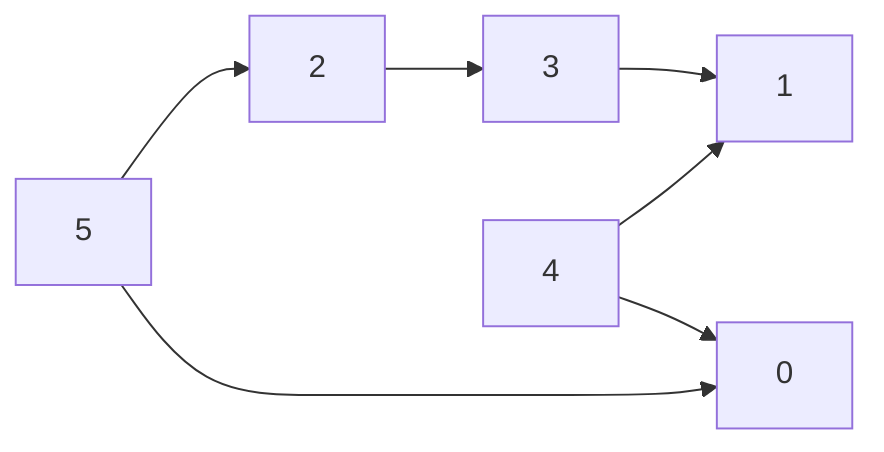

# Topological Sort

> **Estimated Time:** 5 hr | **Difficulty:** Intermediate
> **Prerequisites:** [01 - Graph Basics, BFS and DFS](../01-graph-basics-bfs-dfs/README.md), [03 - Cycle Detection and Bipartite](../03-cycle-and-bipartite/README.md)

---

## What You'll Learn

- You can explain what a DAG is and why only a DAG has a topological order.
- You can write topological sort two ways: DFS with a stack, and Kahn's BFS with indegrees.
- You can detect a cycle in a directed graph just by counting how many nodes you processed.
- You can tell when the order is unique and when many orders exist.
- You can use the order to run DP on a DAG (longest path, shortest path, counting paths, ancestors, colors).

---

## The Big Idea

Think about getting dressed. Socks go before shoes. Underwear goes before trousers. Trousers go before the belt. You do not care about one exact order of the whole morning. You only care that every "A before B" rule is respected. If someone adds "shoes before socks" on top, there is no valid morning at all. That is a cycle.

A **topological order** is a line-up of all nodes of a directed graph such that for every edge `u -> v`, `u` comes before `v`. It exists **if and only if** the graph has no directed cycle. Such a graph is called a **DAG** (Directed Acyclic Graph).

Why it matters: many problems are secretly "do these things in a valid order" (build systems, course plans, spreadsheets, package installs). Once you have the order, you can process each node after all things it depends on are done. That makes DP on a graph easy: no recursion, no repeated work.

Interviewers love it because it tests three things at once: can you model a story as a graph, can you handle cycles, and do you know the two standard algorithms.

Facts to keep in mind:

- A DAG can have **many** valid orders. Any one is usually accepted unless the problem says otherwise.
- Topological order is for **directed** graphs only. For undirected graphs there is no "before".
- Both algorithms run in O(V + E).






Valid orders for this DAG include `5 4 2 0 3 1` and `4 5 0 2 3 1`. Order `1 ...` first is never valid because `1` needs `4` and `3` before it.

---

## How to Spot It

| If the problem says ... | think ... |
|---|---|
| "prerequisites", "dependencies", "must come before" | topological sort |
| "can you finish all", "is there a valid order" | Kahn's, compare processed count with `n` |
| "return any valid order" | either algorithm |
| "derive the order from sorted words / rules" | build edges, then topo sort (alien dictionary) |
| "minimum number of rounds / semesters / time" | Kahn's by levels (BFS layers) |
| "longest / shortest path in a DAG", "number of ways" | topo order + DP |
| "is the order unique" | queue must hold exactly one node at every step |
| "peel from the outside", "leaves first" | Kahn-style trimming (minimum height trees) |
| "nodes that can never reach a cycle" | reverse the graph, Kahn on outdegrees |

---

## Core Concepts / Template

### Indegree

The **indegree** of a node is the number of edges coming into it. A node with indegree 0 has no unmet dependency, so it can go first. Outdegree is the number of edges going out.

### Way 1: Kahn's algorithm (BFS)

1. Count the indegree of every node.
2. Put all indegree-0 nodes in a queue.
3. Pop a node, add it to the answer, and "remove" its edges: reduce the indegree of each neighbor by 1. If a neighbor reaches 0, push it.
4. Repeat until the queue is empty.
5. If the answer has fewer than `n` nodes, the leftover nodes sit on or behind a cycle. **Cycle detected.**

```js
function topoKahn(n, edges) {
  const adj = Array.from({ length: n }, () => []);
  const indeg = new Array(n).fill(0);
  for (const [u, v] of edges) { adj[u].push(v); indeg[v]++; }
  const q = [];
  for (let i = 0; i < n; i++) if (indeg[i] === 0) q.push(i);
  const order = [];
  for (let h = 0; h < q.length; h++) { // index pointer: O(1) pop, no shift()
    const u = q[h];
    order.push(u);
    for (const v of adj[u]) if (--indeg[v] === 0) q.push(v);
  }
  return order.length === n ? order : []; // [] means cycle
}
```

Trace on edges `5->2, 5->0, 4->0, 4->1, 2->3, 3->1` (n = 6):

| Step | Pop | Queue after | Indegrees changed |
|---|---|---|---|
| start | - | [4, 5] | indeg: 0:2, 1:2, 2:1, 3:1 |
| 1 | 4 | [5] | 0:1, 1:1 |
| 2 | 5 | [2, 0] | 2:0, 0:0 |
| 3 | 2 | [0, 3] | 3:0 |
| 4 | 0 | [3] | - |
| 5 | 3 | [] | 1:0, push 1 |
| 6 | 1 | [] | - |

Order: `4 5 2 0 3 1`, six nodes, so no cycle.

### Way 2: DFS with a stack (finish-time order)

Idea: in DFS, a node **finishes** only after everything reachable from it finished. So if we write nodes down in finishing order, every node appears after all the nodes it points to. Reverse that list and we get a topological order.

We use three states: 0 = not seen, 1 = on the current DFS path, 2 = finished. Meeting a state-1 node means we found a back edge, which means a cycle.

```js
function topoDfs(n, edges) {
  const adj = Array.from({ length: n }, () => []);
  for (const [u, v] of edges) adj[u].push(v);
  const state = new Array(n).fill(0); // 0 new, 1 on path, 2 done
  const out = [];
  let cyc = false;
  function dfs(u) {
    state[u] = 1;
    for (const v of adj[u]) {
      if (state[v] === 1) { cyc = true; return; }
      if (state[v] === 0) { dfs(v); if (cyc) return; }
    }
    state[u] = 2;
    out.push(u); // post-order
  }
  for (let i = 0; i < n && !cyc; i++) if (state[i] === 0) dfs(i);
  return cyc ? [] : out.reverse();
}
```

### Kahn vs DFS

| | Kahn (BFS) | DFS |
|---|---|---|
| Cycle detection | processed count < n | back edge to a node on the path |
| Gives levels (layers)? | yes, easy | no |
| Recursion depth issue? | no | yes for long chains (deep recursion in JS) |
| Check "is order unique" | yes, queue size | awkward |
| Lexicographically smallest order | swap queue for a min-heap | harder |

My default in interviews: **Kahn**. It is iterative, detects cycles for free, and gives layers.

### Is the order unique?

The order is unique exactly when, at every step of Kahn, the queue holds **one** node. Another way: consecutive nodes in the order must each have a direct edge (`order[i] -> order[i+1]`). If two nodes are in the queue together, either could go first, so more than one order exists.

### Order of "who points to whom"

The edge direction matters. "To take course `a` you need `b` first" is `b -> a`. Draw one tiny example before coding. Reversing the edges gives the reverse order, which is a classic wrong-answer source.

### Hint: strongly connected components (advanced, reference)

If the graph may have cycles and you still want structure, group nodes into **strongly connected components** (SCC) with Kosaraju or Tarjan. Collapse each SCC into one node and the result is always a DAG, so you can topologically sort the components. This is covered in [08 - Advanced Graphs](../08-advanced-graphs/README.md). It is rarely required for a first interview round.

---

## Problems (easy -> hard)

### 1. Topological Sort (DFS with stack) — Medium
**Companies:** Amazon, Microsoft, Google
**Problem:** Given `n` nodes (0 to n-1) and directed edges, return any order where every edge `u -> v` has `u` before `v`. Return an empty list if impossible. Example: `n=6, edges=[[5,2],[5,0],[4,0],[4,1],[2,3],[3,1]]` -> `[5,4,2,3,1,0]` or any other valid order.
**Intuition:** A node finishes in DFS only after all its descendants finished. So the reverse of the finish order puts each node before everything it points to.
**Approach 1 - Brute force:** Try all n! permutations and check each. Time O(n! * E), Space O(n). Unusable beyond tiny n.
**Approach 2 - Better:** Repeatedly scan for a node with no incoming edge among the remaining nodes, remove it. Time O(V * (V + E)), Space O(V).
**Approach 3 - Optimal:** DFS with three states, push the node to a list when it finishes, reverse the list at the end.

Dry run (adjacency: 5:[2,0], 4:[0,1], 2:[3], 3:[1]). Start at 0: finish 0. Start at 1: finish 1. Node 2 -> 3 -> 1(done): finish 3, finish 2. Node 4: finish 4. Node 5: finish 5. Finish list `[0,1,3,2,4,5]`, reversed: `[5,4,2,3,1,0]`.

```js
function topoDfs(n, edges) {
  const adj = Array.from({ length: n }, () => []);
  for (const [u, v] of edges) adj[u].push(v);
  const state = new Array(n).fill(0); // 0 new, 1 on path, 2 done
  const out = [];
  let cyc = false;
  function dfs(u) {
    state[u] = 1;
    for (const v of adj[u]) {
      if (state[v] === 1) { cyc = true; return; }
      if (state[v] === 0) { dfs(v); if (cyc) return; }
    }
    state[u] = 2;
    out.push(u);
  }
  for (let i = 0; i < n && !cyc; i++) if (state[i] === 0) dfs(i);
  return cyc ? [] : out.reverse();
}
```

**Complexity:** Time O(V + E), Space O(V + E) (adjacency + recursion).
**Watch out:** A plain "visited" array is not enough to find cycles. A node that is finished is fine to meet again; a node still on the path is a cycle. Also a self loop `[0,0]` is a cycle (the code above catches it). Very long chains can overflow the JS call stack; use Kahn then.

### 2. Topological Sort (Kahn's BFS) — Medium
**Companies:** Amazon, Microsoft, Google
**Problem:** Same as above, solved with indegrees and a queue. Example: same edges -> `[4,5,2,0,3,1]`.
**Intuition:** A node with indegree 0 has nothing blocking it. Take it, then its neighbors lose one blocker each.
**Approach 1 - Brute force:** Same repeated scan as above, O(V * (V + E)).
**Approach 2 - Optimal:** Maintain indegrees and a queue of ready nodes (trace in Core Concepts). If we process fewer than `n` nodes, there is a cycle.

```js
function topoKahn(n, edges) {
  const adj = Array.from({ length: n }, () => []);
  const indeg = new Array(n).fill(0);
  for (const [u, v] of edges) { adj[u].push(v); indeg[v]++; }
  const q = [];
  for (let i = 0; i < n; i++) if (indeg[i] === 0) q.push(i);
  const order = [];
  for (let h = 0; h < q.length; h++) {
    const u = q[h];
    order.push(u);
    for (const v of adj[u]) if (--indeg[v] === 0) q.push(v);
  }
  return order.length === n ? order : [];
}
```

**Complexity:** Time O(V + E), Space O(V + E).
**Watch out:** Do not use `queue.shift()` on big inputs; it is O(n) in the worst case. The index pointer `h` avoids that. Isolated nodes (indegree 0, no edges) must still appear in the answer.

### 3. Course Schedule — Medium
**Companies:** Amazon, Google, Meta, Microsoft, Apple
**Problem:** There are `numCourses` courses. `prerequisites[i] = [a, b]` means you must take `b` before `a`. Can you finish all courses? Example: `2, [[1,0]]` -> `true`; `2, [[1,0],[0,1]]` -> `false`.
**Intuition:** You can finish all courses exactly when the graph has no cycle. Kahn's tells us that by the processed count.
**Approach 1 - Brute force:** For every course, DFS and check if you can return to it. Time O(V * (V + E)), Space O(V).
**Approach 2 - Optimal:** Build edges `b -> a`, run Kahn, return `order.length === n`. For `[[1,0],[0,1]]` both nodes have indegree 1, the queue starts empty, count 0 < 2, so `false`.

```js
function findOrder(numCourses, prerequisites) {
  return topoKahn(numCourses, prerequisites.map(([a, b]) => [b, a]));
}
function canFinish(n, p) { return findOrder(n, p).length === n; }
```

(`topoKahn` is the function from problem 2.)

**Complexity:** Time O(V + E), Space O(V + E).
**Watch out:** Edge direction. The pair is `[course, prerequisite]`, so the edge is `prerequisite -> course`. For the yes/no answer the direction does not change the result, but for problem 4 it does. With `n = 0` or no prerequisites the answer is `true`.

### 4. Course Schedule II — Medium
**Companies:** Amazon, Google, Meta, Microsoft
**Problem:** Same input, but return one valid order to take the courses, or an empty array if impossible. Example: `4, [[1,0],[2,0],[3,1],[3,2]]` -> `[0,1,2,3]` (or `[0,2,1,3]`).
**Intuition:** It is exactly topological sort. Courses with no prerequisite go first.
**Approach 1 - Brute force:** Try permutations, O(n!).
**Approach 2 - Optimal:** Kahn's with edges `b -> a`; return the order, or `[]` when the count is short. Trace: indegrees `0:0, 1:1, 2:1, 3:2`; pop 0 -> push 1 and 2; pop 1 -> `3` has indegree 1; pop 2 -> `3` hits 0; pop 3. Order `0 1 2 3`.

The code is the `findOrder` function shown in problem 3.

**Complexity:** Time O(V + E), Space O(V + E).
**Watch out:** Return `[]` (not `null`) on a cycle if the judge says so. Duplicate prerequisite pairs are harmless here because indegree is counted per edge and decremented per edge.

### 5. Find Eventual Safe States — Medium
**Companies:** Google, Amazon, Meta
**Problem:** A node is **terminal** if it has no outgoing edge. A node is **safe** if every path from it leads to a terminal node. Return all safe nodes in ascending order. Example: `graph=[[1,2],[2,3],[5],[0],[5],[],[]]` -> `[2,4,5,6]`.
**Intuition:** Safe nodes are the ones that can **never** reach a cycle. Start from the terminal nodes and walk backward: a node becomes safe once all its outgoing neighbors are safe. That is Kahn's on the **reversed** graph, using outdegree instead of indegree.
**Approach 1 - Brute force:** For each node run a DFS with colors and see if it reaches a cycle. With memoization (3-color DFS) this is O(V + E) too.
**Approach 2 - Optimal (reverse Kahn):** Reverse every edge. Nodes with outdegree 0 start in the queue. When a node is popped (safe), reduce the outdegree of each node that pointed to it.

Trace on `graph=[[1,2],[2,3],[5],[0],[5],[],[]]`: outdegrees `[2,2,1,1,1,0,0]`. Queue `[5,6]`. Pop 5: nodes 2 and 4 point to 5, their outdegree becomes 0, push both. Pop 6: nobody. Pop 2: node 0 and 1 had 2 -> outdeg 0:1, 1:1. Pop 4. Done. Safe: `{5,6,2,4}` sorted `[2,4,5,6]`. Nodes 0, 1, 3 stay stuck, they sit on the cycle `0 -> 1 -> 3 -> 0` or reach it.

```js
function eventualSafeNodes(graph) {
  const n = graph.length;
  const rev = Array.from({ length: n }, () => []);
  const outdeg = graph.map(a => a.length);
  graph.forEach((vs, u) => vs.forEach(v => rev[v].push(u)));
  const q = [];
  for (let i = 0; i < n; i++) if (outdeg[i] === 0) q.push(i);
  const safe = new Array(n).fill(false);
  for (let h = 0; h < q.length; h++) {
    const u = q[h];
    safe[u] = true;
    for (const p of rev[u]) if (--outdeg[p] === 0) q.push(p);
  }
  const res = [];
  for (let i = 0; i < n; i++) if (safe[i]) res.push(i);
  return res;
}
```

**Complexity:** Time O(V + E), Space O(V + E).
**Watch out:** Return the answer sorted (loop over indices instead of sorting the queue). A node that only reaches a cycle, without being on it, is not safe either.

### 6. Parallel Courses (Minimum Semesters) — Hard
**Companies:** Amazon, Google, Meta
**Problem:** Courses are numbered `1..n`. `relations[i] = [prev, next]` means `prev` must be finished before `next`. In one semester you can take any number of courses whose prerequisites were done in earlier semesters. Return the minimum number of semesters, or `-1` if there is a cycle. Example: `n=3, [[1,3],[2,3]]` -> `2`.
**Intuition:** Run Kahn **layer by layer**. All courses ready now go in this semester. The number of layers is the answer, and it equals the length of the longest chain.
**Approach 1 - Brute force:** Simulate semesters by scanning all courses each time. Time O(V * (V + E)).
**Approach 2 - Optimal:** BFS in levels. Count the courses processed; if it is not `n`, return `-1`.

Trace on `n=3, [[1,3],[2,3]]`: level 1 = `[1,2]` (semester 1), their edges free `3`; level 2 = `[3]` (semester 2). Answer 2.

```js
function minimumSemesters(n, relations) { // courses 1..n, [prev,next]
  const adj = Array.from({ length: n + 1 }, () => []);
  const indeg = new Array(n + 1).fill(0);
  for (const [a, b] of relations) { adj[a].push(b); indeg[b]++; }
  let level = [];
  for (let i = 1; i <= n; i++) if (indeg[i] === 0) level.push(i);
  let sem = 0, done = 0;
  while (level.length) {
    sem++;
    const next = [];
    for (const u of level) {
      done++;
      for (const v of adj[u]) if (--indeg[v] === 0) next.push(v);
    }
    level = next;
  }
  return done === n ? sem : -1;
}
```

**Complexity:** Time O(V + E), Space O(V + E).
**Watch out:** Courses are 1-indexed here. The "levels" loop must process the whole current layer before moving on, otherwise semesters are miscounted. (A variant, "Parallel Courses III", adds a time per course; then use `finish[v] = max(finish[v], finish[u]) + time[v]` in topo order.)

### 7. Alien Dictionary — Hard
**Companies:** Google, Meta, Amazon, Airbnb, Microsoft
**Problem:** You get a list of words sorted in an unknown alphabet's order. Return a string with the letters in a valid alphabet order, or `""` if the input is inconsistent. Example: `["wrt","wrf","er","ett","rftt"]` -> `"wertf"`.
**Intuition:** Each pair of **adjacent** words gives at most one fact: compare them letter by letter, the first different pair `x != y` means `x` comes before `y`. Those facts are edges. A topological order of the letters is the alphabet.
**Approach 1 - Brute force:** Try all permutations of the letters and check them against the word list. O(k! * total length).
**Approach 2 - Optimal:** Add every letter as a node (even letters that never appear in an edge). For each adjacent pair add one edge for the first mismatch. Run Kahn. If the output is shorter than the letter count, there is a cycle: return `""`.

Trace: `wrt,wrf` gives `t -> f`; `wrf,er` gives `w -> e`; `er,ett` gives `r -> t`; `ett,rftt` gives `e -> r`. Chain: `w -> e -> r -> t -> f`. Output `wertf`.

```js
function alienOrder(words) {
  const adj = new Map();
  const indeg = new Map();
  for (const w of words) for (const c of w) if (!adj.has(c)) { adj.set(c, new Set()); indeg.set(c, 0); }
  for (let i = 0; i + 1 < words.length; i++) {
    const a = words[i], b = words[i + 1];
    if (a.length > b.length && a.startsWith(b)) return ''; // "abc" before "ab" is invalid
    for (let j = 0; j < Math.min(a.length, b.length); j++) {
      if (a[j] !== b[j]) {
        if (!adj.get(a[j]).has(b[j])) { adj.get(a[j]).add(b[j]); indeg.set(b[j], indeg.get(b[j]) + 1); }
        break; // only the first difference counts
      }
    }
  }
  const q = [...indeg].filter(([, d]) => d === 0).map(([c]) => c);
  let out = '';
  for (let h = 0; h < q.length; h++) {
    const c = q[h];
    out += c;
    for (const nx of adj.get(c)) { indeg.set(nx, indeg.get(nx) - 1); if (indeg.get(nx) === 0) q.push(nx); }
  }
  return out.length === adj.size ? out : '';
}
```

**Complexity:** Time O(C + min(U^2, N)) where C is the total number of characters, U the number of unique letters and N the number of words (at most one edge per adjacent word pair); Space O(U + edges). The graph has at most U letters, so it is small.
**Watch out:** Three traps. (1) A longer word before its own prefix (`["abc","ab"]`) is invalid, return `""`. (2) Stop at the first mismatch, later letters tell you nothing. (3) Do not add the same edge twice or the indegree will be wrong (the `Set` guards this). Many answers can be valid; judges usually check validity, not one string.

### 8. Sequence Reconstruction — Medium
**Companies:** Google, Microsoft
**Problem:** `nums` is a permutation of `1..n`. Given `sequences` (each is a subsequence of `nums`), check whether `nums` is the **only** shortest supersequence of all of them. Example: `nums=[1,2,3], sequences=[[1,2],[1,3]]` -> `false` (`[1,3,2]` also works); with `[[1,2],[1,3],[2,3]]` -> `true`.
**Intuition:** Every consecutive pair in a sequence is an edge. `nums` is the unique answer exactly when the topological order is unique and equals `nums`. Unique means: the Kahn queue never holds more than one node.
**Approach 1 - Brute force:** Generate all topological orders and count them. Exponential.
**Approach 2 - Optimal:** Kahn's. At each step if the queue size is above 1, return `false`. The node popped must equal `nums[idx]`. At the end `idx` must be `n`.

Trace on `[1,2,3]` with `[[1,2],[1,3]]`: edges `1->2`, `1->3`. Queue `[1]`, pop 1, queue becomes `[2,3]` (size 2) -> `false`.

```js
function sequenceReconstruction(nums, sequences) {
  const n = nums.length;
  const adj = Array.from({ length: n + 1 }, () => []);
  const indeg = new Array(n + 1).fill(0);
  for (const s of sequences) {
    for (const x of s) if (x < 1 || x > n) return false;
    for (let i = 0; i + 1 < s.length; i++) { adj[s[i]].push(s[i + 1]); indeg[s[i + 1]]++; }
  }
  let q = [];
  for (let i = 1; i <= n; i++) if (indeg[i] === 0) q.push(i);
  let idx = 0;
  while (q.length) {
    if (q.length > 1) return false; // two choices = not unique
    const u = q.pop();
    if (nums[idx++] !== u) return false;
    for (const v of adj[u]) if (--indeg[v] === 0) q.push(v);
  }
  return idx === n;
}
```

**Complexity:** Time O(n + total length of sequences), Space O(n + edges).
**Watch out:** If some number never appears in any sequence, it has indegree 0 together with another node, so the queue gets size 2 and we return `false`. That is correct, since its position is not forced. A cycle leaves `idx < n`, also `false`. Note `sequences = [[1]]` with `nums=[1]` is `true`.

### 9. Minimum Height Trees — Medium
**Companies:** Google, Amazon, Meta
**Problem:** A tree has `n` nodes and `n-1` undirected edges. Choose a root so the tree height is minimum. Return all such roots. Example: `n=4, edges=[[1,0],[1,2],[1,3]]` -> `[1]`.
**Intuition:** The best roots are the **center** of the tree (one or two nodes). Find them by peeling off the leaves layer by layer, like peeling an onion, until at most two nodes remain. This is Kahn's idea on an undirected tree: "indegree" is degree, and the start set is the leaves (degree 1).
**Approach 1 - Brute force:** BFS from each node to find its height, keep the smallest. Time O(n^2), Space O(n).
**Approach 2 - Optimal:** Repeatedly remove all current leaves. Stop when 2 or fewer nodes are left. Those nodes are the answer.

Trace on `n=6, edges=[[3,0],[3,1],[3,2],[3,4],[5,4]]`: leaves are `0,1,2,5`. Remove them, so `left = 6 - 4 = 2`. Node 3 lost three neighbors and node 4 lost one, so both now have degree 1 and are the new leaves. `left = 2`, stop. Answer `[3,4]`.

```js
function findMinHeightTrees(n, edges) {
  if (n === 1) return [0];
  const adj = Array.from({ length: n }, () => []);
  const deg = new Array(n).fill(0);
  for (const [a, b] of edges) { adj[a].push(b); adj[b].push(a); deg[a]++; deg[b]++; }
  let leaves = [];
  for (let i = 0; i < n; i++) if (deg[i] === 1) leaves.push(i);
  let left = n;
  while (left > 2) {
    left -= leaves.length;
    const next = [];
    for (const l of leaves) for (const v of adj[l]) if (--deg[v] === 1) next.push(v);
    leaves = next;
  }
  return leaves;
}
```

**Complexity:** Time O(n), Space O(n).
**Watch out:** `n = 1` has no edges, so there are no leaves; return `[0]`. `n = 2` returns both nodes. A tree has at most 2 centers, never 3.

### 10. Longest Path in a DAG — Medium
**Companies:** Amazon, Microsoft
**Problem:** Given a DAG, find the length (number of edges) of its longest path. Example: `n=6, edges=[[0,1],[1,2],[2,3],[0,3],[3,4],[4,5]]` -> `5`.
**Intuition:** In a general graph the longest path is NP-hard, but in a DAG it is easy. Process nodes in topological order. When we reach `u`, `dp[u]` is final (all its predecessors came earlier), so we push `dp[u] + 1` to its neighbors.
**Approach 1 - Brute force:** DFS from every node trying all paths. Exponential in the worst case.
**Approach 2 - Optimal:** Topological order, then `dp[v] = max(dp[v], dp[u] + 1)` for each edge. Answer is the max of `dp`.

Trace on the example: order `0,1,2,3,4,5`. `dp[1]=1`, `dp[2]=2`, `dp[3]=max(3, 1)=3`, `dp[4]=4`, `dp[5]=5`. Answer 5 (the shortcut edge `0->3` does not matter).

```js
function longestPathDag(n, edges) {
  const order = topoKahn(n, edges);
  if (order.length !== n) return -1; // cycle
  const adj = Array.from({ length: n }, () => []);
  for (const [u, v] of edges) adj[u].push(v);
  const dp = new Array(n).fill(0);
  let best = 0;
  for (const u of order) {
    best = Math.max(best, dp[u]);
    for (const v of adj[u]) dp[v] = Math.max(dp[v], dp[u] + 1);
  }
  return best;
}
```

**Complexity:** Time O(V + E), Space O(V + E).
**Watch out:** Path length in edges vs in nodes (differs by 1). Start every `dp` at 0 because a path may start at any node, not only at node 0.

### 11. Shortest Path and Number of Paths in a Weighted DAG — Medium
**Companies:** Amazon, Google
**Problem:** Given a weighted DAG (weights may be negative) and a source, find the shortest distance to every node and how many shortest paths reach each node. Also count all paths from `src` to `dst`. Example: edges `[0,1,1],[0,2,1],[1,3,1],[2,3,1]`, src 0 -> `dist=[0,1,1,2]`, `ways=[1,1,1,2]`.
**Intuition:** Dijkstra is not needed. If we relax edges in topological order, each node's distance is final the first time we leave it, because all its incoming edges were already relaxed. This also works with negative weights, and it takes O(V + E) instead of O(E log V).
**Approach 1 - Brute force:** Bellman-Ford, O(V * E).
**Approach 2 - Better:** Dijkstra with a heap, O(E log V), fails with negative weights.
**Approach 3 - Optimal:** Topo order + relax. Keep `ways[v]`: if a strictly better distance is found, copy `ways[u]`; on a tie, add `ways[u]`. For "all paths" (no weights) just do `cnt[v] += cnt[u]`.

Trace for the example: order `0,1,2,3`. From 0: `dist[1]=1, ways=1`; `dist[2]=1, ways=1`. From 1: `dist[3]=2, ways=1`. From 2: tie, `ways[3]=2`.

```js
function dagShortest(n, edges, src) { // edges [u, v, w]
  const order = topoKahn(n, edges.map(([u, v]) => [u, v]));
  const adj = Array.from({ length: n }, () => []);
  for (const [u, v, w] of edges) adj[u].push([v, w]);
  const dist = new Array(n).fill(Infinity);
  const ways = new Array(n).fill(0); // number of shortest paths
  dist[src] = 0; ways[src] = 1;
  for (const u of order) {
    if (dist[u] === Infinity) continue; // unreachable from src
    for (const [v, w] of adj[u]) {
      const d = dist[u] + w;
      if (d < dist[v]) { dist[v] = d; ways[v] = ways[u]; }
      else if (d === dist[v]) ways[v] += ways[u];
    }
  }
  return { dist, ways };
}

function countPathsDag(n, edges, src, dst) {
  const order = topoKahn(n, edges);
  const adj = Array.from({ length: n }, () => []);
  for (const [u, v] of edges) adj[u].push(v);
  const cnt = new Array(n).fill(0);
  cnt[src] = 1;
  for (const u of order) for (const v of adj[u]) cnt[v] += cnt[u];
  return cnt[dst];
}
```

**Complexity:** Time O(V + E), Space O(V + E).
**Watch out:** Skip nodes with `Infinity` distance, or `Infinity + w` ties and wrongly adds counts. The number of paths can be huge; real problems ask for it modulo `1e9+7`. This trick needs a DAG: with a cycle `topoKahn` returns `[]` and nothing is relaxed.

### 12. All Ancestors of a Node in a DAG — Medium
**Companies:** Amazon, Google
**Problem:** Given a DAG with `n` nodes and directed edges, return for each node the sorted list of all its ancestors (nodes that can reach it). Example: `n=3, edges=[[0,1],[1,2]]` -> `[[],[0],[0,1]]`.
**Intuition:** In topological order, when we pop `u`, its ancestor set is complete. For each edge `u -> v`, the ancestors of `v` include `u` and everything in `anc[u]`.
**Approach 1 - Brute force:** For each node, DFS on the reversed graph. Time O(V * (V + E)), Space O(V + E) per run. This is also fine for the usual limits (n up to 1000).
**Approach 2 - Optimal-ish:** Kahn's, merging `anc[u]` into `anc[v]` along each edge. Time O(V * (V + E)) worst case because sets can hold V items, but simple and in order. The output itself can be O(V^2), so you cannot do better in general.

```js
function getAncestors(n, edges) {
  const adj = Array.from({ length: n }, () => []);
  const indeg = new Array(n).fill(0);
  for (const [u, v] of edges) { adj[u].push(v); indeg[v]++; }
  const anc = Array.from({ length: n }, () => new Set());
  const q = [];
  for (let i = 0; i < n; i++) if (indeg[i] === 0) q.push(i);
  for (let h = 0; h < q.length; h++) {
    const u = q[h];
    for (const v of adj[u]) {
      anc[v].add(u);
      for (const a of anc[u]) anc[v].add(a);
      if (--indeg[v] === 0) q.push(v);
    }
  }
  return anc.map(s => [...s].sort((a, b) => a - b));
}
```

**Complexity:** Time O(V * (V + E)), Space O(V^2).
**Watch out:** Sets avoid duplicates when two paths reach the same ancestor. Sort at the end because the problem asks for ascending order. Parallel edges are harmless.

### 13. Largest Color Value in a Directed Graph — Hard
**Companies:** Google, Amazon
**Problem:** Each node has a lowercase letter color. A path's value is the number of times its most frequent color appears. Return the largest path value in the graph, or `-1` if there is a cycle. Example: `colors="abaca", edges=[[0,1],[0,2],[2,3],[3,4]]` -> `3` (path `0 -> 2 -> 3 -> 4` has `a` three times).
**Intuition:** On a DAG, do DP in topological order. Let `cnt[v][c]` be the best count of color `c` over all paths ending at `v`. When we move from `u` to `v`, `cnt[v][c] = max(cnt[v][c], cnt[u][c])`, and when we process a node we add its own color. A cycle means the value is infinite, so `-1`.
**Approach 1 - Brute force:** Enumerate all paths, count colors. Exponential.
**Approach 2 - Optimal:** Kahn's with a `26`-wide count array per node. Count processed nodes to detect the cycle.

Trace for `colors="abaca"`: node 0 (`a`): `cnt[0][a]=1`. It feeds 1 and 2. Node 2 (`a`) adds one: `cnt[2][a]=2`. Node 3 (`c`): inherits `a:2`, adds `c:1`. Node 4 (`a`): inherits `a:2`, becomes `a:3`. Best = 3.

```js
function largestPathValue(colors, edges) {
  const n = colors.length;
  const adj = Array.from({ length: n }, () => []);
  const indeg = new Array(n).fill(0);
  for (const [u, v] of edges) { adj[u].push(v); indeg[v]++; }
  const cnt = Array.from({ length: n }, () => new Array(26).fill(0));
  const q = [];
  for (let i = 0; i < n; i++) if (indeg[i] === 0) q.push(i);
  let seen = 0, best = 0;
  for (let h = 0; h < q.length; h++) {
    const u = q[h];
    seen++;
    best = Math.max(best, ++cnt[u][colors.charCodeAt(u) - 97]);
    for (const v of adj[u]) {
      for (let c = 0; c < 26; c++) cnt[v][c] = Math.max(cnt[v][c], cnt[u][c]);
      if (--indeg[v] === 0) q.push(v);
    }
  }
  return seen === n ? best : -1;
}
```

**Complexity:** Time O(26 * (V + E)), Space O(26 * V + E).
**Watch out:** Add the node's own color exactly once, when it is popped (all inputs have been merged into it by then). A self loop is a cycle. The graph may be disconnected, so start from all indegree-0 nodes.

### 14. Sort Items by Groups Respecting Dependencies — Hard
**Companies:** Google, Amazon
**Problem:** `n` items, each belongs to a group `0..m-1` or to no group (`-1`). `beforeItems[i]` lists items that must come before item `i`. Return an order where items of the same group sit next to each other and all dependencies hold, or `[]` if impossible.
**Intuition:** Two topological sorts. One on **items**, one on **groups** (an item dependency across groups becomes a group dependency). Then lay out groups in group order, and inside each group keep the item order.
**Approach 1 - Brute force:** Try permutations of groups and items. Exponential.
**Approach 2 - Optimal:** Give each ungrouped item its own new group id so every item has a group. Build item edges and group edges (only when the two groups differ). Run `topoKahn` on both; if either has a cycle return `[]`. Put each item into its group's bucket in item-topological order, then output buckets in group order.

```js
function sortItems(n, m, group, beforeItems) {
  let g = m;
  group = group.map(x => (x === -1 ? g++ : x)); // every loner gets its own group
  const itemEdges = [], groupEdges = [];
  for (let v = 0; v < n; v++) for (const u of beforeItems[v]) {
    itemEdges.push([u, v]);
    if (group[u] !== group[v]) groupEdges.push([group[u], group[v]]);
  }
  const itemOrder = topoKahn(n, itemEdges);
  const groupOrder = topoKahn(g, groupEdges);
  if (itemOrder.length !== n || groupOrder.length !== g) return [];
  const buckets = Array.from({ length: g }, () => []);
  for (const it of itemOrder) buckets[group[it]].push(it); // keeps item topo order inside group
  return groupOrder.flatMap(gr => buckets[gr]);
}
```

**Complexity:** Time O(V + E) with up to V + m groups, Space O(V + E).
**Watch out:** Forgetting to give loner items their own group breaks "same group contiguous". A cross-group cycle (group A needs B, B needs A) is only visible in the group graph, so you need both sorts.

---

## Common Mistakes

- **"Topological sort works on any graph."** It works only on a DAG. On a cyclic graph there is no valid order; always check the count (Kahn) or back edges (DFS).
- **"A normal visited array finds directed cycles."** In a directed graph, meeting an already visited node is fine if it is finished. You need the "on current path" state.
- **"The edge is `a -> b` because the pair is `[a, b]`."** In Course Schedule `[a, b]` means `b` first, so the edge is `b -> a`. Always read the sentence, not the order of the numbers.
- **"The answer is unique."** Usually not. Do not compare your output with the sample output; check validity (or use a checker like the one in the tests).
- **"Isolated nodes can be ignored."** They have indegree 0 and must be in the order. Create nodes for all `n`, not only for nodes in edges (and in Alien Dictionary, all letters).
- **"`queue.shift()` is fine."** It can be O(n) per call. Use an index pointer or a deque.
- **"Kahn's detects cycles by an empty queue."** The queue always ends empty. Compare the processed count with `n`.
- **Mixing node or edge counts with level counts.** For "minimum semesters" count BFS layers, not nodes.

---

## Interview Tips

- Say first: "This is a dependency problem. I model items as nodes and 'A before B' as a directed edge. A valid order exists only if there is no cycle, so I will use topological sort."
- State the choice: "I'll use Kahn's algorithm because it is iterative and tells me about cycles through the processed count. DFS also works."
- Always say what the edge direction is, with a one-line example, before writing code.
- Mention edge cases: no edges, isolated nodes, self loops, duplicate edges, disconnected graph, `n = 0` or `1`, cycles.
- Complexity line: "O(V + E) time and space."
- Follow-ups you may get:
  - "Return the lexicographically smallest order." Replace the queue with a min-heap.
  - "Is the order unique?" Queue size must be 1 at each step.
  - "Find the cycle itself." Use DFS with a parent map or the stuck nodes (nodes whose indegree never reached 0, then walk among them).
  - "Count the number of topological orders." That is #P-hard in general; for small `n` use bitmask DP (`dp[mask]` = ways to pick the set `mask` so far).
  - "What if there are cycles but you still want structure?" Condense strongly connected components first (Tarjan or Kosaraju), then topo sort the component DAG. See [08 - Advanced Graphs](../08-advanced-graphs/README.md).
  - "Shortest path in a DAG?" Topological order + relaxation, O(V + E), also works with negative weights. Compare with [05 - Shortest Paths](../05-shortest-paths/README.md).
- If the graph is huge and deep, mention that recursive DFS can overflow the stack, so you prefer Kahn.

---

## Practice List

**Easy**
- Find the Town Judge
- Find Center of Star Graph
- Course Schedule (basics, if new to graphs)

**Medium**
- Parallel Courses II
- Parallel Courses III
- Loud and Rich
- Longest Increasing Path in a Matrix (topological layers on a grid)
- Number of Ways to Arrive at Destination (DAG-like shortest path count)
- Build a Matrix With Conditions
- Maximum Employees to Be Invited to a Meeting
- Count Visited Nodes in a Directed Graph
- Find All Possible Recipes from Given Supplies
- Collect Coins in a Tree

**Hard**
- Course Schedule IV
- Strange Printer II
- Critical Connections in a Network (SCC and bridges, advanced)

---

## Key Takeaways

- A **topological order** exists **if and only if** the directed graph is a **DAG**.
- **Kahn's algorithm** = indegrees + queue of ready nodes; **processed count < n means a cycle**.
- **DFS** version = reverse of post-order (finish time); a back edge to a node **on the current path** means a cycle.
- The order is **unique only when the queue has exactly one node at every step**; otherwise many valid orders exist.
- For "minimum rounds / semesters" run Kahn **level by level**; the layer count is the answer.
- Once you have the order, **DP over the order** solves longest path, shortest path (even with negative weights), path counts, ancestors and color counts in O(V + E).
- Reverse the graph and use outdegree to find "safe" nodes; peel leaves to find tree centers (**same Kahn idea, different start set**).

---

[← Previous: Cycle Detection and Bipartite](../03-cycle-and-bipartite/README.md) | [Next: Shortest Paths →](../05-shortest-paths/README.md) | [Back to Graphs Index](../README.md)
