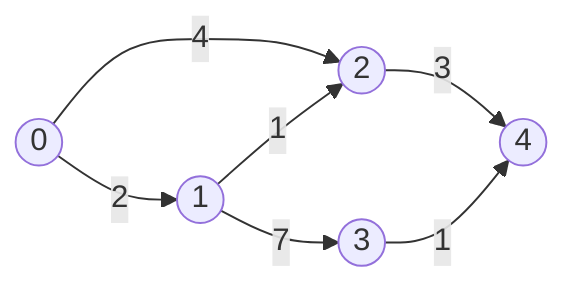

# Shortest Paths

> **Estimated Time:** 6 hr | **Difficulty:** Intermediate
> **Prerequisites:** [04-graphs/01 - Graph Basics, BFS and DFS](../01-graph-basics-bfs-dfs/README.md), [04-graphs/04 - Topological Sort](../04-topological-sort/README.md), [02-intermediate/05 - Heaps](../../02-intermediate/05-heaps/README.md)

---

## What You'll Learn
- You can pick the right shortest-path tool in 10 seconds: BFS, 0-1 BFS, Dijkstra, Bellman-Ford, DAG order or Floyd-Warshall.
- You can write Dijkstra with a min-heap from memory, including the "skip stale entries" line.
- You can explain why a negative edge breaks Dijkstra, and what to use instead.
- You can detect a negative cycle and rebuild the actual path, not just its length.
- You can spot the "hidden Dijkstra" in grid, probability, effort and state-graph problems.

## The Big Idea

Think of a road trip. You stand in one city and want the cheapest way to every other city. A smart traveler keeps a notebook: "best known cost to reach each city". She always visits the city with the smallest cost in the notebook next. Once she is standing there, no other route can be cheaper, because every other route is already more expensive before the last leg. That is Dijkstra. If some roads paid you money (negative edges), a long route could suddenly become cheaper, and her "no cheaper route exists" argument fails.

All shortest-path algorithms share one move, called **relaxation**: "if going through `u` makes `v` cheaper, update `v`".

```
if (dist[u] + w < dist[v]) dist[v] = dist[u] + w;
```

The algorithms differ only in the order they relax edges:

| Algorithm | Order of relaxing | Works when |
|---|---|---|
| BFS | level by level | all edges cost 1 |
| 0-1 BFS | deque, front for 0, back for 1 | edges cost 0 or 1 |
| Dijkstra | cheapest unvisited node first | no negative edges |
| DAG order | topological order | graph has no cycles (negatives are fine) |
| Bellman-Ford | all edges, V-1 rounds | negatives fine, finds negative cycles |
| Floyd-Warshall | try every middle node k | all pairs, small V |

Interviewers love this topic because it tests whether you can pick the right algorithm, not just code one. Many problems look like "grid" or "number puzzle" and are really Dijkstra in disguise.

## How to Spot It

| If the problem says ... | think ... |
|---|---|
| "minimum number of steps/moves", every move equal | BFS |
| moves cost 0 or 1 (free vs paid) | 0-1 BFS |
| "minimum time/cost/distance", positive weights | Dijkstra |
| "minimize the maximum" along a path (effort, water level) | Dijkstra with `max` instead of `+` |
| "maximize probability" (multiply numbers in 0..1) | Dijkstra on max-heap (negate, or use a max-heap) |
| "at most K edges/stops" | Bellman-Ford with K+1 rounds (or Dijkstra with state) |
| "number of shortest paths" | Dijkstra plus a `ways[]` array |
| negative weights | Bellman-Ford (or DAG order if acyclic) |
| "detect arbitrage / negative cycle" | Bellman-Ford, one extra round |
| all pairs, V up to about 400 | Floyd-Warshall |
| directed acyclic graph with weights | topological order, relax once |
| numbers or states as nodes (multiply, mod) | BFS or Dijkstra on an implicit graph |

## Core Concepts / Template

### 1. BFS for unweighted graphs
BFS visits nodes in order of distance, so the first time you reach a node is the shortest way. Use an index pointer instead of `shift()` (which is O(n)).

```js
function bfsDist(n, edges, src) {
  const adj = Array.from({ length: n }, () => []);
  for (const [u, v] of edges) { adj[u].push(v); adj[v].push(u); }
  const dist = Array(n).fill(-1);
  dist[src] = 0;
  const q = [src];
  for (let h = 0; h < q.length; h++) {
    const u = q[h];
    for (const v of adj[u]) if (dist[v] === -1) { dist[v] = dist[u] + 1; q.push(v); }
  }
  return dist; // -1 means unreachable
}
```

### 2. 0-1 BFS
If edges cost 0 or 1, you do not need a heap. Push a 0-cost move to the **front** of a deque and a 1-cost move to the **back**. The deque stays sorted by distance. Time O(V + E). JavaScript has no deque, so here is a tiny one (all operations O(1)):

```js
class Deque {
  constructor() { this.d = {}; this.h = 0; this.t = 0; }
  get size() { return this.t - this.h; }
  pushBack(x) { this.d[this.t++] = x; }
  pushFront(x) { this.d[--this.h] = x; }
  popFront() { const x = this.d[this.h]; delete this.d[this.h++]; return x; }
}
```

### 3. A minimal min-heap (so this chapter stands alone)
Items are arrays whose first element is the priority, like `[dist, node]`. It is the same heap as in the Heaps chapter, trimmed to what Dijkstra needs.

```js
class MinHeap {
  constructor() { this.a = []; }
  get size() { return this.a.length; }
  push(x) {
    const a = this.a; a.push(x);
    let i = a.length - 1;
    while (i > 0) {
      const p = (i - 1) >> 1;
      if (a[p][0] <= a[i][0]) break;
      [a[p], a[i]] = [a[i], a[p]]; i = p;
    }
  }
  pop() {
    const a = this.a, top = a[0], last = a.pop();
    if (a.length) {
      a[0] = last;
      let i = 0;
      for (;;) {
        const l = 2 * i + 1, r = l + 1;
        let m = i;
        if (l < a.length && a[l][0] < a[m][0]) m = l;
        if (r < a.length && a[r][0] < a[m][0]) m = r;
        if (m === i) break;
        [a[m], a[i]] = [a[i], a[m]]; i = m;
      }
    }
    return top;
  }
}
```

### 4. Dijkstra template
Keep a heap of `[distance, node]`. Pop the smallest. If it is older than what we know (`d > dist[u]`), skip it: this is a **stale entry** (JavaScript heaps cannot decrease a key, so we push a new entry and ignore the old one later). Otherwise relax every neighbor.

```js
function dijkstra(n, adj, src) { // adj[u] = [[v, w], ...]
  const dist = Array(n).fill(Infinity);
  dist[src] = 0;
  const pq = new MinHeap();
  pq.push([0, src]);
  while (pq.size) {
    const [d, u] = pq.pop();
    if (d > dist[u]) continue;            // stale entry
    for (const [v, w] of adj[u]) {
      if (d + w < dist[v]) { dist[v] = d + w; pq.push([dist[v], v]); }
    }
  }
  return dist;
}
```

Time O((V + E) log V), space O(V + E).

Trace on edges 0-1:2, 0-2:4, 1-2:1, 1-3:7, 2-4:3, 3-4:1 from node 0:

| pop `[d,u]` | action | dist after (nodes 0..4) |
|---|---|---|
| start | | 0, inf, inf, inf, inf |
| [0,0] | relax 1 (2), 2 (4) | 0, 2, 4, inf, inf |
| [2,1] | relax 2 (3 beats 4), 3 (9) | 0, 2, 3, 9, inf |
| [3,2] | relax 4 (6) | 0, 2, 3, 9, 6 |
| [4,2] | stale (4 > 3), skip | same |
| [6,4] | relax 3 (7 beats 9) | 0, 2, 3, 7, 6 |
| [7,3] | nothing better | same |
| [9,3] | stale, skip | final: 0, 2, 3, 7, 6 |






(Edges are undirected in the trace; arrows only show the drawing direction.)

### 5. Why negative edges break Dijkstra
Dijkstra's promise: "when I pop a node, its distance is final". The reason is that every other path to it must go through a node still in the heap, which costs at least as much already, and adding more edges only adds more cost. A negative edge breaks the last part: a later edge can subtract.

Example: A->B cost 2, A->C cost 3, C->B cost -2. Dijkstra pops B first with cost 2 and calls it final. But A->C->B costs 1. The answer 2 is wrong. The textbook version never revisits B. The "re-push if better" version above can fix some cases, but it may reprocess nodes exponentially many times, and with a negative cycle it never stops. Do not rely on it: use Bellman-Ford.

### 6. Bellman-Ford
A shortest path without cycles has at most V-1 edges. So relax **every edge** V-1 times. After round i, every shortest path that uses at most i edges is correct. If a V-th round still improves something, a negative cycle is reachable. Time O(V * E), space O(V).

```js
function bellmanFord(n, edges, src) { // edges = [[u, v, w], ...] directed
  const dist = Array(n).fill(Infinity);
  dist[src] = 0;
  for (let i = 0; i < n - 1; i++) {
    let changed = false;
    for (const [u, v, w] of edges)
      if (dist[u] !== Infinity && dist[u] + w < dist[v]) { dist[v] = dist[u] + w; changed = true; }
    if (!changed) break;              // early exit
  }
  for (const [u, v, w] of edges)
    if (dist[u] !== Infinity && dist[u] + w < dist[v]) return null; // negative cycle
  return dist;
}
```

### 7. Floyd-Warshall
A DP over "allowed middle nodes". `d[i][j]` after processing nodes `0..k` is the best path from i to j that only uses those as middles. The loop over `k` must be the **outermost** loop. Time O(V^3), space O(V^2).

```js
function floydWarshall(n, edges) {
  const d = Array.from({ length: n }, (_, i) => Array.from({ length: n }, (_, j) => (i === j ? 0 : Infinity)));
  for (const [u, v, w] of edges) d[u][v] = Math.min(d[u][v], w);
  for (let k = 0; k < n; k++)
    for (let i = 0; i < n; i++) {
      if (d[i][k] === Infinity) continue;
      for (let j = 0; j < n; j++)
        if (d[i][k] + d[k][j] < d[i][j]) d[i][j] = d[i][k] + d[k][j];
    }
  return d; // a negative d[i][i] means i is on a negative cycle
}
```

### 8. Path reconstruction
Store `parent[v] = u` whenever you improve `dist[v]` through `u`. At the end, walk from the target back to the source following `parent`, then reverse. For Floyd-Warshall, store `next[i][j]` (the first step from i toward j) and update it together with `d[i][j]`.

### 9. Which one do I pick?

| Graph | Best choice | Time |
|---|---|---|
| unweighted | BFS | O(V + E) |
| weights 0/1 | 0-1 BFS | O(V + E) |
| positive weights | Dijkstra | O((V+E) log V) |
| DAG, any weights | topological order | O(V + E) |
| negative weights, cyclic | Bellman-Ford | O(VE) |
| all pairs, small V | Floyd-Warshall | O(V^3) |

## Problems (easy -> hard)

### 1. Shortest Path in an Unweighted Graph — Easy
**Companies:** Amazon, Microsoft, Flipkart
**Problem:** Given an undirected graph with `n` nodes and edges, return the shortest distance from `src` to every node (`-1` if unreachable). Example: `n=3`, edges `[[0,1]]`, src 0 -> `[0, 1, -1]`.
**Intuition:** BFS explores in rings: all nodes 1 step away, then 2 steps, and so on. The first time we touch a node is its shortest distance.
**Approach 1 - Brute force:** Try every path with DFS and keep the minimum. Exponential time.
**Approach 2 - Optimal (BFS):** Queue plus `dist` array filled with `-1`. When we pop `u`, for each unseen neighbor set `dist = dist[u] + 1`.

| step | queue | dist |
|---|---|---|
| start | [0] | [0,-1,-1] |
| pop 0 | [1] | [0,1,-1] |
| pop 1 | [] | [0,1,-1] |

```js
// see bfsDist in Core Concepts
function bfsDist(n, edges, src) {
  const adj = Array.from({ length: n }, () => []);
  for (const [u, v] of edges) { adj[u].push(v); adj[v].push(u); }
  const dist = Array(n).fill(-1);
  dist[src] = 0;
  const q = [src];
  for (let h = 0; h < q.length; h++) {
    const u = q[h];
    for (const v of adj[u]) if (dist[v] === -1) { dist[v] = dist[u] + 1; q.push(v); }
  }
  return dist;
}
```

**Complexity:** Time O(V + E), Space O(V + E).
**Watch out:** Mark a node visited when you **push** it, not when you pop it, or the queue fills with duplicates.

### 2. Shortest Path in Binary Matrix (recap) — Medium
**Companies:** Amazon, Meta, Google, Microsoft
**Problem:** In an `n x n` grid of 0s and 1s, find the length of the shortest clear path (cells with 0) from top-left to bottom-right, moving in 8 directions. Count cells on the path. Return `-1` if none. Example: `[[0,1],[1,0]]` -> `2`.
**Intuition:** Every move costs one cell, so it is plain BFS on a grid with 8 neighbors.
**Approach 1 - Brute force:** DFS over all paths. Exponential.
**Approach 2 - Optimal (BFS by levels):** Start at `(0,0)` with length 1. Process one level at a time; the level number is the path length. Mark cells as blocked when pushed.

| level | cells in queue |
|---|---|
| 1 | (0,0) |
| 2 | (1,1) -> it is the target, answer 2 |

```js
function shortestPathBinaryMatrix(g0) {
  const g = g0.map(r => r.slice()), n = g.length; // copy: we mutate to mark visited
  if (g[0][0] || g[n - 1][n - 1]) return -1;
  let q = [[0, 0]]; g[0][0] = 1;
  let d = 1;
  while (q.length) {
    const next = [];
    for (const [r, c] of q) {
      if (r === n - 1 && c === n - 1) return d;
      for (let dr = -1; dr <= 1; dr++) for (let dc = -1; dc <= 1; dc++) {
        const nr = r + dr, nc = c + dc;
        if (nr >= 0 && nc >= 0 && nr < n && nc < n && !g[nr][nc]) { g[nr][nc] = 1; next.push([nr, nc]); }
      }
    }
    q = next; d++;
  }
  return -1;
}
```

**Complexity:** Time O(n^2), Space O(n^2).
**Watch out:** Check that the start and end cells are 0 first. A 1x1 grid with `0` answers `1`. See the grid chapter for more BFS-on-grid patterns.

### 3. Shortest Path in a DAG (reference) — Medium
**Companies:** Amazon, Google
**Problem:** Given a weighted directed acyclic graph and a source, find the shortest distance to every node (`-1` if unreachable). Weights may be negative. Example: edges `[[0,1,2],[0,4,1],[4,5,4],[4,2,2],[1,2,3],[2,3,6],[5,3,1]]`, 7 nodes, src 0 -> `[0,2,3,6,1,5,-1]`.
**Intuition:** In a DAG there is a natural order (topological order) in which every edge points forward. If we relax nodes in that order, every node is final by the time we reach it. No heap, and negatives are fine.
**Approach 1 - Brute force:** Bellman-Ford, O(VE).
**Approach 2 - Optimal:** Get a topological order (Kahn's algorithm, see the Topological Sort chapter), set `dist[src]=0`, then relax outgoing edges of each node in that order.

```js
function dagShortest(n, edges, src) {
  const adj = Array.from({ length: n }, () => []), indeg = Array(n).fill(0);
  for (const [u, v, w] of edges) { adj[u].push([v, w]); indeg[v]++; }
  const order = [], q = [];
  for (let i = 0; i < n; i++) if (!indeg[i]) q.push(i);
  for (let h = 0; h < q.length; h++) {
    const u = q[h]; order.push(u);
    for (const [v] of adj[u]) if (--indeg[v] === 0) q.push(v);
  }
  const dist = Array(n).fill(Infinity); dist[src] = 0;
  for (const u of order)
    if (dist[u] !== Infinity)
      for (const [v, w] of adj[u]) dist[v] = Math.min(dist[v], dist[u] + w);
  return dist.map(d => (d === Infinity ? -1 : d));
}
```

**Complexity:** Time O(V + E), Space O(V + E).
**Watch out:** Skip nodes that are still `Infinity`, otherwise `Infinity + negative` hides bugs. Nodes before `src` in the order stay unreachable.

### 4. Minimum Obstacle Removal to Reach Corner (0-1 BFS) — Hard
**Companies:** Google, Amazon
**Problem:** Grid cells are `0` (empty) or `1` (obstacle). You may remove obstacles. Return the minimum removals to go from top-left to bottom-right (4 directions). Example: `[[0,1,1],[1,1,0],[1,1,0]]` -> `2`.
**Intuition:** Stepping into an empty cell costs 0, into an obstacle costs 1. Edge weights are only 0 or 1, so a deque beats a heap.
**Approach 1 - Brute force:** DFS over paths, exponential.
**Approach 2 - Better:** Dijkstra with a heap, O(mn log(mn)).
**Approach 3 - Optimal (0-1 BFS):** Pop from the front. For each neighbor, `cost = dist[cur] + grid[neighbor]`. If it improves, update and push to the **front** if the step cost 0, else to the **back**.

Trace on `[[0,1,1],[1,1,0],[1,1,0]]`: start dist(0,0)=0. Every neighbor is an obstacle (cost 1), so they go to the back with dist 1. From those, (1,2) is reachable through (0,2) or (1,1) with dist 2 total; then (2,2) is empty, cost 0, front, dist 2. Answer 2.

```js
function minimumObstacles(g) {
  const m = g.length, n = g[0].length;
  const dist = Array.from({ length: m }, () => Array(n).fill(Infinity));
  dist[0][0] = 0;
  const dq = new Deque();           // Deque class from Core Concepts
  dq.pushBack([0, 0]);
  while (dq.size) {
    const [r, c] = dq.popFront();
    for (const [dr, dc] of [[1, 0], [-1, 0], [0, 1], [0, -1]]) {
      const nr = r + dr, nc = c + dc;
      if (nr < 0 || nc < 0 || nr >= m || nc >= n) continue;
      const w = g[nr][nc];
      if (dist[r][c] + w < dist[nr][nc]) {
        dist[nr][nc] = dist[r][c] + w;
        w === 0 ? dq.pushFront([nr, nc]) : dq.pushBack([nr, nc]);
      }
    }
  }
  return dist[m - 1][n - 1];
}
```

**Complexity:** Time O(mn), Space O(mn).
**Watch out:** Never use `array.shift()`/`unshift()` as a deque on big inputs; they are O(n). A cell can be pushed more than once; the `dist` check keeps it correct.

### 5. Dijkstra's Algorithm — Medium
**Companies:** Amazon, Google, Microsoft, Uber
**Problem:** Given a weighted undirected graph with non-negative weights, return the shortest distance from `src` to all nodes. Example: 5 nodes, edges `[[0,1,2],[0,2,4],[1,2,1],[1,3,7],[2,4,3],[3,4,1]]`, src 0 -> `[0,2,3,7,6]`.
**Intuition:** Always finalize the closest unfinished node. Its distance cannot be beaten, because all other routes pass through nodes that are even farther.
**Approach 1 - Brute force:** Repeatedly scan all nodes for the smallest unfinished one, O(V^2). Fine for dense graphs.
**Approach 2 - Better:** A sorted set with decrease-key. Not available in JS.
**Approach 3 - Optimal:** Min-heap with lazy deletion (skip stale pops). Dry run is in Core Concepts: final `[0,2,3,7,6]`.

```js
function dijkstraAll(n, edges, src) {
  const adj = Array.from({ length: n }, () => []);
  for (const [u, v, w] of edges) { adj[u].push([v, w]); adj[v].push([u, w]); }
  const dist = Array(n).fill(Infinity); dist[src] = 0;
  const pq = new MinHeap(); pq.push([0, src]);
  while (pq.size) {
    const [d, u] = pq.pop();
    if (d > dist[u]) continue;
    for (const [v, w] of adj[u]) if (d + w < dist[v]) { dist[v] = d + w; pq.push([dist[v], v]); }
  }
  return dist; // Infinity = unreachable
}
```

**Complexity:** Time O((V + E) log V), Space O(V + E).
**Watch out:** Forgetting the `d > dist[u]` check still gives correct answers but can be much slower. Negative weights give wrong answers.

### 6. Shortest Path with Printing the Path — Medium
**Companies:** Amazon, Flipkart, Microsoft
**Problem:** Nodes are `1..n`, undirected weighted edges. Return the shortest distance from 1 to n followed by the nodes on one shortest path. Return `[-1]` if unreachable. Example: n=5, edges `[[1,2,2],[2,5,5],[2,3,4],[1,4,1],[4,3,3],[3,5,1]]` -> `[5,1,4,3,5]` (cost 5, path 1-4-3-5).
**Intuition:** Remember who improved you last. `parent[v] = u` is written every time `dist[v]` gets better, so at the end it holds the last (best) improver.
**Approach 1 - Brute force:** Enumerate all paths, keep the cheapest. Exponential.
**Approach 2 - Optimal:** Dijkstra plus a `parent` array. Walk back from `n` to `1`, then reverse.

| node | dist | parent |
|---|---|---|
| 1 | 0 | -1 |
| 4 | 1 | 1 |
| 2 | 2 | 1 |
| 3 | 4 (via 4) | 4 |
| 5 | 5 (via 3) | 3 |

Walk back: 5 -> 3 -> 4 -> 1, reversed: 1, 4, 3, 5.

```js
function shortestPath(n, edges) {
  const adj = Array.from({ length: n + 1 }, () => []);
  for (const [u, v, w] of edges) { adj[u].push([v, w]); adj[v].push([u, w]); }
  const dist = Array(n + 1).fill(Infinity), parent = Array(n + 1).fill(-1);
  dist[1] = 0;
  const pq = new MinHeap(); pq.push([0, 1]);
  while (pq.size) {
    const [d, u] = pq.pop();
    if (d > dist[u]) continue;
    for (const [v, w] of adj[u])
      if (d + w < dist[v]) { dist[v] = d + w; parent[v] = u; pq.push([dist[v], v]); }
  }
  if (dist[n] === Infinity) return [-1];
  const path = [];
  for (let x = n; x !== -1; x = parent[x]) path.push(x);
  return [dist[n], ...path.reverse()];
}
```

**Complexity:** Time O((V + E) log V), Space O(V + E).
**Watch out:** Check `dist[n]` before walking back. If `n === 1`, the path is just `[1]` with cost 0. Many shortest paths may exist; ask which one is wanted.

### 7. Network Delay Time — Medium
**Companies:** Amazon, Google, Meta, Microsoft
**Problem:** `times[i] = [u, v, w]` is a directed edge: a signal goes from u to v in w time. A signal starts at node `k`. Return the time for all `n` nodes to receive it, or `-1` if some never do. Example: `[[2,1,1],[2,3,1],[3,4,1]]`, n=4, k=2 -> `2`.
**Intuition:** The signal reaches each node by its shortest path, in parallel. The last node to hear is the one with the **largest** shortest distance.
**Approach 1 - Brute force:** Bellman-Ford, O(VE). Works since V <= 100.
**Approach 2 - Optimal:** Dijkstra from `k`, take `max(dist)`; if any is `Infinity`, return `-1`.

Trace: dist from 2 = `[_,1,0,1,2]` (nodes 1..4) -> max 2.

```js
function networkDelayTime(times, n, k) {
  const adj = Array.from({ length: n + 1 }, () => []);
  for (const [u, v, w] of times) adj[u].push([v, w]);
  const dist = Array(n + 1).fill(Infinity); dist[k] = 0;
  const pq = new MinHeap(); pq.push([0, k]);
  while (pq.size) {
    const [d, u] = pq.pop();
    if (d > dist[u]) continue;
    for (const [v, w] of adj[u]) if (d + w < dist[v]) { dist[v] = d + w; pq.push([dist[v], v]); }
  }
  let best = 0;
  for (let i = 1; i <= n; i++) best = Math.max(best, dist[i]);
  return best === Infinity ? -1 : best;
}
```

**Complexity:** Time O(E log V), Space O(V + E).
**Watch out:** Nodes are 1-indexed, so `dist[0]` must be ignored. Edges are directed.

### 8. Path With Minimum Effort — Medium
**Companies:** Google, Amazon, Meta
**Problem:** In a grid of heights, the effort of a path is the **largest** absolute height difference between two neighboring cells on it. Find the path from top-left to bottom-right with minimum effort. Example: `[[1,2,2],[3,8,2],[5,3,5]]` -> `2`.
**Intuition:** It is Dijkstra, but the "cost of a path" is the **max** of its edges instead of the sum. Dijkstra still works as long as extending a path never makes it cheaper, and `max` has that property.
**Approach 1 - Brute force:** DFS over all paths. Exponential.
**Approach 2 - Better:** Binary search on the effort `E`, and BFS to check whether a path exists using only differences <= E. O(mn log(maxH)).
**Approach 3 - Optimal:** Dijkstra where `newEffort = max(curEffort, |h[next] - h[cur]|)`.

Trace on the example: the path 1,2,2,2,5 has differences 1,0,0,3 so effort 3. The path 1,3,5,3,5 has differences 2,2,2,2 so effort 2. Dijkstra settles on the best, 2.

```js
function minimumEffortPath(h) {
  const m = h.length, n = h[0].length;
  const eff = Array.from({ length: m }, () => Array(n).fill(Infinity)); eff[0][0] = 0;
  const pq = new MinHeap(); pq.push([0, 0, 0]);
  while (pq.size) {
    const [e, r, c] = pq.pop();
    if (r === m - 1 && c === n - 1) return e;
    if (e > eff[r][c]) continue;
    for (const [dr, dc] of [[1, 0], [-1, 0], [0, 1], [0, -1]]) {
      const nr = r + dr, nc = c + dc;
      if (nr < 0 || nc < 0 || nr >= m || nc >= n) continue;
      const ne = Math.max(e, Math.abs(h[nr][nc] - h[r][c]));
      if (ne < eff[nr][nc]) { eff[nr][nc] = ne; pq.push([ne, nr, nc]); }
    }
  }
}
```

**Complexity:** Time O(mn log(mn)), Space O(mn).
**Watch out:** Use `max`, not `+`. A 1x1 grid returns 0.

### 9. Path with Maximum Probability — Medium
**Companies:** Amazon, Google, Microsoft
**Problem:** An undirected graph has edge success probabilities. Find the maximum probability of getting from `start` to `end`, or `0` if no path. Example: n=3, edges `[[0,1],[1,2],[0,2]]`, probs `[0.5,0.5,0.2]`, 0 -> 2 gives `0.25`.
**Intuition:** Multiplying numbers at most 1 never increases the result, just like adding non-negative costs never decreases a distance. So the greedy "take the best-so-far node" is valid. We want the **max**, so we pop the largest probability first.
**Approach 1 - Brute force:** Try all paths and multiply. Exponential.
**Approach 2 - Better:** Bellman-Ford with `max` and `*`. O(VE).
**Approach 3 - Optimal:** Dijkstra with probabilities. JavaScript heaps here are min-heaps, so push the **negative** probability.

Trace: start p=1. Via 0-2 direct: 0.2. Via 0-1: 0.5, then 1-2: 0.25 > 0.2. Answer 0.25.

```js
function maxProbability(n, edges, succ, start, end) {
  const adj = Array.from({ length: n }, () => []);
  edges.forEach(([u, v], i) => { adj[u].push([v, succ[i]]); adj[v].push([u, succ[i]]); });
  const best = Array(n).fill(0); best[start] = 1;
  const pq = new MinHeap(); pq.push([-1, start]);   // negate: min-heap acts as max-heap
  while (pq.size) {
    const [np, u] = pq.pop(), p = -np;
    if (u === end) return p;
    if (p < best[u]) continue;
    for (const [v, w] of adj[u]) if (p * w > best[v]) { best[v] = p * w; pq.push([-best[v], v]); }
  }
  return 0;
}
```

**Complexity:** Time O(E log V), Space O(V + E).
**Watch out:** Tests compare floats; the judge allows small error. Do not use `log` tricks unless asked, they add error.

### 10. Swim in Rising Water — Hard
**Companies:** Google, Amazon, Meta
**Problem:** An `n x n` grid holds elevations (a permutation of `0..n^2-1`). At time `t` water depth is `t`; you can move between neighbors if both have elevation <= t. Return the least `t` to get from top-left to bottom-right. Example: `[[0,2],[1,3]]` -> `3`.
**Intuition:** You must wait until the water covers the **highest** cell on your path. So path cost = max elevation on the path, and we minimize it. Same trick as Path With Minimum Effort.
**Approach 1 - Brute force:** Try every `t` from 0 up, run BFS each time. O(n^4).
**Approach 2 - Better:** Binary search on `t` with BFS/DFS check, O(n^2 log n). Or sort cells and union-find.
**Approach 3 - Optimal:** Dijkstra where cost of reaching a cell is `max(cost so far, elevation of cell)`.

Trace on `[[0,2],[1,3]]`: start cost 0. Neighbors: 2 and 1. Pop 1 (cost 1). From it, the target 3 gives cost 3. Pop 2 (cost 2), target also 3. Answer 3 (the target itself is 3, so t cannot be lower).

```js
function swimInWater(g) {
  const n = g.length;
  const best = Array.from({ length: n }, () => Array(n).fill(Infinity));
  best[0][0] = g[0][0];
  const pq = new MinHeap(); pq.push([g[0][0], 0, 0]);
  while (pq.size) {
    const [t, r, c] = pq.pop();
    if (r === n - 1 && c === n - 1) return t;
    if (t > best[r][c]) continue;
    for (const [dr, dc] of [[1, 0], [-1, 0], [0, 1], [0, -1]]) {
      const nr = r + dr, nc = c + dc;
      if (nr < 0 || nc < 0 || nr >= n || nc >= n) continue;
      const nt = Math.max(t, g[nr][nc]);
      if (nt < best[nr][nc]) { best[nr][nc] = nt; pq.push([nt, nr, nc]); }
    }
  }
}
```

**Complexity:** Time O(n^2 log n), Space O(n^2).
**Watch out:** The start cell's own elevation counts: start with `g[0][0]`, not 0.

### 11. Minimum Multiplications to Reach End — Medium
**Companies:** Amazon, Flipkart, Microsoft
**Problem:** Given an array `arr`, a `start` and an `end`, one step multiplies the current number by any element of `arr`, then takes `% 100000`. Return the minimum steps from `start` to `end`, or `-1`. Example: `arr=[2,5,7]`, start 3, end 30 -> `2` (3*2=6, 6*5=30).
**Intuition:** Each number `0..99999` is a node; each multiplication is an edge of cost 1. There are only 100000 nodes, so a BFS on this **implicit graph** is cheap. We never build the graph, we compute neighbors on the fly.
**Approach 1 - Brute force:** Recursion over all sequences, no memo. Exponential.
**Approach 2 - Optimal:** BFS with a `dist` array of size 100000.

| step | numbers reached |
|---|---|
| 0 | 3 |
| 1 | 6, 15, 21 |
| 2 | 12, 30 (6*5) -> end found |

```js
function minimumMultiplications(arr, start, end) {
  const MOD = 100000;
  if (start === end) return 0;
  const dist = Array(MOD).fill(-1); dist[start] = 0;
  const q = [start];
  for (let h = 0; h < q.length; h++) {
    const u = q[h];
    for (const a of arr) {
      const v = (u * a) % MOD;
      if (dist[v] === -1) { dist[v] = dist[u] + 1; if (v === end) return dist[v]; q.push(v); }
    }
  }
  return -1;
}
```

**Complexity:** Time O(100000 * |arr|), Space O(100000).
**Watch out:** `start === end` is 0 steps. `u * a` stays far below 2^53 for typical inputs (u < 1e5, a up to 1e5), so plain numbers are safe.

### 12. Number of Ways to Arrive at Destination — Medium
**Companies:** Amazon, Google, Microsoft
**Problem:** An undirected weighted graph with `n` nodes (0..n-1). Return the number of different paths from node 0 to node n-1 that take the shortest time, modulo 1e9+7. Example: the 7-node sample from LeetCode -> `4`.
**Intuition:** Run Dijkstra, and keep a second array `ways[v]`. When you find a **strictly better** distance to `v`, throw away the old count and copy `ways[u]`. When you find an **equal** distance, add `ways[u]`.
**Approach 1 - Brute force:** DFS all paths, track the shortest and its count. Exponential.
**Approach 2 - Optimal:** Dijkstra with `ways[]`.

Mini trace, diamond 0->1 (1), 0->2 (1), 1->3 (1), 2->3 (1):

| pop | dist | ways |
|---|---|---|
| 0 | [0,1,1,2] | [1,1,1,1] |
| 1 | relax 3: 2 (first time) | ways[3]=1 |
| 2 | relax 3: 2 equals, add | ways[3]=2 |

```js
function countPaths(n, roads) {
  const MOD = 1e9 + 7, adj = Array.from({ length: n }, () => []);
  for (const [u, v, w] of roads) { adj[u].push([v, w]); adj[v].push([u, w]); }
  const dist = Array(n).fill(Infinity), ways = Array(n).fill(0);
  dist[0] = 0; ways[0] = 1;
  const pq = new MinHeap(); pq.push([0, 0]);
  while (pq.size) {
    const [d, u] = pq.pop();
    if (d > dist[u]) continue;
    for (const [v, w] of adj[u]) {
      if (d + w < dist[v]) { dist[v] = d + w; ways[v] = ways[u]; pq.push([dist[v], v]); }
      else if (d + w === dist[v]) ways[v] = (ways[v] + ways[u]) % MOD;
    }
  }
  return ways[n - 1];
}
```

**Complexity:** Time O(E log V), Space O(V + E).
**Watch out:** Weights must be positive so `ways[u]` is final when `u` is popped (a zero-weight edge breaks this). Distances can be large, but sums stay below 2^53 for LeetCode limits. `n = 1` returns 1.

### 13. Cheapest Flights Within K Stops — Medium
**Companies:** Amazon, Google, Meta, Uber, Airbnb
**Problem:** Directed flights `[from, to, price]`. Find the cheapest price from `src` to `dst` using at most `k` stops (so at most `k+1` flights), or `-1`. Example: n=4, flights `[[0,1,100],[1,2,100],[2,0,100],[1,3,600],[2,3,200]]`, src 0, dst 3, k=1 -> `700`.
**Intuition:** Plain Dijkstra picks the cheapest route, which might use too many stops. We need to limit the **number of edges**, and that is exactly what Bellman-Ford does: after round `i`, it knows the best cost using at most `i` edges.
**Approach 1 - Brute force:** DFS with a stop counter. Exponential.
**Approach 2 - Better:** Dijkstra/BFS on states `(node, stops used)`; more code, careful pruning.
**Approach 3 - Optimal:** Run `k+1` rounds of Bellman-Ford, relaxing from a **copy** of the previous round, so each round adds at most one flight.

Trace on the example (`k=1`, 2 rounds):

| round | dist (nodes 0..3) |
|---|---|
| start | 0, inf, inf, inf |
| 1 (1 flight) | 0, 100, inf, inf |
| 2 (2 flights) | 0, 100, 200, 700 |

```js
function findCheapestPrice(n, flights, src, dst, k) {
  let dist = Array(n).fill(Infinity); dist[src] = 0;
  for (let i = 0; i <= k; i++) {
    const nd = dist.slice();                 // read old, write new: one flight per round
    for (const [u, v, w] of flights)
      if (dist[u] !== Infinity && dist[u] + w < nd[v]) nd[v] = dist[u] + w;
    dist = nd;
  }
  return dist[dst] === Infinity ? -1 : dist[dst];
}
```

**Complexity:** Time O(K * E), Space O(V).
**Watch out:** Without the copy, one round can chain several flights and break the limit. `k` stops means `k+1` flights. `k = 0` allows only a direct flight.

### 14. Minimum Cost to Reach Destination with Discounts (brief) — Medium
**Companies:** -
**Problem:** Undirected highways `[a, b, toll]`. You have `d` discounts; each halves one toll (integer division) and each highway can use at most one. Return the min cost from 0 to n-1, or `-1`. Example: n=5, highways `[[0,1,4],[2,1,3],[1,4,11],[3,2,3],[3,4,2]]`, discounts 1 -> `9`.
**Intuition:** Add the number of discounts used to the node: state `(city, used)`. Dijkstra over these states. Each node splits into `d+1` copies.
**Approach 1 - Brute force:** Try every subset of highways for discounts. Exponential.
**Approach 2 - Optimal:** Dijkstra on `(city, used)`: take an edge at full price (same `used`) or at half price (`used+1`, if available).

```js
function minimumCost(n, highways, discounts) {
  const adj = Array.from({ length: n }, () => []);
  for (const [u, v, w] of highways) { adj[u].push([v, w]); adj[v].push([u, w]); }
  const best = Array.from({ length: n }, () => Array(discounts + 1).fill(Infinity));
  best[0][0] = 0;
  const pq = new MinHeap(); pq.push([0, 0, 0]);
  while (pq.size) {
    const [d, u, used] = pq.pop();
    if (u === n - 1) return d;
    if (d > best[u][used]) continue;
    for (const [v, w] of adj[u]) {
      if (d + w < best[v][used]) { best[v][used] = d + w; pq.push([d + w, v, used]); }
      if (used < discounts) {
        const c = d + (w >> 1);
        if (c < best[v][used + 1]) { best[v][used + 1] = c; pq.push([c, v, used + 1]); }
      }
    }
  }
  return -1;
}
```

**Complexity:** Time O(E * D * log(V * D)), Space O(V * D).
**Watch out:** A discount applies to a highway, so `w >> 1` is per edge. The same technique handles "at most K free edges" or "K coupons" problems.

### 15. Bellman-Ford Algorithm — Medium
**Companies:** Amazon, Microsoft, Flipkart
**Problem:** Given a directed weighted graph (weights may be negative) and a source, return the shortest distance to every node, or report that a negative cycle exists. Example: 6 nodes, edges `[[3,2,6],[5,3,1],[0,1,5],[1,5,-3],[1,2,-2],[3,4,-2],[2,4,3]]`, src 0 -> `[0,5,3,3,1,2]`.
**Intuition:** The best path to any node uses at most V-1 edges. Each round relaxes every edge once, so round `i` makes all paths of `i` edges correct.
**Approach 1 - Brute force:** Enumerate all paths. Exponential.
**Approach 2 - Optimal:** V-1 rounds of relaxing all edges, with an early stop when nothing changes. One extra round checks for a negative cycle.

Trace (nodes 0..5, edges in the given order): round 1 gives `[0,5,3,inf,6,2]` (edges out of unreached nodes are skipped). Round 2 improves node 3 to 3 (via 5) and node 4 to 1 (via 3): `[0,5,3,3,1,2]`. Round 3 changes nothing, so we stop.

```js
// returns dist array, or null if a negative cycle is reachable from src
function bellmanFord(n, edges, src) {
  const dist = Array(n).fill(Infinity); dist[src] = 0;
  for (let i = 0; i < n - 1; i++) {
    let changed = false;
    for (const [u, v, w] of edges)
      if (dist[u] !== Infinity && dist[u] + w < dist[v]) { dist[v] = dist[u] + w; changed = true; }
    if (!changed) break;
  }
  for (const [u, v, w] of edges)
    if (dist[u] !== Infinity && dist[u] + w < dist[v]) return null;
  return dist;
}
```

**Complexity:** Time O(V * E), Space O(V).
**Watch out:** Guard `dist[u] !== Infinity`. For an **undirected** graph with a negative edge, the edge itself is a negative cycle (go back and forth), so Bellman-Ford does not apply as is.

### 16. Negative Cycle Detection — Medium
**Companies:** -
**Problem:** Given a directed weighted graph, return `true` if it has any negative cycle (the cycle may be anywhere, not only reachable from node 0). Example: edges `[[0,1,1],[1,2,-1],[2,0,-1]]` -> `true` (cycle sum -1).
**Intuition:** A cycle that lowers cost can be repeated forever, so distances keep dropping. If distances still drop after V rounds, there is a negative cycle. To catch cycles in other components, start **every** node at distance 0 (like a hidden super-source with 0-weight edges to all).
**Approach 1 - Brute force:** Floyd-Warshall, then check `d[i][i] < 0`. O(V^3).
**Approach 2 - Optimal:** Bellman-Ford with all `dist = 0`. If round `V` still changes something, return `true`.

Trace on the example: round 1: dist[1]=0 (0+1 not better), dist[2]=-1, dist[0]=-2. Round 2: dist[1]=-1, dist[2]=-2... keeps falling, so after V=3 rounds it still changes, `true`.

```js
function hasNegativeCycle(n, edges) {
  const dist = Array(n).fill(0);           // all nodes are sources
  for (let i = 0; i < n; i++) {
    let changed = false;
    for (const [u, v, w] of edges)
      if (dist[u] + w < dist[v]) { dist[v] = dist[u] + w; changed = true; }
    if (!changed) return false;
  }
  return true;                             // still changing at round n
}
```

**Complexity:** Time O(V * E), Space O(V).
**Watch out:** A cycle with sum exactly 0 is not negative. Starting from one source misses cycles it cannot reach. Real-life use: currency **arbitrage** (take `-log(rate)` as weights, a negative cycle means free money).

### 17. Floyd-Warshall — Medium
**Companies:** Amazon, Microsoft, Flipkart
**Problem:** Given a directed weighted graph, return the shortest distance between every pair of nodes. Example: 4 nodes, edges `[[0,1,3],[1,2,-2],[2,3,2],[0,3,10]]` -> row 0 is `[0,3,1,3]`, and `d[3][0]` is `Infinity`.
**Intuition:** Ask for each pair: "is it cheaper to go through node k?" Try `k = 0, 1, 2, ...`. After handling `k`, every path that uses only middles `0..k` is optimal. This is DP.
**Approach 1 - Brute force:** Run Dijkstra from every node: O(V (V+E) log V). Better for sparse graphs with no negatives.
**Approach 2 - Optimal for small V:** Triple loop with `k` outermost.

Trace for row 0: initial `[0,3,inf,10]`. k=1: 0->1->2 = 1, so `[0,3,1,10]`. k=2: 0->2->3 = 3 beats 10, so `[0,3,1,3]`.

```js
function floydWarshall(n, edges) {
  const d = Array.from({ length: n }, (_, i) => Array.from({ length: n }, (_, j) => (i === j ? 0 : Infinity)));
  for (const [u, v, w] of edges) d[u][v] = Math.min(d[u][v], w);
  for (let k = 0; k < n; k++)
    for (let i = 0; i < n; i++) {
      if (d[i][k] === Infinity) continue;
      for (let j = 0; j < n; j++)
        if (d[i][k] + d[k][j] < d[i][j]) d[i][j] = d[i][k] + d[k][j];
    }
  return d;
}
```

**Complexity:** Time O(V^3), Space O(V^2).
**Watch out:** Put `k` in the **outer** loop; putting it inside gives wrong answers. If any `d[i][i] < 0` after the run, a negative cycle exists. `Infinity + Infinity` is fine in JS, but `Infinity + (-x)` is still `Infinity`, which is why the skip line is safe. Multiple edges between the same pair: keep the smallest.

### 18. Find the City With the Smallest Number of Neighbors at a Threshold Distance — Medium
**Companies:** Amazon, Google, Microsoft
**Problem:** Undirected weighted graph of `n` cities. For each city, count the cities reachable within `distanceThreshold`. Return the city with the fewest; on a tie, the largest index. Example: n=4, edges `[[0,1,3],[1,2,1],[1,3,4],[2,3,1]]`, threshold 4 -> `3`.
**Intuition:** We need distances between all pairs, and `n <= 100`, which is exactly Floyd-Warshall territory.
**Approach 1 - Brute force:** Dijkstra from each city, O(V (E log V)). Also fine.
**Approach 2 - Optimal:** Floyd-Warshall, then count `d[i][j] <= T` for each `i`. Use `<=` when comparing counts so later (larger) indices win ties.

Trace: counts within 4: city 0 -> {1,2} = 2; city 1 -> {0,2,3} = 3; city 2 -> {1,3,0} = 3 (0 is at 4); city 3 -> {1,2} = 2. Tie between 0 and 3: pick 3.

```js
function findTheCity(n, edges, T) {
  const d = Array.from({ length: n }, (_, i) => Array.from({ length: n }, (_, j) => (i === j ? 0 : Infinity)));
  for (const [u, v, w] of edges) { d[u][v] = Math.min(d[u][v], w); d[v][u] = Math.min(d[v][u], w); }
  for (let k = 0; k < n; k++)
    for (let i = 0; i < n; i++)
      for (let j = 0; j < n; j++)
        if (d[i][k] + d[k][j] < d[i][j]) d[i][j] = d[i][k] + d[k][j];
  let ans = -1, fewest = Infinity;
  for (let i = 0; i < n; i++) {
    let c = 0;
    for (let j = 0; j < n; j++) if (i !== j && d[i][j] <= T) c++;
    if (c <= fewest) { fewest = c; ans = i; }   // <= : ties go to the larger index
  }
  return ans;
}
```

**Complexity:** Time O(V^3), Space O(V^2).
**Watch out:** Do not count the city itself. Fill both `d[u][v]` and `d[v][u]` (undirected). A city with no edges has count 0 and wins.

## Common Mistakes
- **"BFS works for weighted graphs."** It only counts edges. With different weights, use Dijkstra (or 0-1 BFS for 0/1 weights).
- **"Dijkstra handles negative edges if I just re-push."** It may be exponentially slow or loop forever. Use Bellman-Ford.
- **Mark visited at pop time in BFS.** Mark when you push, or the queue holds many copies.
- **No stale check in Dijkstra.** Correct but slow; add `if (d > dist[u]) continue`.
- **Using `array.shift()` as a queue/deque.** It is O(n). Use an index pointer or a real deque.
- **Using `Infinity` blindly with negative weights.** `Infinity + (-5)` is still `Infinity`, which looks fine, but skip unreachable nodes explicitly so intent is clear.
- **Cheapest Flights with plain Dijkstra and a global `dist`.** The cheapest route may use too many stops. Track stops in the state or use K+1 Bellman-Ford rounds, reading from a copy.
- **Floyd-Warshall with `k` inside.** The middle node must be the outermost loop.
- **Counting ways with zero-weight edges.** The `ways[]` trick assumes positive weights.

## Interview Tips
- Say the question out loud first: "Are weights all equal? Any negative? One source or all pairs? Is there a limit on edges?" The answers pick the algorithm.
- Say "Dijkstra pops each node with its final distance, because weights are non-negative" and then state the complexity `O((V+E) log V)`.
- JavaScript has no built-in heap. Say you would write a small binary heap, and do it. That is normal in JS interviews.
- Follow-ups: "How do you print the path?" (`parent` array). "What if weights can be negative?" (Bellman-Ford, O(VE)). "What if the graph is a DAG?" (topological order, O(V+E)). "What about many queries?" (Floyd-Warshall precomputation, or Dijkstra per query).
- Edge cases to mention: source equals target, unreachable nodes, disconnected graphs, parallel edges (keep the cheapest), self-loops, a single node, a negative cycle, large weights (sum may exceed 32 bits; JS numbers are safe up to 2^53).
- "Minimize the maximum" and "maximize a product" problems are Dijkstra with a different combine rule. Name that pattern.
- Mention A* only as an idea: Dijkstra plus a guess of the distance left; not expected to code.

## Practice List
**Easy**
- Find if Path Exists in Graph
- Shortest Path in Undirected Graph with Unit Distance (BFS)
- Network Delay Time (basic version)

**Medium**
- 01 Matrix
- Rotting Oranges
- Word Ladder
- Shortest Path in Binary Matrix
- Network Delay Time
- Path With Minimum Effort
- Cheapest Flights Within K Stops
- Path with Maximum Probability
- Number of Ways to Arrive at Destination
- Minimum Cost to Reach City With Discounts
- Find the City With the Smallest Number of Neighbors at a Threshold Distance
- Reachable Nodes in Subdivided Graph
- Minimum Weighted Subgraph With the Required Paths
- Shortest Path Visiting All Nodes
- Evaluate Division
- Find the Safest Path in a Grid

**Hard**
- Swim in Rising Water
- Minimum Obstacle Removal to Reach Corner
- Minimum Cost to Make at Least One Valid Path in a Grid
- Shortest Path in a Grid with Obstacles Elimination
- Second Minimum Time to Reach Destination
- Word Ladder II
- Number of Restricted Paths From First to Last Node

## Key Takeaways
- **Relaxation** (`if dist[u] + w < dist[v]`) is the one move behind every shortest-path algorithm; only the order differs.
- **BFS** for equal weights, **0-1 BFS** (deque) for 0/1 weights, **Dijkstra** for non-negative weights.
- Dijkstra's finality argument needs **non-negative edges**; a negative edge can make an already-finalized node cheaper.
- In JavaScript, write a small **min-heap** and use **lazy deletion** (`if (d > dist[u]) continue`).
- **Bellman-Ford** handles negatives and finds **negative cycles** with one extra round; with K+1 rounds on a copy it solves "at most K stops".
- **Floyd-Warshall** is a DP over middle nodes with **`k` as the outer loop**; use it for all pairs when V is small.
- Many problems are **Dijkstra in disguise**: change the combine rule (`max`, product), the state (node, stops/discounts used) or the graph (implicit numbers).
- To print the path, store a **`parent` array** and walk back from the target.

---
[← Previous: Topological Sort](../04-topological-sort/README.md) | [Next: Union-Find →](../06-union-find/README.md) | [Back to Graphs Index](../README.md)
