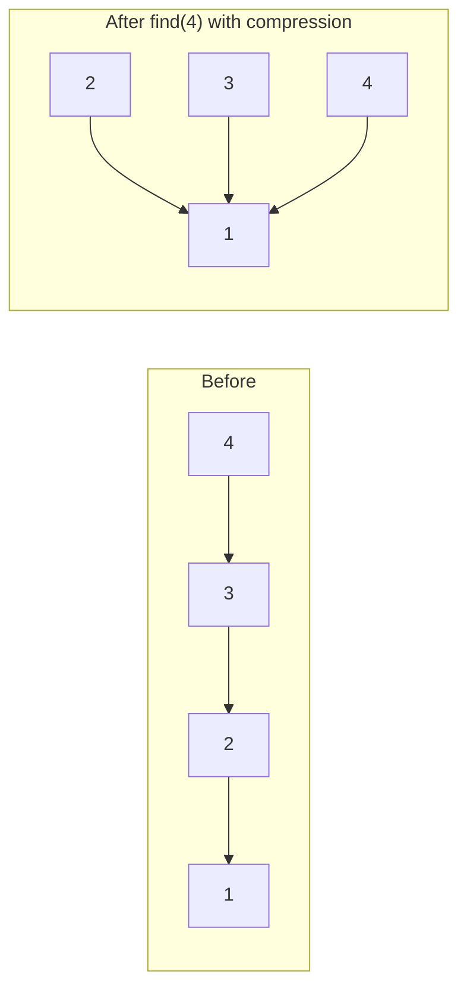

# Union-Find (Disjoint Set Union)

> **Estimated Time:** 4 hr | **Difficulty:** Intermediate
> **Prerequisites:** [01 - Graph Basics, BFS and DFS](../01-graph-basics-bfs-dfs/README.md), [02 - Grid and Islands](../02-grid-and-islands/README.md)

---

## What You'll Learn
- You can build a DSU with `find` (path compression) and `union` (by size) from memory in under two minutes.
- You can explain why the cost per operation is almost O(1) (inverse Ackermann, alpha(n)).
- You can decide when DSU beats DFS/BFS (edges arrive one by one, or you only need "same group?" answers).
- You can map "things that must be grouped" onto DSU nodes (emails, stones, letters, grid cells, even triangles inside a cell).
- You can use a weighted DSU to store a ratio or distance to the root (Evaluate Division).

## The Big Idea

Think of a school with many friend circles. Every circle has one "captain". To ask "are Asha and Ravi in the same circle?", you walk each of them up to their captain and compare captains. To merge two circles, you tell one captain to follow the other. You never write down who is friends with whom. You only remember "who is my captain".

That is Union-Find. It keeps a forest. Each tree is one group, the root is the captain. Two operations:

- `find(x)`: who is the root of x's group?
- `union(a, b)`: if the roots differ, hang one root under the other.

Two tricks keep the trees flat:

- **Union by size (or rank):** hang the smaller tree under the bigger one. Height stays O(log n).
- **Path compression:** during `find`, make nodes point closer to the root. Next time the walk is short.

With both tricks the amortized cost per operation is O(alpha(n)), where alpha is the inverse Ackermann function. It grows so slowly that alpha(n) is at most 4 for any n you will ever meet. Treat it as O(1). With only one of the two tricks you get O(log n) amortized, still fine.






(Arrows point from child to parent. After `find(4)` every node on the path points straight to the root 1.)

**Why interviewers love it:** it is a short data structure (about 20 lines) that turns hard-looking connectivity problems into a loop. It also tests whether you know when NOT to use a heavy graph traversal. Limit: DSU only merges. It cannot split a group (no "delete edge") unless you reverse time (see problem 16).

### DSU vs DFS/BFS

| Situation | Better tool |
|---|---|
| Graph is fixed, one question ("how many components?") | DFS/BFS or DSU, both O(V+E) |
| Edges/cells are added over time, answer needed after each add | **DSU** (DFS would redo O(V+E) every time) |
| Many "are a and b connected?" queries between merges | **DSU** |
| Need the actual path, distances, or order of visit | DFS/BFS (DSU forgets the path) |
| Edges are removed over time | Process in reverse and use DSU, or use other structures |
| Cycle check in an **undirected** graph | **DSU** (edge whose ends already share a root closes a cycle) |
| Cycle check in a **directed** graph | DFS colouring / topological sort (DSU does not see direction) |

## How to Spot It

| If the problem says ... | think ... |
|---|---|
| "connected components", "groups", "provinces" | count roots, or `count` field of DSU |
| "add edges one by one", "after each operation" | online DSU |
| "which edge makes a cycle", "redundant edge" | first edge where `union` returns false |
| "is it a tree" | exactly n-1 edges and no cycle |
| "merge accounts / items that share something" | DSU over items, map shared key to first owner |
| "a == b" and "a != b" constraints | union all equals first, then check not-equals |
| "ratios / distances between variables" | weighted DSU |
| "cheapest/earliest time when A and B become connected" | sort by time, union until connected (or reverse time) |
| "can swap any two inside a group" | group by root, sort inside each group |
| "remove / delete over time" | reverse the timeline, delete becomes add |

## Core Concepts / Template

### The template (use this everywhere)

```js
class DSU {
  constructor(n) {
    this.parent = Array.from({ length: n }, (_, i) => i);
    this.size = new Array(n).fill(1);
    this.count = n; // number of components
  }
  find(x) {
    while (this.parent[x] !== x) {
      this.parent[x] = this.parent[this.parent[x]]; // path halving
      x = this.parent[x];
    }
    return x;
  }
  union(a, b) {
    let ra = this.find(a), rb = this.find(b);
    if (ra === rb) return false;                       // already together
    if (this.size[ra] < this.size[rb]) [ra, rb] = [rb, ra];
    this.parent[rb] = ra;                              // small under big
    this.size[ra] += this.size[rb];
    this.count--;
    return true;
  }
  connected(a, b) { return this.find(a) === this.find(b); }
}
```

Notes on choices:
- **Iterative `find`.** A recursive `find` can overflow the call stack on a long chain before compression happens. The loop above uses *path halving* (point to grandparent), which gives the same bound as full compression.
- **`union` returns a boolean.** `false` means "they were already connected". Cycle detection, redundant edges and "count merges" all use this return value.
- **`size` is only valid at roots.** Read `dsu.size[dsu.find(x)]`, never `dsu.size[x]`.
- **Rank vs size.** Both give the same bound. Size is more useful because many problems ask for the group size.

### Trace

`new DSU(5)`, then `union(0,1)`, `union(3,4)`, `union(1,4)`:

| Step | parent array | sizes of roots | count |
|---|---|---|---|
| start | [0,1,2,3,4] | all 1 | 5 |
| union(0,1) | [0,0,2,3,4] | size[0]=2 | 4 |
| union(3,4) | [0,0,2,3,3] | size[3]=2 | 3 |
| union(1,4) | find(1)=0, find(4)=3, equal size, so 3 goes under 0: [0,0,2,0,3] | size[0]=4 | 2 |

Components: {0,1,3,4} and {2}.

### Weighted DSU (idea)

Store one extra number per node: its relation to its parent (for example `ratio[x] = x / parent[x]`, or a distance, or an xor, or a parity). When `find` compresses a path, multiply (or add) the numbers along the path so each node ends up with its relation to the **root**. Then the relation between two nodes in the same group is `rel[a] / rel[b]` (or `rel[a] - rel[b]`). Problem 11 uses this for ratios. The same idea checks bipartiteness with parity (0 = same side, 1 = other side).

### Complexity cheat table

| Variant | Amortized per operation |
|---|---|
| No tricks | O(n) worst case (a long chain) |
| Union by size only | O(log n) |
| Path compression only | O(log n) |
| Both | O(alpha(n)), effectively O(1) |

Memory is O(n). Building from m edges costs O(m * alpha(n)).

## Problems (easy -> hard)

### 1. Implement Union-Find (Disjoint Set Union) — Easy
**Companies:** -
**Problem:** Build a structure with `find(x)`, `union(a, b)` and `connected(a, b)` over n elements. Example: `union(0,1)`, `union(1,2)` then `connected(0,2)` -> true, `connected(0,5)` -> false.
**Intuition:** Every element points to a parent. A root points to itself. Walk up to find the root, and flatten the path on the way so later walks are short.
**Approach 1 - Brute force:** Keep a `group[]` id per element. `union` relabels every element of one group: O(n) per union. `find` is O(1). Bad when there are many unions.
**Approach 2 - Better:** Parent pointers with no tricks. `union` and `find` are O(height), and the tree can become a chain: O(n).
**Approach 3 - Optimal:** Parent pointers + union by rank + path compression. Below is the recursive-compression, rank flavour (the template in Core Concepts is the iterative, size flavour). Both are fine to write in an interview.

```js
function makeDSU(n) {
  const parent = Array.from({ length: n }, (_, i) => i);
  const rank = new Array(n).fill(0); // upper bound on tree height
  const find = (x) => (parent[x] === x ? x : (parent[x] = find(parent[x]))); // full compression
  const union = (a, b) => {
    const ra = find(a), rb = find(b);
    if (ra === rb) return false;
    if (rank[ra] < rank[rb]) parent[ra] = rb;
    else if (rank[ra] > rank[rb]) parent[rb] = ra;
    else { parent[rb] = ra; rank[ra]++; } // only equal ranks grow the height
    return true;
  };
  return { find, union, connected: (a, b) => find(a) === find(b) };
}
```

**Complexity:** Time O(alpha(n)) amortized per operation, Space O(n).
**Watch out:** Recursive `find` is safe here because union by rank keeps height at most log n. Without it, a chain of 100000 nodes can overflow the stack. Always compare roots, never the raw nodes.

### 2. Number of Provinces — Medium
**Companies:** Amazon, Google, Microsoft, Meta
**Problem:** `isConnected[i][j] = 1` means city i and j are directly linked. Count groups of cities connected directly or indirectly. Example: `[[1,1,0],[1,1,0],[0,0,1]]` -> 2.
**Intuition:** Start with n groups. Each link that joins two different groups reduces the number of groups by one. The answer is the final group count.
**Approach 1 - Brute force:** DFS/BFS from every unvisited city. Time O(n^2), Space O(n). This is already optimal for an adjacency matrix.
**Approach 2 - Optimal (DSU):** Same time, but no recursion and the same code reused for all later problems. Trace on the example: count=3; union(0,1) merges, count=2; (0,2),(1,2) are 0 so nothing; answer 2.

```js
function findCircleNum(isConnected) {
  const n = isConnected.length, dsu = new DSU(n);
  for (let i = 0; i < n; i++)
    for (let j = i + 1; j < n; j++) if (isConnected[i][j]) dsu.union(i, j);
  return dsu.count;
}
```

**Complexity:** Time O(n^2 * alpha(n)), Space O(n).
**Watch out:** The diagonal is always 1, skip it (loop `j` from `i + 1`). The matrix is symmetric, so one triangle is enough.

### 3. Graph Valid Tree — Medium
**Companies:** Google, Meta, Amazon, LinkedIn
**Problem:** Given n nodes (0..n-1) and undirected edges, is the graph one tree? Example: `n=5, [[0,1],[0,2],[0,3],[1,4]]` -> true; adding `[2,3]` instead of `[1,4]` leaves node 4 alone -> false.
**Intuition:** A tree on n nodes has exactly n-1 edges, is connected and has no cycle. If the edge count is n-1, "no cycle" and "connected" imply each other. So check the count, then check that no edge closes a cycle.
**Approach 1 - Brute force:** DFS from node 0 with parent tracking, check no cycle and that all n nodes are visited. Time O(n + e), Space O(n + e) for the adjacency list.
**Approach 2 - Optimal (DSU):** If `edges.length !== n - 1` return false. Otherwise every `union` must succeed. If one fails, that edge joined two nodes already connected: a cycle.

```js
function validTree(n, edges) {
  if (edges.length !== n - 1) return false;
  const dsu = new DSU(n);
  for (const [a, b] of edges) if (!dsu.union(a, b)) return false;
  return true;
}
```

**Complexity:** Time O(n * alpha(n)), Space O(n).
**Watch out:** Without the count check, a forest (no cycle but several pieces) would wrongly pass. With `n = 1` and no edges the answer is true.

### 4. Redundant Connection — Medium
**Companies:** Amazon, Google, Meta
**Problem:** A tree with n nodes (1..n) got one extra edge. Return the edge that can be removed so it is a tree again. If many answers, return the one that appears last in the input. Example: `[[1,2],[1,3],[2,3]]` -> `[2,3]`.
**Intuition:** Add edges in order. The first edge whose two ends are already connected closes the only cycle, and it is the last edge of that cycle in input order.
**Approach 1 - Brute force:** For each edge from last to first, remove it and test if the rest is a tree with DFS. Time O(n^2).
**Approach 2 - Optimal:** DSU. Trace on `[[1,2],[1,3],[2,3]]`: union(1,2) ok, union(1,3) ok, union(2,3): roots equal -> return `[2,3]`.

```js
function findRedundantConnection(edges) {
  const dsu = new DSU(edges.length + 1); // nodes are 1-indexed
  for (const [a, b] of edges) if (!dsu.union(a, b)) return [a, b];
  return [];
}
```

**Complexity:** Time O(n * alpha(n)), Space O(n).
**Watch out:** Nodes start at 1, so allocate n+1 slots. Returning the first failed union is correct for "last in input" because every earlier edge was fine.

### 5. Number of Operations to Make Network Connected — Medium
**Companies:** Amazon, Google, Microsoft
**Problem:** n computers, some cables. In one operation you can move a cable to connect two computers. Return the minimum operations to connect everyone, or -1 if impossible. Example: `n=4, [[0,1],[0,2],[1,2]]` -> 1.
**Intuition:** Connecting k components needs k-1 cables. You need at least n-1 cables in total. Extra cables (those that close a cycle) are free to move, and there are always enough extras if the total is at least n-1.
**Approach 1 - Brute force:** DFS to count components, count redundant edges separately. Time O(n + e).
**Approach 2 - Optimal:** If `connections.length < n - 1` return -1. Otherwise union everything; the answer is `components - 1`. Trace on the example: edges 3 >= 3. count 4 -> union(0,1)=3 -> union(0,2)=2 -> (1,2) cycle. Answer 2-1 = 1.

```js
function makeConnected(n, connections) {
  if (connections.length < n - 1) return -1;
  const dsu = new DSU(n);
  for (const [a, b] of connections) dsu.union(a, b);
  return dsu.count - 1;
}
```

**Complexity:** Time O((n + e) * alpha(n)), Space O(n).
**Watch out:** Do not count redundant edges yourself. The `n - 1` check already guarantees enough spare cables.

### 6. Satisfiability of Equality Equations — Medium
**Companies:** Google, Amazon, Meta
**Problem:** Strings like `"a==b"` and `"b!=c"` over lowercase letters. Can all be true at once? Example: `["a==b","b!=a"]` -> false.
**Intuition:** Equality is transitive, so `==` builds groups. A `!=` between two letters of the same group is a contradiction. Order matters: finish all unions first, then check.
**Approach 1 - Brute force:** Build a graph from `==` and DFS for each `!=`. Time O(n * 26).
**Approach 2 - Optimal:** DSU on 26 letters. Two passes. Trace `["a==b","b==c","a!=c"]`: pass 1 merges a,b,c. Pass 2: `a!=c` but connected -> false.

```js
function equationsPossible(equations) {
  const dsu = new DSU(26), code = (c) => c.charCodeAt(0) - 97;
  for (const e of equations) if (e[1] === '=') dsu.union(code(e[0]), code(e[3]));
  for (const e of equations)
    if (e[1] === '!' && dsu.connected(code(e[0]), code(e[3]))) return false;
  return true;
}
```

**Complexity:** Time O(n * alpha(26)), Space O(1).
**Watch out:** The format is `x==y` or `x!=y`: the operator is at index 1 and the second letter at index 3. `"a!=a"` is false (a letter is connected to itself).

### 7. Longest Consecutive Sequence (via DSU) — Medium
**Companies:** Amazon, Google, Meta, Microsoft
**Problem:** Find the length of the longest run of consecutive integers in an unsorted array, in O(n). Example: `[100,4,200,1,3,2]` -> 4 (1,2,3,4).
**Intuition:** Treat each distinct value as a node. If `x` and `x+1` both exist, they belong to the same group. The answer is the largest group size.
**Approach 1 - Brute force:** Sort, then scan. Time O(n log n).
**Approach 2 - Better:** Hash set; start counting only from numbers with no `x-1`. Time O(n), Space O(n). (This is the usual best answer, see the Hashing chapter.)
**Approach 3 - DSU:** Give each distinct value an id, then union `x` with `x+1`. Read the biggest `size`. Trace on the example: ids 100,4,200,1,3,2. 1-2, 2-3, 3-4 are unioned into size 4.

```js
function longestConsecutive(nums) {
  const id = new Map();
  for (const x of nums) if (!id.has(x)) id.set(x, id.size); // dedupe first
  const dsu = new DSU(id.size);
  for (const [x, i] of id) if (id.has(x + 1)) dsu.union(i, id.get(x + 1));
  let best = 0;
  for (let i = 0; i < id.size; i++) best = Math.max(best, dsu.size[dsu.find(i)]);
  return best;
}
```

**Complexity:** Time O(n * alpha(n)), Space O(n).
**Watch out:** Duplicates must not get two ids or the count inflates (`[1,1,1]` -> 1). Empty array -> 0. Say out loud that the set solution is simpler; DSU is the "other way".

### 8. Most Stones Removed with Same Row or Column — Medium
**Companies:** Google, Amazon, Meta
**Problem:** Stones sit at grid points. You may remove a stone if another stone shares its row or column (not yet removed). Max stones you can remove? Example: `[[0,0],[0,1],[1,0],[1,2],[2,1],[2,2]]` -> 5.
**Intuition:** Stones linked by rows/columns form a component. In any component you can remove all stones but one (remove leaves of a spanning tree first). So the answer is `stones - components`.
**Approach 1 - Brute force:** Build a stone graph (O(n^2) pair checks) and DFS components. Time O(n^2).
**Approach 2 - Optimal:** Remember the first stone seen in each row and each column. A later stone in that row/column is unioned with it. Trace on `[[0,0],[0,1],[1,0]]`: stone0 owns r0,c0. Stone1 (0,1): r0 owned by 0 -> union(1,0). Stone2 (1,0): c0 owned by 0 -> union(2,0). One component, answer 3-1 = 2.

```js
function removeStones(stones) {
  const dsu = new DSU(stones.length), owner = new Map(); // "r0" / "c0" -> first stone index
  stones.forEach(([r, c], i) => {
    for (const key of ['r' + r, 'c' + c]) {
      if (owner.has(key)) dsu.union(i, owner.get(key));
      else owner.set(key, i);
    }
  });
  return stones.length - dsu.count;
}
```

**Complexity:** Time O(n * alpha(n)), Space O(n).
**Watch out:** Row and column keys must not collide (`"r1"` vs `"c1"`). A single stone gives 0. Another popular version unions row index with column index (`r` with `c + 10001`) as nodes; same result.

### 9. Accounts Merge — Medium
**Companies:** Amazon, Google, Meta, Microsoft, Uber
**Problem:** Each account is `[name, email1, email2, ...]`. Two accounts belong to the same person if they share any email. Merge them; return each person as `[name, ...sorted emails]`. Example: two "John" accounts sharing `johnsmith@mail.com` become one.
**Intuition:** Accounts are the nodes. Two accounts share an email, so union them. Group emails by their account's root at the end.
**Approach 1 - Brute force:** Repeatedly merge any two accounts that share an email until nothing changes. Time O(n^2 * k).
**Approach 2 - Optimal:** Map each email to the first account that owned it. Seeing it again unions the current account with that owner. Finally group emails by `find(owner)`, sort each group, and prepend the name.

```js
function accountsMerge(accounts) {
  const dsu = new DSU(accounts.length), owner = new Map(); // email -> account index
  accounts.forEach((acc, i) => {
    for (let k = 1; k < acc.length; k++) {
      if (owner.has(acc[k])) dsu.union(i, owner.get(acc[k]));
      else owner.set(acc[k], i);
    }
  });
  const groups = new Map();
  for (const [email, i] of owner) {
    const r = dsu.find(i);
    if (!groups.has(r)) groups.set(r, []);
    groups.get(r).push(email);
  }
  return [...groups].map(([r, emails]) => [accounts[r][0], ...emails.sort()]);
}
```

**Complexity:** Time O(N log N) where N is the total number of emails (sorting dominates), Space O(N).
**Watch out:** Do not merge by name. Two different people can share a name. Skip index 0 (the name) when reading emails. Sort with the default string sort, which is what the problem expects.

### 10. Smallest String With Swaps — Medium
**Companies:** Google, Amazon, Microsoft
**Problem:** You get a string and index pairs. You may swap the characters of any given pair any number of times. Return the lexicographically smallest string. Example: `"dcab"`, `[[0,3],[1,2]]` -> `"bacd"`.
**Intuition:** Swaps along connected pairs let you reorder the characters of one connected group arbitrarily (think bubble sort along a path). So inside each group, put the smallest letters on the smallest indices.
**Approach 1 - Brute force:** BFS over all reachable strings. Exponential.
**Approach 2 - Optimal:** DSU over indices. For each group collect its indices (already increasing) and its characters, sort the characters, assign them in order. Trace `"dcab"` with `[[0,3],[1,2]]`: groups {0,3} chars d,b -> b,d; {1,2} chars c,a -> a,c. Result `b a c d`.

```js
function smallestStringWithSwaps(s, pairs) {
  const dsu = new DSU(s.length);
  for (const [a, b] of pairs) dsu.union(a, b);
  const groups = new Map();
  for (let i = 0; i < s.length; i++) {
    const r = dsu.find(i);
    if (!groups.has(r)) groups.set(r, []);
    groups.get(r).push(i); // pushed in increasing order, so already sorted
  }
  const res = new Array(s.length);
  for (const idx of groups.values()) {
    const chars = idx.map((i) => s[i]).sort();
    idx.forEach((i, k) => (res[i] = chars[k]));
  }
  return res.join('');
}
```

**Complexity:** Time O(n log n + p * alpha(n)), Space O(n).
**Watch out:** Pairs `[0,2]` and `[2,5]` also let you swap 0 and 5 (transitivity). That is exactly why DSU applies. Indices with no pair are groups of size 1 and stay.

### 11. Evaluate Division — Medium
**Companies:** Google, Amazon, Meta, Uber
**Problem:** Given equations like `a / b = 2.0`, answer queries like `a / c`. Return -1.0 when unknown. Example: `a/b=2, b/c=3`; query `a/c` -> 6, `b/a` -> 0.5, `a/e` -> -1.
**Intuition:** Every variable in a group can be written as "k times the root". Store `ratio[x] = x / parent(x)`. Compression multiplies ratios along the path so each node knows `x / root`. Then `a / b = (a/root) / (b/root)`.
**Approach 1 - Brute force / graph:** Edges `a -> b` weight v and `b -> a` weight 1/v. DFS per query. Time O(q * (V + E)).
**Approach 2 - Optimal (weighted DSU):** Each union links two roots and fixes the root's ratio so the new equation holds. Derivation: we want `ra / rb`. `a/b = v`, `a = ratio[a] * ra`, `b = ratio[b] * rb`. So `ra / rb = v * ratio[b] / ratio[a]`.

```js
function calcEquation(equations, values, queries) {
  const parent = new Map(), ratio = new Map(); // ratio.get(x) = x / parent(x)
  const find = (x) => {
    if (!parent.has(x)) { parent.set(x, x); ratio.set(x, 1); }
    if (parent.get(x) === x) return x;
    const p = parent.get(x), root = find(p);          // after this, p points to root
    ratio.set(x, ratio.get(x) * ratio.get(p));        // x/root = (x/p) * (p/root)
    parent.set(x, root);
    return root;
  };
  const union = (a, b, v) => { // a / b = v
    const ra = find(a), rb = find(b);
    if (ra === rb) return;
    parent.set(ra, rb);
    ratio.set(ra, (v * ratio.get(b)) / ratio.get(a)); // ra / rb
  };
  equations.forEach(([a, b], i) => union(a, b, values[i]));
  return queries.map(([a, b]) => {
    if (!parent.has(a) || !parent.has(b)) return -1;
    if (find(a) !== find(b)) return -1;
    return ratio.get(a) / ratio.get(b);
  });
}
```

**Complexity:** Time O((E + Q) * alpha), Space O(V). (Recursive `find` here; with no union by size the amortized bound is O(log V). Add size-based linking if you want the full alpha.)
**Watch out:** Call `find(a)` and `find(b)` before reading ratios, so both are compressed to the root. An unknown variable gives -1, even for `x / x`. A known `a / a` gives 1.

### 12. Regions Cut By Slashes — Medium
**Companies:** Google, Amazon
**Problem:** An n x n grid where each cell is `' '`, `'/'` or `'\\'`. Slashes split the square into regions. Count regions. Example: `[" /","/ "]` -> 2.
**Intuition:** A cell is too small a node: a slash splits it in two. Cut each cell into 4 triangles (top, right, bottom, left). A slash joins some triangles and blocks others. Triangles always join across cell borders (my bottom with the cell below's top, my right with the right cell's left).
**Approach 1 - Brute force:** Upscale the grid 3x and flood fill. Time O(9 n^2). Also valid.
**Approach 2 - Optimal:** DSU with 4*n*n nodes. Triangle ids: `4 * (r*n + c) + k`, with k = 0 top, 1 right, 2 bottom, 3 left.
- `' '`: all four triangles merge.
- `'/'`: top+left merge, right+bottom merge.
- `'\\'`: top+right merge, bottom+left merge.
- Always: bottom with the lower cell's top, right with the right cell's left.
The answer is `dsu.count`.

```js
function regionsBySlashes(grid) {
  const n = grid.length, dsu = new DSU(4 * n * n);
  const id = (r, c, k) => 4 * (r * n + c) + k; // k: 0 top, 1 right, 2 bottom, 3 left
  for (let r = 0; r < n; r++)
    for (let c = 0; c < n; c++) {
      const ch = grid[r][c];
      if (ch === ' ') { dsu.union(id(r, c, 0), id(r, c, 1)); dsu.union(id(r, c, 1), id(r, c, 2)); dsu.union(id(r, c, 2), id(r, c, 3)); }
      else if (ch === '/') { dsu.union(id(r, c, 0), id(r, c, 3)); dsu.union(id(r, c, 1), id(r, c, 2)); }
      else { dsu.union(id(r, c, 0), id(r, c, 1)); dsu.union(id(r, c, 2), id(r, c, 3)); }
      if (r + 1 < n) dsu.union(id(r, c, 2), id(r + 1, c, 0));
      if (c + 1 < n) dsu.union(id(r, c, 1), id(r, c + 1, 3));
    }
  return dsu.count;
}
```

**Complexity:** Time O(n^2 * alpha), Space O(n^2).
**Watch out:** In a JS string literal a backslash must be written `'\\'`. Mixing up which triangles `'/'` joins is the classic bug: `'/'` runs from bottom-left to top-right, so it separates {top, left} from {bottom, right}. The grid `["/\\","\\/"]` gives 5.

### 13. Redundant Connection II (directed) — Hard
**Companies:** Google, Amazon, Meta
**Problem:** A rooted tree (all edges point away from the root, every node except the root has exactly one parent) got one extra directed edge. Return the extra edge to delete; if many choices, the one last in input. Example: `[[1,2],[1,3],[2,3]]` -> `[2,3]`.
**Intuition:** The extra edge causes one of two problems, possibly both: (A) some node has two parents; (B) there is a cycle. DSU handles the cycle; a parent array handles the two parents.
**Approach 1 - Brute force:** Try deleting each edge from the end, validate with DFS. Time O(n^2).
**Approach 2 - Optimal:**
1. Scan edges. If a node `v` already has a parent, we found two candidates: `cand1` = the earlier edge into `v`, `cand2` = the later one.
2. Run DSU while skipping `cand2`. If a union fails (cycle): when there was no two-parent node, that edge is the answer; otherwise the cycle must contain `cand1`, so the answer is `cand1`.
3. If no cycle appeared, deleting `cand2` fixed it, so answer `cand2`.

Trace `[[2,1],[3,1],[4,2],[1,4]]`: node 1 has parents 2 and 3, so cand1=[2,1], cand2=[3,1]. Skip [3,1]; unions 2-1, 4-2, then 1-4 closes a cycle, so answer cand1=[2,1].

```js
function findRedundantDirectedConnection(edges) {
  const n = edges.length, parentOf = new Array(n + 1).fill(0);
  let cand1 = null, cand2 = null;
  for (const [u, v] of edges) {
    if (parentOf[v]) { cand1 = [parentOf[v], v]; cand2 = [u, v]; }
    else parentOf[v] = u;
  }
  const dsu = new DSU(n + 1);
  for (const [u, v] of edges) {
    if (cand2 && u === cand2[0] && v === cand2[1]) continue; // pretend cand2 is deleted
    if (!dsu.union(u, v)) return cand1 || [u, v];
  }
  return cand2;
}
```

**Complexity:** Time O(n * alpha(n)), Space O(n).
**Watch out:** DSU ignores direction, which is fine here because we already handled the two-parent case separately. Three cases to name in the interview: only a cycle, two parents without cycle, two parents with cycle. With only a cycle, cand1 is null and the failing edge is returned.

### 14. Number of Islands II — Hard
**Companies:** Google, Amazon, Meta, Uber
**Problem:** An m x n grid starts all water. Each operation turns one cell into land. After each operation return the number of islands. Example: `m=3,n=3`, positions `[[0,0],[0,1],[1,2],[2,1]]` -> `[1,1,2,3]`.
**Intuition:** This is the textbook online problem. Re-running DFS after each add costs O(m*n) each time. With DSU, adding a cell is: count+1, then every neighbour that is land and not yet in the same group reduces count by one.
**Approach 1 - Brute force:** DFS over the whole grid per operation. Time O(k * m * n).
**Approach 2 - Optimal:** DSU with a `land` array. Trace: add (0,0): count 1. Add (0,1): +1 = 2, union with (0,0) succeeds -> 1. Add (1,2): +1 = 2, neighbours (0,2),(1,1),(2,2) are water -> 2. Add (2,1): -> 3. Output `[1,1,2,3]`.

```js
function numIslands2(m, n, positions) {
  const dsu = new DSU(m * n), land = new Array(m * n).fill(false), res = [];
  let count = 0;
  for (const [r, c] of positions) {
    const id = r * n + c;
    if (!land[id]) { // a repeated position changes nothing
      land[id] = true; count++;
      for (const [dr, dc] of [[1, 0], [-1, 0], [0, 1], [0, -1]]) {
        const nr = r + dr, nc = c + dc;
        if (nr < 0 || nc < 0 || nr >= m || nc >= n || !land[nr * n + nc]) continue;
        if (dsu.union(id, nr * n + nc)) count--; // merged two different islands
      }
    }
    res.push(count);
  }
  return res;
}
```

**Complexity:** Time O(k * alpha(m*n)) plus O(m*n) setup, Space O(m*n).
**Watch out:** Duplicate positions must be ignored (the answer stays the same). Use our own `count`, not `dsu.count`, because water cells are also DSU nodes. Only merge with neighbours that are land.

### 15. Making A Large Island — Hard
**Companies:** Google, Amazon, Meta, Uber
**Problem:** Binary n x n grid. You may flip at most one 0 to 1. Return the size of the largest island. Example: `[[1,0],[0,1]]` -> 3.
**Intuition:** Label islands with DSU and record sizes. Then for each water cell, the new island = 1 + sum of sizes of the distinct neighbouring islands.
**Approach 1 - Brute force:** For each 0, flip it and DFS the grid. Time O(n^4).
**Approach 2 - Optimal:** Build DSU on land cells (only union right and down neighbours). Track the best existing island. Then for each 0 collect the *distinct roots* of its 4 neighbours in a Set, add their sizes plus 1.

```js
function largestIsland(grid) {
  const n = grid.length, dsu = new DSU(n * n), dirs = [[1, 0], [-1, 0], [0, 1], [0, -1]];
  for (let r = 0; r < n; r++)
    for (let c = 0; c < n; c++) {
      if (!grid[r][c]) continue;
      if (r + 1 < n && grid[r + 1][c]) dsu.union(r * n + c, (r + 1) * n + c);
      if (c + 1 < n && grid[r][c + 1]) dsu.union(r * n + c, r * n + c + 1);
    }
  let best = 0;
  for (let i = 0; i < n * n; i++)
    if (grid[(i / n) | 0][i % n]) best = Math.max(best, dsu.size[dsu.find(i)]);
  for (let r = 0; r < n; r++)
    for (let c = 0; c < n; c++) {
      if (grid[r][c]) continue;
      const roots = new Set(); // distinct neighbours only, or we double count
      for (const [dr, dc] of dirs) {
        const nr = r + dr, nc = c + dc;
        if (nr >= 0 && nc >= 0 && nr < n && nc < n && grid[nr][nc]) roots.add(dsu.find(nr * n + nc));
      }
      let total = 1;
      for (const root of roots) total += dsu.size[root];
      best = Math.max(best, total);
    }
  return best;
}
```

**Complexity:** Time O(n^2 * alpha), Space O(n^2).
**Watch out:** Two neighbours can belong to the same island; the Set stops double counting. All-ones grid: no zero to flip, `best` already holds n*n. All zeros: answer 1.

### 16. Last Day Where You Can Still Cross — Hard
**Companies:** Google, Amazon, Meta
**Problem:** A `row x col` grid is all land on day 0. On day i, `cells[i]` (1-indexed) floods. Return the last day you can walk from any top cell to any bottom cell over land (4 directions). Example: `row=2,col=2, cells=[[1,1],[2,1],[1,2],[2,2]]` -> 2.
**Intuition:** Land disappears over time, but DSU only merges. Reverse the timeline: start with all water and let cells come back as land, going from the last day to the first. The first moment (in reverse) when top and bottom become connected is the answer. Use two virtual nodes, TOP and BOTTOM.
**Approach 1 - Brute force:** For each day, BFS. Time O(row * col * cells).
**Approach 2 - Better:** Binary search on the day with BFS check (monotonic: if you can cross on day d you could on d-1). Time O(row*col*log).
**Approach 3 - Optimal (reverse DSU):** Iterate `d` from `cells.length - 1` down to 0. Make `cells[d]` land. Union with land neighbours; if it is in row 0 union with TOP; if in the last row union with BOTTOM. If TOP and BOTTOM connect, then days 0..d-1 have `cells[0..d-1]` flooded, so the answer is `d`.

Trace on the example (reverse): d=3 (2,2) lands, bottom row -> BOTTOM. d=2 (1,2): top row -> TOP; neighbour (2,2) is land -> TOP and BOTTOM connected, return 2.

```js
function latestDayToCross(row, col, cells) {
  const TOP = row * col, BOTTOM = row * col + 1, dsu = new DSU(row * col + 2);
  const land = new Array(row * col).fill(false);
  for (let d = cells.length - 1; d >= 0; d--) { // reverse time: water turns into land
    const r = cells[d][0] - 1, c = cells[d][1] - 1, id = r * col + c;
    land[id] = true;
    if (r === 0) dsu.union(id, TOP);
    if (r === row - 1) dsu.union(id, BOTTOM);
    for (const [dr, dc] of [[1, 0], [-1, 0], [0, 1], [0, -1]]) {
      const nr = r + dr, nc = c + dc;
      if (nr >= 0 && nc >= 0 && nr < row && nc < col && land[nr * col + nc]) dsu.union(id, nr * col + nc);
    }
    if (dsu.connected(TOP, BOTTOM)) return d; // cells[d..] are land again; cells[0..d-1] are water
  }
  return 0;
}
```

**Complexity:** Time O(row * col * alpha), Space O(row * col).
**Watch out:** Off-by-one is the whole difficulty. On day i (1-indexed) the cell `cells[i-1]` floods, so after day `d` exactly `cells[0..d-1]` are water. When the reverse loop at index `d` first connects TOP and BOTTOM, the grid with `cells[0..d-1]` flooded is still crossable, which is day `d`. So returning `d` is right. Cells are 1-indexed, subtract 1.

### 17. Swim in Rising Water (via DSU) — Hard
**Companies:** Google, Amazon, Meta
**Problem:** `grid[r][c]` is the elevation, a permutation of `0..n*n-1`. At time t, water depth is t, and you can move between adjacent cells if both have elevation <= t. Least t to reach the bottom-right from the top-left? Example: `[[0,2],[1,3]]` -> 3.
**Intuition:** At time t, "reachable" cells are those with height <= t. As t grows, more cells become usable, which only merges groups. The first t where start and end share a group is the answer.
**Approach 1 - Brute force:** For each t, BFS. Time O(n^4).
**Approach 2 - Better:** Binary search on t with BFS, or Dijkstra with a min-heap on the max height along the path: O(n^2 log n).
**Approach 3 - DSU:** Because heights are a permutation, `where[h]` gives the cell with height h. For t = 0, 1, 2, ...: activate `where[t]`, union with neighbours of height <= t, check start and end.

```js
function swimInWater(grid) {
  const n = grid.length, dsu = new DSU(n * n), where = new Array(n * n);
  for (let r = 0; r < n; r++) for (let c = 0; c < n; c++) where[grid[r][c]] = [r, c]; // permutation
  for (let t = 0; t < n * n; t++) {
    const [r, c] = where[t];
    for (const [dr, dc] of [[1, 0], [-1, 0], [0, 1], [0, -1]]) {
      const nr = r + dr, nc = c + dc;
      if (nr >= 0 && nc >= 0 && nr < n && nc < n && grid[nr][nc] <= t) dsu.union(r * n + c, nr * n + nc);
    }
    if (dsu.connected(0, n * n - 1)) return t;
  }
  return n * n - 1;
}
```

**Complexity:** Time O(n^2 * alpha), Space O(n^2).
**Watch out:** If heights were not a permutation, sort the cells by height instead of using `where`. The answer is at least `max(grid[0][0], grid[n-1][n-1])`; the loop handles it automatically. `n = 1` returns `grid[0][0]`, which is 0.

### 18. Remove Max Number of Edges to Keep Graph Fully Traversable — Hard
**Companies:** Google, Amazon
**Problem:** Edges are `[type, u, v]`: type 1 only Alice can use, type 2 only Bob, type 3 both. Remove the most edges so that both Alice and Bob can still reach every node. Return -1 if impossible. Example: `n=4, [[3,1,2],[3,2,3],[1,1,3],[1,2,4],[1,1,2],[2,3,4]]` -> 2.
**Intuition:** Keep a minimum spanning forest for each person, and share as much as possible. A type 3 edge serves both, so prefer them. Use two DSUs, one per person.
**Approach 1 - Brute force:** Try all subsets of edges. Exponential.
**Approach 2 - Optimal (greedy + 2 DSUs):**
1. Process all type 3 edges first. An edge is "used" if it merges in at least one of the two DSUs.
2. Then type 1 edges in Alice's DSU and type 2 edges in Bob's DSU. Each successful union means the edge is needed.
3. If both DSUs end with a single component the answer is `edges.length - used`; otherwise -1.
Trace on the sample: type 3 `[1,2]`,`[2,3]` used (2). Type 1 `[1,3]` redundant (1-2-3 already), `[2,4]` used (3), `[1,2]` redundant. Type 2 `[3,4]` used (4). Both fully connected; 6 - 4 = 2.

```js
function maxNumEdgesToRemove(n, edges) {
  const alice = new DSU(n + 1), bob = new DSU(n + 1); // nodes are 1-indexed, slot 0 unused
  let used = 0;
  for (const [t, u, v] of edges) // type 3 first: one edge serves both
    if (t === 3) { const a = alice.union(u, v), b = bob.union(u, v); if (a || b) used++; }
  for (const [t, u, v] of edges) {
    if (t === 1 && alice.union(u, v)) used++;
    if (t === 2 && bob.union(u, v)) used++;
  }
  return alice.count === 2 && bob.count === 2 ? edges.length - used : -1; // 2 = unused slot 0 + one component
}
```

**Complexity:** Time O(e * alpha(n)), Space O(n).
**Watch out:** Because the DSU has `n+1` slots, a fully connected graph shows `count === 2`, not 1. Call `a` and `b` as separate statements so both unions run (do not write `alice.union(..) || bob.union(..)`, which short-circuits). If you want a simpler check, build the DSUs with `n` slots and 0-index the nodes.

## Common Mistakes
- **"Union of two nodes is enough, I can compare raw parents."** Parents are not roots. Always compare `find(a)` with `find(b)`.
- **"`size[x]` is the size of x's group."** Only true at the root. Use `size[find(x)]`.
- **"Recursive `find` is always fine."** On a degenerate chain it can overflow the stack. Use the iterative template or union by size.
- **"DSU can handle directed cycles."** It cannot. It forgets direction. Use DFS colours or Kahn's algorithm (see [04 - Topological Sort](../04-topological-sort/README.md)), and special-case two parents as in problem 13.
- **"I can delete an edge from a DSU."** DSU only merges. For deletions, reverse the timeline (problem 16) or use another structure.
- **"After the unions, `parent[x]` is the root."** Not until you call `find(x)`. Group by `find(x)` at the end.
- **"Merge by name / by label."** Merge by the thing that is truly shared (an email, a row, a letter), never by a display name.
- **Wrong node count.** 1-indexed inputs need `n + 1` slots. Grid cells map to `r * cols + c`. Extra virtual nodes (TOP, BOTTOM) need extra slots, and they change what "one component" means for `count`.
- **Checking `!=` before all `==` are applied.** In the equations problem the order of passes matters.

## Interview Tips
- Say it first: "I will use union-find with path compression and union by size, so each operation is almost constant time." Then write the template without hesitation.
- Explain the parts of the cost: union by size alone gives O(log n), compression alone gives O(log n) amortized, together O(alpha(n)), which is below 5 for any realistic n.
- Name the trade-off: DSU answers "connected?" but cannot give the path, cannot shortest-path, and cannot split groups.
- When asked "why not DFS?", answer with the **online** angle: edges or cells arrive over time and you need the answer after each one.
- Common follow-ups: "How would you support deletions?" (offline reverse, or link-cut trees / divide-and-conquer on time). "How would you keep the size of each group?" (size array). "Can you also find the number of groups?" (a `count` decremented on each successful union). "Can you detect a bipartite graph?" (parity DSU, weighted by 0/1).
- Edge cases to mention: single node, no edges, duplicate edges, self loops (`union(a, a)` returns false, which also detects them), 1-indexed input, disconnected input.
- If the key is not an integer (emails, strings, variables), map it to an integer id first, or use a `Map` based DSU as in Evaluate Division.
- Kruskal's minimum spanning tree is DSU plus sorting. See [07 - Minimum Spanning Tree](../07-minimum-spanning-tree/README.md).

## Practice List
**Easy**
- Find if Path Exists in Graph
- Count Unreachable Pairs of Nodes in an Undirected Graph

**Medium**
- Connecting Cities With Minimum Cost
- Number of Connected Components in an Undirected Graph
- Is Graph Bipartite? (DSU or BFS)
- Possible Bipartition
- Sentence Similarity II
- Couples Holding Hands
- Minimize Malware Spread
- Largest Component Size by Common Factor
- Process Restricted Friend Requests
- Rank Transform of a Matrix
- Min Cost to Connect All Points (Kruskal)
- Find All People With Secret

**Hard**
- Number of Good Paths
- Checking Existence of Edge Length Limited Paths
- Minimize Malware Spread II
- Bricks Falling When Hit (reverse DSU)
- Optimize Water Distribution in a Village

## Key Takeaways
- **DSU = a forest where the root is the group's name.** `find` gives the root, `union` links two roots.
- **Union by size plus path compression gives O(alpha(n)) per operation**, practically constant.
- **`union` returning false means "already connected"**, which detects cycles, redundant edges and counts merges.
- **Use DSU when connections arrive over time** or when you only need "same group?"; use DFS/BFS when you need paths or order.
- **Model the problem first:** decide what the nodes are (accounts, stones as rows and columns, triangles in a cell, a virtual TOP and BOTTOM).
- **DSU cannot delete.** Reverse the timeline so deletions become additions.
- **Directed graphs need extra care.** DSU only sees undirected links; handle the two-parent case separately (Redundant Connection II, problem 13).
- **Weighted DSU** keeps a ratio, distance or parity to the root, multiplied or added during compression.

---

[← Previous: Shortest Paths](../05-shortest-paths/README.md) | [Next: Minimum Spanning Tree →](../07-minimum-spanning-tree/README.md) | [Back to Graphs Index](../README.md)
