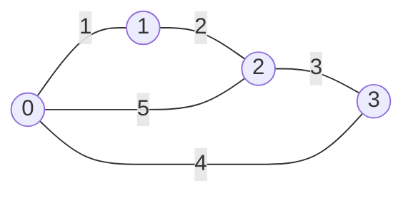

# Minimum Spanning Tree

> **Estimated Time:** 3 hr | **Difficulty:** Intermediate
> **Prerequisites:** [04.01 - Graph Basics, BFS and DFS](../01-graph-basics-bfs-dfs/README.md), [04.06 - Union Find](../06-union-find/README.md), [02.05 - Heaps](../../02-intermediate/05-heaps/README.md), [02.04 - Greedy](../../02-intermediate/04-greedy/README.md)

---

## What You'll Learn

- You can explain what a spanning tree and a minimum spanning tree (MST) are, in one sentence each.
- You can explain the cut property in plain words and use it to justify Kruskal and Prim.
- You can write Kruskal (sort edges + DSU) and Prim (min-heap) from memory.
- You can choose between Kruskal and Prim based on graph density and input format.
- You can solve "connect everything at minimum cost" problems, and the harder MST-property questions (critical edges, bottleneck paths, second-best MST).

## The Big Idea

Imagine a company that must lay cable between 6 offices. Any office must be able to reach any other, directly or through other offices. Cable costs money per metre. You do not want loops (a loop means one cable is wasted) and you do not want an office left out. You want the cheapest set of cables that links everyone.

That cheapest set is a **minimum spanning tree**.

- **Spanning tree:** pick edges of a connected graph so that all `n` vertices are connected and there are no cycles. Such a set always has exactly `n - 1` edges.
- **Minimum spanning tree:** among all spanning trees, the one with the smallest total edge weight.

Only undirected, weighted graphs are in scope here. (Directed graphs need a different algorithm, which interviews almost never ask.)

Why interviewers love it: it is a clean greedy proof ("always take the cheapest safe edge"), it reuses two tools you already know (DSU and heap), and many problems are an MST in disguise (connect cities, connect points, wire up wells).

**The cut property, in plain words.** Split the vertices into two groups in any way you like. Look at all edges that go between the two groups. The cheapest of those edges belongs to some MST (if several tie for cheapest, at least one of them does). Why? If the MST did not use it, the MST must cross between the two groups some other way, using a more expensive edge. Swap that expensive edge for the cheap one and the tree stays a tree and gets cheaper or equal. So the cheap edge is always safe to take.

Both algorithms are just two ways of choosing the groups:

- Kruskal: take the globally cheapest edge that does not make a cycle. (The "groups" are the component of one endpoint versus everything else.)
- Prim: grow one blob. The groups are "already in the blob" versus "not yet". Always take the cheapest edge leaving the blob.

A twin fact, the **cycle property**: in any cycle, the single heaviest edge (if strictly heavier than the rest) is in no MST.

Here is a small graph. The MST uses the edges with weights 1, 2 and 3 (total 6). Edges 4 and 5 would close cycles, so they are skipped.






## How to Spot It

| If the problem says ... | think ... |
|---|---|
| "connect all nodes / cities / computers with minimum total cost" | MST (Kruskal or Prim) |
| "minimum cost to connect points, cost = Manhattan distance" | Complete graph MST, Prim O(n^2) |
| "some nodes can be powered/supplied on their own at a cost" | Add a virtual node 0, edge (0, i) = own cost, then MST |
| "minimize the largest edge on the path between two nodes" | MST property (minimum bottleneck path) |
| "which edges are in every MST / in some MST" | Critical and pseudo-critical edges, rebuild MST with edge banned/forced |
| "second cheapest way to connect everything" | Second-best MST: swap one non-tree edge for the heaviest tree edge on its cycle |
| "extra cables / redundant edges, count what to move" | Components + spare edges (DSU), not a full MST |
| "maximum total weight, still a tree" | Same algorithms, sort descending |
| "is the graph connected after picking edges?" | After Kruskal, check you took `n - 1` edges (or components == 1) |

## Core Concepts / Template

### The two shared tools

You need a DSU (to ask "are these two already connected?") and a min-heap. They are pasted here so this chapter stands alone. For deeper explanation see [Union Find](../06-union-find/README.md) and [Heaps](../../02-intermediate/05-heaps/README.md).

```js
class DSU {
  constructor(n) { this.p = Array.from({ length: n }, (_, i) => i); this.sz = new Array(n).fill(1); this.comps = n; }
  find(x) { while (this.p[x] !== x) { this.p[x] = this.p[this.p[x]]; x = this.p[x]; } return x; }
  union(a, b) {
    a = this.find(a); b = this.find(b);
    if (a === b) return false;
    if (this.sz[a] < this.sz[b]) [a, b] = [b, a];
    this.p[b] = a; this.sz[a] += this.sz[b]; this.comps--; return true;
  }
}
```

`union` returns `false` if the two were already in the same set. That `false` is exactly the "this edge makes a cycle" signal Kruskal needs.

```js
class MinHeap { // items are arrays, ordered by item[0]
  constructor() { this.a = []; }
  get size() { return this.a.length; }
  push(x) {
    const a = this.a; a.push(x); let i = a.length - 1;
    while (i > 0) { const p = (i - 1) >> 1; if (a[p][0] <= a[i][0]) break; [a[p], a[i]] = [a[i], a[p]]; i = p; }
  }
  pop() {
    const a = this.a, top = a[0], last = a.pop();
    if (a.length) {
      a[0] = last; let i = 0;
      for (;;) {
        let l = 2 * i + 1, r = l + 1, m = i;
        if (l < a.length && a[l][0] < a[m][0]) m = l;
        if (r < a.length && a[r][0] < a[m][0]) m = r;
        if (m === i) break; [a[m], a[i]] = [a[i], a[m]]; i = m;
      }
    }
    return top;
  }
}
```

Heap items are arrays. The first slot is the priority, the rest is payload, for example `[weight, node]`.

### Kruskal: sort edges, add if no cycle

1. Sort all edges by weight, smallest first.
2. For each edge `(u, v, w)`: if `u` and `v` are in different sets, take the edge and union them. Otherwise skip it.
3. Stop when you hold `n - 1` edges. If you run out of edges first, the graph is disconnected and has no spanning tree (it has a spanning forest).

Trace on the graph above (edges as `u-v:w`):

| Edge (sorted) | Same set before? | Action | Total |
|---|---|---|---|
| 0-1:1 | no | take | 1 |
| 1-2:2 | no | take | 3 |
| 2-3:3 | no | take | 6 |
| 0-3:4 | yes (0 and 3 already joined) | skip | 6 |
| 0-2:5 | yes | skip | 6 |

Cost: sorting dominates, **O(E log E)**, which is the same as O(E log V) because E is at most V^2. DSU work is nearly O(E).

### Prim: grow one blob with a heap

1. Start at any vertex. Push `[0, start]` into the heap.
2. Pop the cheapest `[w, u]`. If `u` is already in the blob, skip it (stale entry). Otherwise add `u`, add `w` to the total.
3. Push every edge from `u` to a vertex not yet in the blob.
4. Repeat until the heap is empty. If fewer than `n` vertices were taken, the graph is disconnected.

Trace on the same graph, starting at 0:

| Pop `[w,node]` | Action | Blob | Total |
|---|---|---|---|
| [0,0] | take 0, push [1,1],[4,3],[5,2] | {0} | 0 |
| [1,1] | take 1, push [2,2] | {0,1} | 1 |
| [2,2] | take 2, push [3,3] | {0,1,2} | 3 |
| [3,3] | take 3 | {0,1,2,3} | 6 |
| [4,3] | 3 already in, skip | | 6 |
| [5,2] | 2 already in, skip | | 6 |

Cost with a binary heap and adjacency list: **O(E log V)**. A dense version with no heap (scan an array for the closest vertex) is **O(V^2)**, which is better when the graph is complete.

### Kruskal vs Prim: when to pick which

| Situation | Pick | Why |
|---|---|---|
| Input is an edge list | Kruskal | Sort and go, no adjacency list needed |
| Sparse graph (E close to V) | Kruskal or Prim, both fine | O(E log E) vs O(E log V) |
| Dense or complete graph (E close to V^2), e.g. points on a plane | Prim with the O(V^2) array scan | Avoids sorting V^2 edges |
| You need to process edges in sorted order, or check "when did u and v connect" | Kruskal | The DSU timeline gives it for free |
| Graph is given as adjacency list / grid and you only grow from one source | Prim | Natural fit |
| Edges arrive online (a stream) | Neither, offline only (mention this) | Ask the interviewer |

In an interview, both are accepted. Say which one you pick and why, in one sentence.

### MST uniqueness

- If **all edge weights are distinct**, the MST is **unique**. Reason: at every step the cheapest edge across a cut is unique, so there is no choice to make.
- If some weights tie, there can be several MSTs, but they all have the **same total weight**. They even have the same multiset of edge weights.
- A cheap sanity test: if two different spanning trees both have the minimum weight, some tie existed.
- Warning: Kruskal and Prim may return different trees on tied weights. The total is still the same. If a problem asks for the tree itself, check how ties are broken.

### Second-best MST idea

The second-best spanning tree differs from the MST by exactly **one edge swap**. (Informal reason: a tree further away can always be improved toward a closer one.) So:

1. Build the MST. Remember its weight `W`.
2. For each non-tree edge `(u, v, w)`: adding it to the MST makes one cycle, the tree path from `u` to `v` plus this edge. To get a tree again, remove the heaviest tree edge on that path, `maxOnPath(u, v)`.
3. Candidate weight is `W + w - maxOnPath(u, v)`. The answer is the smallest candidate.

Naive path query by DFS is O(V) per edge, so O(E * V) total. For large inputs, binary lifting (store the maximum edge on each jump) gives O(E log V). If the problem wants a **strictly** larger weight than the MST, skip candidates equal to `W`, and when `w == maxOnPath` use the second-largest edge on the path (this is the tricky part, mention it and keep the simple version unless asked).

## Problems (easy -> hard)

### 1. Minimum Cost to Connect Sticks — Medium
**Companies:** Amazon, Google, Microsoft
**Problem:** You have sticks with given lengths. Joining two sticks of lengths `x` and `y` costs `x + y` and gives one stick. Join them all into one stick at minimum total cost. `[2,4,3]` -> `14`.
**Intuition:** This is not an MST, but it is the same greedy flavour and it is the heap warm-up for Prim. Every stick you join gets paid again each time it is part of a later join. So join the two smallest first, and the big sticks get paid the fewest times (this is Huffman coding).
**Approach 1 - Brute force:** Try every join order. Exponential.
**Approach 2 - Better:** Sort the array, join the two smallest, insert the result in the right place, repeat. Each insertion is O(n), so O(n^2) time.
**Approach 3 - Optimal:** A min-heap. Pop two, push their sum, add the sum to cost.

| Heap before | Pop two | Sum (cost) | Total |
|---|---|---|---|
| 2, 3, 4 | 2, 3 | 5 | 5 |
| 4, 5 | 4, 5 | 9 | 14 |
| 9 | done | | 14 |

```js
function minCostToConnectSticks(sticks) {
  const h = new MinHeap(); for (const s of sticks) h.push([s]);
  let cost = 0;
  while (h.size > 1) { const s = h.pop()[0] + h.pop()[0]; cost += s; h.push([s]); }
  return cost;
}
```

**Complexity:** Time O(n log n), Space O(n).
**Watch out:** One stick means cost 0. Use a heap, not a re-sorted array. Sums can be big, but JS numbers are safe up to 2^53.

### 2. Number of Operations to Make Network Connected — Medium
**Companies:** Amazon, Google, Microsoft
**Problem:** `n` computers and some cables between them. In one operation you move one existing cable to join two other computers. Return the minimum operations to connect everyone, or `-1` if impossible. `n=4, [[0,1],[0,2],[1,2]]` -> `1`.
**Intuition:** A connected network of `n` computers needs at least `n - 1` cables. If you have fewer, it is impossible. Otherwise, there are enough cables, and each operation can merge two components, so you need `components - 1` moves. Redundant cables (ones that close a cycle) are the spare ones you can move. No weights, so this is only a DSU question (see [Union Find](../06-union-find/README.md)), not a real MST.
**Approach 1 - Brute force:** Simulate moving cables with BFS to count components after each move. Messy and slow.
**Approach 2 - Optimal:** If `connections.length < n - 1` return `-1`. Union all edges. Answer is the component count minus 1.

Trace on `n=6, [[0,1],[0,2],[0,3],[1,2],[1,3]]`: 5 cables >= 5 needed. Unions: 0-1, 0-2, 0-3 merge; 1-2 and 1-3 are redundant. Components: {0,1,2,3}, {4}, {5} = 3, answer 2.

```js
function makeConnected(n, connections) {
  if (connections.length < n - 1) return -1;
  const d = new DSU(n); for (const [a, b] of connections) d.union(a, b);
  return d.comps - 1;
}
```

**Complexity:** Time O(n + m * alpha(n)), Space O(n).
**Watch out:** The check `m < n - 1` must come first. You do not need to count the redundant edges: if `m >= n - 1`, there are always enough spares.

### 3. Kruskal MST Weight — Medium
**Companies:** Amazon, Microsoft, Adobe
**Problem:** Given `n` vertices (0..n-1) and weighted undirected edges `[u, v, w]`, return the weight of the MST, or `-1` if the graph is disconnected.
**Intuition:** Cheapest edges first; skip any edge that joins two vertices already connected.
**Approach 1 - Brute force:** Try every subset of `n - 1` edges, keep those that form a tree, take the minimum. Exponential.
**Approach 2 - Optimal:** Kruskal, as in the template. Sort, DSU, add if `union` returns true. Connected iff one component remains.

Dry run on `n=4`, edges `[0,1,1] [1,2,2] [2,3,3] [0,3,4] [0,2,5]`: take 1, 2, 3, skip 4 and 5. Answer 6.

```js
function kruskal(n, edges) { // edges: [u, v, w]; -1 if graph is disconnected
  const dsu = new DSU(n); let total = 0;
  for (const [u, v, w] of [...edges].sort((x, y) => x[2] - y[2])) if (dsu.union(u, v)) total += w;
  return dsu.comps === 1 ? total : -1;
}
```

**Complexity:** Time O(E log E), Space O(V + E) (the sorted copy).
**Watch out:** Check connectivity (`comps === 1`), otherwise you silently return the weight of a forest. Copy before sorting if the caller owns the array. A graph with one vertex has weight 0.

### 4. Prim MST Weight — Medium
**Companies:** Amazon, Microsoft, Adobe
**Problem:** Same as above, but solve it with Prim.
**Intuition:** Start with one vertex. The next vertex to add is always the one reachable by the cheapest edge from the blob.
**Approach 1 - Brute force:** Each round, scan all edges to find the cheapest one leaving the blob. O(V * E).
**Approach 2 - Optimal:** A min-heap of `[weight, node]`. Lazy deletion: when you pop a node that is already in the blob, just skip it (see the Prim trace above).

```js
function prim(n, edges) {
  const adj = Array.from({ length: n }, () => []);
  for (const [u, v, w] of edges) { adj[u].push([v, w]); adj[v].push([u, w]); }
  const seen = new Array(n).fill(false), heap = new MinHeap();
  heap.push([0, 0]); let total = 0, taken = 0;
  while (heap.size) {
    const [w, u] = heap.pop();
    if (seen[u]) continue;
    seen[u] = true; total += w; taken++;
    for (const [v, c] of adj[u]) if (!seen[v]) heap.push([c, v]);
  }
  return taken === n ? total : -1;
}
```

**Complexity:** Time O(E log E) = O(E log V), Space O(V + E).
**Watch out:** Each undirected edge goes into the adjacency list twice. Do not forget the `seen` check on pop, or the total is wrong. If the graph is disconnected, `taken < n`, return `-1`. Prim is not a shortest path algorithm: the heap key is the single edge weight, not the distance from the source (a classic mix-up with Dijkstra, see [Shortest Paths](../05-shortest-paths/README.md)).

### 5. Connecting Cities With Minimum Cost — Medium
**Companies:** Amazon, Google, Microsoft
**Problem:** Cities are numbered `1..n`. `connections[i] = [a, b, cost]` is a possible road. Return the minimum cost to connect all cities, or `-1`. `n=3, [[1,2,5],[1,3,6],[2,3,1]]` -> `6`.
**Intuition:** Straight Kruskal. Only twist: cities start at 1, so shift to 0-based (or make the DSU size `n + 1`).
**Approach 1 - Brute force:** Subsets of roads. Exponential.
**Approach 2 - Optimal:** Shift indexes, run Kruskal. Costs 1, 5 chosen (the edge 6 would close a cycle): 1 + 5 = 6.

```js
function minimumCost(n, connections) { // cities are 1..n
  return kruskal(n, connections.map(([a, b, c]) => [a - 1, b - 1, c]));
}
```

(It uses the `kruskal` function from problem 3.)

**Complexity:** Time O(m log m), Space O(n + m).
**Watch out:** Off-by-one between 1-based city ids and 0-based arrays. Return `-1` when `n - 1` roads cannot be chosen.

### 6. Min Cost to Connect All Points — Medium
**Companies:** Amazon, Google, Meta, Microsoft
**Problem:** Points on a plane. Cost to connect two points is their Manhattan distance `|x1-x2| + |y1-y2|`. Return the minimum cost to make all points connected. `[[0,0],[2,2],[3,10],[5,2],[7,0]]` -> `20`.
**Intuition:** Every pair of points is an edge, so it is a complete graph with about n^2/2 edges. Building and sorting all of them is wasteful. Prim in its dense form (no heap, just an array `dist` of "cheapest known edge into the blob") runs in O(n^2) with tiny memory.
**Approach 1 - Brute force:** Kruskal on all n(n-1)/2 edges: O(n^2 log n) time, O(n^2) memory. Correct, just heavier.
**Approach 2 - Optimal:** Dense Prim. `dist[v]` = cheapest edge from the blob to `v`. Each round, pick the unused vertex with the smallest `dist`, add it, relax the rest.

Trace on the first three points `[0,0] [2,2] [3,10]`: `dist = [0, inf, inf]`; take 0, `dist[1]=4, dist[2]=13`; take 1 (cost 4), `dist[2] = min(13, 9) = 9`; take 2 (cost 9). Total 13.

```js
function minCostConnectPoints(points) { // dense Prim, O(n^2), no heap
  const n = points.length, dist = new Array(n).fill(Infinity), used = new Array(n).fill(false);
  dist[0] = 0; let total = 0;
  for (let i = 0; i < n; i++) {
    let u = -1;
    for (let j = 0; j < n; j++) if (!used[j] && (u === -1 || dist[j] < dist[u])) u = j;
    used[u] = true; total += dist[u];
    for (let v = 0; v < n; v++) if (!used[v]) {
      const d = Math.abs(points[u][0] - points[v][0]) + Math.abs(points[u][1] - points[v][1]);
      if (d < dist[v]) dist[v] = d;
    }
  }
  return total;
}
```

**Complexity:** Time O(n^2), Space O(n).
**Watch out:** `dist` for vertex 0 must be 0 and the others `Infinity`. Use Manhattan, not Euclidean, as the problem says. A single point costs 0. Duplicate points are fine (distance 0).

### 7. Optimize Water Distribution in a Village — Hard
**Companies:** Google, Amazon, Facebook
**Problem:** `n` houses. House `i` can get water by building its own well at cost `wells[i-1]`, or by a pipe `[a, b, cost]` from another supplied house. Return the minimum total cost to supply all houses. `n=3, wells=[1,2,2], pipes=[[1,2,1],[2,3,1]]` -> `3`.
**Intuition:** A well is like "a pipe from the water source to this house". Add a virtual node 0 (the source). Each well becomes an edge `(0, i, wells[i-1])`. Now "everyone is connected to some well" is "all `n + 1` nodes are connected", which is an MST. The virtual node trick appears in many problems: whenever there is a "go it alone at a cost" option, create a super-node.
**Approach 1 - Brute force:** Choose a subset of wells, then a minimum pipe forest. Exponential.
**Approach 2 - Optimal:** Build the extended edge list and run Kruskal on `n + 1` nodes.

Trace: edges: (0,1):1 (0,2):2 (0,3):2 (1,2):1 (2,3):1. Sorted: 1,1,1,2,2. Take (0,1), (1,2), (2,3) = 3. Done.

```js
function minCostToSupplyWater(n, wells, pipes) { // houses 1..n, virtual node 0 = water source
  const edges = pipes.map(([a, b, c]) => [a, b, c]);
  wells.forEach((w, i) => edges.push([0, i + 1, w]));
  return kruskal(n + 1, edges);
}
```

(Uses `kruskal` from problem 3. Houses are 1-based, so node 0 is free to be the source.)

**Complexity:** Time O((n + m) log (n + m)), Space O(n + m).
**Watch out:** The answer is always finite because every house can build a well, so the graph is always connected. Do not forget to count the wells as edges, not as node weights.

### 8. Maximum Spanning Tree — Medium
**Companies:** -
**Problem:** Return the largest possible total weight of a spanning tree. For example, a network where the weight is the bandwidth of each link and you want the highest total.
**Intuition:** Flip the sort. Every argument for the MST (cut property) works the same with "largest" instead of "smallest". Equivalent trick: negate all weights and run the normal MST.
**Approach 1 - Brute force:** Try every spanning tree. Exponential.
**Approach 2 - Optimal:** Kruskal with edges sorted descending.

Dry run on the earlier graph (1,2,3,4,5): take 5 (0-2), take 4 (0-3), take 3 (2-3)? 2 and 3 are already connected through 0, skip. Take 2 (1-2): joins vertex 1. Total 5 + 4 + 2 = 11.

```js
function maxSpanningTree(n, edges) {
  const dsu = new DSU(n); let total = 0;
  for (const [u, v, w] of [...edges].sort((x, y) => y[2] - x[2])) if (dsu.union(u, v)) total += w;
  return dsu.comps === 1 ? total : -1;
}
```

**Complexity:** Time O(E log E), Space O(V + E).
**Watch out:** If you negate the weights, remember to negate the answer back. This is a spanning tree question, not "longest path", which is NP-hard.

### 9. MST Edges in Order — Medium
**Companies:** -
**Problem:** Return which edges (as indices into the input list) Kruskal picks, in the order it picks them, or `null` if no spanning tree exists.
**Intuition:** The same loop as Kruskal, but record the edge instead of summing. Sort the indices, not the edges, so you can report the original positions. Break weight ties by index so the output is deterministic.
**Approach 1 - Brute force:** Enumerate trees, find the lightest, then sort its edges. Exponential.
**Approach 2 - Optimal:** Kruskal over sorted indices; push `i` whenever `union` succeeds.

Example: edges `[0,1,1] [1,2,2] [2,3,3] [0,3,4] [0,2,5]` -> `[0, 1, 2]`.

```js
function mstEdgesInOrder(n, edges) { // returns original indices in the order Kruskal takes them
  const dsu = new DSU(n), order = edges.map((_, i) => i).sort((a, b) => edges[a][2] - edges[b][2] || a - b);
  const picked = [];
  for (const i of order) if (dsu.union(edges[i][0], edges[i][1])) picked.push(i);
  return dsu.comps === 1 ? picked : null;
}
```

**Complexity:** Time O(E log E), Space O(V + E).
**Watch out:** Never mutate the input order; keep the original indices. With ties, say out loud that the answer is one valid MST, not the only one.

### 10. Minimum Bottleneck Path — Medium
**Companies:** -
**Problem:** Among all paths from `s` to `t`, the "bottleneck" of a path is its heaviest edge. Find the smallest bottleneck over all paths. Think "narrowest bridge on the best route".
**Intuition:** The path between `s` and `t` inside the MST is always a minimum bottleneck path. Even better, you do not need to build the tree. Run Kruskal; the first moment `s` and `t` become connected, the edge just added is the answer. Before that edge, every edge was lighter, and `s` and `t` were still apart, so no path with a smaller maximum exists.
**Approach 1 - Brute force:** For each threshold weight, BFS using only edges with weight <= threshold. Smallest working threshold wins. O(E * (V + E)). (Binary search on the threshold brings it to O((V + E) log E).)
**Approach 2 - Optimal:** Kruskal, stop when `find(s) === find(t)`.

Dry run on the earlier graph with `s=0, t=3`: after 0-1:1, 1-2:2, 2-3:3 they are connected. Answer 3 (not 4, even though there is a direct edge 0-3 of weight 4).

```js
function minBottleneck(n, edges, s, t) { // smallest possible "heaviest edge" on any s-t path; -1 if none
  if (s === t) return 0;
  const dsu = new DSU(n);
  for (const [u, v, w] of [...edges].sort((x, y) => x[2] - y[2])) {
    dsu.union(u, v);
    if (dsu.find(s) === dsu.find(t)) return w;
  }
  return -1;
}
```

**Complexity:** Time O(E log E), Space O(V + E).
**Watch out:** The minimum bottleneck path is not the shortest (lightest-sum) path. The MST path may be long in total weight. If `s === t` the answer is 0 (no edges). Return `-1` if they never connect. This same idea solves problems like "Path With Minimum Effort" and "Swim in Rising Water", see [Shortest Paths](../05-shortest-paths/README.md).

### 11. Find Critical and Pseudo-Critical Edges in MST — Hard
**Companies:** Google, Amazon
**Problem:** For a connected weighted graph, return two lists of edge indices. **Critical** edges appear in every MST (deleting one makes the MST heavier or disconnects the graph). **Pseudo-critical** edges appear in some MSTs but not all. Example: `n=5, [[0,1,1],[1,2,1],[2,3,2],[0,3,2],[0,4,3],[3,4,3],[1,4,6]]` -> `[[0,1],[2,3,4,5]]`.
**Intuition:** Compute the base MST weight once. For each edge, ask two questions:
1. If I ban this edge, does the MST get heavier (or become impossible)? Then the edge is critical.
2. If not critical, and I force this edge in first, do I still reach the base weight? Then it is pseudo-critical. If forcing it costs more, the edge is in no MST at all (it is neither).
**Approach 1 - Brute force:** Enumerate all spanning trees. Exponential.
**Approach 2 - Optimal (for the constraints):** For every edge, run Kruskal twice (banned, forced). Total O(E * E * alpha), which is fine for the usual limit of about 200 edges. A faster method uses bridges inside groups of equal weight edges, which is much harder to write. Mention it, do not code it unless asked.

Trace on the 4-cycle `n=4`, all weights 1: base = 3. Ban any edge: still 3, so no critical. Force any edge: still 3, so all four are pseudo-critical.

```js
function findCriticalAndPseudoCriticalEdges(n, edges) {
  const E = edges.map((e, i) => [...e, i]).sort((a, b) => a[2] - b[2]);
  // skip: edge index to ban; force: edge index to take first
  const build = (skip, force) => {
    const d = new DSU(n); let w = 0;
    if (force >= 0) { const e = E.find(x => x[3] === force); d.union(e[0], e[1]); w += e[2]; }
    for (const [u, v, c, i] of E) if (i !== skip && d.union(u, v)) w += c;
    return d.comps === 1 ? w : Infinity;
  };
  const base = build(-1, -1), critical = [], pseudo = [];
  for (let i = 0; i < edges.length; i++) {
    if (build(i, -1) > base) critical.push(i);
    else if (build(-1, i) === base) pseudo.push(i);
  }
  return [critical, pseudo];
}
```

**Complexity:** Time O(E^2 * alpha(V)), Space O(V + E).
**Watch out:** Return original indices, so attach the index before sorting. Test critical first, and use `else if`, because a critical edge also passes the "forced" test. Compare with `Infinity` when the banned graph is disconnected.

### 12. Second-Best Minimum Spanning Tree — Hard
**Companies:** -
**Problem:** Return the weight of the cheapest spanning tree that is different from a chosen MST (it may tie the MST weight if another MST exists), or `-1` if the MST is the only spanning tree.
**Intuition:** See the second-best idea above. Add one non-tree edge, remove the heaviest edge on the cycle it creates. Try all non-tree edges.
**Approach 1 - Brute force:** Enumerate all spanning trees. Exponential.
**Approach 2 - Better:** The swap method with a DFS per non-tree edge. O(E * V). Good enough for interviews.
**Approach 3 - Optimal:** The same swap method but with binary lifting (max edge on a jump) for O(log V) path queries, total O(E log V). Same logic, only the path query changes.

Trace on the first graph (MST edges 1,2,3; W = 6): non-tree edge 0-3:4 has the tree path 0-1-2-3 with max 3, candidate 6 + 4 - 3 = 7. Edge 0-2:5 has path 0-1-2 with max 2, candidate 6 + 5 - 2 = 9. Answer 7.

```js
function secondBestMST(n, edges) { // weight of best spanning tree different from the MST (may tie); -1 if none
  const dsu = new DSU(n), inTree = new Set(), adj = Array.from({ length: n }, () => []);
  let mst = 0;
  const order = edges.map((_, i) => i).sort((a, b) => edges[a][2] - edges[b][2]);
  for (const i of order) { const [u, v, w] = edges[i]; if (dsu.union(u, v)) { inTree.add(i); mst += w; adj[u].push([v, w]); adj[v].push([u, w]); } }
  if (dsu.comps !== 1) return -1;
  const maxOnPath = (s, t) => { // DFS on the tree
    const st = [[s, -1, 0]];
    while (st.length) {
      const [u, par, m] = st.pop();
      if (u === t) return m;
      for (const [v, w] of adj[u]) if (v !== par) st.push([v, u, Math.max(m, w)]);
    }
  };
  let best = Infinity;
  for (let i = 0; i < edges.length; i++) if (!inTree.has(i)) {
    const [u, v, w] = edges[i];
    best = Math.min(best, mst + w - maxOnPath(u, v));
  }
  return best === Infinity ? -1 : best;
}
```

**Complexity:** Time O(E log E + E * V), Space O(V + E).
**Watch out:** Only non-tree edges are tried. If the graph is already a tree, there is no second tree and the answer is `-1`. This version allows a tie with the MST weight, as written in the problem; a "strictly greater" variant needs the second-largest edge on the path when `w` equals the path maximum.

## Common Mistakes

- **"Kruskal and Prim give the same edges."** They give the same total weight, but with tied weights the chosen edges can differ.
- **"Prim is Dijkstra with a different name."** The heap key in Prim is the weight of one edge into the blob. Dijkstra's key is the total distance from the source. Using the wrong key gives wrong answers.
- **"An MST gives the shortest path between two nodes."** No. It minimizes the total weight, not any single pair's distance. It does however give the minimum bottleneck path.
- **"I took `n - 1` edges, so I am done."** In Kruskal you only know the graph is connected if you actually reached one component. Check it, or return `-1`.
- **"An MST edge list has `n` edges."** It has `n - 1`. A set with `n` edges on `n` vertices has a cycle.
- **"MST works on directed graphs."** It does not. The directed version (minimum arborescence) is a different, harder algorithm.
- **"Negative weights break MST."** They do not. Kruskal and Prim only compare weights, never add them up along a path. (This is unlike Dijkstra.)
- **"Forgetting stale heap entries in Prim."** A node can be pushed several times. Skip it when popped again.
- **"Sorting the input array in place."** It surprises the caller. Copy first.

## Interview Tips

- Open with the definition: "MST connects all vertices with `n - 1` edges and minimum total weight." Then state the algorithm and its one-line proof: the cut property.
- Say which algorithm you choose and why: "edge list given, so Kruskal"; "complete graph of points, so dense Prim".
- Be ready to prove greedy correctness in two sentences (exchange argument from the cut property).
- Edge cases to mention: disconnected graph (return `-1`), a single node (cost 0), parallel edges (keep all, the cheaper wins naturally), self loops (never taken, `union` returns false), negative weights (fine), ties (MST not unique).
- Common follow-ups: "What if weights are distinct?" (unique MST). "What if one edge weight changes?" (if a tree edge gets cheaper, it stays; if a non-tree edge gets cheaper, swap it for the heaviest edge on its cycle if smaller; if a tree edge gets heavier, remove it and reconnect the two halves with the cheapest crossing edge). "Can you do it online?" "What if edges are already sorted?" (Kruskal becomes near-linear.)
- Mention complexity: Kruskal O(E log E), Prim O(E log V) with a binary heap, O(V^2) dense.
- Do not name algorithms you will not code. If asked for Borůvka, say it exists (grow all components in parallel, each picks its cheapest outgoing edge, good for parallel setups) and that you would reach for Kruskal or Prim in practice.

## Practice List

**Easy**
- Minimum Cost to Connect Sticks (heap warm-up)
- Number of Provinces (DSU warm-up)
- Redundant Connection

**Medium**
- Min Cost to Connect All Points
- Connecting Cities With Minimum Cost
- Number of Operations to Make Network Connected
- Path With Minimum Effort
- Swim in Rising Water
- Most Stones Removed with Same Row or Column
- Checking Existence of Edge Length Limited Paths

**Hard**
- Optimize Water Distribution in a Village
- Find Critical and Pseudo-Critical Edges in Minimum Spanning Tree
- Remove Max Number of Edges to Keep Graph Fully Traversable

## Key Takeaways

- A spanning tree has **exactly n - 1 edges** and no cycles; the MST is the cheapest one.
- The **cut property** says the cheapest edge across any split of the vertices is safe to take. Both algorithms follow from it.
- **Kruskal = sort edges + DSU**, O(E log E). Best for edge lists and sparse graphs.
- **Prim = grow a blob with a min-heap**, O(E log V); the O(V^2) array version is best for dense graphs and points on a plane.
- **Distinct weights mean a unique MST;** ties mean several MSTs with the same total weight.
- The MST path between two nodes is a **minimum bottleneck path**; Kruskal can answer it by stopping when the two nodes join.
- Spot MST in disguise: a **virtual node** for "build it yourself" options, and "connect everything at minimum cost" wording.

---

[← Previous: Union Find](../06-union-find/README.md) | [Next: Advanced Graphs →](../08-advanced-graphs/README.md) | [Back to Graphs Index](../README.md)
