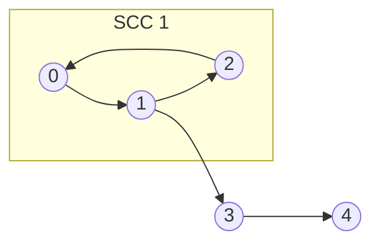

# Advanced Graphs

> **Estimated Time:** 6 hr | **Difficulty:** Advanced
> **Prerequisites:** [01 - Graph Basics, BFS and DFS](../01-graph-basics-bfs-dfs/README.md), [04 - Topological Sort](../04-topological-sort/README.md), [06 - Union Find](../06-union-find/README.md), [03 - Paths, LCA and Tree Properties](../../03-trees/03-paths-lca-and-tree-properties/README.md)

---

## What You'll Learn
- You can find strongly connected components (SCCs) with both Kosaraju and Tarjan, and explain why each works.
- You can find bridges and articulation points with the low-link idea.
- You can build an Euler path or circuit with Hierholzer's algorithm (Reconstruct Itinerary, Cracking the Safe).
- You can answer "k-th ancestor" and LCA queries in O(log n) with binary lifting.
- You know what bipartite matching (Kuhn) is, and what 2-SAT and A* are, well enough to name them in an interview.

## The Big Idea

Think of a city with one-way streets. Some groups of streets form "loop neighbourhoods": from any place in the group you can drive to any other place in the same group and come back. Those are SCCs. Now think of the same city with two-way roads. A bridge is a road whose closing cuts the city in two. An articulation point is a junction whose closing does the same. An Euler path is a mail carrier who must walk every street exactly once.

All of these come from the same tool: one DFS, plus a little bookkeeping. You record when each node was first visited (`disc`) and, for the nodes below it, the earliest visited node they can reach by a back-edge (`low`). From these two numbers you can read the answer.

Interviewers like this chapter because it separates people who memorised BFS/DFS from people who understand what DFS really knows about a graph. Most interviews only need bridges (LeetCode 1192) and Euler path (LeetCode 332), and sometimes binary lifting (LeetCode 1483). SCC is a common "name the algorithm" question.

## How to Spot It

| If the problem says ... | think ... |
|---|---|
| "directed graph, groups where everyone can reach everyone" | SCC (Kosaraju or Tarjan) |
| "condense cycles into single nodes", "minimum edges to make all reachable" | SCC then DAG of components |
| "critical connection", "if this link fails the network splits" | Bridges (low-link) |
| "if this server is removed, graph splits" | Articulation points |
| "use every edge exactly once", "reconstruct itinerary", "de Bruijn" | Euler path / circuit (Hierholzer) |
| "k-th ancestor", "LCA of many queries", "jump up 2^j steps" | Binary lifting |
| "assign each worker one job, maximise assignments" | Bipartite matching |
| "each variable is true/false, clauses of two literals" | 2-SAT (mention: build implication graph, run SCC) |
| "shortest path with a good distance guess" | A* (mention: Dijkstra plus a heuristic) |

## Core Concepts / Template

### 1. SCC: Kosaraju (two passes)

Idea in plain words: in a DFS, a node finishes after everything it can reach. So the node that finishes LAST sits in a "source" component (one with no arrows coming into it from other components). If we then walk the REVERSED graph from that node, we cannot leave its own component, because all arrows between components got flipped. We peel off one SCC, then take the next-latest finisher, and so on.

Steps:
1. DFS on the graph; push a node to `order` when it finishes.
2. Build the reversed graph.
3. Take nodes from `order` in reverse. If not visited, DFS on the reversed graph. Everything reached is one SCC.

### 2. SCC: Tarjan (one pass)

Idea: keep a stack of nodes that are "still open". For every node keep `disc` (visit time) and `low` (smallest `disc` reachable using tree edges down plus at most one back-edge to a node still on the stack). If `low[u] == disc[u]`, then `u` cannot reach anything earlier, so `u` is the root of an SCC: pop the stack down to `u`.

The graph below has three SCCs. Collapsing each SCC into a point always gives a DAG, which is why SCC is the first step in many "directed graph" problems.






### 3. Bridges and articulation points (undirected, low-link)

Run one DFS. For each node: `disc[u]` is the visit time, `low[u]` is the smallest `disc` reachable from the subtree of `u` using any number of tree edges and at most ONE back-edge.

- Edge `u -> v` (v is a DFS child) is a **bridge** if `low[v] > disc[u]`. The subtree of `v` cannot reach `u` or above without this edge.
- Node `u` is an **articulation point** if it is a non-root with a child `v` where `low[v] >= disc[u]` (note `>=`, because a back-edge to `u` itself does not save the subtree once `u` is gone), or if it is the root with 2 or more DFS children.

The only difference between the two tests is `>` versus `>=`. Remember: removing an edge keeps `u`, removing a node removes `u`.

### 4. Euler path and circuit (Hierholzer)

- Undirected graph: Euler circuit needs every degree even (and edges connected); Euler path needs exactly 0 or 2 odd-degree nodes.
- Directed graph: circuit needs `in == out` for every node; path needs one node with `out - in = 1` (start), one with `in - out = 1` (end), the rest balanced.

Hierholzer: from the start node, keep taking an unused edge and moving on (stack). When a node has no unused edges left, pop it into the answer. The answer comes out reversed. Why it works: a dead end can only be the END of the path, so we write nodes down as we get stuck and the stuck-order is the path backwards.

```js
// Hierholzer on a directed multigraph: adj is Map<node, array of next nodes>
function hierholzer(adj, start) {
  const path = [], st = [start];
  while (st.length) {
    const u = st[st.length - 1];
    const list = adj.get(u);
    if (list && list.length) st.push(list.pop()); // use one edge
    else path.push(st.pop());                     // stuck: finalize
  }
  return path.reverse();
}
```

Trace on edges `A->B, B->C, C->A, A->D`: start A, push B, C, A, D. D is stuck, pop D. A is stuck now, pop A. C, B, A pop. Path reversed = A, B, C, A, D. Correct.

### 5. Binary lifting

`up[j][v]` is the `2^j`-th ancestor of `v`. Then `up[j][v] = up[j-1][ up[j-1][v] ]` (jump half, then half again). Any jump of `k` steps is the sum of powers of two in its binary form, so a query is O(log n) with O(n log n) memory. Same trick gives LCA: lift the deeper node to the same depth, then lift both together from the biggest power to the smallest while their ancestors differ.

```
k = 5 = 101 in binary  ->  jump 1 step, then jump 4 steps
node -> up[0] -> (skip up[1]) -> up[2]
```

### 6. Mentions only
- **Bipartite matching:** left side and right side, each node matched at most once. Kuhn's algorithm tries to give a left node a partner; if the partner is taken, it asks the current owner to move elsewhere (an "augmenting path"). O(V * E). Hopcroft-Karp is faster, O(E * sqrt(V)). König's theorem: in a bipartite graph, max matching = min vertex cover.
- **2-SAT:** each variable `x` becomes two nodes (`x`, `not x`). A clause `(a or b)` adds edges `not a -> b` and `not b -> a`. The formula is satisfiable exactly when no variable and its negation sit in the same SCC.
- **A\*:** Dijkstra with priority `dist + heuristic(node, goal)`. If the heuristic never overestimates the true distance, the first time the goal is popped the path is shortest. Used on maps and puzzle boards.

## Problems (easy -> hard)

### 1. Kosaraju SCC Count — Medium
**Companies:** -
**Problem:** Given a directed graph with `n` nodes, return the number of strongly connected components. Example: `n=5, edges 0->1, 1->2, 2->0, 1->3, 3->4` -> `3`.
**Intuition:** Finish order of a DFS tells us which component is "upstream". Walking the reversed graph from the latest finisher cannot escape its own component.
**Approach 1 - Brute force:** For every pair `(u, v)` check mutual reachability with BFS, then group. Time O(V * (V + E)), Space O(V + E).
**Approach 2 - Optimal (Kosaraju):** DFS for finish order, then DFS on the reversed graph in reverse finish order. Each new start is one SCC.

Dry run (`order` is finish order):

| Step | Detail |
|---|---|
| Pass 1 | DFS from 0: visit 0,1,2 then 3,4. Finish order: 2, 4, 3, 1, 0 (2 ends first because its only edge goes to visited 0) |
| Pass 2 start | Take 0 (last finisher). Reversed edges from 0: 2. From 2: 1. From 1: 0. SCC {0,1,2}, count 1 |
| Next | Take 1, 2 (done). Take 3: reversed edge from 3 goes to 1 (done). SCC {3}, count 2 |
| Next | Take 4: reversed edge goes to 3 (done). SCC {4}, count 3 |

```js
function kosarajuCount(n, edges) {
  const g = Array.from({ length: n }, () => []);
  const rg = Array.from({ length: n }, () => []);
  for (const [u, v] of edges) { g[u].push(v); rg[v].push(u); }

  // pass 1: iterative DFS, record finish order
  const seen = new Array(n).fill(false), order = [];
  for (let s = 0; s < n; s++) {
    if (seen[s]) continue;
    seen[s] = true;
    const st = [[s, 0]]; // [node, next neighbour index]
    while (st.length) {
      const top = st[st.length - 1];
      const [u, i] = top;
      if (i < g[u].length) {
        top[1]++;
        const v = g[u][i];
        if (!seen[v]) { seen[v] = true; st.push([v, 0]); }
      } else { order.push(u); st.pop(); }
    }
  }

  // pass 2: reversed graph, latest finisher first
  const done = new Array(n).fill(false);
  let count = 0;
  for (let k = n - 1; k >= 0; k--) {
    const s = order[k];
    if (done[s]) continue;
    count++;
    done[s] = true;
    const st = [s];
    while (st.length) {
      const u = st.pop();
      for (const v of rg[u]) if (!done[v]) { done[v] = true; st.push(v); }
    }
  }
  return count;
}
```

**Complexity:** Time O(V + E), Space O(V + E).
**Watch out:** Pass 2 must use the REVERSED graph and the REVERSED finish order. Forgetting either gives wrong counts. A recursive DFS can overflow the call stack for around 10^4 or more nodes in JS, so the iterative form is safer.

### 2. Tarjan SCC (Return the Components) — Hard
**Companies:** -
**Problem:** Return every SCC as a list of nodes. Example: `n=5, edges 0->1, 1->2, 2->0, 1->3, 3->4` -> `[[4],[3],[0,1,2]]` in some order.
**Intuition:** One DFS. If a node cannot reach anything discovered earlier than itself (`low == disc`), it is the head of an SCC and everything above it on the stack belongs to that SCC.
**Approach 1 - Brute force:** Mutual reachability for all pairs. Time O(V * (V + E)).
**Approach 2 - Better:** Kosaraju, two passes plus a reversed graph. Time O(V + E).
**Approach 3 - Optimal (Tarjan):** One DFS with a stack. Only update `low` from a neighbour that is still ON the stack; a neighbour that already finished belongs to an SCC that is already closed, so it must be ignored.

Dry run:

| Event | disc / low | Stack after |
|---|---|---|
| visit 0, 1, 2 | 0/0, 1/1, 2/2 | [0,1,2] |
| edge 2->0 (0 on stack) | low[2] = 0, then low[1] = 0 on return | [0,1,2] |
| visit 3, 4 from 1 | 3/3, 4/4 | [0,1,2,3,4] |
| exit 4: low == disc | pop 4 -> SCC {4} | [0,1,2,3] |
| exit 3: low == disc | pop 3 -> SCC {3} | [0,1,2] |
| exit 2, 1: low 0 != disc | nothing | [0,1,2] |
| exit 0: low == disc | pop 2,1,0 -> SCC {0,1,2} | [] |

```js
function tarjanScc(n, edges) {
  const g = Array.from({ length: n }, () => []);
  for (const [u, v] of edges) g[u].push(v);
  const disc = new Array(n).fill(-1), low = new Array(n).fill(0);
  const onStack = new Array(n).fill(false);
  const stack = [], comps = [];
  let time = 0;

  function dfs(u) {
    disc[u] = low[u] = time++;
    stack.push(u); onStack[u] = true;
    for (const v of g[u]) {
      if (disc[v] === -1) { dfs(v); low[u] = Math.min(low[u], low[v]); }
      else if (onStack[v]) low[u] = Math.min(low[u], disc[v]);
    }
    if (low[u] === disc[u]) { // u is the head of an SCC
      const comp = [];
      let w;
      do { w = stack.pop(); onStack[w] = false; comp.push(w); } while (w !== u);
      comps.push(comp);
    }
  }
  for (let i = 0; i < n; i++) if (disc[i] === -1) dfs(i);
  return comps;
}
```

**Complexity:** Time O(V + E), Space O(V + E).
**Watch out:** Without the `onStack` check you merge components wrongly (a cross-edge to a finished SCC must not lower `low`). Tarjan emits SCCs in reverse topological order of the condensed DAG, a handy free fact. Recursion depth can be a problem on huge graphs.

### 3. Critical Connections in a Network (Bridges) — Hard
**Companies:** Amazon, Google, Meta, Microsoft
**Problem:** `n` servers, undirected `connections`. Return all connections that, if removed, make some server unreachable. Example: `n=4, [[0,1],[1,2],[2,0],[1,3]]` -> `[[1,3]]`.
**Intuition:** An edge is on a cycle if the subtree below it can climb back above it. If it cannot, the edge is a bridge.
**Approach 1 - Brute force:** Remove each edge, run DFS, check connectivity. Time O(E * (V + E)), Space O(V + E).
**Approach 2 - Optimal:** Low-link DFS. Edge `u -> v` is a bridge if `low[v] > disc[u]`.

Dry run on the example:

| Node | disc | low | Note |
|---|---|---|---|
| 0 | 0 | 0 | |
| 1 | 1 | 0 | child 2 reaches 0 via back-edge |
| 2 | 2 | 0 | back-edge 2->0 |
| 3 | 3 | 3 | `low[3]=3 > disc[1]=1` -> edge 1-3 is a bridge |

```js
function criticalConnections(n, connections) {
  const g = Array.from({ length: n }, () => []);
  // store the edge id so we skip only the exact edge we came from
  connections.forEach(([a, b], id) => { g[a].push([b, id]); g[b].push([a, id]); });
  const disc = new Array(n).fill(-1), low = new Array(n).fill(0), res = [];
  let time = 0;
  function dfs(u, parentEdge) {
    disc[u] = low[u] = time++;
    for (const [v, id] of g[u]) {
      if (id === parentEdge) continue;
      if (disc[v] === -1) {
        dfs(v, id);
        low[u] = Math.min(low[u], low[v]);
        if (low[v] > disc[u]) res.push([u, v]);
      } else low[u] = Math.min(low[u], disc[v]);
    }
  }
  for (let i = 0; i < n; i++) if (disc[i] === -1) dfs(i, -1);
  return res;
}
```

**Complexity:** Time O(V + E), Space O(V + E).
**Watch out:** Skip the parent by EDGE id, not by parent node. With parallel edges (two links between the same pair) skipping by node wrongly reports a bridge. Output may need any order; LeetCode accepts any order. The graph can be disconnected in general, so loop over all start nodes.

### 4. Articulation Points — Hard
**Companies:** -
**Problem:** Return all nodes whose removal increases the number of connected components of an undirected graph. Example: `n=5, edges 0-1, 1-2, 2-0, 1-3, 3-4` -> `[1, 3]`.
**Intuition:** Same low-link DFS as bridges, but removing a node also removes its back-edge anchor, so the test is `>=`. The root is special: it is a cut node only if it has 2 or more DFS children.
**Approach 1 - Brute force:** For each node, remove it and count components. Time O(V * (V + E)).
**Approach 2 - Optimal:** Low-link DFS, one pass.

Dry run: DFS 0 -> 1 -> 2 (back-edge to 0, low[2]=0), 1 -> 3 -> 4.

| Node | disc | low | Test |
|---|---|---|---|
| 0 (root) | 0 | 0 | 1 DFS child only -> not a cut |
| 1 | 1 | 0 | child 3 has `low=3 >= disc[1]=1` -> cut |
| 3 | 3 | 3 | child 4 has `low=4 >= disc[3]=3` -> cut |
| 2, 4 | | | no children -> not cut |

```js
function articulationPoints(n, edges) {
  const g = Array.from({ length: n }, () => []);
  for (const [a, b] of edges) { g[a].push(b); g[b].push(a); }
  const disc = new Array(n).fill(-1), low = new Array(n).fill(0);
  const isAp = new Array(n).fill(false);
  let time = 0;
  function dfs(u, p) {
    disc[u] = low[u] = time++;
    let children = 0;
    for (const v of g[u]) {
      if (v === p) continue;
      if (disc[v] === -1) {
        children++;
        dfs(v, u);
        low[u] = Math.min(low[u], low[v]);
        if (p !== -1 && low[v] >= disc[u]) isAp[u] = true;
      } else low[u] = Math.min(low[u], disc[v]);
    }
    if (p === -1 && children > 1) isAp[u] = true;
  }
  for (let i = 0; i < n; i++) if (disc[i] === -1) dfs(i, -1);
  const res = [];
  isAp.forEach((x, i) => { if (x) res.push(i); });
  return res;
}
```

**Complexity:** Time O(V + E), Space O(V + E).
**Watch out:** Root rule: never apply the `low[v] >= disc[u]` test to the root (it is always true there and would mark every root). Use `>=` here, `>` for bridges. This version skips by parent node, which is fine because for cut nodes parallel edges do not matter.

### 5. Reconstruct Itinerary — Hard
**Companies:** Google, Amazon, Meta, Uber
**Problem:** Given airline tickets `[from, to]`, build the itinerary that starts at `"JFK"`, uses every ticket exactly once, and is the smallest in lexical order among valid ones. Example: `[["MUC","LHR"],["JFK","MUC"],["SFO","SJC"],["LHR","SFO"]]` -> `["JFK","MUC","LHR","SFO","SJC"]`.
**Intuition:** Using every ticket exactly once is an Euler path. Hierholzer gives it in O(E log E). For lexical order, always try the smallest destination first; a dead end is naturally the final stretch of the path.
**Approach 1 - Brute force:** Backtracking over all orders of tickets, return the first complete one in sorted order. Time exponential in the worst case (it can also be O(E!)-like on bad inputs).
**Approach 2 - Optimal:** Hierholzer with sorted adjacency. Sort each list in descending order so `pop()` returns the smallest.

Dry run on `JFK->SFO, JFK->ATL, SFO->ATL, ATL->JFK, ATL->SFO`:

| Stack top | Action | Output (reversed at end) |
|---|---|---|
| JFK | go ATL (smallest) | |
| ATL | go JFK (smallest) | |
| JFK | go SFO | |
| SFO | go ATL | |
| ATL | go SFO | |
| SFO | stuck, pop | SFO |
| ATL, SFO, JFK, ATL, JFK | all pop in turn | SFO, ATL, SFO, JFK, ATL, JFK |

Reversed: `JFK, ATL, JFK, SFO, ATL, SFO`.

```js
function findItinerary(tickets) {
  const g = new Map();
  for (const [a, b] of tickets) {
    if (!g.has(a)) g.set(a, []);
    g.get(a).push(b);
  }
  for (const list of g.values()) list.sort().reverse(); // pop() = smallest
  const route = [], st = ['JFK'];
  while (st.length) {
    const u = st[st.length - 1];
    const list = g.get(u);
    if (list && list.length) st.push(list.pop());
    else route.push(st.pop());
  }
  return route.reverse();
}
```

**Complexity:** Time O(E log E) for sorting, Space O(E).
**Watch out:** Do NOT output a node when you first visit it; output it when it is stuck. A plain greedy "go to smallest" can strand you at a dead end while tickets remain; Hierholzer repairs that by splicing the dead-end part to the end.

### 6. Valid Arrangement of Pairs — Hard
**Companies:** -
**Problem:** Given `pairs[i] = [start, end]`, reorder them so that `end` of each pair equals `start` of the next. A valid answer always exists. Example: `[[5,1],[4,5],[11,9],[9,4]]` -> `[[11,9],[9,4],[4,5],[5,1]]`.
**Intuition:** Each pair is a directed edge. Chaining all edges is an Euler path. Start from the node with `out - in = 1`; if none exists (it is a circuit), any node works.
**Approach 1 - Brute force:** Backtracking over orderings. Exponential.
**Approach 2 - Optimal:** Compute degrees, pick the start, run Hierholzer, convert the node path into pairs.

Dry run: out/in: 11:+1, 9:0, 4:0, 5:0, 1:-1. Start = 11. Path 11,9,4,5,1. Pairs: (11,9),(9,4),(4,5),(5,1).

```js
function validArrangement(pairs) {
  const g = new Map(), diff = new Map(); // diff = out - in
  for (const [a, b] of pairs) {
    if (!g.has(a)) g.set(a, []);
    g.get(a).push(b);
    diff.set(a, (diff.get(a) || 0) + 1);
    diff.set(b, (diff.get(b) || 0) - 1);
  }
  let start = pairs[0][0]; // circuit case: any node
  for (const [k, d] of diff) if (d === 1) start = k;
  const path = [], st = [start];
  while (st.length) {
    const u = st[st.length - 1];
    const list = g.get(u);
    if (list && list.length) st.push(list.pop());
    else path.push(st.pop());
  }
  path.reverse();
  const res = [];
  for (let i = 0; i + 1 < path.length; i++) res.push([path[i], path[i + 1]]);
  return res;
}
```

**Complexity:** Time O(E), Space O(E).
**Watch out:** Using `Map` matters: node values go up to 10^9, so arrays indexed by value are out. Picking a wrong start in the path case (not the `out - in = 1` node) produces a broken chain.

### 7. Cracking the Safe — Hard
**Companies:** Google, Amazon
**Problem:** A safe has an `n`-digit password with digits `0..k-1`. It opens when the last `n` typed digits match. Return the shortest string that contains every possible password. Example: `n=2, k=2` -> `"01100"` (any valid shortest answer works; length `k^n + n - 1`).
**Intuition:** Make a graph where each node is an `(n-1)`-digit string, and each edge is one digit that appends a digit and drops the first. Each edge is one password of length `n`. Visiting every edge exactly once is an Euler circuit (a de Bruijn sequence).
**Approach 1 - Brute force:** Try all strings of growing length. Exponential.
**Approach 2 - Optimal:** Hierholzer by DFS: from a node, for each unused digit mark the edge used, recurse to the next node, then append the digit AFTER recursion (post-order).

Dry run `n=2,k=2` (nodes "0","1"; start "0"):

| Node | Edge (digit) | Action |
|---|---|---|
| "0" | "00" | mark, go to node "0" |
| "0" | "01" | mark, go to node "1" |
| "1" | "10" | mark, go to "0": nothing left. append 0 |
| "1" | "11" | mark, go to "1": nothing left. append 1 |
| back | | append 1, then append 0 |

Post-order digits: `0, 1, 1, 0`. Add start `"0"` at the end -> `"01100"`.

```js
function crackSafe(n, k) {
  const seen = new Set(), out = [];
  const start = '0'.repeat(n - 1);
  function dfs(node) {
    for (let d = 0; d < k; d++) {
      const edge = node + d; // an n-digit password
      if (!seen.has(edge)) {
        seen.add(edge);
        dfs(edge.slice(1));
        out.push(d);
      }
    }
  }
  dfs(start);
  return out.join('') + start;
}
```

**Complexity:** Time O(k^n * n) because each edge builds a string of length n, Space O(k^n * n).
**Watch out:** Append the digit after the recursive call (post-order), not before. For `n=1` the start is the empty string and edges are single digits; it still works. Recursion depth is up to `k^n`, so keep to LeetCode's limits (`k^n <= 4096`).

### 8. Kth Ancestor of a Tree Node — Hard
**Companies:** Google, Meta, Amazon
**Problem:** Tree with nodes `0..n-1`, `parent[0] = -1`. Design `getKthAncestor(node, k)`, which returns the k-th ancestor or `-1` if it does not exist. Example: parents `[-1,0,0,1,1,2,2]`: `getKthAncestor(3,1)` -> `1`, `getKthAncestor(5,2)` -> `0`, `getKthAncestor(6,3)` -> `-1`.
**Intuition:** Any `k` is a sum of powers of 2. Precompute the `2^j`-th ancestor for all `j`, then jump along the set bits of `k`.
**Approach 1 - Brute force:** Walk up `k` times. Query O(k), Space O(n).
**Approach 2 - Optimal:** Binary lifting. Preprocess O(n log n), query O(log n).

Dry run for `getKthAncestor(5, 2)`: `2 = 10` in binary. Bit 0 is 0 (skip), bit 1 is 1: `up[1][5]`. `up[0][5] = 2`, `up[1][5] = up[0][2] = 0`. Answer 0.

```js
class TreeAncestor {
  constructor(n, parent) {
    this.n = n;
    this.LOG = Math.max(1, Math.ceil(Math.log2(n)) + 1);
    this.up = [parent.slice()]; // up[j][v] = 2^j-th ancestor, -1 if none
    for (let j = 1; j < this.LOG; j++) {
      const prev = this.up[j - 1];
      this.up.push(prev.map((p) => (p === -1 ? -1 : prev[p])));
    }
  }
  getKthAncestor(node, k) {
    if (k >= this.n) return -1; // a tree path has fewer than n edges
    for (let j = 0; j < this.LOG && node !== -1; j++) {
      if ((k >> j) & 1) node = this.up[j][node];
    }
    return node;
  }
}
```

**Complexity:** Time O(n log n) build, O(log n) per query. Space O(n log n).
**Watch out:** Keep `-1` as a sticky "no ancestor" value and never index with it. The early `k >= n` return also protects the bit loop from huge `k` (JS shifts only use 32 bits, so an oversized `k` would otherwise be misread).

### 9. Lowest Common Ancestor via Binary Lifting — Hard
**Companies:** Google, Meta, Amazon, Microsoft
**Problem:** Given an undirected tree on `n` nodes rooted at 0, answer many queries `lca(a, b)`. Example: edges `0-1, 0-2, 1-3, 1-4, 2-5, 2-6`: `lca(3,4)=1`, `lca(3,5)=0`, `lca(1,4)=1`.
**Intuition:** First bring both nodes to the same depth. Then jump both up together by the biggest power of 2 that keeps them DIFFERENT. After all jumps, they are children of the LCA.
**Approach 1 - Brute force:** Store parents and depths, climb one step at a time. Query O(depth), which is O(n) on a chain.
**Approach 2 - Optimal:** Binary lifting table, query O(log n). (Offline alternative: Euler tour plus sparse table gives O(1) queries; see the sparse-table chapter. Tarjan offline LCA is another option.)

Dry run `lca(3, 5)`: depth(3)=2, depth(5)=2, equal. Top-down: `up[1][3]=0` and `up[1][5]=0` are equal, skip. `up[0][3]=1`, `up[0][5]=2` differ, so move: a=1, b=2. Answer `up[0][1] = 0`.

```js
function buildLCA(n, edges, root = 0) {
  const g = Array.from({ length: n }, () => []);
  for (const [a, b] of edges) { g[a].push(b); g[b].push(a); }
  const LOG = Math.max(1, Math.ceil(Math.log2(n)));
  // the root points to itself so jumps past the root stay at the root
  const up = Array.from({ length: LOG }, () => new Array(n).fill(root));
  const depth = new Array(n).fill(0), seen = new Array(n).fill(false);
  const st = [root];
  seen[root] = true;
  while (st.length) {
    const u = st.pop();
    for (const v of g[u]) if (!seen[v]) {
      seen[v] = true; depth[v] = depth[u] + 1; up[0][v] = u; st.push(v);
    }
  }
  for (let j = 1; j < LOG; j++)
    for (let v = 0; v < n; v++) up[j][v] = up[j - 1][up[j - 1][v]];

  return function lca(a, b) {
    if (depth[a] < depth[b]) [a, b] = [b, a];
    let diff = depth[a] - depth[b];
    for (let j = 0; diff; j++, diff >>= 1) if (diff & 1) a = up[j][a]; // equalize depth
    if (a === b) return a;
    for (let j = LOG - 1; j >= 0; j--) {
      if (up[j][a] !== up[j][b]) { a = up[j][a]; b = up[j][b]; }
    }
    return up[0][a];
  };
}
```

**Complexity:** Time O(n log n) build, O(log n) per query. Space O(n log n).
**Watch out:** Use the root-points-to-itself trick here (not `-1`), otherwise the "ancestors differ" test breaks near the root. Check `a === b` right after equalizing depth: that is the case where one node is an ancestor of the other. The LOG must satisfy `2^LOG >= n`.

### 10. Minimum Time to Collect All Apples in a Tree — Medium
**Companies:** Amazon, Google
**Problem:** An undirected tree, root 0, some nodes have apples. Walking one edge takes 1 second. Return the minimum seconds to start at 0, collect all apples, and return to 0. Example: 7 nodes, edges `0-1, 0-2, 1-4, 1-5, 2-3, 2-6`, apples at 2, 4, 5 -> `8`.
**Intuition:** Every edge you must use, you walk twice (down and back). An edge is needed only if its lower subtree has an apple. So answer = 2 * (number of needed edges).
**Approach 1 - Brute force:** Try all walk orders. Exponential.
**Approach 2 - Optimal:** DFS. For a child `v`, add `cost(v) + 2` only if `cost(v) > 0` or `v` itself has an apple.

Dry run (apples at 2, 4, 5):

| Node | Children costs | Cost |
|---|---|---|
| 4 | none | 0, but has apple |
| 5 | none | 0, but has apple |
| 1 | 4: +2, 5: +2 | 4 |
| 3, 6 | none, no apple | 0 (skipped) |
| 2 | 3: skip, 6: skip | 0, but has apple |
| 0 | 1: 4+2=6, 2: 0+2=2 | 8 |

```js
function minTime(n, edges, hasApple) {
  const g = Array.from({ length: n }, () => []);
  for (const [a, b] of edges) { g[a].push(b); g[b].push(a); }
  function dfs(u, parent) {
    let time = 0;
    for (const v of g[u]) {
      if (v === parent) continue;
      const c = dfs(v, u);
      if (c > 0 || hasApple[v]) time += c + 2;
    }
    return time;
  }
  return dfs(0, -1);
}
```

**Complexity:** Time O(n), Space O(n) for adjacency plus recursion depth.
**Watch out:** The check must include `hasApple[v]` because a leaf with an apple has cost 0 but still needs its edge. The root itself having an apple costs nothing extra. If no apples, the answer is 0.

### 11. Word Ladder II (brief) — Hard
**Companies:** Amazon, Google, Meta
**Problem:** Given `beginWord`, `endWord` and a word list, return ALL shortest transformation sequences where each step changes one letter and every word is in the list. Example: `hit -> cog` with `[hot,dot,dog,lot,log,cog]` -> `[[hit,hot,dot,dog,cog],[hit,hot,lot,log,cog]]`.
**Intuition:** First find shortest distances with BFS by levels, remembering ALL parents of each word at its first-seen level. Then walk backwards from `endWord` through the parents to list every path. Building paths in the forward direction would explore many dead ends.
**Approach 1 - Brute force:** DFS from the start trying all paths, then keep the shortest. Exponential.
**Approach 2 - Optimal:** Level-by-level BFS with a parents map, then DFS backtracking from the end. Remove a whole level's words from the set only AFTER the level is processed (so two words in the same level can both link to a word in the next level).

```js
function findLadders(beginWord, endWord, wordList) {
  const words = new Set(wordList);
  if (!words.has(endWord)) return [];
  words.delete(beginWord);
  const parents = new Map(); // word -> words in the previous level that reach it
  let level = [beginWord], found = false;
  while (level.length && !found) {
    const next = new Map();
    for (const w of level) {
      for (let i = 0; i < w.length; i++) {
        for (let c = 97; c < 123; c++) {
          const x = w.slice(0, i) + String.fromCharCode(c) + w.slice(i + 1);
          if (!words.has(x)) continue;
          if (!next.has(x)) next.set(x, []);
          next.get(x).push(w);
          if (x === endWord) found = true;
        }
      }
    }
    for (const [x, ps] of next) { words.delete(x); parents.set(x, ps); }
    level = [...next.keys()];
  }
  if (!found) return [];
  const res = [];
  (function build(w, path) {
    path.push(w);
    if (w === beginWord) res.push([...path].reverse());
    else for (const p of parents.get(w)) build(p, path);
    path.pop();
  })(endWord, []);
  return res;
}
```

**Complexity:** Time O(N * L * 26) for BFS (N words, length L, plus string building), plus the size of the output. Space O(N * L) plus output. The number of shortest paths can itself be exponential.
**Watch out:** This is a graph-search problem, not an advanced-graph algorithm; it sits here because of the BFS-then-backtrack pattern. If you delete words from the set while still processing a level, you lose parallel parents and miss paths.

### 12. Maximum Bipartite Matching (Kuhn) (brief) — Hard
**Companies:** -
**Problem:** Left nodes `0..nLeft-1`, right nodes `0..nRight-1`, `adj[u]` lists right nodes `u` may be paired with. Return the maximum number of pairs with no node used twice. Example: `adj = [[0,1],[0,2],[1,0]]` (3 left, 3 right) -> `3`. Example: `adj = [[0],[0],[0]]` -> `1`.
**Intuition:** Try to match each left node one by one. If its favourite right node is already taken, ask the current owner to re-route to another right node (recursively). If that works, we found an augmenting path and the matching grows by one.
**Approach 1 - Brute force:** Try all subsets of edges. Exponential.
**Approach 2 - Optimal (Kuhn):** For each left node run one DFS with a fresh `visited` set over the right side. Time O(V * E). Hopcroft-Karp reaches O(E * sqrt(V)) (mention only). Max flow also solves it.

```js
function maxMatching(nLeft, nRight, adj) {
  const matchR = new Array(nRight).fill(-1); // right node -> its left partner
  function tryKuhn(u, vis) {
    for (const v of adj[u]) {
      if (vis[v]) continue;
      vis[v] = true;
      // v free, or its current owner can move somewhere else
      if (matchR[v] === -1 || tryKuhn(matchR[v], vis)) { matchR[v] = u; return true; }
    }
    return false;
  }
  let res = 0;
  for (let u = 0; u < nLeft; u++) if (tryKuhn(u, new Array(nRight).fill(false))) res++;
  return res;
}
```

**Complexity:** Time O(V * E), Space O(V + E).
**Watch out:** Reset `vis` for each new left node, not inside the recursion. This only works when the graph is truly bipartite; first check that with the 2-coloring from the [Cycle and Bipartite](../03-cycle-and-bipartite/README.md) chapter if the sides are not given.

## Common Mistakes
- **Wrong belief:** "Tarjan's `low` can use any visited neighbour." **Correction:** In a directed graph only neighbours still on the stack count. In an undirected graph there is no stack; you only skip the parent edge.
- **Wrong belief:** "Bridges and articulation points use the same test." **Correction:** Bridge: `low[v] > disc[u]`. Articulation: `low[v] >= disc[u]`, plus the root needs 2+ children.
- **Wrong belief:** "Skip the parent node in bridges code." **Correction:** Skip the parent EDGE id. Parallel edges between the same two nodes are never bridges.
- **Wrong belief:** "Kosaraju pass 2 runs on the original graph." **Correction:** It runs on the reversed graph, taking start nodes by decreasing finish time.
- **Wrong belief:** "Hierholzer output is in visit order." **Correction:** Nodes are added when stuck, so the list is reversed at the end.
- **Wrong belief:** "Binary lifting with `-1` for no parent works for LCA." **Correction:** For LCA, point the root to itself; `-1` breaks the `up[j][a] !== up[j][b]` comparison.
- **Wrong belief:** "Recursive DFS is fine for any size." **Correction:** Node's default stack handles roughly ten thousand frames. For path-like graphs with 10^5 nodes, write the DFS iteratively.

## Interview Tips
- Say the invariant out loud: "`low[u]` is the earliest discovery time reachable from `u`'s subtree with one back-edge. If `low[v] > disc[u]`, the subtree of `v` is cut off when I remove edge `u-v`."
- For SCC, state the two choices: Kosaraju is easier to explain (two DFS and a reversed graph); Tarjan is one pass and needs no reversed graph. Both O(V + E).
- Before coding an Euler path, check the degree conditions out loud (in vs out for directed, odd count for undirected) and say what you do if no valid path exists (the problem often guarantees it).
- For Reconstruct Itinerary, explain why the naive greedy fails (dead end with unused tickets) and how Hierholzer's post-order fixes it.
- Common follow-ups: "How would you do it without recursion?" (explicit stack, shown in Kosaraju and Hierholzer above), "What if the graph is disconnected?" (loop over all starts), "Can you answer 10^5 LCA queries?" (binary lifting, or Euler tour plus sparse table for O(1)).
- Edge cases: single node, no edges, self-loops, parallel edges, disconnected graph, `k` larger than depth, tree that is a single chain.
- You do not need to code 2-SAT or A* from scratch. Name them: "2-SAT builds an implication graph and checks no variable shares an SCC with its negation. A* is Dijkstra with an admissible heuristic."

## Practice List
**Easy**
- Find the Town Judge
- Find Center of Star Graph
- Number of Provinces (connectivity warm-up)

**Medium**
- Course Schedule II (topological order, SCC idea)
- Minimum Number of Vertices to Reach All Nodes
- Sum of Distances in Tree
- Maximum Employees to Be Invited to a Meeting (functional graph, cycles)
- Find Eventual Safe States
- Minimum Time to Collect All Apples in a Tree
- Redundant Connection (also solvable with Union Find)
- Longest Cycle in a Graph
- Lowest Common Ancestor of a Binary Tree (compare with lifting)

**Hard**
- Critical Connections in a Network
- Reconstruct Itinerary
- Cracking the Safe
- Valid Arrangement of Pairs
- Kth Ancestor of a Tree Node
- Word Ladder II
- Minimum Number of Days to Disconnect Island (articulation-point idea)
- Maximum Students Taking Exam (bipartite matching / bitmask)
- Strongly Connected Components (GeeksforGeeks / CSES "Flight Routes Check")
- Minimum Edges to Make a Directed Graph Strongly Connected (condensation in-degree and out-degree)

## Key Takeaways
- **One DFS with `disc` and `low`** answers SCC, bridges and articulation points; the only differences are the stack check and `>` versus `>=`.
- **Kosaraju = finish order plus reversed graph; Tarjan = one pass plus a stack**, both O(V + E).
- **Bridge test is `low[v] > disc[u]`; articulation test is `low[v] >= disc[u]`**, and the root needs 2+ children.
- **Use every edge once means Euler path**; run Hierholzer, add nodes when stuck, then reverse.
- **Cracking the Safe is a de Bruijn sequence**: nodes are `(n-1)`-digit strings, edges are digits.
- **Binary lifting turns k steps into log k jumps**; build `up[j][v] = up[j-1][up[j-1][v]]`; use -1 for k-th ancestor, root-to-itself for LCA.
- **Matching, 2-SAT and A\* are good to name** and sketch: Kuhn's augmenting paths, SCC on implication graph, Dijkstra plus heuristic.

---
[← Previous: Minimum Spanning Tree](../07-minimum-spanning-tree/README.md) | [Next: DP Intuition →](../../05-dynamic-programming/01-dp-intuition/README.md) | [Back to Graphs Index](../README.md)
