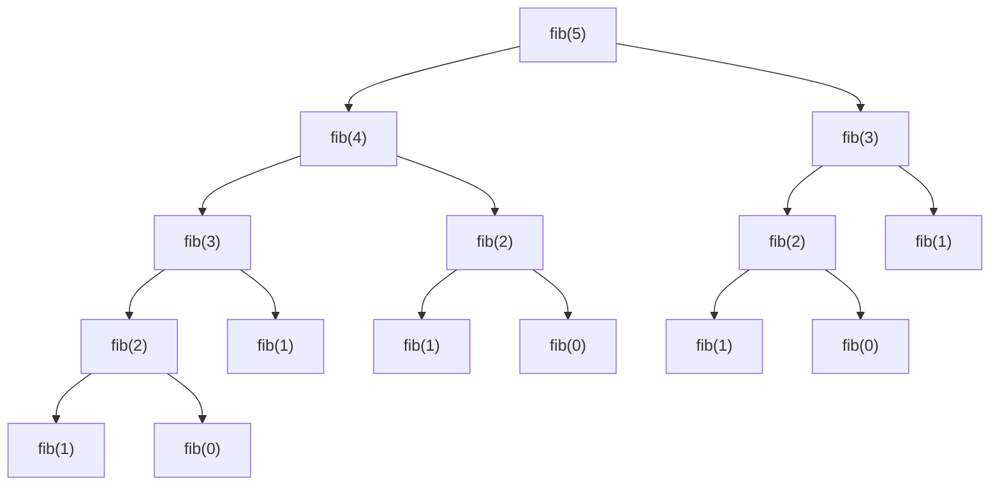

# DP Intuition

> **Estimated Time:** 4 hr | **Difficulty:** Intermediate
> **Prerequisites:** [Recursion](../../02-intermediate/01-recursion/README.md), [Greedy](../../02-intermediate/04-greedy/README.md)

---

## What You'll Learn
- You can explain **overlapping subproblems** and **optimal substructure**, and say why both are needed for DP.
- You can apply the **5-step DP recipe** (state, transition, base, order, answer) to a new problem.
- You can turn a plain recursion into **top-down memo**, then **bottom-up tabulation**, then a **space-optimised** loop.
- You can recognise a DP problem from its wording, and say when greedy is enough and when it is not.
- You can solve the classic starter set: Fibonacci, stairs, house robber, frog jump, decode ways.

## The Big Idea

Imagine you are adding a long column of numbers by hand. Halfway down, someone asks, "what was the sum of the first 10 numbers again?" You do not add them again. You wrote the partial sum on the page, so you just read it. DP is that habit: **never solve the same small question twice. Write the answer down and reuse it.**

Plain recursion is often correct but slow, because it asks the same small question again and again. DP keeps the same logic and adds a notebook. The reasoning is the hard part. The notebook is easy.

For DP to work, a problem needs two properties:

1. **Overlapping subproblems.** The small questions repeat. `fib(3)` is needed by `fib(5)` and also by `fib(4)`. If every small question were different (like merge sort halves), a notebook would never be read, and DP gives no gain.
2. **Optimal substructure.** The best answer for the big problem can be built from the best answers of smaller problems. The best way to reach step 10 uses the best way to reach step 9 or step 8. Nothing else about the past matters.

Here is the repeated work in `fib(5)`. Same-numbered nodes are the same question.






`fib(3)` appears twice, `fib(2)` three times. For big `n` the tree has about 2^n nodes, but only `n + 1` different questions exist. That gap is what DP removes.

**Why interviewers love it:** DP tests whether you can define a problem precisely (what does `dp[i]` mean?), see a pattern, and improve a slow solution step by step. A candidate who says the state out loud, in one sentence, usually does well.

## How to Spot It

| If the problem says ... | think ... |
|---|---|
| "number of ways to ..." | DP counting: add the ways from smaller states |
| "minimum / maximum cost / profit / length ..." | DP optimisation: take min or max over choices |
| "is it possible to ..." (reach a sum, split, match) | DP with true/false states |
| At each step you choose: take or skip, go 1 or 2 | Take/skip or "last move" transition |
| Brute force tries all choices and has repeated sub-calls | Add memo, it is already DP |
| "Return the count / best value", not the list of all answers | DP. If they want all the actual answers, you need backtracking |
| Small input numbers (n up to a few thousand) with a big answer | Likely DP (state count is polynomial) |
| Greedy choice fails on a small counter-example | DP (try all choices, keep the best) |

Quick test: write the brute-force recursion. If the same arguments appear in more than one call, DP applies.

## Core Concepts / Template

### The 5-step recipe

Always answer these five, in this order, before writing code.

| Step | Question | Fibonacci example | House robber example |
|---|---|---|---|
| 1. **State** | What do I need to know to describe a subproblem? What does `dp[i]` mean (one sentence)? | `dp[i]` = the i-th Fibonacci number | `dp[i]` = max money using houses `0..i` |
| 2. **Transition** | How does `dp[i]` come from smaller states? | `dp[i] = dp[i-1] + dp[i-2]` | `dp[i] = max(dp[i-1], dp[i-2] + nums[i])` |
| 3. **Base** | Which states are known without any work? | `dp[0]=0, dp[1]=1` | `dp[0]=nums[0]`, `dp[1]=max(nums[0],nums[1])` |
| 4. **Order** | In which order do I fill them so that dependencies are ready? | `i` from 2 up to n | `i` from 2 up to n-1 |
| 5. **Answer** | Which state holds the final answer? | `dp[n]` | `dp[n-1]` |

If you cannot write step 1 in one clear sentence, stop. Most failed DP attempts have a vague state.

### Three styles, one idea

```
1. Top-down (memoisation)   write the recursion, cache results      easy to derive
2. Bottom-up (tabulation)   fill an array from base to answer       no recursion depth limit
3. Space optimised          keep only the last few cells needed     O(1) or O(n) less memory
```

| | Top-down memo | Bottom-up table | Space optimised |
|---|---|---|---|
| How | Recursion + cache | Loops + array | Loops + a few variables |
| Computes | Only states that are reached | All states in the order you choose | All states, but forgets old ones |
| Risk | Deep recursion (stack overflow near ~10^4 levels in JS) | Must find a correct order | You cannot rebuild the path afterwards |
| When | First draft, tricky orders | Default in interviews | After the table version works |

### Converting recursion to DP, step by step

1. Write the brute-force recursion with only the parameters that change. Remove everything else.
2. Check that the function is **pure**: the answer depends only on its parameters.
3. Add a cache keyed by the parameters (`Map`, or an array when the parameter is a small integer). Check the cache first, store before returning. That is top-down.
4. Look at which indices each call needs (`i-1`, `i-2`). They point to smaller indices, so fill from small to large. That is bottom-up.
5. Look at which previous cells the loop still reads. If only the last 1 or 2, replace the array with variables. That is space optimisation.

### Template (1D, "last move" style)

```js
// dp[i] = best answer for the first i items / for position i
function solve(n) {
  const dp = new Array(n + 1).fill(0);
  dp[0] = /* base */ 0;
  for (let i = 1; i <= n; i++) {
    dp[i] = /* combine dp[i - something] over all choices */ 0;
  }
  return dp[n];
}
```

### 1D vs 2D state

- **1D**: one thing changes: a position `i`. (stairs, robber, frog)
- **2D**: two things change: `(i, j)` as a grid cell, `(index, remaining capacity)`, or two string prefixes. Rule of thumb: **one parameter per thing that changes between calls and affects the answer**. State count = product of the ranges, and each state costs the work of its transition.
- Prefer the smallest state that still decides the future. If the extra parameter does not change the answer, drop it.

### When greedy and DP differ

Greedy picks the locally best move and never looks back. DP tries every choice (through cached sub-answers) and keeps the best. Greedy is correct only when the local best can be proven safe.

| Problem | Greedy? | Why |
|---|---|---|
| Coins `[1,5,10,25]`, make 41 | works | Each coin divides the next, so the largest-first choice is safe |
| Coins `[1,3,4]`, make 6 | **fails** | Greedy: 4+1+1 = 3 coins. Best: 3+3 = 2 coins. Needs DP |
| Max sum with no two adjacent | **fails** | Picking the largest value can block two good neighbours |
| Activity selection (earliest end time) | works | Exchange argument proves it |

How to decide: try to find a small counter-example for the greedy rule. If you find one, or cannot prove the rule in a sentence, use DP.

## Problems (easy -> hard)

### 1. Fibonacci Number (4 versions) — Easy
**Companies:** Amazon, Google, Microsoft, Apple
**Problem:** `fib(0)=0`, `fib(1)=1`, `fib(n)=fib(n-1)+fib(n-2)`. Given `n`, return `fib(n)`. Example: `10 -> 55`.
**Intuition:** Every value needs only the two before it, and the same values are asked many times. This is the smallest example of the whole DP journey, so we write all four versions.
**Approach 1 - Brute force:** plain recursion. The call tree has about 2^n nodes. Time O(2^n), Space O(n) (stack).
**Approach 2 - Better (top-down memo):** cache each `fib(k)` the first time it is computed. Only `n+1` different states, each computed once. Time O(n), Space O(n).
**Approach 3 - Better (bottom-up table):** fill `dp[0..n]` in a loop, no recursion. Time O(n), Space O(n).
**Approach 4 - Optimal (space optimised):** `dp[i]` reads only `dp[i-1]` and `dp[i-2]`, so keep two variables.

Dry run of version 4, `n = 5`:

| i | prev | cur (= fib(i)) |
|---|---|---|
| start | 0 | 1 |
| 2 | 1 | 1 |
| 3 | 1 | 2 |
| 4 | 2 | 3 |
| 5 | 3 | 5 |

```js
// 1) brute force: O(2^n)
function fibRec(n) {
  return n < 2 ? n : fibRec(n - 1) + fibRec(n - 2);
}

// 2) top-down memo: O(n) time, O(n) space
function fibMemo(n, memo = new Map()) {
  if (n < 2) return n;
  if (memo.has(n)) return memo.get(n);
  const r = fibMemo(n - 1, memo) + fibMemo(n - 2, memo);
  memo.set(n, r);
  return r;
}

// 3) bottom-up table: O(n) time, O(n) space
function fibTab(n) {
  if (n < 2) return n;
  const dp = new Array(n + 1).fill(0);
  dp[1] = 1;
  for (let i = 2; i <= n; i++) dp[i] = dp[i - 1] + dp[i - 2];
  return dp[n];
}

// 4) space optimised: O(n) time, O(1) space
function fibOpt(n) {
  if (n < 2) return n;
  let prev = 0, cur = 1;
  for (let i = 2; i <= n; i++) [prev, cur] = [cur, prev + cur];
  return cur;
}
```

**Complexity:** Time O(n) for versions 2-4 (O(2^n) for version 1). Space O(1) for the optimal one.
**Watch out:** `n = 0` and `n = 1` must return directly. Past `n = 78` the value exceeds `Number.MAX_SAFE_INTEGER`; use `BigInt` if the problem asks for exact big values (most problems ask for the answer modulo something). There is also an O(log n) matrix-power method, rarely needed.

### 2. Climbing Stairs — Easy
**Companies:** Amazon, Google, Adobe, Apple, Microsoft
**Problem:** You climb `n` steps, taking 1 or 2 steps at a time. Count the distinct ways to reach the top. Example: `n = 3 -> 3` (1+1+1, 1+2, 2+1).
**Intuition:** Look at the **last move**. You reached step `n` either from `n-1` (a 1-step) or from `n-2` (a 2-step). Those two groups never overlap, so `ways(n) = ways(n-1) + ways(n-2)`. It is Fibonacci with a story.
**Approach 1 - Brute force:** recursion on the formula. Time O(2^n), Space O(n).
**Approach 2 - Better:** memo or a table `dp[i]`. Time O(n), Space O(n).
**Approach 3 - Optimal:** keep two variables. Recipe: state `ways(i)`; transition above; base `ways(0)=1` (one way to stand still), `ways(1)=1`; order low to high; answer `ways(n)`.

Dry run, `n = 5`: ways 1, 1, 2, 3, 5, 8 for steps 0..5. Answer 8.

```js
function climbStairs(n) {
  let a = 1, b = 1; // ways(0), ways(1)
  for (let i = 2; i <= n; i++) [a, b] = [b, a + b];
  return b;
}
```

**Complexity:** Time O(n), Space O(1).
**Watch out:** Base `ways(0) = 1`, not 0. That "empty way" is what makes `ways(2) = ways(1) + ways(0) = 2`.

### 3. N-th Tribonacci Number — Easy
**Companies:** Amazon, Google, Microsoft
**Problem:** `T0=0, T1=1, T2=1`, and `Tn = Tn-1 + Tn-2 + Tn-3`. Return `Tn`. Example: `n = 4 -> 4`.
**Intuition:** Same as Fibonacci but each state looks back 3 cells. Keep three variables instead of two.
**Approach 1 - Brute force:** recursion, about 3^n calls. Time O(3^n), Space O(n).
**Approach 2 - Better:** memo / table. Time O(n), Space O(n).
**Approach 3 - Optimal:** slide a window of three values.

Dry run, `n = 4`: window `(0,1,1)` -> `(1,1,2)` -> `(1,2,4)`. Answer 4.

```js
function tribonacci(n) {
  if (n === 0) return 0;
  if (n < 3) return 1;
  let a = 0, b = 1, c = 1; // T(i-3), T(i-2), T(i-1)
  for (let i = 3; i <= n; i++) [a, b, c] = [b, c, a + b + c];
  return c;
}
```

**Complexity:** Time O(n), Space O(1).
**Watch out:** Three base cases, not two. The loop starts at 3.

### 4. Min Cost Climbing Stairs — Easy
**Companies:** Amazon, Google, Adobe
**Problem:** `cost[i]` is what you pay to leave step `i`. You may start on step 0 or 1, and climb 1 or 2 steps. Return the cheapest cost to get **past the last step** (the top is index `n`). Example: `[10,15,20] -> 15` (start at 1, pay 15, jump 2).
**Intuition:** Let `dp[i]` be the cheapest cost to be standing on position `i` (not yet paid for leaving it). You arrive from `i-1` by paying `cost[i-1]`, or from `i-2` by paying `cost[i-2]`. Take the cheaper.
**Approach 1 - Brute force:** recursion over both moves. Time O(2^n), Space O(n).
**Approach 2 - Better:** table `dp[0..n]`, `dp[0]=dp[1]=0` (free starts). Time O(n), Space O(n).
**Approach 3 - Optimal:** only the last two cells matter.

Dry run, `cost = [10,15,20]`:

| i | from i-1 | from i-2 | dp[i] |
|---|---|---|---|
| 0 | - | - | 0 |
| 1 | - | - | 0 |
| 2 | 0+15 | 0+10 | 10 |
| 3 | 10+20 | 0+15 | **15** |

```js
function minCostClimbingStairs(cost) {
  let a = 0, b = 0; // dp[i-2], dp[i-1]
  for (let i = 2; i <= cost.length; i++) {
    [a, b] = [b, Math.min(b + cost[i - 1], a + cost[i - 2])];
  }
  return b;
}
```

**Complexity:** Time O(n), Space O(1).
**Watch out:** The answer is `dp[n]`, not `dp[n-1]`: the top is one past the last index. Also, `dp[i]` here excludes the cost of leaving `i`; mixing the two meanings gives off-by-one answers.

### 5. Frog Jump — Easy
**Companies:** -
**Problem:** A frog is on stone 0 of `n` stones with heights `h[]`. It jumps to `i+1` or `i+2`; a jump costs `|h[i] - h[j]|`. Return the minimum total cost to reach the last stone. Example: `[10,20,30,10] -> 20` (0 -> 1 -> 3 costs 10 + 10).
**Intuition:** Same shape as min-cost stairs, but the jump cost depends on both ends. `dp[i]` = cheapest cost to reach stone `i`. Last move was from `i-1` or `i-2`.
**Approach 1 - Brute force:** recursion from the last stone. Time O(2^n), Space O(n).
**Approach 2 - Better:** table. Time O(n), Space O(n).
**Approach 3 - Optimal:** two variables.

Dry run, `h = [10,20,30,10]`:

| i | from stone i-1 | from stone i-2 | dp[i] |
|---|---|---|---|
| 0 | - | - | 0 |
| 1 | 0+10 = 10 | - | 10 |
| 2 | 10+10 = 20 | 0+20 = 20 | 20 |
| 3 | 20+20 = 40 | 10+10 = 20 | **20** |

```js
function frogJump(h) {
  let prev2 = 0, prev1 = 0; // dp[i-2], dp[i-1]; dp[0] = 0
  for (let i = 1; i < h.length; i++) {
    const one = prev1 + Math.abs(h[i] - h[i - 1]);
    const two = i > 1 ? prev2 + Math.abs(h[i] - h[i - 2]) : Infinity;
    [prev2, prev1] = [prev1, Math.min(one, two)];
  }
  return prev1;
}
```

**Complexity:** Time O(n), Space O(1).
**Watch out:** At `i = 1` there is no `i-2`; guard it. One stone (or none) costs 0.

### 6. Frog Jump with K Jumps — Medium
**Companies:** -
**Problem:** Same as above, but the frog may jump 1 to `k` stones ahead. Example: `h = [10,30,40,50,20], k = 3 -> 30` (0 -> 1 -> 4: 20 + 10).
**Intuition:** The transition now loops over the last `k` positions: `dp[i] = min over j in 1..k of dp[i-j] + |h[i]-h[i-j]|`. This is the "k choices" version of the recipe, and the template for many harder DPs.
**Approach 1 - Brute force:** recursion with `k` branches. Time O(k^n), Space O(n).
**Approach 2 - Optimal (standard):** table, inner loop of `k`. Time O(n*k), Space O(n).
(A sliding-window trick cannot drop the `k` factor here, because the cost depends on `h[i-j]` too. Space can drop to O(k) with a circular buffer, but O(n) is fine.)

Dry run, `h = [10,30,40,50,20], k = 3`:

| i | best choice | dp[i] |
|---|---|---|
| 0 | start | 0 |
| 1 | from 0: 20 | 20 |
| 2 | from 0: 30, from 1: 20+10 | 30 |
| 3 | from 0: 40, from 1: 20+20, from 2: 30+10 | 40 |
| 4 | from 1: 20+10 = 30, from 2: 30+20, from 3: 40+30 | **30** |

```js
function frogJumpK(h, k) {
  const n = h.length, dp = new Array(n).fill(Infinity);
  dp[0] = 0;
  for (let i = 1; i < n; i++) {
    for (let j = 1; j <= k && i - j >= 0; j++) {
      dp[i] = Math.min(dp[i], dp[i - j] + Math.abs(h[i] - h[i - j]));
    }
  }
  return dp[n - 1];
}
```

**Complexity:** Time O(n*k), Space O(n).
**Watch out:** Stop the inner loop at index 0 (`i - j >= 0`). Fill `dp` with `Infinity`, not 0, or `min` always returns 0.

### 7. Climbing Stairs with K Steps — Medium
**Companies:** -
**Problem:** Climb `n` steps, taking any of `1..k` steps at a time. Count the ways. Example: `n = 4, k = 3 -> 7`.
**Intuition:** `ways(i) = ways(i-1) + ... + ways(i-k)`. All `k` possible last moves, added together. With `k = 2` it is Fibonacci; with `k = 3` it is Tribonacci-like.
**Approach 1 - Brute force:** recursion with `k` branches. Time O(k^n), Space O(n).
**Approach 2 - Better:** table with an inner loop. Time O(n*k), Space O(n).
**Approach 3 - Optimal:** keep a running window sum: add `dp[i-1]`, subtract `dp[i-k-1]`, giving O(n) time. The simple version below is usually enough in an interview; mention the window sum as the follow-up.

Dry run, `n = 4, k = 3`: `dp = [1, 1, 2, 4, 7]` (`dp[3] = 2+1+1`, `dp[4] = 4+2+1`).

```js
function climbK(n, k) {
  const dp = new Array(n + 1).fill(0);
  dp[0] = 1;
  for (let i = 1; i <= n; i++) {
    for (let j = 1; j <= k && j <= i; j++) dp[i] += dp[i - j];
  }
  return dp[n];
}
```

**Complexity:** Time O(n*k), Space O(n).
**Watch out:** Guard `j <= i` so you never read a negative index. `n = 0` has exactly 1 way. Counts grow fast; ask whether a modulo is expected.

### 8. House Robber — Medium
**Companies:** Amazon, Google, Microsoft, Apple, Adobe
**Problem:** Houses in a row hold `nums[i]` money. You cannot rob two neighbours. Return the max you can rob. Example: `[2,7,9,3,1] -> 12` (2 + 9 + 1).
**Intuition:** Standing at house `i`, you have two options: **skip it** (keep the best of `0..i-1`) or **rob it** (take `nums[i]` plus the best of `0..i-2`). Pick the bigger. This is the first full run of the 5-step recipe:

1. State: `dp[i]` = max money from houses `0..i`.
2. Transition: `dp[i] = max(dp[i-1], dp[i-2] + nums[i])`.
3. Base: `dp[-1] = dp[-2] = 0` (no houses, no money).
4. Order: left to right.
5. Answer: `dp[n-1]`.

**Approach 1 - Brute force:** recursion with take/skip. Time O(2^n), Space O(n).
**Approach 2 - Better:** table `dp[i]`. Time O(n), Space O(n).
**Approach 3 - Optimal:** only `dp[i-1]` and `dp[i-2]` are read, so two variables.

Dry run, `[2,7,9,3,1]`:

| house | value | skip (= old take) | rob (= skip_old + value) | best so far |
|---|---|---|---|---|
| 0 | 2 | 0 | 0+2 = 2 | 2 |
| 1 | 7 | 2 | 0+7 = 7 | 7 |
| 2 | 9 | 7 | 2+9 = 11 | 11 |
| 3 | 3 | 11 | 7+3 = 10 | 11 |
| 4 | 1 | 11 | 11+1 = 12 | **12** |

```js
function rob(nums) {
  let skip = 0, take = 0; // best up to i-2, best up to i-1
  for (const x of nums) [skip, take] = [take, Math.max(take, skip + x)];
  return take;
}
```

**Complexity:** Time O(n), Space O(1).
**Watch out:** Starting with `0, 0` handles empty and one-house input without special cases. "Rob" does not mean you must rob `i-2`; `dp[i-2]` is only the best up to there. A common wrong greedy: "take every other house" or "always take the largest". Test with `[2,1,1,2] -> 4`.

### 9. Maximum Sum of Non-Adjacent Elements — Medium
**Companies:** Amazon, Microsoft
**Problem:** Given an array (values may be negative), pick elements so that no two are neighbours and the sum is maximum. Picking nothing (sum 0) is allowed. Example: `[2,1,4,9] -> 11` (2 + 9).
**Intuition:** This is House Robber in disguise. The only new detail: a negative value should never be taken, so the "take" option is `prevprev + max(x, 0)`. In TUF's version the same idea is shown as take / not-take recursion, then tabulation, then two variables.
**Approach 1 - Brute force:** each element is take or skip, with take jumping to `i+2`. Time O(2^n), Space O(n).
**Approach 2 - Better:** memo on the index. Time O(n), Space O(n).
**Approach 3 - Optimal:** two variables.

Dry run, `[2,1,4,9]`: best = 2, 2, 6, 11. Answer 11.

```js
function maxNonAdjacent(a) {
  let p2 = 0, p1 = 0; // best up to i-2, best up to i-1
  for (const x of a) {
    const cur = Math.max(p1, p2 + Math.max(x, 0));
    p2 = p1;
    p1 = cur;
  }
  return p1;
}
```

**Complexity:** Time O(n), Space O(1).
**Watch out:** Ask whether the empty pick is allowed. If you must pick at least one element and all are negative, the answer is the largest single element, so the code needs a special case. Also the circular variant (House Robber II) needs two runs: once without the first house, once without the last.

### 10. Decode Ways (intro) — Medium
**Companies:** Amazon, Google, Meta, Microsoft, Bloomberg
**Problem:** `A=1, B=2, ..., Z=26`. Given a digit string `s`, count how many letter strings it can decode to. Example: `"226" -> 3` (BZ, VF, BBF).
**Intuition:** Look at the **last piece**: the last digit alone (valid if not `'0'`) or the last two digits (valid if between 10 and 26). Add the ways of the matching shorter prefixes. It is climbing stairs, except each step is only allowed if the digits form a valid letter.
**Approach 1 - Brute force:** recursion trying 1 or 2 digits at each position. Time O(2^n), Space O(n).
**Approach 2 - Better:** `dp[i]` = ways to decode the first `i` characters, with `dp[0] = 1`. Time O(n), Space O(n).
**Approach 3 - Optimal:** only the last two values are needed.

Dry run, `"226"`:

| i | one digit valid? | two digits valid? | dp[i] |
|---|---|---|---|
| 0 | - | - | 1 (empty) |
| 1 ("2") | yes (+dp[0]) | - | 1 |
| 2 ("22") | yes (+dp[1]=1) | 22 ok (+dp[0]=1) | 2 |
| 3 ("226") | yes (+dp[2]=2) | 26 ok (+dp[1]=1) | **3** |

```js
function numDecodings(s) {
  if (s.length === 0) return 0;
  let p2 = 1, p1 = s[0] === '0' ? 0 : 1; // dp[i-2], dp[i-1]
  for (let i = 2; i <= s.length; i++) {
    let cur = 0;
    if (s[i - 1] !== '0') cur += p1;          // last digit alone
    const two = Number(s.slice(i - 2, i));
    if (two >= 10 && two <= 26) cur += p2;    // last two digits together
    [p2, p1] = [p1, cur];
  }
  return p1;
}
```

**Complexity:** Time O(n), Space O(1).
**Watch out:** Zeros are the trap. `"06"` is 0 (a leading zero is invalid), `"10"` is 1, `"100"` is 0. Two digits `"06"` are not 6: use the range 10..26, not "<= 26". The full treatment and variants live in the next chapters on 1D DP.

## Common Mistakes
- **Vague state.** "`dp[i]` is the answer" is not a definition. Write "`dp[i]` is the max money from houses `0..i`". The transition follows from the sentence.
- **Memo that is not pure.** The cached function reads a global that changes, so the cache returns stale answers. Make the result depend only on the parameters.
- **Wrong base case.** `ways(0) = 1`, not 0. Empty input has exactly one way (do nothing) in counting problems, and 0 cost in min problems.
- **Off-by-one in the answer cell.** Min-cost stairs answers at `dp[n]`; house robber at `dp[n-1]`. Say which index is the answer in step 5.
- **Assuming greedy works.** "Pick the biggest" feels natural and breaks on `[2,1,1,2]`. Look for a counter-example before trusting greedy.
- **Optimising space too early.** First get the table version correct, then shrink it. Space optimisation also loses the ability to reconstruct the chosen path.
- **Recursion depth.** Top-down memo with `n = 10^5` can overflow the JS stack. Switch to the bottom-up loop.
- **Cache key mistakes.** Using `memo[a + ',' + b]` is fine, but forgetting one changing parameter silently mixes different states.
- **Mutating the input (or a shared array) inside recursion** and not undoing it. DP states must not depend on hidden mutated data.

## Interview Tips
- **Say the recipe aloud:** "State is ..., transition is ..., base cases are ..., I fill in this order, and the answer is at ...". Interviewers mark this as strong structure.
- Start with the brute-force recursion, state its time (usually exponential), point at the repeated sub-calls, then add memo. This shows the reasoning, not a memorised table.
- Mention the three levels: memo, table, space-optimised, and say the complexity of each. Go to O(1) space only when asked or when it is obviously simple.
- Common follow-ups: "Can you reduce space?", "Can you print the actual path, not just the value?" (keep the table, or store the parent choice and walk back), "What if the input is circular?", "What if there is a modulo?", "What if `n` is 10^9?" (matrix exponentiation).
- Edge cases to mention: empty input, one element, all negative values, zero in decode ways, very large `n` (overflow, recursion depth).
- When asked "why not greedy?", give a counter-example (coins `[1,3,4]`, target 6). A concrete counter-example is more convincing than a theory.
- Check state count: states times work per state is your complexity. If it is too big, the state is wrong.

## Practice List
**Easy**
- Fibonacci Number
- Climbing Stairs
- N-th Tribonacci Number
- Min Cost Climbing Stairs
- Divisor Game
- Pascal's Triangle

**Medium**
- House Robber
- House Robber II
- Decode Ways
- Delete and Earn
- Maximum Product Subarray
- Coin Change
- Word Break
- Longest Increasing Subsequence
- Unique Paths
- Jump Game

**Hard**
- Decode Ways II
- Minimum Cost to Cut a Stick
- Frog Jump (LeetCode river-crossing problem; different from the TUF "Frog Jump")
- Number of Ways to Stay in the Same Place After Some Steps

## Key Takeaways
- DP is recursion plus a notebook: **never solve the same subproblem twice**.
- It needs **overlapping subproblems** (repeats exist) and **optimal substructure** (best of big = built from best of small).
- Use the **5-step recipe**: state, transition, base, order, answer. The **state sentence** is the most important line you write.
- Derive in this order: **brute recursion, memo, table, space-optimised**. Each step keeps the same logic.
- Many 1D DPs only look back a fixed number of cells, so **two or three variables** are enough.
- If greedy has a **counter-example**, or you cannot prove it, use DP. Coins `[1,3,4]` for 6 is the standard example.
- Complexity = **number of states x work per state**.

---

[← Previous: Advanced Graphs](../../04-graphs/08-advanced-graphs/README.md) | [Next: One-D DP →](../02-one-d-dp/README.md) | [Back to Dynamic Programming Index](../README.md)
