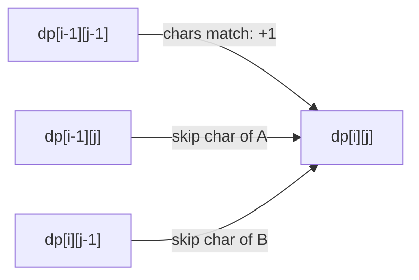

# String DP

> **Estimated Time:** 5 hr | **Difficulty:** Intermediate
> **Prerequisites:** [01 - DP Intuition](../01-dp-intuition/README.md), [04 - Subset and Subsequence DP](../04-subset-and-subsequence-dp/README.md), [05 - Knapsack](../05-knapsack/README.md)

---

## What You'll Learn

- You can define `dp[i][j]` as an answer about "the first `i` characters of A and the first `j` characters of B".
- You can write the match / mismatch transition for LCS and see how many other problems are the same table with a small twist.
- You can rebuild the actual string (not just its length) by walking the table backwards.
- You can handle pattern-matching DP: wildcard `?` `*` and regex `.` `*`.
- You can cut memory from O(n*m) to O(m) when only the previous row is needed.

## The Big Idea

Imagine you and a friend each have a long to-do list, and you want to know how much the two lists have in common, in order. You walk down both lists with two fingers. When the two items are the same, you tick it and move both fingers. When they differ, you must decide: skip an item on list A, or skip an item on list B. You do not know which skip is better, so you try both and keep the better one. That is a string DP.

The table: `dp[i][j]` answers the question for **the first `i` chars of A and the first `j` chars of B**. Row 0 and column 0 are the "empty string" cases, so there is no index-out-of-range trouble. Every cell depends on three neighbours only: up, left, and diagonal up-left.

```
          B -> ""  a  c  e
   A
   ""            0  0  0  0
   a             0  .  .  .
   b             0  .  .  .      cell (i,j) looks at:
   c             0  .  .  .        (i-1,j-1)  (i-1,j)
   ...                              (i,j-1)   (i,j)
```






Why interviewers love it: it tests whether you can define a state clearly, write the two cases (match, mismatch), set the base row and column, and then reconstruct an answer. Many problems below are LCS in disguise, so seeing the disguise is the real skill.

## How to Spot It

| If the problem says ... | think ... |
|---|---|
| "two strings" and "subsequence" | LCS table, `dp[i][j]` |
| "contiguous" / "substring" | same table, but mismatch resets to 0, track the max |
| "make A equal to B with insert / delete / replace" | edit distance |
| "make it a palindrome" | compare the string with its reverse (LCS) |
| "pattern with `?`, `*`, `.`" | pattern DP: `dp[i][j]` = first `i` of text matches first `j` of pattern |
| "count the ways" | same table, but add instead of max |
| "string made from two strings keeping order" | interleaving / supersequence |
| "split string into pieces, minimum pieces" | 1D DP over cut position, with a palindrome table |

## Core Concepts / Template

**Template (LCS).** Everything else is a variation.

```js
function lcs(a, b) {
  const n = a.length, m = b.length;
  // extra row and column for the empty string, filled with 0
  const dp = Array.from({ length: n + 1 }, () => new Array(m + 1).fill(0));
  for (let i = 1; i <= n; i++)
    for (let j = 1; j <= m; j++)
      dp[i][j] = a[i - 1] === b[j - 1]
        ? dp[i - 1][j - 1] + 1                    // match: take it, shrink both
        : Math.max(dp[i - 1][j], dp[i][j - 1]);   // mismatch: drop one char, keep the best
  return dp[n][m];
}
```

Note the off-by-one: `dp[i][j]` talks about `a[i-1]` and `b[j-1]`, because `dp` has one extra row and column.

**Trace for `a = "abcde"`, `b = "ace"`.**

```
        ""  a  c  e
   ""    0  0  0  0
   a     0  1  1  1
   b     0  1  1  1
   c     0  1  2  2
   d     0  1  2  2
   e     0  1  2  3     -> answer 3 ("ace")
```

Check a few cells: `(c,c)` match, so `dp = dp[b][a] + 1 = 1 + 1 = 2`. `(b,a)` mismatch, so `max(up=1, left=0) = 1`.

**Recipe for every problem in this chapter.**

1. Say what `dp[i][j]` means in one sentence.
2. Write the transition for "last chars equal" and "last chars differ".
3. Fill row 0 and column 0 (empty string cases).
4. Say which cell is the answer (usually `dp[n][m]`).
5. If only the last row is needed, roll the table to O(m) space. If you must rebuild the string, keep the full table.

**Memoisation vs tabulation.** Top-down recursion `f(i, j)` works too and is easier to think about. Bottom-up is faster in JS (no call stack, no recursion limit on strings of length 1000+). The chapter uses bottom-up.

## Problems (easy -> hard)

### 1. Longest Common Subsequence — Medium
**Companies:** Amazon, Google, Microsoft, Meta
**Problem:** Return the length of the longest subsequence present in both strings. A subsequence keeps order but may skip chars. `"abcde", "ace" -> 3`.
**Intuition:** Look at the last char of each string. If they are equal, they can both be the last char of the answer, so take 1 plus the answer for the shorter strings. If not, at least one of them is not used, so try dropping each and keep the better.
**Approach 1 - Brute force:** Try every subsequence of A and check if it is in B. Time O(2^n * m), Space O(n).
**Approach 2 - Better:** Recursion `f(i, j)` with memo. Time O(n*m), Space O(n*m) plus recursion stack.
**Approach 3 - Optimal:** Bottom-up table (see the trace in the template). Time O(n*m). Space can drop to O(m) with two rows if you do not need the string.

```js
function longestCommonSubsequence(a, b) {
  const n = a.length, m = b.length;
  let prev = new Array(m + 1).fill(0);
  for (let i = 1; i <= n; i++) {
    const cur = new Array(m + 1).fill(0);
    for (let j = 1; j <= m; j++)
      cur[j] = a[i - 1] === b[j - 1] ? prev[j - 1] + 1 : Math.max(prev[j], cur[j - 1]);
    prev = cur;
  }
  return prev[m];
}
```

**Complexity:** Time O(n*m), Space O(m).
**Watch out:** Subsequence is not substring. Do not forget the +1 uses the diagonal, not the up or left cell.

### 2. Print the Longest Common Subsequence — Medium
**Companies:** Amazon, Microsoft
**Problem:** Return one actual LCS string, not only its length. `"abcde", "ace" -> "ace"`.
**Intuition:** The table remembers how each cell was built. Start at the bottom-right corner and walk back. If the chars match, that char is in the answer, go diagonal. Otherwise move toward the neighbour with the bigger value.
**Approach 1 - Brute force:** Generate all subsequences, keep the longest common one. Exponential.
**Approach 3 - Optimal:** Build the full table, then backtrack, collect chars in reverse and flip at the end.

Trace on the table above, start at `(e,e)=3`: chars match, take `e`, go to `(d,c)=2`. `d != c`, up `(c,c)=2` >= left `(d,a)=1`, move up. `(c,c)` match, take `c`, go to `(b,a)=1`. Mismatch, up `(a,a)=1` >= left 0, move up. `(a,a)` match, take `a`. Collected `e, c, a`, reversed: `ace`.

```js
function printLCS(a, b) {
  const n = a.length, m = b.length;
  const dp = Array.from({ length: n + 1 }, () => new Array(m + 1).fill(0));
  for (let i = 1; i <= n; i++)
    for (let j = 1; j <= m; j++)
      dp[i][j] = a[i - 1] === b[j - 1]
        ? dp[i - 1][j - 1] + 1
        : Math.max(dp[i - 1][j], dp[i][j - 1]);
  const out = [];
  let i = n, j = m;
  while (i > 0 && j > 0) {
    if (a[i - 1] === b[j - 1]) { out.push(a[i - 1]); i--; j--; }
    else if (dp[i - 1][j] >= dp[i][j - 1]) i--;
    else j--;
  }
  return out.reverse().join('');
}
```

**Complexity:** Time O(n*m), Space O(n*m).
**Watch out:** You need the full table, so no rolling rows. If there are several valid LCS strings, any one is fine unless the problem says otherwise.

### 3. Longest Common Substring — Medium
**Companies:** Amazon, Microsoft
**Problem:** Longest run of characters that appears contiguously in both strings. `"abcdxyz", "xyzabcd" -> 4` (`"abcd"`).
**Intuition:** Same table as LCS, but a mismatch breaks the run, so the cell becomes 0. A cell means "longest common suffix ending at `a[i-1]` and `b[j-1]`". The answer is the maximum over all cells, not the corner.
**Approach 1 - Brute force:** For every start pair, extend while chars match. Time O(n*m*min(n,m)).
**Approach 3 - Optimal:** DP table with reset on mismatch. Only the previous row is needed.

```js
function longestCommonSubstring(a, b) {
  const n = a.length, m = b.length;
  let prev = new Array(m + 1).fill(0), best = 0;
  for (let i = 1; i <= n; i++) {
    const cur = new Array(m + 1).fill(0);
    for (let j = 1; j <= m; j++) {
      if (a[i - 1] === b[j - 1]) {
        cur[j] = prev[j - 1] + 1;
        best = Math.max(best, cur[j]);
      } // else stays 0: the run is broken
    }
    prev = cur;
  }
  return best;
}
```

**Complexity:** Time O(n*m), Space O(m).
**Watch out:** Returning `dp[n][m]` is the classic bug. The best run can end anywhere. (A suffix automaton or binary search plus hashing is faster but rarely asked.)

### 4. Longest Palindromic Subsequence — Medium
**Companies:** Amazon, Google, Microsoft
**Problem:** Length of the longest subsequence of `s` that reads the same both ways. `"bbbab" -> 4` (`"bbbb"`).
**Intuition:** A palindrome reads the same forwards and backwards. So a palindromic subsequence of `s` is a common subsequence of `s` and `reverse(s)`. Reuse LCS.
**Approach 1 - Brute force:** Try all subsequences. O(2^n * n).
**Approach 2 - Better:** Interval DP `dp[l][r]`: if `s[l]==s[r]` then `2 + dp[l+1][r-1]` else `max(dp[l+1][r], dp[l][r-1])`. Time O(n^2), Space O(n^2).
**Approach 3 - Optimal:** LCS of `s` and its reverse. Same O(n^2) time, but you already wrote the code, so there are fewer places for bugs.

```js
function longestPalindromeSubseq(s) {
  const t = [...s].reverse().join('');
  return longestCommonSubsequence(s, t); // from problem 1
}
```

**Complexity:** Time O(n^2), Space O(n).
**Watch out:** Palindromic substring (contiguous) is a different problem with expand-around-centre, not this table.

### 5. Minimum Insertion Steps to Make a String Palindrome — Hard
**Companies:** Amazon, Google
**Problem:** Fewest characters to insert anywhere to make `s` a palindrome. `"mbadm" -> 2` (`"mbdadbm"`).
**Intuition:** The chars that already form the longest palindromic subsequence can stay. Every other char needs a mirror twin inserted. So the answer is `n - LPS`.
**Approach 1 - Brute force:** Try all insert choices. Exponential.
**Approach 3 - Optimal:** `n - longestPalindromeSubseq(s)`. For `"mbadm"`: LPS is `"mam"` or `"mdm"`, length 3, so `5 - 3 = 2`.

```js
function minInsertions(s) {
  return s.length - longestPalindromeSubseq(s); // from problem 4
}
```

**Complexity:** Time O(n^2), Space O(n).
**Watch out:** Minimum deletions to make a palindrome is the same number. Do not mix it up with palindrome partitioning (problem 15).

### 6. Delete Operation for Two Strings — Medium
**Companies:** Amazon, Google
**Problem:** Minimum deletions (from either string) to make the two strings equal. `"sea", "eat" -> 2`.
**Intuition:** What is left must be a common subsequence. Keep the longest one, delete everything else from both.
**Approach 3 - Optimal:** `n + m - 2 * LCS`. For `"sea","eat"`: LCS `"ea"` = 2, so `3 + 3 - 4 = 2`.

```js
function minDistance(a, b) {
  return a.length + b.length - 2 * longestCommonSubsequence(a, b);
}
```

**Complexity:** Time O(n*m), Space O(m).
**Watch out:** Deletions happen in both strings. Only deleting from A is a different (smaller) problem, see problem 7.

### 7. Minimum Insertions and Deletions to Convert String A to B — Medium
**Companies:** Amazon, Microsoft
**Problem:** Convert A to B using only insert and delete. Return the counts. `"heap" -> "pea"`: 2 deletions, 1 insertion.
**Intuition:** Keep the LCS of A and B. Delete the rest of A (`n - lcs`). Insert the missing chars of B (`m - lcs`).
**Approach 3 - Optimal:** Compute LCS once. `"heap","pea"`: LCS `"ea"` = 2. Deletions `4 - 2 = 2` (h, p), insertions `3 - 2 = 1` (p).

```js
function minInsertDelete(a, b) {
  const l = longestCommonSubsequence(a, b);
  return { deletions: a.length - l, insertions: b.length - l };
}
```

**Complexity:** Time O(n*m), Space O(m).
**Watch out:** Total operations = `n + m - 2*lcs`, same formula as problem 6. Problem 6 is just "delete only, from both sides".

### 8. Longest Repeating Subsequence — Medium
**Companies:** Amazon, Microsoft
**Problem:** Longest subsequence that appears twice in `s` using different index positions for each copy. `"axxxy" -> 2` (`"xx"`).
**Intuition:** LCS of `s` with itself, with one rule: a char at index `i` may not pair with itself at index `j == i`. That rule is the only change.
**Approach 3 - Optimal:** In the match case, also require `i !== j`.

```js
function longestRepeatingSubsequence(s) {
  const n = s.length;
  const dp = Array.from({ length: n + 1 }, () => new Array(n + 1).fill(0));
  for (let i = 1; i <= n; i++)
    for (let j = 1; j <= n; j++)
      dp[i][j] = s[i - 1] === s[j - 1] && i !== j
        ? dp[i - 1][j - 1] + 1
        : Math.max(dp[i - 1][j], dp[i][j - 1]);
  return dp[n][n];
}
```

**Complexity:** Time O(n^2), Space O(n^2).
**Watch out:** Using `s[i] === s[j]` alone gives the whole string (LCS of a string with itself). Index check is the point. `"abc" -> 0`.

### 9. Shortest Common Supersequence (with the string) — Hard
**Companies:** Google, Amazon, Microsoft
**Problem:** Shortest string that has both A and B as subsequences. `"abac", "cab" -> "cabac"` (length 5).
**Intuition:** Overlapping chars can be written once. The most we can share is the LCS. So the length is `n + m - lcs`. To build the string, walk back through the LCS table: on a match write the char once; otherwise write the char from the side you step away from.
**Approach 1 - Brute force:** Try all merges. Exponential.
**Approach 3 - Optimal:** LCS table, then backtrack. When one string runs out, copy the rest of the other.

Tiny trace on `"abac"`, `"cab"` (LCS length 2, `"ab"`): the answer length is `4 + 3 - 2 = 5`. Any valid 5-char answer is accepted, such as `"cabac"`.

```js
function shortestCommonSupersequence(a, b) {
  const n = a.length, m = b.length;
  const dp = Array.from({ length: n + 1 }, () => new Array(m + 1).fill(0));
  for (let i = 1; i <= n; i++)
    for (let j = 1; j <= m; j++)
      dp[i][j] = a[i - 1] === b[j - 1]
        ? dp[i - 1][j - 1] + 1
        : Math.max(dp[i - 1][j], dp[i][j - 1]);
  const out = [];
  let i = n, j = m;
  while (i > 0 && j > 0) {
    if (a[i - 1] === b[j - 1]) { out.push(a[i - 1]); i--; j--; }
    else if (dp[i - 1][j] >= dp[i][j - 1]) out.push(a[--i]); // leave a char of A
    else out.push(b[--j]);                                    // leave a char of B
  }
  while (i > 0) out.push(a[--i]);
  while (j > 0) out.push(b[--j]);
  return out.reverse().join('');
}
```

**Complexity:** Time O(n*m), Space O(n*m).
**Watch out:** Do not forget the two leftover `while` loops. Many valid answers exist; LeetCode accepts any shortest one.

### 10. Distinct Subsequences — Hard
**Companies:** Amazon, Google, Meta
**Problem:** Count how many different index choices in `s` spell out `t`. `"rabbbit", "rabbit" -> 3`.
**Intuition:** `dp[i][j]` = ways to form the first `j` chars of `t` from the first `i` chars of `s`. If `s[i-1] == t[j-1]`, we can use this char (`dp[i-1][j-1]`) or skip it (`dp[i-1][j]`). Otherwise we must skip it. The empty `t` can always be formed in exactly 1 way, so `dp[i][0] = 1`.
**Approach 1 - Brute force:** Recursion on all choices, exponential.
**Approach 2 - Better:** Full 2D table, O(n*m) space.
**Approach 3 - Optimal:** One row, filled right to left so `dp[j-1]` is still the previous row's value.

Trace for `s = "aab"`, `t = "ab"`, row = `[dp0, dp1, dp2]`:

| after char | row |
|---|---|
| start | `[1,0,0]` |
| `a` | `[1,1,0]` |
| `a` | `[1,2,0]` |
| `b` | `[1,2,2]` -> answer 2 |

```js
function numDistinct(s, t) {
  const m = t.length;
  const dp = new Array(m + 1).fill(0);
  dp[0] = 1;
  for (let i = 1; i <= s.length; i++)
    for (let j = m; j >= 1; j--) // right to left: do not reuse this char twice
      if (s[i - 1] === t[j - 1]) dp[j] += dp[j - 1];
  return dp[m];
}
```

**Complexity:** Time O(n*m), Space O(m).
**Watch out:** Left-to-right in 1D uses the same `s` char twice. Counts can get big; LeetCode guarantees they fit in 32-bit, but in a custom version you may need BigInt or a modulo.

### 11. Edit Distance — Medium
**Companies:** Amazon, Google, Microsoft, Meta
**Problem:** Fewest operations (insert, delete, replace one char) to turn `word1` into `word2`. `"horse" -> "ros"` is 3.
**Intuition:** `dp[i][j]` = cost to turn the first `i` chars of A into the first `j` chars of B. If last chars are equal, no cost: `dp[i-1][j-1]`. Otherwise pick the cheapest of three moves, each costing 1:
- replace: `dp[i-1][j-1]`
- delete from A: `dp[i-1][j]`
- insert into A: `dp[i][j-1]`

Base: turning `i` chars into nothing costs `i` deletes, and nothing into `j` chars costs `j` inserts.
**Approach 1 - Brute force:** Recursion, three branches per step. Exponential.
**Approach 2 - Better:** Memoised recursion O(n*m).
**Approach 3 - Optimal:** Table.

```
        ""  r  o  s
   ""    0  1  2  3
   h     1  1  2  3
   o     2  2  1  2
   r     3  2  2  2
   s     4  3  3  2
   e     5  4  4  3     -> 3
```

```js
function minDistanceEdit(a, b) {
  const n = a.length, m = b.length;
  const dp = Array.from({ length: n + 1 }, () => new Array(m + 1).fill(0));
  for (let i = 0; i <= n; i++) dp[i][0] = i;
  for (let j = 0; j <= m; j++) dp[0][j] = j;
  for (let i = 1; i <= n; i++)
    for (let j = 1; j <= m; j++)
      dp[i][j] = a[i - 1] === b[j - 1]
        ? dp[i - 1][j - 1]
        : 1 + Math.min(dp[i - 1][j - 1], dp[i - 1][j], dp[i][j - 1]);
  return dp[n][m];
}
```

**Complexity:** Time O(n*m), Space O(n*m) (O(min(n,m)) with rolling rows).
**Watch out:** Forgetting to fill row 0 and column 0 with `j` and `i`. Mixing up which neighbour is "insert" and which is "delete" does not change the answer (the table is symmetric), but be able to explain it.

### 12. Interleaving String — Medium
**Companies:** Amazon, Google, Microsoft
**Problem:** Is `s3` made by weaving `s1` and `s2` together, keeping each one's order? `"aabcc", "dbbca", "aadbbcbcac" -> true`.
**Intuition:** `dp[i][j]` = can the first `i` chars of `s1` and first `j` of `s2` build the first `i+j` chars of `s3`? The last char of that prefix of `s3` must come from `s1` or from `s2`. Check both.
**Approach 1 - Brute force:** Recursion, two branches per char. O(2^(n+m)).
**Approach 3 - Optimal:** Table. First check `n + m === s3.length`, otherwise it is false at once.

```js
function isInterleave(s1, s2, s3) {
  const n = s1.length, m = s2.length;
  if (n + m !== s3.length) return false;
  const dp = Array.from({ length: n + 1 }, () => new Array(m + 1).fill(false));
  dp[0][0] = true;
  for (let i = 0; i <= n; i++)
    for (let j = 0; j <= m; j++) {
      if (i > 0 && s1[i - 1] === s3[i + j - 1] && dp[i - 1][j]) dp[i][j] = true;
      if (j > 0 && s2[j - 1] === s3[i + j - 1] && dp[i][j - 1]) dp[i][j] = true;
    }
  return dp[n][m];
}
```

**Complexity:** Time O(n*m), Space O(n*m) (O(m) with a rolling row).
**Watch out:** Greedy fails when both `s1` and `s2` could supply the next char. That is why you need the table.

### 13. Wildcard Matching — Hard
**Companies:** Google, Amazon, Meta
**Problem:** Does pattern `p` match the whole string `s`? `?` matches any one char, `*` matches any sequence (including empty). `"adceb", "*a*b" -> true`.
**Intuition:** `dp[i][j]` = first `i` chars of `s` match first `j` chars of `p`.
- `p[j-1]` is a letter or `?`: needs a char match, then `dp[i-1][j-1]`.
- `p[j-1]` is `*`: it matches empty (`dp[i][j-1]`) or eats one more char of `s` and stays alive (`dp[i-1][j]`).

Base: `dp[0][0]` = true. `dp[0][j]` is true only if the pattern so far is all `*`.
**Approach 1 - Brute force:** Backtracking on every `*`. Exponential on bad inputs.
**Approach 2 - Better:** Two-pointer greedy with a saved star position. O(n*m) worst case, O(1) space, but it is trickier to get right.
**Approach 3 - Optimal (safe):** Table.

```js
function isMatchWildcard(s, p) {
  const n = s.length, m = p.length;
  const dp = Array.from({ length: n + 1 }, () => new Array(m + 1).fill(false));
  dp[0][0] = true;
  for (let j = 1; j <= m; j++) dp[0][j] = p[j - 1] === '*' && dp[0][j - 1];
  for (let i = 1; i <= n; i++)
    for (let j = 1; j <= m; j++) {
      if (p[j - 1] === '*') dp[i][j] = dp[i][j - 1] || dp[i - 1][j];
      else if (p[j - 1] === '?' || p[j - 1] === s[i - 1]) dp[i][j] = dp[i - 1][j - 1];
    }
  return dp[n][m];
}
```

**Complexity:** Time O(n*m), Space O(n*m).
**Watch out:** `"" vs "***"` is true. A `*` in the pattern is a standalone token here; do not confuse it with the regex `*` (next problem).

### 14. Regular Expression Matching — Hard
**Companies:** Google, Amazon, Meta, Microsoft
**Problem:** Match the whole string `s` against `p`, where `.` matches any one char and `x*` means zero or more copies of `x`. `"aab", "c*a*b" -> true`.
**Intuition:** Here `*` does not stand alone. It changes the char before it. So when `p[j-1]` is `*`, look at `p[j-2]`:
- zero copies: skip the pair, `dp[i][j-2]`
- one more copy: only if `p[j-2]` is `.` or equals `s[i-1]`, then `dp[i-1][j]` (we stay on the same `x*`, so it may eat more)

Otherwise a normal char match uses `dp[i-1][j-1]`. Base: `dp[0][j]` for patterns like `a*b*` that can match empty: `dp[0][j] = p[j-1]=='*' && dp[0][j-2]`.
**Approach 1 - Brute force:** Recursion, exponential without memo.
**Approach 3 - Optimal:** Table.

```js
function isMatchRegex(s, p) {
  const n = s.length, m = p.length;
  const dp = Array.from({ length: n + 1 }, () => new Array(m + 1).fill(false));
  dp[0][0] = true;
  for (let j = 2; j <= m; j++) dp[0][j] = p[j - 1] === '*' && dp[0][j - 2];
  for (let i = 1; i <= n; i++)
    for (let j = 1; j <= m; j++) {
      if (p[j - 1] === '*') {
        dp[i][j] = dp[i][j - 2];                       // zero copies
        const prev = p[j - 2];
        if (prev === '.' || prev === s[i - 1]) dp[i][j] = dp[i][j] || dp[i - 1][j]; // one more
      } else if (p[j - 1] === '.' || p[j - 1] === s[i - 1]) {
        dp[i][j] = dp[i - 1][j - 1];
      }
    }
  return dp[n][m];
}
```

**Complexity:** Time O(n*m), Space O(n*m).
**Watch out:** `"mississippi", "mis*is*p*."` is false. The input is guaranteed to have a valid char before every `*`, so `p[j-2]` always exists when `p[j-1] === '*'`.

### 15. Palindrome Partitioning II — Hard
**Companies:** Amazon, Google, Microsoft
**Problem:** Fewest cuts to split `s` so that every piece is a palindrome. `"aab" -> 1` (`"aa" | "b"`).
**Intuition:** This one is a 1D DP on cut positions with a helper 2D table. `cut[end]` = fewest cuts for `s[0..end]`. If `s[start..end]` is a palindrome, then one option is `cut[start-1] + 1` (or 0 if `start == 0`, the whole prefix is already a palindrome). Palindrome check is O(1) from a table: `s[start..end]` is a palindrome if the ends match and the inside is a palindrome.
**Approach 1 - Brute force:** Try every split, check each piece. Exponential.
**Approach 2 - Better:** Memoised recursion that checks palindromes in O(n) each. O(n^3).
**Approach 3 - Optimal:** Palindrome table and cut array together, O(n^2).

```js
function minCut(s) {
  const n = s.length;
  const pal = Array.from({ length: n }, () => new Array(n).fill(false));
  const cut = new Array(n).fill(0);
  for (let end = 0; end < n; end++) {
    cut[end] = end; // worst case: a cut between every char
    for (let start = 0; start <= end; start++) {
      if (s[start] === s[end] && (end - start < 2 || pal[start + 1][end - 1])) {
        pal[start][end] = true; // inside (start+1..end-1) was filled on an earlier "end"
        cut[end] = start === 0 ? 0 : Math.min(cut[end], cut[start - 1] + 1);
      }
    }
  }
  return n ? cut[n - 1] : 0;
}
```

**Complexity:** Time O(n^2), Space O(n^2).
**Watch out:** `pal[start+1][end-1]` is ready because `end-1 < end`. Note this is cuts, not pieces (pieces = cuts + 1). `"a" -> 0`.

## Common Mistakes

- **"`dp[i][j]` uses `a[i]` and `b[j]`."** With an extra empty row and column, it uses `a[i-1]` and `b[j-1]`. Mixing the two gives off-by-one answers.
- **"LCS and longest common substring are the same table."** Close, but substring resets to 0 on mismatch and takes the max over all cells.
- **"I can roll the table and still print the string."** No. To backtrack you need the full table (or Hirschberg's trick, which is rarely asked).
- **"Base cases are all zeros."** Not for edit distance (`i` and `j`), distinct subsequences (`dp[i][0] = 1`), or pattern matching (`dp[0][0] = true`).
- **"`*` means the same in wildcard and regex."** In wildcard it is a free token. In regex it repeats the previous char. The transitions are different.
- **"1D rolling is always left to right."** For distinct subsequences you must go right to left, or one char is used twice.

## Interview Tips

- Say the state out loud first: "`dp[i][j]` is the answer for the first `i` chars of A and first `j` of B." Then base cases, then transition. This order wins most of the marks.
- Start with the recursive idea (compare last chars, two branches), then say "these subproblems repeat, so I will tabulate."
- Mention the reductions: LPS = LCS with reverse, min insertions = `n - LPS`, SCS length = `n + m - LCS`, delete-two-strings = `n + m - 2*LCS`. It shows you see the pattern.
- Space follow-up: "only the previous row is read, so I can keep two rows." Mention you cannot do that if you must print the string.
- Edge cases: empty strings, one string a subsequence of the other, all chars equal, no common char, pattern of only `*`.
- Follow-ups you may get: print the answer, count the answers, return the edit operations, handle unicode (JS strings are UTF-16, so emoji count as two units; spread `[...s]` if the problem needs code points).

## Practice List

**Easy**
- Is Subsequence
- Longest Common Prefix
- Valid Palindrome
- Longest Palindrome (count of letters)

**Medium**
- Longest Palindromic Substring
- Palindromic Substrings
- Minimum ASCII Delete Sum for Two Strings
- Maximum Length of Repeated Subarray
- Uncrossed Lines
- One Edit Distance
- Count Different Palindromic Subsequences
- Longest Palindromic Subsequence II
- Word Break

**Hard**
- Minimum Window Subsequence
- Shortest Common Supersequence
- Scramble String
- Distinct Subsequences II
- Palindrome Partitioning III

## Key Takeaways

- **`dp[i][j]` is about two prefixes**, and each cell reads only up, left and diagonal.
- **Match case moves diagonally** (consume both chars); mismatch case drops one char from either side.
- **Many problems are LCS in disguise:** palindromic subsequence, min insertions, supersequence length, delete operations.
- **Read the base row and column carefully**; they differ per problem (0, `i`/`j`, 1, or true).
- **Print the answer by walking back** from `dp[n][m]`; this needs the full table.
- **Roll to one or two rows** when only the length or count is needed, and mind the loop direction.
- **Wildcard `*` is free; regex `*` binds to the previous char.** Do not mix them.

---

[← Previous: Knapsack](../05-knapsack/README.md) | [Next: Stocks →](../07-stocks/README.md) | [Back to Dynamic Programming Index](../README.md)
