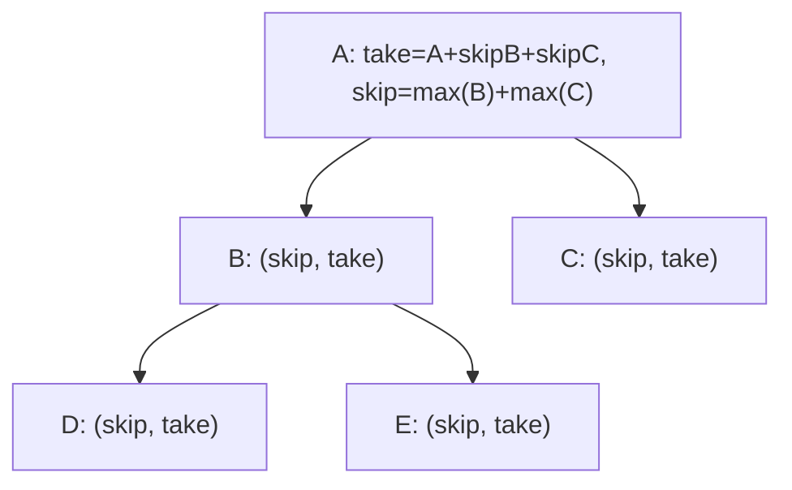

# Tree DP and Digit DP

> **Estimated Time:** 5 hr | **Difficulty:** Advanced
> **Prerequisites:** [01 - DP Intuition](../01-dp-intuition/README.md), [03 - Paths, LCA and Tree Properties](../../03-trees/03-paths-lca-and-tree-properties/README.md), [10 - Bitmask DP](../10-bitmask-dp/README.md)

---

## What You'll Learn
- You can solve a tree problem by returning a small tuple of states from each node (post-order DP).
- You can explain and write the two-pass "rerooting" trick that finds an answer for every node as root.
- You can count numbers up to N with a rule on their digits, using the state (position, tight, started, extra).
- You can pick between a digit-DP search and a closed-form count for a given problem.
- You can solve the basic "stone game" family with the "score difference" DP.

## The Big Idea

**Analogy (tree DP).** A company has a boss, managers and workers. The CEO wants a company-wide answer, for example "the best team to send to a party where no one can sit next to their own boss". The CEO does not look at every person. Each manager reports two numbers upward: "best if I go" and "best if I stay home". The CEO only combines the reports of the direct reports. Each person is visited once.

**Analogy (digit DP).** An odometer counts 0000 to 9999. You want to know how many readings up to 3472 contain no repeated digit. You do not roll the odometer one tick at a time. You fix the first wheel, then the second, and so on. As long as every wheel so far matches 3472, the next wheel cannot go above its digit in 3472. The moment one wheel is lower, the remaining wheels are free. That "still matching or not" flag is called **tight**.

**Tree DP.** A tree has no cycles, so the subproblems are the subtrees. Solve the children first (post-order), then combine them for the parent. The state is "what the parent needs to know about this subtree", often a pair or a triple. There are n nodes, so the cost is usually O(n).

**Digit DP.** Counting numbers in `[0, N]` with a digit rule would take O(N) by brute force and N can be 10^9 or more. Digits give a tiny "tree" of choices: at most about 10 positions with 10 options each. We memoize on a small state, so the work is `positions * states * 10`.

**Why interviewers love it.** Both topics test whether you can define the state precisely. For trees: "what does a node tell its parent?". For digits: "what do I need to remember about the prefix?". Candidates who just recurse without a state blow up to exponential time. Rerooting and digit DP are also the usual "this is the hard one" questions in a DP round.






## How to Spot It

| If the problem says ... | think ... |
|---|---|
| "binary tree, choose nodes so no two adjacent / parent-child" | tree DP with (take, skip) per node |
| "minimum cameras / guards / cover on a tree" | tree DP with 3 states (covered, not covered, has camera) or a greedy post-order |
| "longest path that turns left/right alternately" | return the best length per direction from each node |
| "for every node as root, compute sum of distances" | rerooting: one pass up, one pass down |
| "count integers in [1, N] with no repeated digit / no `11` in binary / only digits from a set" | digit DP, or a direct count by prefix |
| "count numbers up to N where a digit property holds" with N up to 10^9 or 10^18 | digit DP with (pos, tight, started, state) |
| "total number of times digit d appears from 1 to N" | count per position (high, current, low) |
| "two players pick optimally, who wins / what is the score gap" | interval or suffix DP on "my score minus yours" (see [Game Theory](../../06-advanced/07-game-theory-and-puzzles/README.md)) |

## Core Concepts / Template

### Template 1: Tree DP (post-order)

1. Decide what a node returns to its parent. Keep it as small as possible.
2. Base case: a null child returns the "neutral" value (for example `[0, 0]`).
3. Combine the children's results to make the node's result.
4. If the answer can be a path that bends at a node (and cannot be extended up), update a global `best` there.

```js
function treeDP(root) {
  let best = 0;                         // used when answer is "best bending path"
  function dfs(node) {
    if (!node) return /* neutral value */ [0, 0];
    const L = dfs(node.left);
    const R = dfs(node.right);
    // combine L and R into this node's state
    // best = Math.max(best, <answer that bends here>);
    return /* state for parent */ [0, 0];
  }
  const rootState = dfs(root);
  return /* from rootState or best */ best;
}
```

For a deep tree (100k nodes in a chain), recursion can overflow the call stack in JavaScript. Interview trees are usually small. Say it out loud, and know that you can do an iterative version (see problem 6).

### Template 2: Rerooting (intro)

Problem: "answer for **every** node as the root". Running tree DP from each node costs O(n^2). Rerooting does it in O(n):

1. **Pass 1 (up):** root the tree anywhere (node 0). Compute for each node the answer *inside its own subtree*.
2. **Pass 2 (down):** the answer for a child is the answer for its parent, adjusted by "remove the child's subtree's contribution, add the rest of the tree's contribution".

The skill is writing the adjustment formula. Problem 6 does it for distances.

### Template 3: Digit DP

Turn N into a string `s` of digits. Walk positions left to right. The state is:

| State | Meaning |
|---|---|
| `i` | which position we are filling |
| `tight` | all digits so far equal N's prefix, so the next digit is capped at `s[i]` |
| `started` | we already placed a non-zero digit (matters for leading zeros: `007` is the number `7`, not a 3-digit number) |
| extra | whatever the rule needs: a bitmask of used digits, previous digit, a "has changed" flag, a sum |

```js
function digitDP(n) {
  const s = String(n), L = s.length;
  const memo = new Map();
  function go(i, tight, started, extra) {
    if (i === L) return /* 1 if the built number is valid, else 0 */ 1;
    const key = `${i},${tight},${started},${extra}`;
    if (memo.has(key)) return memo.get(key);
    let res = 0;
    const hi = tight ? +s[i] : 9;
    for (let d = 0; d <= hi; d++) {
      // skip digits the rule forbids, then:
      res += go(i + 1, tight && d === hi, started || d > 0, /* new extra */ extra);
    }
    memo.set(key, res);
    return res;
  }
  return go(0, true, false, 0);
}
```

**Trace.** N = 135, count numbers with all-different digits. Positions 0..2, `s = "135"`.

```
pos0: choose 0 (not started: numbers with fewer digits)  -> free below
      choose 1 (tight, equals s[0])                      -> go on tight
pos1 (prefix "1", tight): choose 0..3
      0,2 -> not tight any more, 8 digits left to choose for the last place
      3   -> still tight, last digit <= 5, not 1 and not 3
pos2: ...
```

`started` is needed because "no repeated digit" must ignore leading zeros: in `005`, the two leading zeros are not digits of the number.

**Two ways to count.** You can use the memo DP above (flexible, works for any rule) or a direct count (faster, rule-specific). The direct way is "for each position, for each smaller digit, add the number of free completions". Problems 8, 9 and 12 use that idea.

## Problems (easy -> hard)

### 1. House Robber III — Medium
**Companies:** Amazon, Google, Microsoft, Facebook
**Problem:** Houses form a binary tree. If you rob a house, you cannot rob its parent or children. Maximize the loot. Example: `[3,2,3,null,3,null,1]` -> 7 (rob 3 + 3 + 1).
**Intuition:** For each house, only two facts matter to its parent: "best loot if I am robbed" and "best loot if I am skipped". If I am robbed, my children must be skipped. If I am skipped, each child is free to choose its better option.
**Approach 1 - Brute force:** Recursion: `rob(node) = max(node.val + rob(grandchildren), rob(left) + rob(right))`. Grandchildren are recomputed again and again. Time O(2^n) in the worst case, Space O(h).
**Approach 2 - Better:** The same recursion with a hash map from node to answer. Time O(n), Space O(n).
**Approach 3 - Optimal:** Return `[skip, take]` from each node. Dry run on `[3,2,3,null,3,null,1]` (root 3; left child 2 has a right leaf 3; right child 3 has a right leaf 1). Pairs are (skip, take):

| node | children (skip,take) | take | skip |
|---|---|---|---|
| leaf 3 (under 2) | (0,0),(0,0) | 3 | 0 |
| leaf 1 (under 3) | (0,0),(0,0) | 1 | 0 |
| node 2 | left (0,0), right (0,3) | 2+0+0 = 2 | 0 + 3 = 3 |
| node 3 (right) | left (0,0), right (0,1) | 3+0+0 = 3 | 0 + 1 = 1 |
| root 3 | left (3,2), right (1,3) | 3+3+1 = 7 | 3 + 3 = 6 |

Answer = max(6, 7) = 7.

```js
function rob(root) {
  function dfs(node) {
    if (!node) return [0, 0];            // [skip, take]
    const [ls, lt] = dfs(node.left);
    const [rs, rt] = dfs(node.right);
    const take = node.val + ls + rs;     // children must be skipped
    const skip = Math.max(ls, lt) + Math.max(rs, rt);
    return [skip, take];
  }
  return Math.max(...dfs(root));
}
```

**Complexity:** Time O(n), Space O(h) for the call stack.
**Watch out:** "skip" does not mean "children must be taken". A skipped node lets each child pick its own best. Forgetting this under-counts, for example when a grandchild is much richer than a child.

### 2. Longest ZigZag Path in a Binary Tree — Medium
**Companies:** Amazon, Google, Microsoft
**Problem:** A zigzag path goes left, right, left, ... (or right, left, ...) starting anywhere. Return the longest one, counted in edges. A single node has length 0.
**Intuition:** At each node ask two questions: "longest zigzag that starts here going left" and "going right". Going left means: step to the left child, then the next step must go right from there. So `goLeft(node) = 1 + goRight(node.left)` and `goRight(node) = 1 + goLeft(node.right)`. A missing child gives -1, so the `+1` makes it 0.
**Approach 1 - Brute force:** From every node, try both starting directions and walk. Time O(n^2) on a skewed tree, Space O(h).
**Approach 2 - Better:** Pass `(node, direction, length)` down in one DFS and restart the length at 1 when you go in the same direction twice. Time O(n), Space O(h).
**Approach 3 - Optimal:** Bottom-up version returns `[goLeft, goRight]`, and a global tracks the max. Dry run on a chain top -> (right) middle -> (left) leaf, which is zigzag of length 2:

| node | goLeft = 1 + (left child).goRight | goRight = 1 + (right child).goLeft |
|---|---|---|
| deepest (leaf) | 1 + (-1) = 0 | 1 + (-1) = 0 |
| middle (its left child is the leaf) | 1 + leaf.goRight = 1 | 0 |
| top (its right child is the middle) | 0 | 1 + middle.goLeft = 2 |

```js
function longestZigZag(root) {
  let best = 0;
  function dfs(node) {                   // returns [startLeft, startRight] in edges
    if (!node) return [-1, -1];
    const l = dfs(node.left), r = dfs(node.right);
    const goLeft = l[1] + 1;             // after going left, we must go right
    const goRight = r[0] + 1;
    best = Math.max(best, goLeft, goRight);
    return [goLeft, goRight];
  }
  dfs(root);
  return best;
}
```

**Complexity:** Time O(n), Space O(h).
**Watch out:** Count edges, not nodes. A one-node tree returns 0. Use -1 for a missing child so the formula stays uniform.

### 3. Count Numbers with Unique Digits — Medium
**Companies:** Google, Amazon
**Problem:** Count integers `x` with `0 <= x < 10^n` that have no repeated digit. Example: n = 2 -> 91 (all 100 numbers except 11, 22, ..., 99).
**Intuition:** Count by length. A k-digit number (k >= 2): the first digit has 9 choices (not 0), the second has 9 (0 is allowed now, but the first digit is used), the third has 8, and so on. Add one for the number 0.
**Approach 1 - Brute force:** Check every number below 10^n. Time O(n * 10^n), Space O(1). Fine for n <= 7 only.
**Approach 2 - Optimal:** The product above. Numbers longer than 10 digits must repeat a digit, so cap at 10.

| length | count |
|---|---|
| 1 | 9 (1..9) (plus 0 counted once at the start) |
| 2 | 9 * 9 = 81 |
| 3 | 9 * 9 * 8 = 648 |

Total for n = 3: 1 + 9 + 81 + 648 = 739.

```js
function countNumbersWithUniqueDigits(n) {
  let total = 1, cur = 9, avail = 9;     // total starts with the number 0
  for (let i = 1; i <= n && i <= 10; i++) {
    total += cur;                        // numbers of exactly i digits
    cur *= avail;                        // next length: one more free slot
    avail--;
  }
  return total;
}
```

**Complexity:** Time O(min(n, 10)), Space O(1).
**Watch out:** Do not count 0 twice, and stop at length 10. For n = 0 the answer is 1.

### 4. Rotated Digits — Medium
**Companies:** Google, Amazon
**Problem:** Rotate each digit by 180 degrees. 0, 1, 8 stay the same; 2 <-> 5 and 6 <-> 9 swap; 3, 4, 7 are invalid. A number is "good" if it is valid and the rotated number is different. Count good numbers in `[1, N]`. Example: N = 10 -> 4 (2, 5, 6, 9).
**Intuition:** A number is good if it has no 3, 4, 7 and at least one of 2, 5, 6, 9. That is a clean digit DP: the extra state is one bit, "have I used a changing digit yet?".
**Approach 1 - Brute force:** Test each number. Time O(N log N), Space O(1). For N <= 10^4 this is what the problem intends and it is fine.
**Approach 2 - Optimal:** Digit DP over `(i, tight, changed)`. Leading zeros do not matter here because 0 is a legal unchanged digit, so no `started` flag is needed. The number 0 itself is not counted because `changed` stays false.

Dry run, N = 10, `s = "10"`:

| prefix | tight | allowed next digits | contribution |
|---|---|---|---|
| "0" | no | 0..9 minus {3,4,7} | 2,5,6,9 give changed = 4 numbers |
| "1" | yes | 0 only (cap is 0) | "10" has no changing digit = 0 |

Total 4.

```js
function rotatedDigits(n) {
  const s = String(n), L = s.length;
  const memo = new Map();
  function go(i, tight, changed) {
    if (i === L) return changed ? 1 : 0;
    const key = i * 4 + (tight ? 2 : 0) + (changed ? 1 : 0);
    if (memo.has(key)) return memo.get(key);
    let res = 0;
    const hi = tight ? +s[i] : 9;
    for (let d = 0; d <= hi; d++) {
      if (d === 3 || d === 4 || d === 7) continue;       // invalid when rotated
      const ch = changed || d === 2 || d === 5 || d === 6 || d === 9;
      res += go(i + 1, tight && d === hi, ch);
    }
    memo.set(key, res);
    return res;
  }
  return go(0, true, false);
}
```

**Complexity:** Time O(L * 10 * 4) where L = number of digits, Space O(L * 4).
**Watch out:** Numbers made only of 0, 1, 8 are valid but NOT good, because they rotate to themselves.

### 5. Stone Game — Medium
**Companies:** Google, Amazon
**Problem:** An even number of piles in a row. Alice and Bob alternate, each takes a whole pile from the left or right end. Alice goes first. Both play optimally. Does Alice win? Example: `[5,3,4,5]` -> true.
**Intuition:** Define `dp[i][j]` as "current player's score minus the opponent's score on piles i..j". Taking pile i gives `piles[i] - dp[i+1][j]`: what I gain, minus the best lead my opponent then gets. This "difference" trick is the base of all stone game problems, and it is why game DPs use `max` for both players.
**Approach 1 - Brute force:** Try all moves recursively. Time O(2^n), Space O(n).
**Approach 2 - Better:** Memoize `(i, j)`. Time O(n^2), Space O(n^2). Compress to 1D: Space O(n).
**Approach 3 - Optimal (O(1)):** With an even count of piles, Alice can always take all odd-index piles or all even-index piles, and she can pick the larger group. So the answer is always `true`. Interviewers like it if you know it, but they will still ask for the DP.

Dry run on `[5,3,4,5]` (diff for current player):

| interval | diff |
|---|---|
| [5] [3] [4] [5] | 5, 3, 4, 5 |
| [5,3] | max(5-3, 3-5) = 2 |
| [3,4] | 1 |
| [4,5] | 1 |
| [5,3,4] | max(5 - diff[3,4], 4 - diff[5,3]) = max(4, 2) = 4 |
| [3,4,5] | max(3 - 1, 5 - 1) = 4 |
| [5,3,4,5] | max(5 - 4, 5 - 4) = 1 |

Diff 1 > 0, so Alice wins.

```js
function stoneGame(piles) {
  const n = piles.length, dp = piles.slice();   // dp[i] = diff for window starting at i
  for (let len = 2; len <= n; len++)
    for (let i = 0; i + len - 1 < n; i++) {
      const j = i + len - 1;
      // dp[i+1] is the window [i+1..j]; dp[i] is still the window [i..j-1]
      dp[i] = Math.max(piles[i] - dp[i + 1], piles[j] - dp[i]);
    }
  return dp[0] > 0;
}
```

**Complexity:** Time O(n^2), Space O(n).
**Watch out:** The 1D version overwrites `dp[i]` in increasing `i` order. That is correct only because `dp[i+1]` has not yet been updated for the new length. Do not reverse the loop.

### 6. Sum of Distances in Tree — Hard
**Companies:** Google, Amazon, Facebook
**Problem:** An undirected tree with n nodes (0..n-1) and n-1 edges. For each node i, return the sum of distances from i to all other nodes. Example: n = 6, edges `[[0,1],[0,2],[2,3],[2,4],[2,5]]` -> `[8,12,6,10,10,10]`.
**Intuition:** Moving the root from a parent `p` to its child `c`: every node inside c's subtree gets 1 closer, and every node outside gets 1 farther. So `ans[c] = ans[p] - size[c] + (n - size[c])`. We need subtree sizes and `ans[root]` first. This is rerooting.
**Approach 1 - Brute force:** BFS from every node. Time O(n^2), Space O(n). Too slow for n = 3 * 10^4.
**Approach 2 - Optimal:** Two passes.
- Pass 1 (children before parents): `cnt[u]` = subtree size, `ans[u]` = sum of distances to nodes in u's subtree. For child c of p: `cnt[p] += cnt[c]`, `ans[p] += ans[c] + cnt[c]` (each of the `cnt[c]` nodes is 1 farther from p).
- Pass 2 (parents before children): after pass 1, `ans[0]` is final. For each child c: `ans[c] = ans[p] - cnt[c] + (n - cnt[c])`.

Dry run on the example (root 0, children 1 and 2; node 2 has children 3, 4, 5):

| node | cnt | ans after pass 1 |
|---|---|---|
| 3, 4, 5, 1 | 1 | 0 |
| 2 | 4 | 3 * (0 + 1) = 3 |
| 0 | 6 | (0+1) + (3+4) = 8 |

Pass 2: `ans[1] = 8 - 1 + 5 = 12`, `ans[2] = 8 - 4 + 2 = 6`, `ans[3] = 6 - 1 + 5 = 10`, same for 4 and 5.

I use an iterative order (no recursion) so deep trees do not overflow the stack.

```js
function sumOfDistancesInTree(n, edges) {
  const g = Array.from({ length: n }, () => []);
  for (const [a, b] of edges) { g[a].push(b); g[b].push(a); }
  const cnt = new Array(n).fill(1), ans = new Array(n).fill(0);
  const order = [], parent = new Array(n).fill(-1);
  const st = [0]; parent[0] = -2;                // -2 marks the root
  while (st.length) {
    const u = st.pop(); order.push(u);           // parents appear before children
    for (const v of g[u]) if (parent[v] === -1) { parent[v] = u; st.push(v); }
  }
  for (let i = n - 1; i > 0; i--) {              // pass 1: children first
    const u = order[i], p = parent[u];
    cnt[p] += cnt[u]; ans[p] += ans[u] + cnt[u];
  }
  for (let i = 1; i < n; i++) {                  // pass 2: parents first
    const u = order[i], p = parent[u];
    ans[u] = ans[p] - cnt[u] + (n - cnt[u]);
  }
  return ans;
}
```

**Complexity:** Time O(n), Space O(n).
**Watch out:** The sign is easy to flip. Sanity check: moving from a root to a leaf child with size 1 should add `n - 2` (one node gets closer, n-1 farther). Also `n = 1` must return `[0]`.

### 7. Binary Tree Cameras — Hard
**Companies:** Google, Amazon, Facebook
**Problem:** Place cameras on tree nodes. A camera watches its parent, itself and its children. Return the minimum cameras that watch every node. Example: root with a left child that has two leaf children -> 1 (put it on the left child).
**Intuition:** Leaves are the worst nodes to put a camera on (they cover few nodes). A camera on a leaf's parent covers more. So work bottom-up and place a camera only when a child is forced to ask for one. Each node reports one of three states:

| code | meaning |
|---|---|
| 0 | not covered (needs the parent to have a camera) |
| 1 | covered, no camera here |
| 2 | has a camera |

**Approach 1 - Brute force:** Try all subsets of nodes. Time O(2^n * n), Space O(n).
**Approach 2 - Better:** Tree DP with states `(camera here, covered by child, covered by parent)` and a min over them. Time O(n), Space O(h). It is correct and easier to prove, but longer.
**Approach 3 - Optimal (greedy post-order):** Rules for a node, given the codes of its children (a missing child counts as 1 = "covered", so it asks for nothing):
- any child is 0 -> I must hold a camera, `cams++`, return 2.
- else any child is 2 -> I am covered, return 1.
- else (both children are 1) -> I am not covered, return 0.
At the end, if the root returns 0, add one more camera.

Dry run: chain `root -> a -> b -> c` (each has one child, to the left).

| node | child code | action | returns |
|---|---|---|---|
| c (leaf) | 1, 1 | nothing | 0 |
| b | 0 | camera on b | 2 |
| a | 2 | covered | 1 |
| root | 1 | nothing | 0 |

Root returned 0, so add one camera: total 2.

```js
function minCameraCover(root) {
  let cams = 0;
  function dfs(node) {                   // 0 uncovered, 1 covered, 2 has camera
    if (!node) return 1;
    const l = dfs(node.left), r = dfs(node.right);
    if (l === 0 || r === 0) { cams++; return 2; }
    if (l === 2 || r === 2) return 1;
    return 0;
  }
  if (dfs(root) === 0) cams++;
  return cams;
}
```

**Complexity:** Time O(n), Space O(h).
**Watch out:** Treat a null child as covered (1), not as uncovered. Do not forget the root check at the end. A single node needs 1 camera.

### 8. Non-negative Integers without Consecutive Ones — Hard
**Companies:** Google, Amazon
**Problem:** Count integers in `[0, n]` whose binary form has no two adjacent 1 bits. Example: n = 5 -> 5 (0, 1, 2, 4, 5).
**Intuition:** This is digit DP in base 2. Let `f[k]` be the number of valid k-bit strings (leading zeros allowed). A valid string ends in 0 (any valid (k-1)-bit prefix) or in "01" (any valid (k-2)-bit prefix), so `f[k] = f[k-1] + f[k-2]`, which is Fibonacci. Now walk the bits of n from the top. Each time n has a 1, put a 0 there instead and let the rest be free: add `f[remaining bits]`. Then continue along n by keeping the 1. If we ever see two 1s in a row in n, everything beyond is invalid and we stop.
**Approach 1 - Brute force:** Check each number. Time O(n log n), Space O(1).
**Approach 2 - Better:** Memoized digit DP over `(bit position, tight, previous bit)`. Time O(log n), Space O(log n).
**Approach 3 - Optimal:** The Fibonacci prefix walk. Dry run, n = 5 = `101`, `f = [1, 2, 3, 5]`:

| bit index i | bit | action | res |
|---|---|---|---|
| 0 | 1 | add f[2] = 3 (numbers 000, 001, 010) | 3 |
| 1 | 0 | nothing | 3 |
| 2 | 1 | add f[0] = 1 (number 100); previous bit was 0 so n is still valid | 4 |
| end | | n itself `101` is valid, add 1 | 5 |

```js
function findIntegers(n) {
  const bits = n.toString(2), L = bits.length;
  const f = [1, 2];                       // f[k] = valid k-bit strings
  for (let i = 2; i <= L; i++) f[i] = f[i - 1] + f[i - 2];
  let res = 0, prev = 0;
  for (let i = 0; i < L; i++) {
    if (bits[i] === '1') {
      res += f[L - i - 1];                // put 0 here, the rest is free
      if (prev === 1) return res;         // "11" in n: n and above are invalid
      prev = 1;
    } else prev = 0;
  }
  return res + 1;                         // n itself is valid
}
```

**Complexity:** Time O(log n), Space O(log n).
**Watch out:** When "11" shows up, return `res` without the +1 (n is invalid). Make sure 0 is counted (it is, as the all-zeros string).

### 9. Numbers At Most N Given Digit Set — Hard
**Companies:** Google, Amazon
**Problem:** Given a sorted array of digit characters `digits` (each can be reused), count positive integers `<= n` that can be written using only those digits. Example: digits `["1","3","5","7"]`, n = 100 -> 20.
**Intuition:** Two groups. (1) Numbers shorter than n: with k digits and length len, there are `k^len` of them. (2) Numbers with the same length as n: go left to right, and for every digit in the set that is smaller than `s[i]`, the rest is free: `k^(remaining)`. If `s[i]` itself is in the set, continue (stay tight). Otherwise stop. If we get through all positions, n itself is formable: +1.
**Approach 1 - Brute force:** Test every number up to n. Time O(n * log n), Space O(1). Fails for n = 10^9.
**Approach 2 - Better:** Digit DP `(pos, tight, started)`. Time O(L * k), Space O(L).
**Approach 3 - Optimal:** The prefix walk. Dry run: digits {1,3,5,7}, n = 100 (`L = 3`, `k = 4`):

| step | add |
|---|---|
| shorter lengths 1 and 2 | 4 + 16 = 20 |
| position 0 (`s[0]` = '1'): digits smaller than '1': none | 0 |
| '1' is in the set, continue. Position 1 (`s[1]` = '0'): smaller: none; '0' not in set, stop | 0 |

Total 20.

```js
function atMostNGivenDigitSet(digits, n) {
  const s = String(n), L = s.length, k = digits.length;
  let res = 0;
  for (let len = 1; len < L; len++) res += k ** len;   // shorter numbers
  for (let i = 0; i < L; i++) {
    let hasSame = false;
    for (const d of digits) {
      if (d < s[i]) res += k ** (L - i - 1);           // smaller here, rest is free
      else if (d === s[i]) hasSame = true;
    }
    if (!hasSame) return res;                          // cannot stay tight
  }
  return res + 1;                                      // n itself
}
```

**Complexity:** Time O(L * k), Space O(1).
**Watch out:** Compare digits as characters (`'3' < '5'` works for single digits). Forgetting the "+1 for n itself" is the classic off-by-one.

### 10. Count Special Integers — Hard
**Companies:** Google, Amazon
**Problem:** A number is special if all its digits are different. Count special integers in `[1, n]`. Example: n = 20 -> 19 (all except 11).
**Intuition:** This is the full digit DP: `(i, mask, tight, started)`. `mask` is the set of digits already used (10 bits). `started` lets us have shorter numbers: at each position while not started we may also "skip" (place another leading zero), which counts all shorter numbers.
**Approach 1 - Brute force:** For each number, put digits in a set. Time O(n * log n), Space O(1).
**Approach 2 - Better:** The direct formula by length plus a prefix walk, like problem 9. It works but has many special cases.
**Approach 3 - Optimal:** Memoized DP. The number of states is `L * 1024 * 2 * 2`, at most about 40 000 for a 10-digit n, each with 10 transitions.

Dry run idea, n = 20 (`s = "20"`):

| path | count |
|---|---|
| skip first digit (1-digit numbers) | 1..9 = 9 |
| first digit 1 (not tight), second digit not 1 | 9 (10, 12, ..., 19 without 11) |
| first digit 2 (tight), second digit 0 only | 1 (20) |

Total 19.

```js
function countSpecialIntegers(n) {
  const s = String(n), L = s.length;
  const memo = new Map();
  function go(i, mask, tight, started) {
    if (i === L) return started ? 1 : 0;           // exclude the all-zero "number"
    const key = ((i * 1024 + mask) * 2 + (tight ? 1 : 0)) * 2 + (started ? 1 : 0);
    if (memo.has(key)) return memo.get(key);
    let res = 0;
    if (!started) res += go(i + 1, 0, false, false); // leading zero: shorter number
    const hi = tight ? +s[i] : 9;
    for (let d = started ? 0 : 1; d <= hi; d++) {
      if (mask & (1 << d)) continue;               // digit already used
      res += go(i + 1, mask | (1 << d), tight && d === hi, true);
    }
    memo.set(key, res);
    return res;
  }
  return go(0, 0, true, false);
}
```

**Complexity:** Time O(L * 2^10 * 10), Space O(L * 2^10).
**Watch out:** The skip branch uses `tight = false`. That is right because a shorter number is always smaller than n. Also return 0 (not 1) when nothing was started, or the all-zero string is counted as a number.

### 11. Numbers With Repeated Digits — Hard
**Companies:** Google
**Problem:** Count integers in `[1, n]` that have at least one repeated digit. Example: n = 100 -> 10 (11, 22, ..., 99, 100).
**Intuition:** It is the complement of problem 10. "At least one repeat" = all numbers - "no repeat".
**Approach 1 - Brute force:** Check each number. Time O(n * log n), Space O(1).
**Approach 2 - Optimal:** `n - countSpecialIntegers(n)`. Reuse the DP. Trace for n = 100: special = 90 (9 one-digit + 81 two-digit, and 100 is not special), so the answer is 100 - 90 = 10.

```js
const numDupDigitsAtMostN = (n) => n - countSpecialIntegers(n);
```

**Complexity:** Time O(L * 2^10 * 10), Space O(L * 2^10).
**Watch out:** Counting the thing you do not want is often easier. "At least one" almost always means "total minus none".

### 12. Number of Digit One — Hard
**Companies:** Google, Amazon, Facebook, Microsoft
**Problem:** Count how many times the digit 1 appears in all numbers from 1 to n. Example: n = 13 -> 6 (1, 10, 11 (twice), 12, 13).
**Intuition:** Count position by position. For the digit place `p` (1, 10, 100, ...), split n into `high` (digits above p), `cur` (the digit at p) and `low` (digits below p). The digit at p is 1 in blocks: every full cycle of `10p` contributes `p` numbers with a 1 there. Then the partial last cycle depends on `cur`.
**Approach 1 - Brute force:** Count 1s in each number. Time O(n log n), Space O(1).
**Approach 2 - Better:** Digit DP with state `(pos, tight, count of ones so far)`. Time O(L^2 * 10), Space O(L^2).
**Approach 3 - Optimal:** Per position formula.
- `high * p` ones from complete cycles.
- if `cur > 1`: add `p` (the whole block with 1 at this place).
- if `cur == 1`: add `low + 1` (only up to n).
- if `cur == 0`: add nothing.

Dry run, n = 13:

| p | high | cur | low | added |
|---|---|---|---|---|
| 1 | 1 | 3 | 0 | 1 * 1 + 1 (cur > 1) = 2 (the ones digits of 1 and 11) |
| 10 | 0 | 1 | 3 | 0 + (3 + 1) = 4 (10, 11, 12, 13 have 1 in the tens place) |

Total 6.

```js
function countDigitOne(n) {
  let res = 0;
  for (let p = 1; p <= n; p *= 10) {
    const high = Math.floor(n / (p * 10));
    const cur = Math.floor(n / p) % 10;
    const low = n % p;
    res += high * p;
    if (cur > 1) res += p;
    else if (cur === 1) res += low + 1;
  }
  return res;
}
```

**Complexity:** Time O(log n), Space O(1).
**Watch out:** `cur === 1` adds `low + 1`, not `p`. The `+1` counts the number that ends with all-zero lower digits. n = 0 returns 0 because the loop does not run.

### 13. Stone Game III — Hard
**Companies:** Google, Amazon
**Problem:** Piles in a row with values (possibly negative). Alice goes first. On a turn, a player takes 1, 2 or 3 piles from the front. The higher total wins. Return `"Alice"`, `"Bob"` or `"Tie"`. Example: `[1,2,3,7]` -> `"Bob"`.
**Intuition:** Same "score difference" idea as problem 5. Let `dp[i]` be the best (my score minus the opponent's) if I start at pile i. If I take k piles, I get their sum, and the opponent then has `dp[i+k]`, so the lead is `sum - dp[i+k]`. Pick the best k.
**Approach 1 - Brute force:** Recursion over k = 1..3. Time O(3^n), Space O(n).
**Approach 2 - Optimal:** Bottom-up from the end. Time O(n), Space O(n) (O(1) with a ring of 3 values).

Dry run, `[1,2,3,7]` (`dp[4] = 0`):

| i | options (sum - dp[i+k]) | dp[i] |
|---|---|---|
| 3 | 7 - 0 | 7 |
| 2 | 3 - 7, 3+7 - 0 | 10 |
| 1 | 2 - 10, 5 - 7, 12 - 0 | 12 |
| 0 | 1 - 12, 3 - 10, 6 - 7 | -1 |

`dp[0] = -1 < 0`, so Bob wins.

```js
function stoneGameIII(v) {
  const n = v.length, dp = new Array(n + 3).fill(0);   // dp[i] = my lead from pile i
  for (let i = n - 1; i >= 0; i--) {
    let best = -Infinity, sum = 0;
    for (let k = 1; k <= 3 && i + k <= n; k++) {
      sum += v[i + k - 1];
      best = Math.max(best, sum - dp[i + k]);
    }
    dp[i] = best;
  }
  return dp[0] > 0 ? 'Alice' : dp[0] < 0 ? 'Bob' : 'Tie';
}
```

**Complexity:** Time O(n), Space O(n).
**Watch out:** Values can be negative, so start `best` at `-Infinity`, not 0 (a player may be forced to take a negative pile). `Stone Game II` has the same shape but the number of piles allowed depends on a growing `M`, so the state becomes `(i, M)`. For the full theory (Sprague-Grundy, Nim) see [Game Theory and Puzzles](../../06-advanced/07-game-theory-and-puzzles/README.md).

## Common Mistakes
- **"Recursion on a tree is already fast."** Not if you recompute subtrees. House Robber III with the grandchildren recursion is exponential. Return a tuple instead.
- **"Skipping a node forces its children to be taken."** No. A skipped node leaves the children free to choose either state.
- **"Leading zeros are digits."** In digit DP with "unique digits" they are not. Track `started`, or the number `5` will look like `005` with repeated zeros.
- **"`tight` can be left out of the memo key."** The tight and non-tight states give different counts, so a key without it returns wrong answers. Keep it in the key.
- **Forgetting that N itself is valid.** Prefix-walk solutions need a final `+1` when you stay tight to the end (problems 8, 9).
- **"Rerooting needs a recursion per node."** It needs exactly two passes. Write the formula for moving the root across one edge first and derive the rest.
- **Counting nodes instead of edges** in path problems (zigzag). Read what the problem wants.
- **Using `0` as the "negative infinity" in game DP** when values can be negative.

## Interview Tips
- Say the state out loud first: "Each node returns a pair, (best if skipped, best if robbed)". Then write the code. The interviewer can fix a wrong state before you spend ten minutes coding.
- For tree DP, state the base case (`null` -> neutral) and mention that the recursion depth is the tree height, so a skewed tree uses O(n) stack.
- For digit DP, list the state table (`i, tight, started, extra`) and justify each one. If you do not need `started` (like rotated digits), say why.
- Mention the complement trick ("at least one" = total - none) and the direct-count alternative when it fits (problems 8, 9, 12).
- For rerooting, say the one-line idea: "moving the root across an edge makes the child's subtree closer by 1 and the rest farther by 1."
- Follow-ups you may get: "What if the tree is huge and recursion overflows?" (iterative order, as in problem 6). "What if N is up to 10^18?" (same DP, 19 digits, use BigInt or strings). "Count in a range [A, B]?" (`f(B) - f(A - 1)`). "Return the k-th such number?" (walk the digits and use the counts to choose).
- Edge cases to mention: empty tree, single node, `n = 0`, `n` with all equal digits, a tree that is a straight line, negative pile values.

## Practice List
**Easy**
- Diameter of Binary Tree
- Nim Game
- Same Tree (warm-up for tree recursion)

**Medium**
- House Robber II
- Maximum Product of Splitted Binary Tree
- Longest Univalue Path
- Unique Binary Search Trees
- Binary Tree Coloring Game
- Distribute Coins in Binary Tree
- Stone Game II
- Predict the Winner
- Numbers With Same Consecutive Differences

**Hard**
- Binary Tree Maximum Path Sum
- Count of Integers (digit sum in a range)
- Minimum Height Trees (find all best roots)
- Stone Game IV, Stone Game V, Stone Game VII
- Number of Ways to Reconstruct a Tree
- Find the Closest Palindrome

## Key Takeaways
- **Tree DP is post-order DP**: each node returns a small state to its parent, and the answer comes from the root or a global best.
- **Name the state before coding**: "take / skip", "covered / not covered / camera", "start left / start right".
- **Rerooting = two passes**: one to compute subtree facts, one to shift the root across each edge with a simple formula.
- **Digit DP state is (position, tight, started, extra)**: `tight` caps the next digit, `started` handles leading zeros, `extra` is the rule's memory.
- **A direct prefix count can beat a memo DP** when the rule is simple (Fibonacci for no-consecutive-ones, powers for digit sets, per-place counts for digit one).
- **"At least one" is "total minus none"**, so reuse the counting DP (problem 11).
- **Game DPs use the score difference** `me - opponent`, with `max` at every turn, which makes both players look the same.

---
[← Previous: Bitmask DP](../10-bitmask-dp/README.md) | [Next: String Algorithms →](../../06-advanced/01-string-algorithms/README.md) | [Back to Dynamic Programming Index](../README.md)
