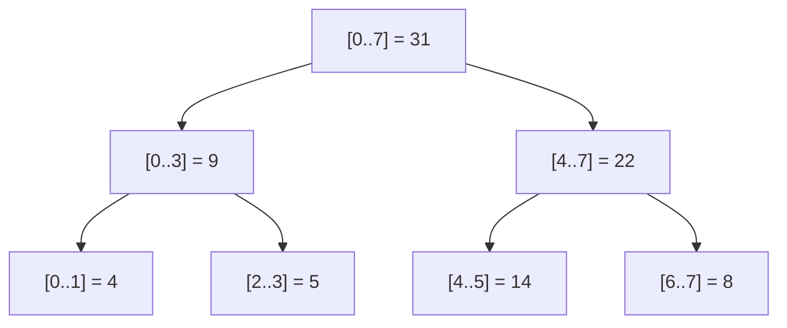

# Segment Tree and Fenwick Tree

> **Estimated Time:** 6 hr | **Difficulty:** Advanced
> **Prerequisites:** [07 - Prefix Sum](../../01-core-linear/07-prefix-sum/README.md), [08 - Binary Search](../../01-core-linear/08-binary-search/README.md), [01 - Binary Tree Traversals](../../03-trees/01-binary-tree-traversals/README.md), [03 - Divide and Conquer](../../02-intermediate/03-divide-and-conquer/README.md)

---

## What You'll Learn

- You can explain why prefix sums break when values change, and what to use instead.
- You can write a Fenwick tree (BIT) from memory: `lowbit`, `add`, `prefix`, and the O(n) build.
- You can write a segment tree two ways (iterative and recursive) for sum, min, max or gcd.
- You can add lazy propagation for range update + range query, and say when you do NOT need it.
- You can use coordinate compression and a BIT to count inversions, smaller-after-self, reverse pairs and range sums.

## The Big Idea

Think of a company with 8 teams. The CEO wants "total head count of teams 3 to 7" many times a day, and teams hire and fire all the time. Adding up 5 teams every time is slow. A printed table of running totals is fast to read, but one hire in team 2 forces you to reprint almost the whole table.

The fix is a hierarchy. Each manager keeps the total of their own group. A change only touches the managers above that team (a few of them). A question is answered by adding a few manager totals, not every team. That hierarchy is a **segment tree**. A **Fenwick tree** is the same idea, squeezed into one small array with a bit trick.

Why interviewers love it: it shows you can see that "prefix sums, but with updates" needs a new structure. Many hard problems (count smaller after self, reverse pairs, falling squares) look unrelated, but all of them reduce to "point update + range query" on a compressed index space.

**Prefix sums vs these trees:**

| Operation | Plain array | Prefix sum array | Fenwick / Segment tree |
|---|---|---|---|
| Range query | O(n) | O(1) | O(log n) |
| Point update | O(1) | O(n) | O(log n) |
| Build | - | O(n) | O(n) (or O(n log n)) |

If there are no updates, prefix sums win. If there are many updates AND many queries, the trees win. If there are only updates then one query at the end, you do not need anything fancy.

## How to Spot It

| If the problem says ... | think ... |
|---|---|
| "update element, then sum of range" (many times) | Fenwick tree |
| "range minimum / maximum / gcd with updates" | Segment tree (Fenwick cannot do min/max on arbitrary ranges) |
| "add value to a whole range, then query sum/max" | Segment tree with lazy propagation (or two BITs for sums) |
| "count elements before/after me that are smaller/larger" | BIT over compressed values, sweep the array |
| "count pairs (i < j) with a condition on nums[i], nums[j]" | Sweep + BIT (or merge sort) |
| "k-th smallest in a changing multiset" | BIT descent |
| "values up to 1e9 but only n of them" | Coordinate compression |
| "max overlap of intervals, online" | Dynamic segment tree or lazy tree |
| "dp[x] depends on the max of dp over a value range" | Segment tree as a DP accelerator |

## Core Concepts / Template

### 1. Coordinate compression

A BIT needs small indexes. If values are huge or negative, replace each value by its **rank** (its position in the sorted list of distinct values). Order is kept, so comparisons still work.

```js
function compress(arr) {
  const sorted = [...new Set(arr)].sort((a, b) => a - b);
  const rank = new Map(sorted.map((v, i) => [v, i + 1])); // 1-based for BIT
  return { sorted, rank };
}
```

`[900, -5, 900, 40]` becomes sorted `[-5, 40, 900]`, ranks `-5 -> 1, 40 -> 2, 900 -> 3`.

### 2. Fenwick tree (Binary Indexed Tree)

**Key trick:** `lowbit(i) = i & -i` is the value of the lowest set bit of `i`. Cell `t[i]` stores the sum of the `lowbit(i)` elements that END at `i`, so it covers `(i - lowbit(i), i]`.

```
index (1-based):  1  2  3  4  5  6  7  8
binary:          001 010 011 100 101 110 111 1000
lowbit:           1  2  1  4  1  2  1  8
t[i] covers:     [1] [1-2] [3] [1-4] [5] [5-6] [7] [1-8]
```

- **prefix(i):** start at `i`, add `t[i]`, then remove the lowest bit (`i -= lowbit`), repeat. At most log n steps.
- **add(i, d):** start at `i`, add `d` to `t[i]`, then go UP (`i += lowbit`), repeat until `i > n`.

Example `a = [3,1,4,1,5,9,2,6]` gives `t = [_, 3, 4, 4, 9, 5, 14, 2, 31]`.

```
prefix(7): i=7 -> t7=2 ; i=6 -> t6=14 ; i=4 -> t4=9 ; i=0 stop   => 2+14+9 = 25  (3+1+4+1+5+9+2 = 25)
add(3,+10): i=3 -> t3 ; i=4 -> t4 ; i=8 -> t8 ; i=16 > n stop
```

```js
class BIT {
  constructor(n) { this.n = n; this.t = new Array(n + 1).fill(0); } // 1-indexed
  add(i, d) { for (; i <= this.n; i += i & -i) this.t[i] += d; }
  prefix(i) { let s = 0; for (; i > 0; i -= i & -i) s += this.t[i]; return s; }
  range(l, r) { return this.prefix(r) - this.prefix(l - 1); }
}

// O(n) build: push each cell into its parent once
function buildBIT(arr) {
  const n = arr.length, t = new Array(n + 1).fill(0);
  for (let i = 1; i <= n; i++) {
    t[i] += arr[i - 1];
    const p = i + (i & -i);
    if (p <= n) t[p] += t[i];
  }
  return t;
}
```

**Range update, point query.** Store the DIFFERENCE array in the BIT. To add `v` to `[l, r]`: `add(l, v)` and `add(r + 1, -v)`. The value at `i` is `prefix(i)`.

**Range update, range sum.** Use two BITs (math: `sum(1..i) = B1(i) * i - B2(i)`):

```js
class RangeBIT {
  constructor(n) { this.n = n; this.b1 = new Array(n + 2).fill(0); this.b2 = new Array(n + 2).fill(0); }
  _add(b, i, d) { for (; i <= this.n; i += i & -i) b[i] += d; }
  _sum(b, i) { let s = 0; for (; i > 0; i -= i & -i) s += b[i]; return s; }
  rangeAdd(l, r, v) { // 1-indexed, inclusive
    this._add(this.b1, l, v); this._add(this.b1, r + 1, -v);
    this._add(this.b2, l, v * (l - 1)); this._add(this.b2, r + 1, -v * r);
  }
  prefix(i) { return this._sum(this.b1, i) * i - this._sum(this.b2, i); }
  rangeSum(l, r) { return this.prefix(r) - this.prefix(l - 1); }
}
```

This is shorter than a lazy tree, but it only works for SUM (and similar invertible operations).

**2D BIT (brief).** Same trick in two loops. Use it for "sum of a sub-rectangle with point updates" (LeetCode "Range Sum Query 2D - Mutable"). Cost O(log R * log C) per operation.

```js
class BIT2D {
  constructor(R, C) { this.R = R; this.C = C; this.t = Array.from({ length: R + 1 }, () => new Array(C + 1).fill(0)); }
  add(r, c, d) { for (let i = r; i <= this.R; i += i & -i) for (let j = c; j <= this.C; j += j & -j) this.t[i][j] += d; }
  prefix(r, c) { let s = 0; for (let i = r; i > 0; i -= i & -i) for (let j = c; j > 0; j -= j & -j) s += this.t[i][j]; return s; }
}
// rectangle (r1,c1)-(r2,c2) = prefix(r2,c2) - prefix(r1-1,c2) - prefix(r2,c1-1) + prefix(r1-1,c1-1)
```

**Fenwick limits:** it needs an operation that can be undone (sum, xor, count). For min/max/gcd on arbitrary ranges, use a segment tree.

### 3. Segment tree

Each node stores the answer for a range. The root covers everything; each node splits its range in two halves. Leaves are single elements. For `a = [3,1,4,1,5,9,2,6]` (sum):






(The leaves, one per element, hang under the bottom nodes.)

**Query [l, r]:** at a node, three cases. (1) node range is completely outside: return the identity (0 for sum, Infinity for min). (2) node range is completely inside: return its stored value. (3) partial overlap: ask both children and combine. Only about 2 nodes per level are partial, so O(log n).

**What to store:** anything with an associative `combine` and an `identity`:

| Goal | combine | identity |
|---|---|---|
| sum | `(a,b)=>a+b` | 0 |
| min | `Math.min` | Infinity |
| max | `Math.max` | -Infinity |
| gcd | `gcd(a,b)` | 0 |
| count of something | `+` | 0 |

You can even store a small object (for example `{sum, min, max}` or "best subarray sum" pieces) as long as combine is associative.

**Iterative (bottom-up) version.** Leaves live at `n..2n-1`, parent of `i` is `i>>1`. Short, fast, no recursion. Works for any `n` (not only powers of two). Use it for point update + range query.

```js
class SegTree {
  constructor(arr, combine, identity) {
    this.n = arr.length; this.f = combine; this.id = identity;
    this.t = new Array(2 * this.n).fill(identity);
    for (let i = 0; i < this.n; i++) this.t[this.n + i] = arr[i];
    for (let i = this.n - 1; i >= 1; i--) this.t[i] = this.f(this.t[2 * i], this.t[2 * i + 1]);
  }
  update(i, v) {
    i += this.n; this.t[i] = v;
    for (i >>= 1; i >= 1; i >>= 1) this.t[i] = this.f(this.t[2 * i], this.t[2 * i + 1]);
  }
  query(l, r) { // inclusive
    let resL = this.id, resR = this.id; // two sides keep order correct for non-commutative combine
    for (l += this.n, r += this.n + 1; l < r; l >>= 1, r >>= 1) {
      if (l & 1) resL = this.f(resL, this.t[l++]);
      if (r & 1) resR = this.f(this.t[--r], resR);
    }
    return this.f(resL, resR);
  }
}
```

**Recursive (top-down) version.** Longer, but you need it for lazy propagation and for custom node logic. Array size `4n` is always safe.

```js
// recursive range-min tree, node o covers [l, r]; call build(1, 0, n-1)
const t = new Array(4 * n).fill(Infinity);
function build(o, l, r) {
  if (l === r) { t[o] = arr[l]; return; }
  const m = (l + r) >> 1; build(2 * o, l, m); build(2 * o + 1, m + 1, r);
  t[o] = Math.min(t[2 * o], t[2 * o + 1]);
}
function query(o, l, r, L, R) {
  if (R < l || r < L) return Infinity;       // outside
  if (L <= l && r <= R) return t[o];         // inside
  const m = (l + r) >> 1;                    // partial
  return Math.min(query(2 * o, l, m, L, R), query(2 * o + 1, m + 1, r, L, R));
}
```


**Lazy propagation.** For "add `v` to every element in `[L, R]`": do not walk to all leaves. If a node is fully covered, update its stored sum right away and leave a note (the "lazy tag") that its children are behind. Before going into a node's children, **push** the note down. Then any later query sees correct values. Update and query stay O(log n). The full code is in Problem 10.

**Iterative vs recursive, honestly:**

| | Iterative | Recursive |
|---|---|---|
| Code size | small | larger |
| Speed | faster | slower (call overhead) |
| Lazy propagation | awkward | natural |
| Dynamic / sparse ranges (1e9) | no | yes (create nodes on demand) |

Rule of thumb: point update + range query, use iterative (or BIT). Range update, use recursive.

**Fenwick vs segment tree:**

| | Fenwick | Segment tree |
|---|---|---|
| Code | about 10 lines | 25-50 lines |
| Memory | n | 2n to 4n |
| Sum / count / xor | yes | yes |
| Min / max / gcd | no (only prefix max with increasing updates) | yes |
| Range update | yes for sum with the 2-BIT trick | yes, with lazy |
| Needs invertible op | yes | no |

## Problems (easy -> hard)

### 1. Range Addition II — Easy
**Companies:** -
**Problem:** An `m x n` matrix starts at all zeros. Each op `[a, b]` adds 1 to every cell in rows `0..a-1` and columns `0..b-1`. Return how many cells hold the maximum value. Example: `m=3, n=3, ops=[[2,2],[3,3]]` -> `4`.
**Intuition:** Every op covers the top-left corner. The cells covered by ALL ops are the ones with the max value, and that overlap is a rectangle: `min(a) x min(b)`. No tree is needed. I put it first to show that range updates are not always a data-structure problem. Look for structure before you reach for a tool.
**Approach 1 - Brute force:** Simulate every op on the matrix, then count the max. Time O(ops * m * n), Space O(m * n).
**Approach 2 - Optimal:** Shrink `m` and `n` to the smallest `a` and `b`. The answer is `m * n` (if there are no ops, nothing shrinks, so the answer is the whole matrix).

| op | m | n |
|---|---|---|
| start | 3 | 3 |
| [2,2] | 2 | 2 |
| [3,3] | 2 | 2 |
| answer | | 4 |

```js
function maxCount(m, n, ops) {
  for (const [a, b] of ops) { m = Math.min(m, a); n = Math.min(n, b); }
  return m * n;
}
```

**Complexity:** Time O(ops), Space O(1).
**Watch out:** Empty `ops` means every cell is 0 (the max), so the answer is `m * n`; the loop handles this for free.

### 2. Range Sum Query - Mutable — Medium
**Companies:** Google, Amazon, Microsoft
**Problem:** Support `update(i, val)` (set `nums[i]`) and `sumRange(l, r)` (sum of `nums[l..r]`). Example: `[1,3,5]`, `sumRange(0,2)` -> 9, `update(1,2)`, `sumRange(0,2)` -> 8.
**Intuition:** A BIT stores sums of ranges. An update is a change of `delta = val - old`, so we need to remember the old values. A range sum is two prefix queries.
**Approach 1 - Brute force:** Array: update O(1), query O(n). With a prefix array: query O(1), update O(n). If you have q operations, both give O(q * n).
**Approach 2 - Better:** Square-root blocks (see the next chapter): O(sqrt n) per operation.
**Approach 3 - Optimal:** Fenwick tree, O(log n) per operation. Trace for `[1,3,5]` (BIT `t = [_, 1, 4, 5]`): `update(1, 2)` has `delta = -1` and touches positions `2` then `4 > n` stop, so `t = [_, 1, 3, 5]`. `sumRange(0,2)` = `pre(3) - pre(0)` = `t3 + t2` = `5 + 3` = 8.

```js
class NumArray {
  constructor(nums) { this.n = nums.length; this.nums = [...nums]; this.t = buildBIT(nums); }
  update(i, val) {
    const d = val - this.nums[i]; this.nums[i] = val;
    for (let k = i + 1; k <= this.n; k += k & -k) this.t[k] += d;
  }
  _pre(k) { let s = 0; for (; k > 0; k -= k & -k) s += this.t[k]; return s; }
  sumRange(l, r) { return this._pre(r + 1) - this._pre(l); }
}
// buildBIT is the O(n) builder from the template
```

**Complexity:** Time O(n) build, O(log n) per update and query. Space O(n).
**Watch out:** The BIT is 1-indexed but the problem is 0-indexed. Shift by one in exactly one place. Also, store the old values: "set" must be turned into "add delta".

### 3. Range Minimum Query (segment tree) — Medium
**Companies:** -
**Problem:** Given an array, answer many `min(a[l..r])` queries while some `a[i]` are changed. Example: `[5,2,8,1,9]`: `min(0..2)` -> 2; after `a[3] = 10`, `min(2..4)` -> 8.
**Intuition:** A Fenwick tree cannot do this, because min cannot be "subtracted" (`min(0..r) -> min(0..l-1)` does not give `min(l..r)`). A segment tree does not subtract. It just combines pieces that exactly cover the range.
**Approach 1 - Brute force:** Scan the range. O(n) per query.
**Approach 2 - Better:** A sparse table gives O(1) queries but cannot update (next chapter).
**Approach 3 - Optimal:** Use the `SegTree` class with `Math.min` and `Infinity`. The same class gives range max (`Math.max`, `-Infinity`) or gcd. Trace `query(0, 2)` on `[5,2,8,1,9]` (n = 5, leaves at 5..9): `l=5, r=8`. `l` is odd, so take `t[5]=5`, `l=6`. `r` is even, skip. Move up: `l=3, r=4`. `l` odd, take `t[3] = min(t[6], t[7]) = min(2, 8) = 2`. Final `min(5, 2) = 2`.

```js
const st = new SegTree([5, 2, 8, 1, 9], Math.min, Infinity);
st.query(0, 2);   // 2
st.update(3, 10);
st.query(2, 4);   // 8
// For max: new SegTree(arr, Math.max, -Infinity)
// For gcd: new SegTree(arr, gcd, 0) with gcd(a, 0) = a
```

(`SegTree` is the class from the template above.)

**Complexity:** Time O(n) build, O(log n) per query and update. Space O(n).
**Watch out:** The identity must be neutral for your operation. `0` as identity for min gives wrong answers. Also, for a non-commutative combine (like string concatenation), the two-sided `resL/resR` in the iterative query is what keeps the order correct.

### 4. Inversion Count with BIT — Medium
**Companies:** -
**Problem:** Count pairs `i < j` with `a[i] > a[j]`. Example: `[2,4,1,3,5]` -> 3 (pairs (2,1), (4,1), (4,3)).
**Intuition:** Sweep left to right. When you stand at `a[j]`, the inversions that end here equal "how many earlier elements are bigger". A BIT over ranks keeps "how many earlier elements have rank <= r". Bigger = `seen - prefix(rank)`.
**Approach 1 - Brute force:** Check all pairs. O(n^2).
**Approach 2 - Better:** Merge sort counting during the merge: O(n log n) (see the divide and conquer chapter).
**Approach 3 - Optimal (BIT):** O(n log n). Same speed as merge sort, but the same sweep pattern solves the next four problems. Trace on `[2,4,1,3,5]` (ranks are the same as values here):

| j | a[j] | seen before | prefix(a[j]) | add to answer |
|---|---|---|---|---|
| 0 | 2 | 0 | 0 | 0 |
| 1 | 4 | 1 | 1 | 0 |
| 2 | 1 | 2 | 0 | 2 |
| 3 | 3 | 3 | 2 | 1 |
| 4 | 5 | 4 | 4 | 0 |

Row 3: the earlier values are 2, 4, 1; those `<= 3` are 2 and 1, so `prefix = 2` and we add `3 - 2 = 1`. Total 0+0+2+1+0 = 3.

```js
function countInversions(a) {
  const { rank, sorted } = compress(a);
  const bit = new BIT(sorted.length);
  let inv = 0;
  for (let i = 0; i < a.length; i++) {
    const r = rank.get(a[i]);
    inv += i - bit.prefix(r); // seen so far minus seen <= a[i]
    bit.add(r, 1);
  }
  return inv;
}
```

**Complexity:** Time O(n log n), Space O(n).
**Watch out:** Equal elements are NOT inversions (strict `>`). `prefix(r)` includes equals, so subtracting it leaves only the strictly greater ones. The answer can reach about n^2 / 2, which for n = 1e5 is 5e9: fine for a JS number (safe up to 9e15), but not for a 32-bit int in other languages.

### 5. Kth Smallest with BIT Descent — Medium
**Companies:** -
**Problem:** Maintain a multiset of integers in `1..n` with `add(v, +1/-1)`. Answer `kth(k)`: the k-th smallest element. Example: after adding `5,3,3,9,1`, `kth(1..5)` -> `1,3,3,5,9`.
**Intuition:** A BIT cell `t[pos + 2^j]` holds a count of a known block of values. We can "walk" down the BIT building the answer bit by bit, from the biggest power of two to the smallest: if the block is too small to reach `k`, jump over it and reduce `k`. This is a binary search INSIDE the tree, so there is no extra log factor.
**Approach 1 - Brute force:** Keep a sorted array, insert and delete in O(n), index in O(1).
**Approach 2 - Better:** BIT plus binary search on the answer, with `prefix(mid)` each time: O(log^2 n).
**Approach 3 - Optimal:** BIT descent, O(log n). Trace: `n = 10`, counts for values `{1,3,3,5,9}`, find `kth(4)`. `LOG = 8`. `pos = 0`. `pw = 8`: `t[8]` = count of values 1..8 = 4, which is not `< 4`, so stay. `pw = 4`: `t[4]` = count 1..4 = 3 `< 4`, so `pos = 4`, `k = 1`. `pw = 2`: `t[6]` = count of 5..6 = 1, not `< 1`, stay. `pw = 1`: `t[5]` = count of 5..5 = 1, not `< 1`, stay. Answer `pos + 1 = 5`.

```js
function makeKth(n) {
  const t = new Array(n + 1).fill(0);
  let LOG = 1; while (LOG * 2 <= n) LOG *= 2;
  return {
    add(v, d) { for (; v <= n; v += v & -v) t[v] += d; },
    kth(k) { // 1-based k, assumes 1 <= k <= total count
      let pos = 0;
      for (let pw = LOG; pw > 0; pw >>= 1) {
        if (pos + pw <= n && t[pos + pw] < k) { pos += pw; k -= t[pos]; }
      }
      return pos + 1; // pos = largest index whose prefix count is < k
    },
  };
}
```

**Complexity:** Time O(log n) per operation, Space O(n).
**Watch out:** It finds the first index where the prefix count reaches `k`, which works for duplicates too. It only works when counts are non-negative (never remove something that is not there). Values must be mapped into `1..n`; use compression if they are not. Use it for "median of a stream with removals" and "k-th unused number".

### 6. Count of Smaller Numbers After Self — Hard
**Companies:** Amazon, Google, Microsoft
**Problem:** For each `nums[i]`, count the elements to its right that are strictly smaller. Example: `[5,2,6,1]` -> `[2,1,1,0]`.
**Intuition:** Walk from the RIGHT. When you reach `nums[i]`, every element to its right is already in the BIT. "How many are smaller" is `prefix(rank - 1)`. Then insert yourself.
**Approach 1 - Brute force:** For each `i`, scan the right side. O(n^2).
**Approach 2 - Better:** Merge sort on index pairs, counting how many right-side elements jump ahead during a merge. O(n log n).
**Approach 3 - Optimal (BIT):** Compress, sweep right to left. Trace `[5,2,6,1]`, ranks 5->3, 2->2, 6->4, 1->1:

| i | value | rank | prefix(rank-1) | res[i] |
|---|---|---|---|---|
| 3 | 1 | 1 | 0 | 0 |
| 2 | 6 | 4 | 1 (only rank 1) | 1 |
| 1 | 2 | 2 | 1 (rank 1) | 1 |
| 0 | 5 | 3 | 2 (ranks 1, 2) | 2 |

```js
function countSmaller(nums) {
  const { rank, sorted } = compress(nums);
  const bit = new BIT(sorted.length), res = new Array(nums.length);
  for (let i = nums.length - 1; i >= 0; i--) {
    const r = rank.get(nums[i]);
    res[i] = bit.prefix(r - 1); // strictly smaller: do not include own rank
    bit.add(r, 1);
  }
  return res;
}
```

**Complexity:** Time O(n log n), Space O(n).
**Watch out:** `prefix(r - 1)` (strict), not `prefix(r)`. Negative numbers are fine because of compression; without it, a BIT index of `-1` would silently loop wrong.

### 7. Create Sorted Array through Instructions — Hard
**Companies:** -
**Problem:** Insert numbers one by one into an initially empty array. The cost of inserting `x` is `min(count of elements strictly less than x, count strictly greater than x)` among elements already inserted. Return the total cost mod `1e9+7`. Example: `[1,5,6,2]` -> 1 (only inserting `2` costs: 1 less, 2 greater -> 1).
**Intuition:** You do not need to actually keep the array sorted. You only need two counts at each step, and a BIT over values gives both: `less = prefix(x-1)`, `greater = seen - prefix(x)`.
**Approach 1 - Brute force:** Real sorted insert with a scan: O(n^2).
**Approach 2 - Better:** Merge sort variants. Possible, but clumsy.
**Approach 3 - Optimal:** BIT over values (they are at most 1e5 in this problem, so compression is optional). Trace `[1,2,3,6,5,4]`: inserting `1, 2, 3, 6` costs 0 each (nothing greater, or nothing less). Inserting `5`: less = 3 (1,2,3), greater = 1 (6), cost `min(3,1) = 1`. Inserting `4`: less = 3, greater = 2 (5, 6), cost `min(3,2) = 2`. Total 3.

```js
function createSortedArray(instructions) {
  const MOD = 1000000007;
  let MAX = 0;
  for (const x of instructions) MAX = Math.max(MAX, x);
  const bit = new BIT(MAX);
  let cost = 0;
  for (let i = 0; i < instructions.length; i++) {
    const x = instructions[i];
    const less = bit.prefix(x - 1);
    const greater = i - bit.prefix(x);
    cost += Math.min(less, greater);
    bit.add(x, 1);
  }
  return cost % MOD;
}
```

**Complexity:** Time O(n log M), Space O(M), with `M` the max value.
**Watch out:** Equal elements count as neither less nor greater. The raw cost sum can exceed the mod, so apply the mod; here the sum stays under 2^53 (about 1e5 * 5e4 = 5e9), so one `%` at the end is safe in JS. In other languages with 32-bit ints, mod as you go.

### 8. Reverse Pairs — Hard
**Companies:** Google, Amazon
**Problem:** Count pairs `i < j` with `nums[i] > 2 * nums[j]`. Example: `[1,3,2,3,1]` -> 2.
**Intuition:** It is the inversion pattern with a twist: the condition compares `nums[i]` to `2 * nums[j]`, so the value we look up (`2 * nums[j]`) is NOT necessarily in the array. Compress only the real values, and use a binary search (`upperBound`) to find where `2 * nums[j]` would land.
**Approach 1 - Brute force:** All pairs, O(n^2).
**Approach 2 - Better:** Merge sort: before merging two sorted halves, count pairs with two pointers, then merge. O(n log n), no extra memory beyond the merge buffer.
**Approach 3 - Optimal (BIT):** For each `j`, `seen - (count of earlier values <= 2 * nums[j])` is the count of earlier values greater than it. Trace `[1,3,2,3,1]`:

| j | nums[j] | 2*nums[j] | earlier values | earlier > 2x | running |
|---|---|---|---|---|---|
| 0 | 1 | 2 | - | 0 | 0 |
| 1 | 3 | 6 | 1 | 0 | 0 |
| 2 | 2 | 4 | 1,3 | 0 | 0 |
| 3 | 3 | 6 | 1,3,2 | 0 | 0 |
| 4 | 1 | 2 | 1,3,2,3 | 3, 3 | 2 |

```js
function reversePairs(nums) {
  const sorted = [...new Set(nums)].sort((a, b) => a - b);
  const upperBound = (x) => { // number of distinct values <= x
    let lo = 0, hi = sorted.length;
    while (lo < hi) { const m = (lo + hi) >> 1; if (sorted[m] <= x) lo = m + 1; else hi = m; }
    return lo;
  };
  const bit = new BIT(sorted.length);
  let ans = 0;
  for (let j = 0; j < nums.length; j++) {
    ans += j - bit.prefix(upperBound(2 * nums[j])); // earlier values > 2*nums[j]
    bit.add(upperBound(nums[j]), 1);                // rank of nums[j], 1-based
  }
  return ans;
}
```

**Complexity:** Time O(n log n), Space O(n).
**Watch out:** Use `2 * x`, not `x << 1`: JS shifts work on 32-bit ints and values near `2^31` overflow (the LeetCode tests include `2147483647`). Do not write `nums[i] > nums[j] * 2` as `nums[i] / 2 > nums[j]` with integer division by mistake.

### 9. Count of Range Sum — Hard
**Companies:** Google
**Problem:** Count subarrays whose sum lies in `[lower, upper]`. Example: `[-2,5,-1]`, `lower=-2`, `upper=2` -> 3.
**Intuition:** Subarray sum `j..i` = `P[i+1] - P[j]` with prefix sums `P`. So for each prefix `p`, count EARLIER prefixes `q` with `p - upper <= q <= p - lower`. That is a range count over values = BIT over compressed prefix sums. This is the prefix-sum idea from the earlier chapter, plus a structure to count.
**Approach 1 - Brute force:** Two loops with running sum, O(n^2).
**Approach 2 - Better:** Merge sort on prefix sums, with two pointers per merge. O(n log n).
**Approach 3 - Optimal (BIT):** Compress the prefix sums (including `P[0] = 0`). For each `p` in order: query the BIT for values in `[p - upper, p - lower]` (using lowerBound / upperBound), then insert `p`. Trace: `P = [0, -2, 3, 2]`.

| p | window [p-2, p+2] | earlier prefixes | matches |
|---|---|---|---|
| 0 | [-2, 2] | - | 0 |
| -2 | [-4, 0] | 0 | 1 |
| 3 | [1, 5] | 0, -2 | 0 |
| 2 | [0, 4] | 0, -2, 3 | 2 (0 and 3) |

Total 3.

```js
function countRangeSum(nums, lower, upper) {
  const P = [0];
  for (const x of nums) P.push(P[P.length - 1] + x);
  const sorted = [...new Set(P)].sort((a, b) => a - b);
  const lowerBound = (x) => { let lo = 0, hi = sorted.length; while (lo < hi) { const m = (lo + hi) >> 1; if (sorted[m] < x) lo = m + 1; else hi = m; } return lo; };
  const upperBound = (x) => { let lo = 0, hi = sorted.length; while (lo < hi) { const m = (lo + hi) >> 1; if (sorted[m] <= x) lo = m + 1; else hi = m; } return lo; };
  const bit = new BIT(sorted.length);
  let ans = 0;
  for (const p of P) {
    // count of earlier q with p-upper <= q <= p-lower
    ans += bit.prefix(upperBound(p - lower)) - bit.prefix(lowerBound(p - upper));
    bit.add(lowerBound(p) + 1, 1);
  }
  return ans;
}
```

**Complexity:** Time O(n log n), Space O(n).
**Watch out:** Include `P[0] = 0`, or subarrays starting at index 0 are missed. The values `p - upper` and `p - lower` are not in `sorted`, so you need the two binary searches, with `lowerBound` (first `>=`) on the left and `upperBound` (first `>`) on the right. Prefix sums can be big (up to about 1e14 with big inputs), still safe in a JS double.

### 10. Lazy Range Add + Range Sum — Hard
**Companies:** -
**Problem:** Support `add(L, R, v)` (add `v` to every element in `[L, R]`) and `query(L, R)` (sum over the range). Example: `[1,2,3,4,5]`, `add(1,3,10)` -> array `[1,12,13,14,5]`, `query(0,4)` -> 45.
**Intuition:** If a node is fully inside the update range, change its sum at once (`sum += v * length`) and leave a tag "my children still need `+v`". Only when we must go deeper do we push the tag to the two children. The work done per operation is the same shape as a query: O(log n).
**Approach 1 - Brute force:** Loop over the range for each op. O(n) per op.
**Approach 2 - Better:** Two BITs (the `RangeBIT` class above) for sum. Short and fast, but it only works for sum-like operations.
**Approach 3 - Optimal (lazy segment tree):** Works for sum, min or max with range add. Dry run: `[1,2,3,4,5]`, `add(1,3,10)`: the root `[0..4]` partially overlaps -> go down; the node `[0..2]` partially overlaps; `[1..2]` is fully inside -> `sum += 20`, `lz = 10`, stop. Node `[3..3]` fully inside -> `sum += 10`. Their parents are recomputed on the way up. A later query that must enter `[1..2]` first pushes `10` into `[1..1]` and `[2..2]`.

```js
class LazySeg {
  constructor(a) {
    this.n = a.length; this.a = a;
    this.sum = new Array(4 * this.n).fill(0); this.lz = new Array(4 * this.n).fill(0);
    this._build(1, 0, this.n - 1);
  }
  _build(o, l, r) {
    if (l === r) { this.sum[o] = this.a[l]; return; }
    const m = (l + r) >> 1;
    this._build(2 * o, l, m); this._build(2 * o + 1, m + 1, r);
    this.sum[o] = this.sum[2 * o] + this.sum[2 * o + 1];
  }
  _apply(o, l, r, v) { this.sum[o] += v * (r - l + 1); this.lz[o] += v; }
  _push(o, l, r) { // hand the pending tag to the children
    if (this.lz[o] === 0) return;
    const m = (l + r) >> 1;
    this._apply(2 * o, l, m, this.lz[o]); this._apply(2 * o + 1, m + 1, r, this.lz[o]);
    this.lz[o] = 0;
  }
  add(L, R, v, o = 1, l = 0, r = this.n - 1) {
    if (R < l || r < L) return;
    if (L <= l && r <= R) { this._apply(o, l, r, v); return; }
    this._push(o, l, r);
    const m = (l + r) >> 1;
    this.add(L, R, v, 2 * o, l, m); this.add(L, R, v, 2 * o + 1, m + 1, r);
    this.sum[o] = this.sum[2 * o] + this.sum[2 * o + 1];
  }
  query(L, R, o = 1, l = 0, r = this.n - 1) {
    if (R < l || r < L) return 0;
    if (L <= l && r <= R) return this.sum[o];
    this._push(o, l, r);
    const m = (l + r) >> 1;
    return this.query(L, R, 2 * o, l, m) + this.query(L, R, 2 * o + 1, m + 1, r);
  }
}
```

**Complexity:** Time O(n) build, O(log n) per add and query. Space O(n).
**Watch out:** Three classic bugs: (1) forgetting to push before recursing, (2) forgetting `* (r - l + 1)` when applying a tag to a node, (3) forgetting to recompute the parent after the children change. For "range assign" instead of "range add", the tag needs a "has tag" flag, because `0` is a valid value to assign.

### 11. My Calendar III — Hard
**Companies:** Google
**Problem:** `book(start, end)` adds the half-open interval `[start, end)`. After each booking, return the largest `k` such that some moment is covered by `k` bookings. Times go up to `1e9`. Example: `[10,20] -> 1`, `[50,60] -> 1`, `[10,40] -> 2`, `[5,15] -> 3`.
**Intuition:** It is "range add +1, query global max". The index space is 1e9, too big for an array, and the queries are online (we cannot compress ahead of time). So create segment tree nodes only when needed (**dynamic segment tree**). We never push tags down: a tag stays at the node it was applied to, and a node's max is `max(children) + its own tag`.
**Approach 1 - Brute force:** Keep all bookings, recompute the max overlap with a sweep: O(n log n) per booking.
**Approach 2 - Better:** A sorted map of `time -> +1/-1` deltas and scan all of it each time: O(n) per booking.
**Approach 3 - Optimal:** Dynamic segment tree over `[0, 1e9]`. Each booking creates at most about 2 new nodes per level, and there are about 30 levels (log2 of 1e9). Dry run: book `[10,20)` -> a few nodes on the path to leaf 10..19 get `+1`, root max = 1. Book `[10,40)`: nodes covering `[10..19]` get +1 again (via tags at a higher or equal node), root max = 2.

```js
class MyCalendarThree {
  constructor() { this.mx = [0]; this.add = [0]; this.lc = [0]; this.rc = [0]; } // node 0 is the root; child id 0 means "none"
  _child(o, side) {
    const key = side ? this.rc : this.lc;
    if (key[o] === 0) { key[o] = this.mx.length; this.mx.push(0); this.add.push(0); this.lc.push(0); this.rc.push(0); }
    return key[o];
  }
  _upd(o, lo, hi, l, r) {
    if (r < lo || hi < l) return;
    if (l <= lo && hi <= r) { this.mx[o]++; this.add[o]++; return; }
    const m = Math.floor((lo + hi) / 2);
    const L = this._child(o, 0), R = this._child(o, 1);
    this._upd(L, lo, m, l, r); this._upd(R, m + 1, hi, l, r);
    this.mx[o] = Math.max(this.mx[L], this.mx[R]) + this.add[o]; // tag stays here, never pushed
  }
  book(start, end) { this._upd(0, 0, 1e9, start, end - 1); return this.mx[0]; }
}
```

**Complexity:** Time O(log C) per booking with `C = 1e9`, Space O(n log C).
**Watch out:** The interval is half-open, so update `[start, end - 1]`. Because tags are never pushed, a parent's max MUST add its own tag when recomputed. If the range is small (a few hundred events), a simple map-of-deltas solution is also accepted, and is a fine first answer in an interview before optimizing.

### 12. Longest Increasing Subsequence II — Hard
**Companies:** -
**Problem:** Find the length of the longest strictly increasing subsequence where each adjacent pair differs by at most `k`. Example: `nums = [4,2,1,4,3,4,5,8,15]`, `k = 3` -> 5 (`[1,3,4,5,8]`).
**Intuition:** The classic DP is `dp[i] = 1 + max(dp[j])` for `j < i` with `nums[j] < nums[i]`. Here we also need `nums[i] - nums[j] <= k`. Index the DP by VALUE: `best[v]` = the longest valid subsequence that ENDS with value `v`. Then `dp for x = 1 + max(best[x-k .. x-1])`. That is a range max with point updates. This pairs with the LIS chapter in the dynamic programming section.
**Approach 1 - Brute force:** The O(n^2) DP over pairs. Too slow for `n = 1e5`.
**Approach 2 - Better:** None that is simple.
**Approach 3 - Optimal:** Iterative max segment tree indexed by value. For each `x`: query `[max(0, x-k), x-1]`, add 1, update position `x`. Trace on `[4,2,1,4,3,4,5,8,15]`, `k=3`:

| x | query range | max found | dp | note |
|---|---|---|---|---|
| 4 | [1,3] | 0 | 1 | best[4]=1 |
| 2 | [0,1] | 0 | 1 | best[2]=1 |
| 1 | [0,0] | 0 | 1 | best[1]=1 |
| 4 | [1,3] | 1 | 2 | best[4]=2 |
| 3 | [0,2] | 1 | 2 | best[3]=2 |
| 4 | [1,3] | 2 | 3 | best[4]=3 |
| 5 | [2,4] | 3 | 4 | best[5]=4 |
| 8 | [5,7] | 4 | 5 | best[8]=5 |
| 15 | [12,14] | 0 | 1 | |

```js
function lengthOfLIS(nums, k) {
  let M = 0; for (const x of nums) if (x > M) M = x;
  const size = M + 1, t = new Array(2 * size).fill(0);
  const query = (l, r) => { // inclusive max
    let res = 0;
    for (l += size, r += size + 1; l < r; l >>= 1, r >>= 1) {
      if (l & 1) res = Math.max(res, t[l++]);
      if (r & 1) res = Math.max(res, t[--r]);
    }
    return res;
  };
  const update = (i, v) => {
    i += size; t[i] = Math.max(t[i], v);
    for (i >>= 1; i >= 1; i >>= 1) t[i] = Math.max(t[2 * i], t[2 * i + 1]);
  };
  let best = 0;
  for (const x of nums) {
    const dp = query(Math.max(0, x - k), x - 1) + 1; // values in [x-k, x-1]
    update(x, dp);
    best = Math.max(best, dp);
  }
  return best;
}
```

**Complexity:** Time O(n log M), Space O(M), with `M` the max value (compress if `M` is huge).
**Watch out:** Use `max(t[i], v)` on update; a later equal value may have a smaller dp and must not overwrite a better one. The range ends at `x - 1`, not `x`, to keep it strictly increasing.

### 13. Falling Squares — Hard
**Companies:** Google
**Problem:** Squares fall one at a time. Each is `[left, sideLength]`, lands on the highest thing under its span, and sticks. After each drop, return the height of the tallest stack so far. Example: `[[1,2],[2,3],[6,1]]` -> `[2,5,5]`.
**Intuition:** For a new square, new height = `(max height over [left, left + side)) + side`. Then set the whole span to that height. It is "range max query + range update", on coordinates that can be huge, so compress the edge coordinates. Because the new height is always at least every height in its span, "assign" is the same as "chmax", which does not need push-down.
**Approach 1 - Brute force:** Keep a list of past squares, scan all overlapping ones for each new square. O(n^2). This is accepted for `n <= 1000` and is a fine first answer.
**Approach 2 - Better:** Array of heights per coordinate if coordinates are small.
**Approach 3 - Optimal:** Compress all left and right edges. Cell `i` stands for `[xs[i], xs[i+1])`. Tree with `mx` (max in the node) and `tag` (a chmax that applies to the whole node, never pushed down). Dry run `[[1,2],[2,3],[6,1]]`: edges `1,2,3,5,6,7` (cells: `[1,2) [2,3) [3,5) [5,6) [6,7)`). Square 1 spans cells 0..1 -> height 2. Square 2 spans `[2,5)` = cells 1..2: max there is 2 -> height 5. Square 3 spans cell 4: max 0 -> height 1; top stays 5. Output `[2,5,5]`.

```js
function fallingSquares(positions) {
  const xs = [...new Set(positions.flatMap(([l, s]) => [l, l + s]))].sort((a, b) => a - b);
  const idx = new Map(xs.map((x, i) => [x, i]));
  const n = xs.length - 1; // cell i = [xs[i], xs[i+1])
  const mx = new Array(4 * n).fill(0), tag = new Array(4 * n).fill(0);
  const update = (o, l, r, L, R, h) => {
    if (R < l || r < L) return;
    if (L <= l && r <= R) { mx[o] = Math.max(mx[o], h); tag[o] = Math.max(tag[o], h); return; }
    const m = (l + r) >> 1;
    update(2 * o, l, m, L, R, h); update(2 * o + 1, m + 1, r, L, R, h);
    mx[o] = Math.max(mx[2 * o], mx[2 * o + 1], tag[o]);
  };
  const query = (o, l, r, L, R) => {
    if (R < l || r < L) return 0;
    if (L <= l && r <= R) return mx[o];
    const m = (l + r) >> 1;
    return Math.max(tag[o], query(2 * o, l, m, L, R), query(2 * o + 1, m + 1, r, L, R));
  };
  const ans = []; let top = 0;
  for (const [left, side] of positions) {
    const L = idx.get(left), R = idx.get(left + side) - 1; // right edge is exclusive
    const h = query(1, 0, n - 1, L, R) + side;
    update(1, 0, n - 1, L, R, h);
    top = Math.max(top, h); ans.push(top);
  }
  return ans;
}
```

**Complexity:** Time O(n log n), Space O(n).
**Watch out:** Squares that only TOUCH at an edge do not sit on each other. Using cells (half-open) instead of points handles this. In `query`, a partial node must include its own `tag`, because the tag applies to the entire node range, which contains the query part.

### 14. Rectangle Area II — Hard
**Companies:** Google
**Problem:** Given axis-aligned rectangles `[x1, y1, x2, y2]` that may overlap, return the area of their union, mod `1e9+7`. Example: `[[0,0,2,2],[1,0,2,3],[1,0,3,1]]` -> 6.
**Intuition:** Sweep a vertical line left to right. Between two consecutive event x's, the covered height is constant, so area += `coveredHeight * dx`. A segment tree over compressed y's tells us the covered height: each node keeps a **cover count** (how many rectangles fully cover this node) and the covered length below it. No push-down: a node is "fully covered" if its count is above 0. (A brief treatment; the sweep idea is also in the intervals chapter.)
**Approach 1 - Brute force:** Compress x and y, mark each grid cell, sum areas: O(n^3) for n rectangles.
**Approach 2 - Better:** Sweep with a plain sorted list of y-intervals, merging them at each step: O(n^2 log n).
**Approach 3 - Optimal:** Sweep + segment tree, O(n log n). Events: at `x1` add `+1` over `[y1, y2)`, at `x2` add `-1`. Trace on the example: events by x: `0:+[0,2]`, `1:+[0,3]`, `1:+[0,1]`, `2:-[0,2]`, `2:-[0,3]`, `3:-[0,1]`. Covered length: after x=0 it is 2; at x=1 we add `2 * 1 = 2`, then it becomes 3; at x=2 add `3 * 1 = 3` (total 5); after the removals at x=2 the length is 1 (the `[0,1]` rectangle); at x=3 add `1 * 1` (total 6).

```js
function rectangleArea(rectangles) {
  const MOD = 1000000007n;
  const ys = [...new Set(rectangles.flatMap(([, y1, , y2]) => [y1, y2]))].sort((a, b) => a - b);
  const yi = new Map(ys.map((y, i) => [y, i]));
  const m = ys.length - 1; // cell i = [ys[i], ys[i+1])
  const cnt = new Array(4 * m).fill(0), len = new Array(4 * m).fill(0);
  const upd = (o, l, r, L, R, v) => {
    if (R < l || r < L) return;
    if (L <= l && r <= R) cnt[o] += v;
    else {
      const mid = (l + r) >> 1;
      upd(2 * o, l, mid, L, R, v); upd(2 * o + 1, mid + 1, r, L, R, v);
    }
    if (cnt[o] > 0) len[o] = ys[r + 1] - ys[l];                 // fully covered
    else len[o] = l === r ? 0 : len[2 * o] + len[2 * o + 1];     // from children
  };
  const events = [];
  for (const [x1, y1, x2, y2] of rectangles) { events.push([x1, 1, y1, y2]); events.push([x2, -1, y1, y2]); }
  events.sort((a, b) => a[0] - b[0]);
  let area = 0n, prevX = events[0][0];
  for (const [x, v, y1, y2] of events) {
    area += BigInt(len[1]) * BigInt(x - prevX); // BigInt: up to 1e9 * 1e9 overflows a double
    upd(1, 0, m - 1, yi.get(y1), yi.get(y2) - 1, v);
    prevX = x;
  }
  return Number(area % MOD);
}
```

**Complexity:** Time O(n log n), Space O(n).
**Watch out:** `1e9 * 1e9 = 1e18` is beyond `2^53`, so a plain JS number loses precision. Use `BigInt` for the area. Process events at the same x in any order, since the width between them is 0. Every `-1` must exactly match an earlier `+1` for the same range, or the counts go negative.

## Common Mistakes

- **"A BIT can do range minimum."** It cannot, because min has no inverse. Use a segment tree (or a sparse table if there are no updates).
- **"BIT index 0 is fine."** `0 & -0` is 0, so loops never move. BIT indexes start at 1. Shift in one place only.
- **"I'll compress after I need it."** Compress BEFORE the sweep, and keep the ranks 1-based. A rank of 0 hangs the update loop.
- **"Segment tree size is 2n."** For the recursive version use `4n`. (For the iterative bottom-up version, `2n` is right.)
- **"Updating means setting."** For a BIT you add the delta `new - old`. Keep the original array.
- **"Lazy tags can be skipped if I only query."** The tag must be pushed (or accounted for) before any child is read, in both `add` and `query`.
- **"Inclusive and exclusive ends are the same."** Intervals and squares are half-open. Update `[l, r - 1]` or you will count touching items as overlapping.
- **"`prefix(r)` is strict."** It includes `r`. For "strictly smaller" use `prefix(rank - 1)`.
- **"Numbers are small."** Counts of pairs reach n^2, sums of prefixes reach 1e14, areas reach 1e18. Check against `2^53` and use `BigInt` where needed.

## Interview Tips

- **Say the decision out loud:** "Prefix sums are O(1) per query but O(n) per update. With both updates and queries, I need O(log n) for each, so I will use a Fenwick tree (or a segment tree if the operation is min/max)."
- **Say why Fenwick vs segment tree:** Fenwick is shorter and faster for sum/count. A segment tree is needed for min/max/gcd and for lazy range updates.
- **Count-pairs pattern:** "I sweep in one direction, and the BIT remembers what I have already seen, indexed by compressed value." The same sweep solves inversions, smaller-after-self, reverse pairs and range-sum counts. Know which direction and which query (`prefix(r-1)`, `seen - prefix(r)`) each needs.
- **Offer the alternative:** For counting pairs, merge sort gives the same O(n log n). Mention it, then pick the BIT because it is shorter to write.
- **Follow-ups you will hear:** "What if values are up to 1e9?" (compression, or a dynamic segment tree). "What if updates are range updates?" (difference array in a BIT, two BITs, or lazy). "Do it online." (dynamic segment tree, no offline compression.) "Can it handle 2D?" (2D BIT).
- **Edge cases to mention:** empty array, single element, duplicates (strict vs non-strict), negative numbers (compress first), `l > r`, query on the entire range, and overflow of sums.
- **Know the memory:** segment tree `4n`, iterative `2n`, BIT `n + 1`.
- **If you forget lazy code:** it is acceptable to say you would use two BITs for sum, or sqrt decomposition (next chapter) for a simpler O(sqrt n). Naming a working alternative beats a half-remembered tree.

## Practice List

**Easy**
- Range Sum Query - Immutable
- Range Sum Query 2D - Immutable
- Range Addition II
- Count Number of Teams (BIT or brute force)

**Medium**
- Range Sum Query - Mutable
- Range Sum Query 2D - Mutable
- Count of Smaller Numbers After Self
- Queue Reconstruction by Height (BIT descent version)
- Number of Longest Increasing Subsequence (BIT/segment tree version)
- The Skyline Problem (segment tree or heap)
- My Calendar II
- Online Majority Element In Subarray
- Range Addition
- Count Good Triplets in an Array

**Hard**
- Count of Range Sum
- Reverse Pairs
- My Calendar III
- Longest Increasing Subsequence II
- Falling Squares
- Create Sorted Array through Instructions
- Rectangle Area II
- Booking Concert Tickets in Groups
- Count Number of Rectangles Containing Each Point
- Number of Flowers in Full Bloom (offline, sort + BIT)
- Maximum Sum Queries
- Handling Sum Queries After Update
- Longest Substring of One Repeating Character

## Key Takeaways

- **Prefix sums are for static arrays.** Once there are updates, use a Fenwick tree or a segment tree, both O(log n) per operation.
- **Fenwick = `i & -i`.** `prefix` goes down by removing the lowest bit; `add` goes up by adding it. It needs an invertible operation (sum, count, xor).
- **Segment tree = a combine plus an identity.** Pick them for sum, min, max or gcd. Use the iterative form for point update + range query, the recursive form for lazy.
- **Lazy propagation = leave a note, push it only when going deeper.** Always push before recursing, always recompute the parent after.
- **Coordinate compression turns any value range into `1..k`.** Keep it 1-based for the BIT, and use lowerBound/upperBound for values not in the array.
- **"Count pairs with a condition" = sweep + BIT.** Know which direction to sweep, and whether the condition needs `prefix(r-1)`, `prefix(r)` or `seen - prefix(r)`.
- **Choose by operation:** sum/count -> BIT; min/max/gcd -> segment tree; range add + sum -> two BITs or lazy; online with huge coordinates -> dynamic segment tree.

---

[← Previous: String Algorithms](../01-string-algorithms/README.md) | [Next: Sparse Table and Sqrt Decomposition →](../03-sparse-table-and-sqrt/README.md) | [Back to Advanced Index](../README.md)
